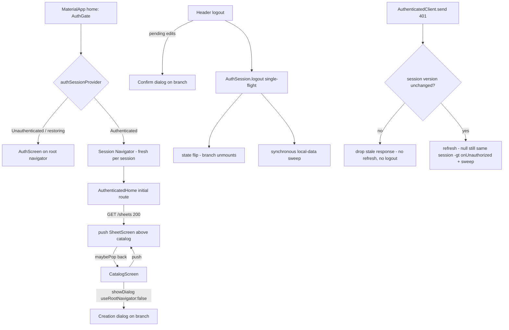

# Desktop Session Boundary Design

**Spec**: `.specs/features/desktop-session-boundary/spec.md`
**Status**: Draft

---

## Architecture Overview

The session becomes the boundary for three concerns, each enforced structurally
rather than by cleanup listeners:

1. **Navigation** — `AuthGate`'s authenticated branch mounts its own `Navigator`
   (spec assumption: navigation ownership, user-confirmed). The branch is built
   when the state flips to `AuthAuthenticated` and destroyed on any session end,
   so every route pushed inside it — the post-login Screen 2, the catalog's
   sheet route, the creation dialog, the confirm dialogs — dies with the
   session. The root `Navigator` keeps exactly one route (`home: AuthGate`).
2. **Session-local data** — `AuthSession.logout()` and `AuthSession.onUnauthorized()`
   are the only two definitive session-end paths; both run one synchronous,
   best-effort local-data sweep (library index in memory + on disk, every draft
   backup file) immediately after the state flip. The transient restore-failure
   path touches neither, so it keeps tokens and files (DATA-04).
3. **Transport** — `_version` becomes a session-generation counter bumped at
   every session boundary (login, register, logout, forced logout). The
   transport captures it when sending and drops a `401` whose session has
   ended, both before starting a refresh and before a forced logout.

The architecture follows the spec's assumption table directly: the navigation
model is the user-confirmed option over a `popUntil` listener, and every other
assumption row (cleanup trigger, forced-logout teardown, best-effort cleanup,
catalog beneath the pushed Screen 2, single logout activation, late-response
hardening) maps to exactly one component below.

---

## Code Reuse Analysis

### Existing Components to Leverage

| Component | Location | How to Use |
| --------- | -------- | ---------- |
| `AuthGate` state swap | `desktop/lib/auth/auth_gate.dart:49` | Wrap the authenticated branch in the new session `Navigator`; the unauthenticated branches stay untouched |
| `CatalogScreen._openSheetScreen` route shape | `desktop/lib/catalog/catalog_screen.dart:243` | Extract verbatim (incl. the `ProviderScope` overrides of AD-004) into one shared `pushSheetScreen` helper reused by the post-login path |
| `SheetScreen._confirmDiscard` dialog shape | `desktop/lib/sheet/sheet_screen.dart:372` | Same `AlertDialog` structure (barrier dismiss = cancel, error-tinted confirm) for the logout confirmation |
| `activeSheetIdProvider` | `desktop/lib/sheet/sheet_refresh.dart:19` | Header reads it at tap time to find the active sheet, then reads that sheet's `isPending` (AD-001: no screen-level watch) |
| `SheetEditState.isPending` | `desktop/lib/sheet/sheet_edit_provider.dart:121` | The dirty signal for the logout confirmation (DATA-05) |
| `_version` stale-refresh guard | `desktop/lib/auth/auth_session.dart:134` | Extended from logout-only to every session boundary |
| `InMemorySecureTokenStore`, `FakeSessionDelegate`, `pumpGate` harness | `desktop/test/auth/fakes.dart`, `desktop/test/api/authenticated_client_test.dart:13`, `desktop/test/auth/auth_gate_test.dart:50` | Test scaffolding for all new tests |
| Best-effort delete pattern | `desktop/lib/sheet/draft_backup_store.dart:134` | `clearAll` follows the same swallow-and-continue contract |

### Integration Points

| System | Integration Method |
| ------ | ------------------ |
| Riverpod session | `authSessionProvider` stays the single state source; new reads (`sessionVersion`, cleanup) go through the same notifier |
| l10n | Four new keys in `desktop/lib/l10n/app_en.arb`, regenerated by `flutter pub get` (`generate: true`) |
| Shortcut registry | Unchanged — `appActions` already dispatches through `activeSheetIdProvider`, which the branch-mounted Screen 2 registers (NAV-08) |

---

## Components

### 1. Session Navigator (AuthGate)

- **Purpose**: Own every authenticated route so unmounting the branch
  unmounts the session's whole navigation stack (NAV-01 … NAV-04).
- **Location**: `desktop/lib/auth/auth_gate.dart`
- **Interfaces**:
  - `AuthGate({super.key, this.navigatorObservers = const []})` — observer
    seam mirroring `MaterialApp.navigatorObservers`, so tests can count
    pushes (NAV-07) without depending on route-dispose notifications.
  - Branch build: `Navigator(onGenerateRoute: … , observers: …)` whose
    initial route renders `AuthenticatedHome`.
- **Dependencies**: `authSessionProvider` (unchanged swap logic at
  `auth_gate.dart:49`).
- **Reuses**: existing gate restore flow; the widget-type alternation
  (`AuthScreen` ⇄ `Navigator` ⇄ `_RestoringSession`) guarantees a brand-new
  `NavigatorState` per authenticated transition — an empty stack by
  construction (NAV-02).

### 2. Session-hosted dialogs

- **Purpose**: Keep modal surfaces inside the session branch so no dialog can
  outlive the session (NAV-04) and a forced logout tears down an open
  confirmation (spec edge case).
- **Location**: the three `showDialog` call sites —
  `desktop/lib/catalog/catalog_screen.dart:224` (creation),
  `desktop/lib/catalog/library_section.dart:118` (library removal),
  `desktop/lib/sheet/sheet_screen.dart:379` (discard guards).
- **Change**: pass `useRootNavigator: false` so `showDialog` pushes on the
  nearest (session) navigator instead of the app root. All dismiss semantics
  (`barrierDismissible`, Esc via `DismissIntent`, `pop(bool)` results) are
  navigator-agnostic and stay as they are.
- **Reuses**: existing dialog builders; only the target navigator changes.

### 3. Shared Screen 2 route builder

- **Purpose**: One navigation model for Screen 2 (spec assumption: base
  beneath the pushed Screen 2) — catalog open, creation flow, and post-login
  open all push the identical route.
- **Location**: `desktop/lib/sheet/sheet_route.dart` (new)
- **Interfaces**:
  - `Future<void> pushSheetScreen(BuildContext context, {required String sheetId, Sheet? sheet})`
    — the `MaterialPageRoute` + `ProviderScope` overrides (AD-004) +
    `AppShell(content: SheetScreen(sheetId: …))` currently inlined at
    `catalog_screen.dart:248`.
- **Dependencies**: `sheetOpenControllerProvider` / `sheetEditControllerProvider`
  overrides, `AppShell`, `SheetScreen`.
- **Reuses**: moved verbatim from the catalog; behavior-preserving refactor.

### 4. AuthenticatedHome post-login open

- **Purpose**: NAV-05 … NAV-07 — after a `200` from `GET /sheets`, open
  Screen 2 as a route above the catalog instead of replacing root content;
  reset per-session shell navigation state.
- **Location**: `desktop/lib/auth/authenticated_home.dart`
- **Interfaces**:
  - `_load()` success path: `setState` (content becomes the catalog) then
    `pushSheetScreen(context, sheetId: sheet.id)` guarded by a
    `_sheetPushed` flag (NAV-07 — one push per authenticated transition;
    Retry-after-failure pushes only on the first success, and the
    `initState`-scheduled load already makes rebuilds no-ops).
  - `build()` after the lookup settles returns `AppShell(content: CatalogScreen())`
    for both the `200` and `404` branches; the resolved sheet exists only as
    the pushed route. Loading/error branches unchanged.
  - `initState` post-frame: reset `shellStateProvider` to
    `ShellSurface.catalog` so a session that starts after a forced logout
    inside the creation dialog cannot inherit a stuck surface (NAV-02
    hygiene; the dialog's `finally` at `catalog_screen.dart:232` never runs
    when its route is disposed with the branch).
- **Dependencies**: session navigator (T1), shared route builder (T3).
- **Reuses**: `_load` single-flight (`_inFlight`), existing retry/error copy.

### 5. Store-level clearing

- **Purpose**: The primitives the session-end sweep calls (DATA-01, DATA-02,
  DATA-03).
- **Location**: `desktop/lib/library/sheet_library_provider.dart`,
  `desktop/lib/sheet/draft_backup_store.dart`
- **Interfaces**:
  - `SheetLibrary.clear()` — empties `_insertionOrder`, republishes state,
    then best-effort persists `[]` (the in-memory clear always lands; a
    `save` failure is swallowed so the session always ends).
  - `DraftBackupStore.clearAll()` — deletes every file under `drafts/`,
    skipping non-file entries and swallowing a per-file or directory-listing
    failure; never throws (same contract as `delete`).
- **Reuses**: `_publish`, the store's atomic write, `delete`'s best-effort
  pattern.

### 6. Session-end cleanup in AuthSession

- **Purpose**: The single sweep point for definitive session ends (DATA-01,
  DATA-02, DATA-03) that never runs on the transient path (DATA-04).
- **Location**: `desktop/lib/auth/auth_session.dart`
- **Interfaces**:
  - private `void _clearSessionLocalData()` — `try/catch` per store so a
    library failure never skips the drafts sweep or the logout itself;
    called synchronously right after `state = AuthUnauthenticated()` in
    both `logout()` (line 174) and `onUnauthorized()` (line 165).
- **Ordering rationale**: flip first, then sweep with no `await` between —
  Dart's single thread makes the pair atomic, so no draft timer tick or
  response continuation can interleave, and anything still scheduled before
  the frame teardown sees a dead session (see the writer guards below).
- **Reuses**: existing explicit call sites; no state-transition watcher —
  a watcher cannot tell a definitive end from the transient restore
  fallback, which is exactly what assumption row "cleanup trigger" resolves.

### 7. Single-flight logout

- **Purpose**: At most one `/auth/logout` request per logout activation
  burst (DATA-08).
- **Location**: `desktop/lib/auth/auth_session.dart`
- **Interfaces**: `logout()` wraps `_doLogout()` in a shared in-flight
  future (same shape as `AuthenticatedClient._refreshOnce`,
  `authenticated_client.dart:57`): the flag is set synchronously before the
  first `await` (the token read the spec calls out), a second activation
  returns the same future, and it clears on completion.
- **Reuses**: the `_refreshOnce` share-in-flight pattern.

### 8. Dirty-logout confirmation

- **Purpose**: DATA-05 … DATA-07 — confirm only when the active sheet has
  pending edits, at tap time.
- **Location**: `desktop/lib/shell/app_shell.dart` (`Header`, line 101) +
  `desktop/lib/l10n/app_en.arb`
- **Interfaces**:
  - `Header` handler: capture the `AuthSession` notifier synchronously,
    read `activeSheetIdProvider`; when non-null read
    `sheetEditControllerProvider(id).isPending` at tap time; if pending,
    `showDialog(useRootNavigator: false)` with the discard copy; only
    `true` proceeds to `session.logout()`. No pending edits → logout
    directly (DATA-07); cancel/Esc/barrier → return without touching
    anything (DATA-06). `context.mounted` is re-checked after the dialog so
    a forced logout that tore the branch down ends the flow.
  - New l10n keys: `authLogoutDialogTitle`, `authLogoutDialogMessage`,
    `authLogoutConfirmAction`, `authLogoutCancelAction` (descriptions cite
    DATA-05).
- **Reuses**: `_confirmDiscard`'s dialog structure and the desktop
  destructive-confirmation rule; the dirty read follows AD-001 (tap-time
  read, no screen-level watch).

### 9. Session-aware writer guards

- **Purpose**: Close the re-write window between the sweep and the frame
  teardown so DATA-01 cannot regress (a writer that lands after the sweep
  would resurrect foreign local data for the next session).
- **Location**: `desktop/lib/sheet/draft_auto_backup.dart:65` (timer tick),
  `desktop/lib/catalog/create_sheet_dialog.dart:160` (library `upsert`)
- **Interfaces**: each writer checks
  `ref.read(authSessionProvider) is AuthAuthenticated` before writing; a
  dead session skips the write (the draft scheduler also stops restarting).
- **Rationale**: the draft timer is the only *recurring* writer — a tick
  landing in the sub-frame window between sweep and unmount would rewrite a
  deleted backup; the creation `upsert` is the only library writer reachable
  without user interaction (a `201` landing after a forced logout). The
  eviction `remove` at `sheet_open_provider.dart:100` is already a no-op on
  a cleared index and needs no guard.

### 10. Session-version transport guard

- **Purpose**: SES-01, SES-02 — a `401`/refresh belonging to a finished
  session never disturbs the current one.
- **Location**: `desktop/lib/auth/auth_session.dart` (delegate + bumps),
  `desktop/lib/api/authenticated_client.dart` (guard)
- **Interfaces**:
  - `SessionDelegate.sessionVersion()` → `_version`, bumped in `login()`
    and `register()` on completion (SES-01) and in `logout()` /
    `onUnauthorized()` (already there). It is deliberately **not** bumped
    when a refresh applies a rotated token: within one session the version
    must stay stable so concurrent `401`s keep sharing one refresh (FE6-11).
  - `AuthenticatedClient.send()` captures the version when the request is
    sent and checks it twice: after the `401` (stale → return the response
    without refreshing or replaying — a foreign request must never execute
    as the new session) and after a `null` refresh (stale → do not call
    `onUnauthorized()`).
- **Reuses**: `_refreshOnce` sharing, the existing `refresh()` internal
  version check.

---

## Error Handling Strategy

| Error Scenario | Handling | User Impact |
| -------------- | -------- | ----------- |
| Library `save` fails during the sweep | Swallowed inside `clear()`; memory is already empty | Logout completes; worst case the on-disk index is stale until the next write |
| One draft file (or the `drafts/` listing) fails to delete | Per-file / outer `FileSystemException` swallowed; other files still deleted | Logout completes; no partial-cleanup deadlock (spec edge case) |
| `/auth/logout` request fails | Existing best-effort behavior, unchanged | Session already ended locally |
| Refresh rejected for the *current* session | `onUnauthorized()` → sweep → auth screen | Forced logout, local data cleared (DATA-02) |
| Refresh fails transiently | Existing rethrow keeps session and stored token; sweep never runs | Auth-screen fallback keeps library + drafts (DATA-04) |
| User cancels the dirty-logout dialog | Handler returns before `logout()` | Session, edits, files intact; no `/auth/logout` sent (DATA-06) |
| Second logout activation in flight | Shared future; no second request | One `/auth/logout` (DATA-08) |
| Stale `401`/refresh after a session switch | Version mismatch drops the response before refresh and before `onUnauthorized()` | New session untouched (SES-02) |

---

## Risks & Concerns

| Concern | Location | Impact | Mitigation |
| ------- | -------- | ------ | ---------- |
| Every future dialog in the authenticated surface must opt into the session navigator; the framework default (`useRootNavigator: true`) silently puts it on the root, above the gate | all `showDialog` sites | A new dialog could float over the auth screen after a forced logout | Recorded as project convention AD-010; the three existing sites are converted in one task so no mixed state remains |
| Two `AppShell`s (hence two `shell-logout` buttons) exist whenever a sheet route is pushed | `catalog_screen.dart:243` route builder | Tests tapping `byKey('shell-logout')` can hit the covered base button | Tests must target the topmost (`find.byKey(...).last` / `hitTestable`); noted in the task's Done-when |
| The pre-existing gate test asserts `CatalogScreen` is *absent* when Screen 2 opens — that behavior is what NAV-05 reverses | `desktop/test/auth/auth_gate_test.dart:284` | The test fails after T4 | Updated in T4 to assert the spec outcome (catalog mounted beneath + Screen 2 pushed above); a spec-mandated assertion change, not a weakening |
| A `201` from a creation POST completing between the sweep and the frame teardown would re-index a foreign sheet | `desktop/lib/catalog/create_sheet_dialog.dart:160` | Bug-1 vector returns for one entry | Session-authenticated guard on the `upsert` (component 9) with a forced-logout test |
| A draft timer tick in the same window would resurrect a deleted backup | `desktop/lib/sheet/draft_auto_backup.dart:65` | DATA-01 silently violated | Session-authenticated guard on the tick (component 9) |
| `AuthSession` unit tests that do not override `appSupportDirectoryProvider` make the sweep throw `StateError` | `desktop/lib/library/sheet_library_provider.dart:16` | None — the per-store `try/catch` swallows it (DATA-03 by construction); cleanup is silently skipped there | Tests that must observe the sweep override the directory, as `logout_test` already does |
| `restore()` still calls `onUnauthorized()` unguarded when its refresh returns null | `desktop/lib/auth/auth_session.dart:78` | Theoretically reachable only if a session boundary happened during the first restore, which the gate makes impossible (no UI yet) | Left unchanged — out of spec scope; noted here so a future change to the gate re-evaluates it |

---

## Tech Decisions

| Decision | Choice | Rationale |
| -------- | ------ | --------- |
| Navigation teardown | Branch-owned `Navigator` inside `AuthGate` | Spec-assigned (user-confirmed): structural, no timing race with route animations, versus a `popUntil` listener on session change |
| Dialog hosting | `useRootNavigator: false` at the three call sites | The dialog route must die with the branch; dismissing dialogs from a state listener would need a global route registry and still race the flip |
| Cleanup trigger | Explicit calls in `logout()` + `onUnauthorized()` | Only these two distinguish a definitive end from the transient restore fallback (assumption row: cleanup trigger); a listener on `AuthState` cannot |
| Sweep ordering | State flip, then synchronous sweep, no `await` in between | Atomic wrt the event loop; writer guards then cover the remaining pre-teardown window |
| Transport identity | Session version integer, not token comparison | Token comparison breaks concurrent-`401` refresh sharing after a rotation (`A1` sent, current is `A2`, same session); a version bumped only at session boundaries does not |
| Version bumps | Login/register/logout/forced logout only — not refresh apply | Keeps the version stable within a session (FE6-11) while invalidating refreshes that started before a login (SES-01) |
| Dirty signal | `activeSheetIdProvider` + `isPending` read at tap time | Reuses the F5 dispatch seam and AD-001's tap-time dirty reads; no new provider |
| Single logout activation | Shared in-flight future in `AuthSession` | The race the spec names is the token read before the state flip; a UI-level flag would not cover queued taps |
| Shell surface reset | On `AuthenticatedHome` mount | The stuck-`creationDialog` state is only reachable when a forced logout disposes the dialog route (its `finally` never runs); resetting at session start is the one place guaranteed to run |

> **Project-level decision:** the session-as-boundary rules (branch navigator,
> session-hosted dialogs, sweep at definitive ends, session-version transport
> guard) are conventions every future desktop feature must follow — recorded
> as **AD-010** in `.specs/STATE.md`.
