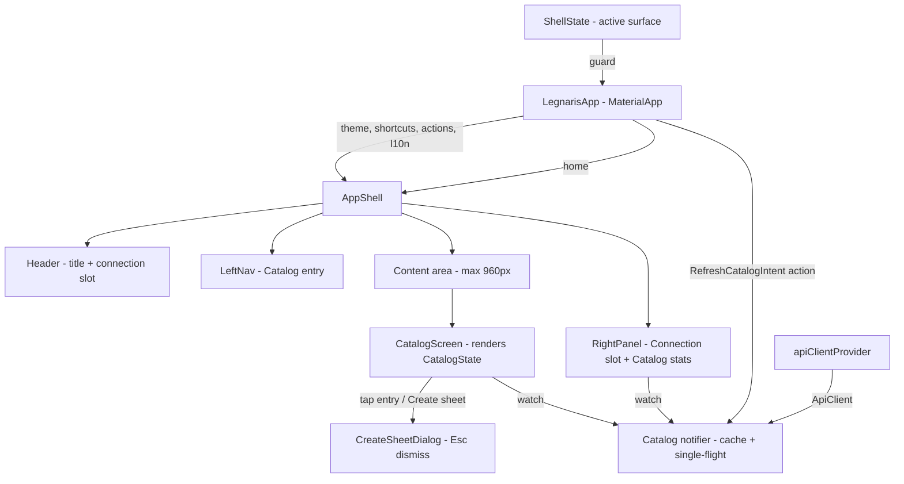

# [Front End] Fase 2 — Catálogo Design

**Spec**: `.specs/features/front-end-phase-2-catalog/spec.md`
**Status**: Approved

---

## Architecture Overview

A single shell (`AppShell`) owns layout once: header, persistent left nav, width-constrained content, and a right panel that collapses first on narrow windows. All dimensions/colors come from `lib/theme/` tokens. The catalog is a single keepAlive Riverpod notifier with an in-memory cache, a single-flight guard, and an explicit immutable `CatalogState`. Screens are stateless renderers of that state; the creation surface is a modal dialog (overlay, not a route stack); keyboard shortcuts live in one rebindable registry consumed by `MaterialApp.shortcuts`/`actions`.



**Approaches considered** (state modeling for the catalog):

1. **Custom `CatalogState` + keepAlive `Notifier` (chosen)** — expresses the five render situations (loading, error, empty, list, list+inline error) and the single-flight flag directly; tests assert plain fields.
2. `AsyncNotifier`/`AsyncValue` — idiomatic, but `AsyncError` discards the cached list, so "refresh failure keeps list + inline error" (CAT-19) fights the type; `copyWithPrevious` hides the distinction the spec makes between first-load failure (error screen) and refresh failure (inline).
3. Screen-driven load (`initState` → `load()`) — makes CAT-07 explicit, but the panel also needs the provider, so a second trigger path appears; provider-owned initial load keeps "exactly once" in one place.

## Code Reuse Analysis

### Existing Components to Leverage

| Component | Location | How to Use |
| --------- | -------- | ---------- |
| `ApiClient.listTemplates()` | `desktop/lib/api/api_client.dart` | Sole endpoint of this phase; reached via new `apiClientProvider` |
| `ApiErrorKind` + `errorCopy` | `desktop/lib/api/error_mapper.dart` | Domain-error copy for CAT-11/CAT-19; extended by `failureCopy` |
| `ApiParseException` / `ApiDomainException` | `desktop/lib/api/api_error.dart` | Home of `failureCopy(Object)` (domain → kind copy, otherwise parse copy) — avoids an import cycle with `error_mapper` |
| `TemplateCatalog` | `desktop/lib/api/models/template.dart` | Card renders `name` + `id` only (FE1-08: list ignores `fields`) |
| Generated `AppLocalizations` | `desktop/lib/l10n/app_localizations.dart` | Every new UI string; `lookupAppLocalizations(const Locale('en'))` from non-widget code (phase-1 pattern) |
| `MockClient` fake transport | `desktop/test/api/api_client_test.dart` | Provider and widget tests count calls without an API (CAT-07/12/13/18) |
| Riverpod codegen | `desktop/lib/main.g.dart` | `@riverpod` classes/functions + `part` files; `dart run build_runner build --delete-conflicting-outputs` |
| `appTitleProvider` | `desktop/lib/main.dart` | Keeps `MaterialApp.title` (OS window title); in-app header title comes from l10n |

### Integration Points

| System | Integration Method |
| ------ | ------------------ |
| `MaterialApp` | `theme:`, `shortcuts:`, `actions:`, `localizationsDelegates:`, `supportedLocales:`, `home:` |
| `ProviderScope` | Tests override `apiClientProvider` with an `ApiClient` over `MockClient` |
| Flutter shortcuts (SDK `widgets/app.dart:1820-1828`) | Own maps **replace** defaults → always spread `WidgetsApp.defaultShortcuts` / `defaultActions` |

---

## Components

### `lib/theme/tokens.dart` + `lib/theme/app_theme.dart`

- **Purpose**: the single source of every size, radius, spacing, and text size (CAT-02); built once, consumed by every widget.
- **Location**: `desktop/lib/theme/`
- **Interfaces**:
  - `abstract final class AppSpacing` — `xs=4, sm=8, md=12, lg=16, xl=24`
  - `abstract final class AppRadius` — `control=2` (inputs, buttons, nav items), `panel=4` (cards, dialogs, panels)
  - `abstract final class AppSizes` — type scale `caption=12, body=13, emphasis=15, title=17` (never above 17); `rowHeight=32`, `controlHeight=36`, `hairline=1`, `headerHeight=48` (2×xl), `leftNavWidth=220` (∈200–240), `rightPanelWidth=300` (∈280–320), `contentMaxWidth=960`, `contentMinWidth=480`, `connectionSlotWidth=160`, `catalogCardMinWidth=280`; `shellMinWidthWithPanel = leftNavWidth + contentMinWidth + rightPanelWidth + 2 * hairline` (=1002, the CAT-03 collapse threshold, derived — not a magic number; the two 1px vertical dividers are real Row children, so the content area sits at its 480px minimum exactly at the threshold)
  - `ThemeData buildAppTheme()` — `ThemeData(useMaterial3: true)` (Material defaults; no invented palette), `copyWith`: textTheme mapped so **every** style lands on {12,13,15,17} (M3 headline/dialog defaults >17 are capped), `dividerTheme` (1px `outlineVariant`), `cardTheme`/`dialogTheme` (radius 4, elevation 0 except dialogs keep default), `outlinedButtonTheme`/`textButtonTheme` (radius 2), `listTileTheme`. Button/input themes are set here even though inputs arrive in Phase 3 — the theme is written once.
- **Dependencies**: Flutter/Material only — **no new package**.
- **Reuses**: `desktop/AGENTS.md` tokens verbatim; `colorScheme.outlineVariant` for all hairlines, `hoverColor`/`secondaryContainer` for states (no hardcoded hex).

### `lib/shell/shortcut_registry.dart`

- **Purpose**: central rebindable registry (desktop/AGENTS.md): plain `action → activator` map for the only two shortcuts of V1 start — F5 and Esc.
- **Location**: `desktop/lib/shell/`
- **Interfaces**:
  - `enum AppShortcut { refreshCatalog, closeOverlay }`
  - `const Map<AppShortcut, ShortcutActivator> defaultShortcuts` — `refreshCatalog: SingleActivator(F5)`, `closeOverlay: SingleActivator(Escape)`
  - `Map<ShortcutActivator, Intent> appShortcuts()` — `{...WidgetsApp.defaultShortcuts, ...registry}` where `refreshCatalog → RefreshCatalogIntent()` (custom) and `closeOverlay → DismissIntent()` (framework intent: `ModalRoute` listens to it — SDK `routes.dart:981` gates it on `barrierDismissible`)
  - `Map<Type, Action<Intent>> appActions(WidgetRef ref)` — `{...WidgetsApp.defaultActions, RefreshCatalogIntent: CallbackAction(onInvoke: …)}` whose callback runs `ref.read(catalogProvider.notifier).refresh()` **only when `shellStateProvider` is `ShellSurface.catalog`** (edge case: F5 on a non-catalog surface issues no request)
- **Dependencies**: `shell_state.dart`, `catalog_provider.dart`.
- **Reuses**: `WidgetsApp.defaultShortcuts`/`defaultActions` (verified: passing own maps replaces defaults — they must be spread); framework `DismissIntent` so dialog dismissal stays rebindable through the same registry.

### `lib/shell/shell_state.dart`

- **Purpose**: real model of which surface is active — `catalog` (screen visible) vs `creationDialog` (modal over the catalog); guards the refresh action and drives nav active state.
- **Interfaces**: `enum ShellSurface { catalog, creationDialog }`; `@Riverpod(keepAlive: true) class ShellState` — `build() → ShellSurface.catalog`, `show(ShellSurface)`.
- **Reuses**: Riverpod codegen pattern.

### `lib/shell/app_shell.dart` (+ `left_nav.dart`, `right_panel.dart`)

- **Purpose**: the shell built exactly once (CAT-01…06); takes `content` so phases 3–5 mount screens inside it.
- **Interfaces**:
  - `AppShell({required Widget content})` — `Column[Header, hairline Divider, Expanded(LayoutBuilder → Row[LeftNav, VerticalDivider, Expanded(Align(topCenter → ConstrainedBox(960) → Padding(16) → content)), (if wide) VerticalDivider + RightPanel])]`
  - Show the right panel iff `width >= AppSizes.shellMinWidthWithPanel` (1002px): below it the panel disappears **first**, content grows back to its min; the nav is a fixed Row child, so it can never be overlapped (CAT-03). Restore is pure layout — the keepAlive provider means no catalog reload (edge case).
  - `LeftNav` — exactly one `NavEntry(label: l10n.navCatalog, active: …)` (CAT-04): height `rowHeight`, padding 12, radius 2, `InkWell` (hover = theme `hoverColor`, no layout shift); active = `secondaryContainer` background, `onSecondaryContainer` text. `active` derives from `shellStateProvider` (catalog screen visible under or over the dialog) so Phase 4's "My sheets" only changes the derivation.
  - `Header` — height `headerHeight`, `Text(l10n.appTitle, titleLarge)` + `SizedBox(width: connectionSlotWidth, key: 'connection-indicator-slot')` — the reserved slot of CAT-05 (empty; connection spec fills it), hairline below.
  - `RightPanel` — width `rightPanelWidth`, hairline left border; block 1: `sectionConnection` header + `SizedBox(key: 'connection-panel-slot')` (reserved, per spec: shell only reserves the slot); hairline `Divider`; block 2: `sectionCatalog` header + `l10n.catalogCount(templates.length)` + `l10n.catalogLastUpdated(DateFormat.Hm().format(lastUpdated))` shown only when `lastUpdated != null` (CAT-06; data comes from the catalog provider — zero extra requests).
- **Dependencies**: theme tokens, `catalogProvider`, `shellStateProvider`, l10n.
- **Reuses**: `desktop/AGENTS.md` layout rules (shell order, collapse order, content measure).

### `lib/catalog/catalog_provider.dart`

- **Purpose**: the catalog cache and request policy (CAT-07…14, 18, 19).
- **Interfaces**:
  - `class CatalogState` — `final List<TemplateCatalog>? templates` (null = never loaded), `final bool isLoading`, `final String? errorMessage`, `final DateTime? lastUpdated`; getters `hasLoaded`, `isEmpty`; `copyWith`. Render mapping: `isLoading && !hasLoaded` → loading; `!hasLoaded && errorMessage != null` → error+Retry; `hasLoaded && isEmpty` → empty; `hasLoaded && isNotEmpty` → list (+ inline error when `errorMessage != null`, + top `LinearProgressIndicator` while `isLoading`).
  - `@Riverpod(keepAlive: true) class Catalog extends _$Catalog`
    - `build()` — `ref.watch(apiClientProvider)`, schedule `Future.microtask(refresh)` (exactly one first load no matter which widget watches first — panel or screen), return `const CatalogState(isLoading: true)`.
    - `Future<void> refresh()` — **single-flight**: `if (_inFlight) return;` (CAT-13); success replaces the list and `lastUpdated`, clears `errorMessage` (CAT-18); failure keeps cached `templates` and sets `errorMessage = failureCopy(error)` (CAT-19); `finally _inFlight = false`.
    - Errors: `ApiDomainException` → `errorCopy(kind)` (Phase-1 mapper); `ApiParseException`, `TypeError`, `FormatException`, anything else raised while decoding → `errorParse` copy (CAT-14 + missing-`data` edge — never a blank screen, never a partial list). List stored as `List.unmodifiable`.
  - `@Riverpod(keepAlive: true) ApiClient apiClientProvider(Ref)` in `lib/api/api_client_provider.dart` — wraps one `http.Client` (`ref.onDispose(client.close)`); the single override point for every test.
- **Dependencies**: `api_client`, `api_error.failureCopy`, `error_mapper`.
- **Reuses**: Phase-1 client/envelope/mapper unchanged; never persists anything (TDD: cache in memory only).

### `lib/catalog/catalog_screen.dart`

- **Purpose**: Tela 1 — renders `CatalogState`; owns no request logic beyond invoking `refresh()` from Retry/cards.
- **Interfaces**: `CatalogScreen` (`ConsumerWidget`) — state mapping as above; cards in a `Wrap` (`spacing`/`runSpacing` = `AppSpacing.lg`): `Card(radius 4, hairline outlineVariant, elevation 0)` → `InkWell(onTap: open)` → name (`titleMedium` 15), id (`bodySmall` 12, `onSurfaceVariant`), `SizedBox(controlHeight)` `TextButton(l10n.catalogCreateAction)`. Empty name renders (id line + button keep layout intact). Empty state: one plain `Text(l10n.catalogEmpty)` line, no art (CAT-10). Error state: mapped message + `OutlinedButton(l10n.actionRetry)` (CAT-11/12). Retry and refresh-failure both go through `refresh()` (single-flight protects double activation).
- **Dependencies**: `catalogProvider`, `shellStateProvider`, theme, l10n.

### `lib/catalog/create_sheet_dialog.dart`

- **Purpose**: the creation surface of CAT-15/16 — **content is the other spec's job**; here only the navigation contract: receives `templateId`, exposes it, closes.
- **Interfaces**: `CreateSheetDialog({required String templateId})` — `AlertDialog` (radius 4): title `l10n.createSheetTitle`, body `l10n.createSheetTemplateLabel` + `Text(templateId, key: 'create-sheet-template-id')`, action `TextButton(l10n.actionClose)`. Opened via `showDialog<void>(barrierDismissible: true)` — **required**: the framework's dismiss action is gated on `barrierDismissible` (`routes.dart:981-984`), so Esc (CAT-16) depends on it. Around the `showDialog` call the screen sets `ShellSurface.creationDialog` and restores `ShellSurface.catalog` in `finally`.
- **Reuses**: framework modal route (Esc, focus trap) — no Navigator stack, keeping CAT-17 by construction.

### `lib/main.dart` (wiring — final task)

- `MaterialApp(title: appTitleProvider, theme: buildAppTheme(), shortcuts: appShortcuts(), actions: appActions(ref), localizationsDelegates/supportedLocales, home: AppShell(content: CatalogScreen()))`.

---

## Data Models

### CatalogState

```dart
class CatalogState {
  const CatalogState({this.templates, this.isLoading = false, this.errorMessage, this.lastUpdated});
  final List<TemplateCatalog>? templates; // null → never loaded (first visit)
  final bool isLoading;                    // a request is in flight (first load or refresh)
  final String? errorMessage;              // resolved UI copy of the last failure
  final DateTime? lastUpdated;             // last successful load
  bool get hasLoaded => templates != null;
}
```

**Relationships**: holds `TemplateCatalog` (Phase-1 model, `name`/`id` used); consumed by `CatalogScreen` (state → widget) and `RightPanel` (count/`lastUpdated`).

---

## Error Handling Strategy

| Error Scenario | Handling | User Impact |
| -------------- | -------- | ----------- |
| `GET /templates` 4xx/5xx | `ApiDomainException` → `failureCopy` → `errorCopy(kind)` | First load: error state + Retry (CAT-11). Refresh with cache: list stays + inline message (CAT-19) |
| Transport failure after Phase-1 retries | kind `offline` → same path | Same as above with offline copy |
| 2xx without `data` key / broken JSON | `ApiParseException` → `errorParse` copy | Error state + Retry — never empty success (edge case, CAT-14 path) |
| Entry missing required field (`TypeError`) | catch-all in `refresh()` → `errorParse` copy | Error state + Retry, never blank/partial (CAT-14) |
| Trigger while a request is in flight | single-flight guard returns without a request | Exactly one request (CAT-13); Retry still fires exactly once per activation (CAT-12) |
| F5 while dialog open / non-catalog surface | `shellStateProvider` guard in the refresh action | No request (edge case) |

---

## Requirement Mapping

| Req | Component(s) | Primary test |
| --- | ------------ | ------------ |
| CAT-01 | `AppShell` + `main.dart` wiring | `test/shell/app_shell_test.dart`, boot test |
| CAT-02 | `tokens.dart`, `app_theme.dart`, `AppShell` | `test/theme/tokens_test.dart`, shell width test |
| CAT-03 | `AppShell` LayoutBuilder + `shellMinWidthWithPanel` | shell responsive test (shrink → restore) |
| CAT-04 | `LeftNav`/`NavEntry` | shell nav test |
| CAT-05 | `Header` slot | shell header test |
| CAT-06 | `RightPanel` sections + dividers | shell panel test |
| CAT-07 | `Catalog.build` microtask load | `test/catalog/catalog_provider_test.dart` (call counter) |
| CAT-08 | loading state mapping | `test/catalog/catalog_screen_test.dart` (gated transport) |
| CAT-09 | success path, API order | provider test |
| CAT-10 | empty mapping + `catalogEmpty` | provider + screen tests |
| CAT-11 | `failureCopy` + error state | provider + screen tests |
| CAT-12 | `refresh()` on Retry | provider test (exact count) |
| CAT-13 | single-flight guard | provider test (completer-gated transport) |
| CAT-14 | catch-all parse mapping | provider test (malformed entry, missing `data`) |
| CAT-15 | card/button → `showDialog(templateId)` | screen navigation test |
| CAT-16 | Esc/close → restore surface, no refetch | screen navigation test (call counter) |
| CAT-17 | dialog overlay, no routes | navigation test (no route push beyond dialog) |
| CAT-18 | F5 action → `refresh()` replaces list | registry + provider tests |
| CAT-19 | refresh failure keeps cache + inline error | provider + screen tests |

---

## Risks & Concerns

| Concern | Location | Impact | Mitigation |
| ------- | -------- | ------ | ---------- |
| Passing `shortcuts`/`actions` to `MaterialApp` **replaces** the defaults (no merge) | Flutter SDK `widgets/app.dart:1820-1828` | Losing tab traversal / text-editing shortcuts | `appShortcuts()`/`appActions()` always spread `WidgetsApp.defaultShortcuts`/`defaultActions`; registry test asserts defaults survive |
| Dialog Esc is gated on `barrierDismissible` | Flutter SDK `widgets/routes.dart:981-984` | CAT-16 (Esc) silently broken with `barrierDismissible: false` | `showDialog(barrierDismissible: true)` + navigation test presses Esc |
| App-level F5 binding sits above the Navigator, so it fires while the dialog has focus | `MaterialApp.shortcuts` | Refresh behind a modal (spec edge case forbids it) | `shellStateProvider` guard + test: F5 while dialog open → 0 new requests |
| Riverpod codegen artifacts must be regenerated/committed | `lib/*.g.dart` | `flutter analyze` red, CI failure | `dart run build_runner build --delete-conflicting-outputs` inside the tasks that add `@riverpod` files; gate = analyze+test |
| Phase-0 placeholder tests assume centered title screen | `desktop/test/widget_test.dart` | Red once `home:` becomes the shell | Rewritten in the wiring task as boot/AC tests (recorded in tasks.md) |
| `failureCopy` resolves copy via `lookupAppLocalizations` (no `BuildContext`) | `lib/api/api_error.dart` | Locale plumbing bypassed | Accepted phase-1 pattern (FE1-23, en-only V1); covered by unit tests |
| `refresh()` guards on `_inFlight` while `build()` could reschedule on `apiClientProvider` change | `catalog_provider.dart` | A rebuild mid-flight would not reload | Feature-local, documented; tests use a stable override; single-flight is the spec's priority |

---

## Tech Decisions

| Decision | Choice | Rationale |
| -------- | ------ | --------- |
| Catalog state type | Custom immutable `CatalogState` on a keepAlive `Notifier` | Expresses list+inline error and single-flight directly; `AsyncValue` conflates first-load failure with refresh failure (CAT-11 vs CAT-19) |
| First load trigger | `Future.microtask(refresh)` inside `build()` | Exactly-once (CAT-07) regardless of whether the panel or the screen is the first watcher |
| Parse-failure copy | `failureCopy(Object)` in `api_error.dart`: domain → `errorCopy(kind)`, everything else → `errorParse` | CAT-14 needs a mapped message for contract drift; placing it beside the exception types avoids an import cycle with `error_mapper` |
| Shortcut consumption | `MaterialApp.shortcuts`/`actions` with spread defaults; Esc → framework `DismissIntent`, F5 → `RefreshCatalogIntent` | Matches `desktop/AGENTS.md` ("rebindable registry … consumed by `MaterialApp.shortcuts`"); dialog Esc stays rebindable via the same map |
| Dialog dismiss | `barrierDismissible: true` | Framework gates Esc on it (`routes.dart:981`) — the spec requires Esc dismissal |
| Collapse threshold | `contentMinWidth = 480` token → panel hides below 1002px total (= nav + content min + panel + the two 1px dividers) | Spec fixes panel/nav widths but no content min; recorded as a token so the threshold is tunable in one place, and derived including the Row's hairline dividers so the boundary is exact (fix T7: the sensor's surviving mutant exposed the 2px ambiguity) |
| Widths | nav 220, panel 300 (midpoints of the allowed ranges) | Headroom in both directions of the spec's ranges |
| Header height | 48 (2× `AppSpacing.xl`) | Derived from spacing tokens — spec gives no header height |
| Content alignment | `topCenter` within 960px | At 2560px, left-align would leave a dead zone before the panel; wireframe spacing preserved at normal widths |
| Shell root | `AppShell` builds inside a `Scaffold` | A bare column paints nothing (window stays at its default black) and leaves unstyled `Text` outside any `Material`, where MaterialApp substitutes its 48px red `_errorTextStyle` fallback — both seen in UAT (fix T8) |
| V1 palette | `ColorScheme.fromSeed(Color(0xFF546E7A))` (blue-gray) passed to the `ThemeData` constructor | Material 3's stock scheme is a purple baseline (`#6750A4`) whose purple-tinted neutrals failed UAT and match the banned "AI-SaaS" aesthetic; a seed keeps Material's tonal logic while V1 stays identity-less (palette = V2). Direction chosen by the maintainer: "azul-acinzentado" |
| Nav entry height | `Align(alignment: topLeft)` inside `LeftNav` | The shell `Row(crossAxisAlignment: stretch)` feeds a tight height the entry's `SizedBox(height: rowHeight)` cannot shrink, inflating the active tint to a full-height block (UAT); `Align` loosens the constraints so the 32px token wins |
| Button box | `minimumSize: Size(64, controlHeight)` + `tapTargetSize: shrinkWrap` in the text/outlined button themes | M3 ships 40px buttons, outside the 32–36 control band; desktop-first (mouse) tap target; set once in the theme so widgets stay number-free |
| Dialog/state hierarchy | Dialog label → `bodySmall` on `onSurfaceVariant`, id → `bodyMedium`; loading/empty → muted `bodyMedium`; panel stats → explicit `bodyMedium` | Plain labels demoted to the caption token, values on the base body token (AGENTS hierarchy); explicit styles on stats guard against ever falling back out of the Material context again |
| Catalog cards | `Wrap` of fixed-width (280) restrained cards | Wireframe Tela 1 + explicit `desktop/AGENTS.md` allowance ("cards … a template entry in the catalog"); flat, hairline, no icons/elevation |
| In-app title | `l10n.appTitle`; `appTitleProvider` keeps `MaterialApp.title` | UI strings must flow through l10n (spec) without breaking the Phase-0 window-title contract/tests |
| No `AD-NNN` entry appended | — | The shell/theme single-source constraint is already normative in `desktop/AGENTS.md`; a STATE.md decision would duplicate project docs |
