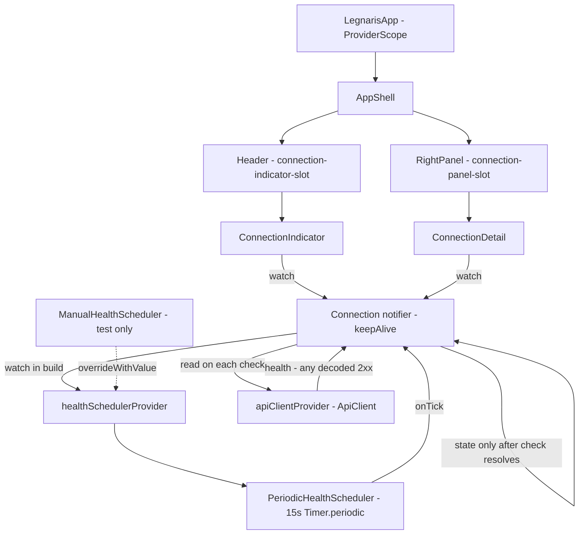

# [Front End] Fase 2 — Indicador de conexão Design

**Spec**: `.specs/features/front-end-phase-2-connection-indicator/spec.md`
**Status**: Approved

---

## Architecture Overview

A single keepAlive Riverpod notifier (`Connection`) owns the connection state machine (`checking → online/offline`, plus `lastSuccess`), fed by exactly one source: `ApiClient.health()`. Polling is driven by an injectable `HealthScheduler` — the app wires a `PeriodicHealthScheduler` (15s `Timer.periodic`, immediate first tick scheduled at build), tests override the same provider with a manual scheduler that fires on command (CONN-12). The header indicator and the right-panel detail are stateless renderers of the notifier; they fill the slots the catalog spec reserved (`connection-indicator-slot`, `connection-panel-slot`), so CAT-05/CAT-06 contracts stay intact and no navigation or catalog logic ever reads or writes connection state (CONN-07, CONN-10).



**Approaches considered**:

1. **Custom `ConnectionState` + keepAlive `Notifier` + scheduler-as-provider (chosen)** — mirrors the catalog notifier (single source, single-flight flag, plain-state asserts), and making the scheduler a provider gives the same single override point tests already use for `apiClientProvider`. The timer lives with the provider container, so `ProviderScope` teardown cancels it (verified: a provider-owned `Timer.periodic` cancelled via `ref.onDispose` leaves no pending-timer failure in `testWidgets`).
2. `AsyncNotifier`/`AsyncValue` — wrong shape: a failed check must *keep* the current state and `lastSuccess` (CONN-06/CONN-09), where `AsyncError` would discard them and conflate "checking" with "failed".
3. Timer inside the widget (`initState`) — ties polling to widget lifecycle (panel collapse/unmount), creates a second trigger path because both header and panel render state, and is untestable without pumping widgets; the spec wants a scheduler the *suite* drives (CONN-12).
4. Scheduler as constructor argument — Riverpod codegen notifiers cannot take constructor parameters; an injection provider is the idiomatic seam.

## Code Reuse Analysis

### Existing Components to Leverage

| Component | Location | How to Use |
| --------- | -------- | ---------- |
| `ApiClient.health()` | `desktop/lib/api/api_client.dart:35` | Sole endpoint; carries the Phase-1 fail-fast policy (5s timeout, one 300ms GET retry) and envelope decoding — no new HTTP code |
| `apiClientProvider` | `desktop/lib/api/api_client_provider.dart:11` | Read on every check; the standard override point for fake transports |
| Catalog notifier pattern | `desktop/lib/catalog/catalog_provider.dart:58` | Same shape: keepAlive `Notifier`, `Future.microtask` first check, `_inFlight` single-flight guard |
| `failureCopy` / error mapper | `desktop/lib/api/api_error.dart` | **Not used**: the indicator shows state, not error copy — errors are collapsed to `offline` by design (spec: one source, no message surface) |
| Generated `AppLocalizations` | `desktop/lib/l10n/app_localizations.dart` | 5 new keys via `lib/l10n/app_en.arb`; regenerated by `flutter gen-l10n` (`flutter: generate: true`) |
| `DateFormat.Hm()` panel pattern | `desktop/lib/shell/right_panel.dart:56` | Timestamp formatting for `connectionLastCheck` (intl already a dependency) |
| `MockClient` + `ProviderContainer` harness | `desktop/test/catalog/catalog_provider_test.dart:36-52` | Provider-test scaffolding (recording client, `addTearDown(container.dispose)`) |
| `pumpShell` / `pumpApp` harnesses | `desktop/test/shell/app_shell_test.dart:27`, `desktop/test/app_boot_test.dart:29` | Widget tests add a manual-scheduler override and path-based request counts |

### Integration Points

| System | Integration Method |
| ------ | ------------------ |
| `Header` (`app_shell.dart:88-91`) | Reserved `SizedBox` keeps its key and width; gains `child: Align(right → ConnectionIndicator)` |
| `RightPanel` (`right_panel.dart:42`) | Reserved `SizedBox` keeps its key; gains `child: ConnectionDetail` |
| `healthSchedulerProvider` | New provider; tests replace it with `ManualHealthScheduler` via `overrideWithValue` |
| Riverpod codegen | New `@Riverpod(keepAlive: true)` files → `dart run build_runner build --delete-conflicting-outputs`, `.g.dart` committed |
| gen-l10n | New arb keys → `flutter gen-l10n`; regenerated `app_localizations*.dart` committed |

---

## Components

### `lib/connection/health_scheduler.dart`

- **Purpose**: the injectable polling clock — time-based schedule independent of API traffic (CONN-07), injectable so no test waits 15s (CONN-12).
- **Location**: `desktop/lib/connection/`
- **Interfaces**:
  - `abstract interface class HealthScheduler` — `start(void Function() onTick)` (begin firing every interval), `cancel()` (stop; idempotent)
  - `class PeriodicHealthScheduler implements HealthScheduler` — ctor `PeriodicHealthScheduler({this.interval = defaultInterval})`; `static const Duration defaultInterval = Duration(seconds: 15)` (spec constant, asserted by test); `start` cancels any existing timer first (a second `start` never doubles ticks); `cancel` clears the timer
  - `@Riverpod(keepAlive: true) HealthScheduler healthScheduler(Ref ref)` — returns `PeriodicHealthScheduler()` and registers `ref.onDispose(scheduler.cancel)`: the provider owns its timer, so container teardown (widget-test end) always cancels it
- **Dependencies**: `dart:async` only.
- **Reuses**: `apiClientProvider`'s ownership style (resource created in provider, released in `onDispose`).

### `lib/connection/connection_provider.dart`

- **Purpose**: the state machine and request policy (CONN-01…07, CONN-13) — the *only* writer of connection state.
- **Interfaces**:
  - `enum ConnectionStatus { checking, online, offline }`
  - `class ConnectionState` — `final ConnectionStatus status`, `final DateTime? lastSuccess` (null → never succeeded); `const` equality-by-fields, no `copyWith` needed (both transitions rebuild fully)
  - `@Riverpod(keepAlive: true) class Connection extends _$Connection`
    - `build()` — `ref.watch(healthSchedulerProvider)`; `scheduler.start(_check)`; `Future.microtask(_check)` (first check at app start, CONN-01); returns `const ConnectionState()` → `checking` + `never` until the first response (CONN-02)
    - `Future<void> _check()` — **single-flight**: `if (_inFlight) return;` (tick during flight is discarded, CONN-05); `await ref.read(apiClientProvider).health()` → success: `state = ConnectionState(online, DateTime.now())` (CONN-03, CONN-13 — any decoded payload, `healthy` or not); any throw → `state = ConnectionState(offline, state.lastSuccess)` (CONN-04, CONN-09 — `lastSuccess` carried over); `finally _inFlight = false`
    - State is written **only** when a check resolves — while in flight the previous state holds (CONN-06)
  - The client is `read` at call time, not `watch`ed in `build()`: a client swap must never restart the schedule or re-trigger the boot check (CONN-07)
- **Dependencies**: `health_scheduler`, `api_client_provider`.
- **Reuses**: catalog's keepAlive + microtask + single-flight pattern verbatim.

### `lib/connection/connection_indicator.dart`

- **Purpose**: the compact header state (CONN-08, CONN-06, CONN-11) — top-right of every screen.
- **Interfaces**:
  - `ConnectionIndicator extends ConsumerWidget` — watches `connectionProvider`; renders `Row(mainAxisSize: min)` of an 8px circle dot (`AppSpacing.sm`, `BoxShape.circle` → radius 4) + `SizedBox(width: AppSpacing.xs)` + status `Text` (`bodySmall`); `key: Key('connection-indicator')` for tests
  - Label via l10n: `connectionChecking` / `connectionOnline` / `connectionOffline`
  - Color from `ColorScheme` only: checking → `onSurfaceVariant`, online → `primary`, offline → `error`
- **Dependencies**: `connectionProvider`, `theme/tokens.dart`, l10n.
- **Reuses**: reserved slot geometry (width 160 already tokenized); no new token, no new package.

### `lib/connection/connection_detail.dart`

- **Purpose**: the panel depth view (CONN-09, CONN-11) — current state + last successful check.
- **Interfaces**:
  - `ConnectionDetail extends ConsumerWidget` — watches `connectionProvider`; `Column(start)`:
    1. state row (same dot + label shape as the indicator, `bodyMedium` — explicit style per the T8 regression rule)
    2. last-check line: `lastSuccess == null` → `connectionLastCheckNever` ("Last check never"); otherwise `connectionLastCheck(DateFormat.Hm().format(lastSuccess))` ("Last check {time}")
- **Dependencies**: `connectionProvider`, `intl`, `theme/tokens.dart`, l10n.
- **Reuses**: `right_panel.dart`'s `DateFormat.Hm()` + placeholder pattern from `catalogLastUpdated`.

### Shell wiring (`lib/shell/app_shell.dart`, `lib/shell/right_panel.dart`) + `lib/l10n/app_en.arb`

- `Header`: `SizedBox(width: connectionSlotWidth, key: Key('connection-indicator-slot'), child: Align(alignment: Alignment.centerRight, child: ConnectionIndicator()))` — key and width unchanged, so CAT-05 assertions keep passing while the slot is filled (CONN-08).
- `RightPanel`: `SizedBox(key: Key('connection-panel-slot'), child: ConnectionDetail())` — CAT-06 assertions (key, single `Divider`) keep passing.
- `app_en.arb`: 5 keys — `connectionChecking` ("Checking…"), `connectionOnline` ("Online"), `connectionOffline` ("Offline"), `connectionLastCheck` ("Last check {time}", String placeholder), `connectionLastCheckNever` ("Last check never") — each with an `@`-description citing the CONN requirement (house style).

---

## Data Models

### ConnectionState

```dart
enum ConnectionStatus { checking, online, offline }

class ConnectionState {
  const ConnectionState({this.status = ConnectionStatus.checking, this.lastSuccess});
  final ConnectionStatus status;   // checking until the first response resolves
  final DateTime? lastSuccess;     // null → never succeeded ("never" in the panel)
}
```

**Relationships**: produced only by `Connection` notifier; consumed by `ConnectionIndicator` (status → label/color) and `ConnectionDetail` (status + `lastSuccess` → lines). Not persisted anywhere (spec: runtime-only state).

---

## Error Handling Strategy

| Error Scenario | Handling | User Impact |
| -------------- | -------- | ----------- |
| Transport failure after the client's retry (timeout, refused, DNS) | `ApiDomainException(kind: offline)` thrown by `health()` → catch-all in `_check` → `offline`, `lastSuccess` kept | Indicator shows Offline within the fail-fast window; panel keeps the old timestamp |
| 4xx/5xx response | `ApiDomainException` from the envelope → same path → `offline` | Definitive "not serving" → offline (spec assumption) |
| 2xx with undecodable body (missing `data`, missing `data.status` → `ApiParseException`/`TypeError`) | Same catch-all → `offline` | Un-decodable ≠ healthy (edge case) |
| 2xx with any decodable status (e.g. `"degraded"`) | No throw → `online` | Reachable = online (CONN-13) |
| Tick arrives while a check is in flight | `_inFlight` guard returns immediately — no request | One request in the air at most (CONN-05) |
| Test ends while the periodic timer exists | `ref.onDispose(scheduler.cancel)` in `healthSchedulerProvider` | No pending-timer failure (verified by probe test) |
| Check resolves after its container was disposed | Tests complete gated transports before teardown (catalog precedent); scheduler stops at dispose so no *new* check starts | Documented limitation, same as `Catalog.refresh` |

---

## Requirement Mapping

| Req | Component(s) | Primary test |
| --- | ------------ | ------------ |
| CONN-01 | `Connection.build` (microtask first check + `scheduler.start`) | `test/connection/connection_provider_test.dart` (boot check without a tick, 15s default) + boot test `/health` count |
| CONN-02 | `ConnectionState()` initial value | provider test (initial state) + indicator widget test ("Checking…") |
| CONN-03 | `_check` success branch | provider table test (200 healthy → online) |
| CONN-04 | `_check` catch-all (transport/4xx/5xx) | provider table test (transport throw, 404, 500 → offline) |
| CONN-05 | `_inFlight` guard | provider test with completer-gated transport (2 ticks during flight → 1 request) |
| CONN-06 | state written only on resolve; Riverpod rebuild | provider test (state holds during flight) + indicator test (updates with no user action) |
| CONN-07 | time-based `PeriodicHealthScheduler`; client `read` not `watch`; catalog calls touch nothing | scheduler test (independent ticks) + provider test (`listTemplates()` issues no health request and does not reset `start`) |
| CONN-08 | `ConnectionIndicator` in the `Header` slot | shell test (indicator inside slot, right-aligned) + boot test (present with dialog open — every screen) |
| CONN-09 | `lastSuccess` carried through failures; `ConnectionDetail` | detail widget test ("never" → timestamp → timestamp kept on failure) |
| CONN-10 | No gating exists anywhere by construction | navigation test with `offline` state: card tap opens dialog, Esc closes, F5 refreshes |
| CONN-11 | All 5 strings via `app_en.arb` | indicator/detail tests assert the l10n-rendered strings; `flutter gen-l10n` output committed |
| CONN-12 | `healthSchedulerProvider` override; `defaultInterval` const | manual-scheduler-driven tests (ms-scale) + scheduler test asserting `defaultInterval == 15s` (rule proven without waiting) |
| CONN-13 | Success branch ignores the returned status value | provider test (2xx `"degraded"` → online) |

---

## Risks & Concerns

| Concern | Location (file:line) | Impact | Mitigation |
| ------- | -------------------- | ------ | ---------- |
| `app_theme_test` pumps `LegnarisApp` with **no transport override** — it already issues a real HTTPS request to `api.legnaris.com.br` today; a boot health check would add a second one | `desktop/test/theme/app_theme_test.dart:141` | Real network in a unit test (repo rule: tests never require external services); pending-timer flakes | Affected-tests task adds an `apiClientProvider` MockClient override (healthy + empty templates) — removes the existing real call and the new one |
| Boot request counts are asserted as totals (`hasLength`), and the boot health poll adds a `/health` request | `desktop/test/app_boot_test.dart:78,120,170`, `desktop/test/shell/app_shell_test.dart:115,127,174` | Existing assertions break | Switch to path-based counts (`listRequestCount`-style) and add an explicit `healthCount == 1` assertion — turns the break into CONN-01 coverage |
| `testWidgets` fails a test with a pending timer after teardown | `flutter_test binding.dart` (pending-timer check) | A stray 15s periodic timer would fail every widget test that mounts the shell | Timer owned by keepAlive provider + `onDispose(cancel)` (verified by probe: provider timer + `ProviderScope` unmount → green); harnesses inject the manual scheduler anyway (CONN-12) |
| `pumpAndSettle` advances fake time; a test pumping ≥15s of fake time would fire a real tick and change request counts | all widget harnesses | Flaky count assertions | No existing test advances ≥15s (grep verified; only the deleted probe did); `pumpShell`/`pumpApp` override the scheduler with a manual instance so the count is deterministic regardless of fake time |
| Riverpod/gen-l10n generated artifacts are committed | `desktop/lib/*.g.dart`, `desktop/lib/l10n/app_localizations*.dart` | `flutter analyze` red if regeneration is skipped | The tasks touching arb/codegen run `flutter gen-l10n` + `dart run build_runner build --delete-conflicting-outputs` and commit the output; gate = analyze + test |
| `Header`/`RightPanel` slot contracts are asserted by catalog tests | `desktop/lib/shell/app_shell.dart:88-91`, `desktop/lib/shell/right_panel.dart:42` | Filling the slots naively (replacing the keyed widget) breaks CAT-05/CAT-06 | Slots keep key and geometry; the indicator/detail go in as `child:` — existing catalog assertions untouched |
| Two widgets render the same dot+label row (header, panel) | `connection_indicator.dart`, `connection_detail.dart` | Small duplication | `desktop/AGENTS.md` forbids extraction below 3 usages — duplicated deliberately, revisit if a third surface appears |

---

## Tech Decisions

| Decision | Choice | Rationale |
| -------- | ------ | --------- |
| Scheduler injection | Provider (`healthSchedulerProvider`) returning a `HealthScheduler` interface | Same single-override-point pattern as `apiClientProvider`; codegen notifiers can't take constructor args; interface keeps `dart:async` out of the provider |
| First check timing | `Future.microtask(_check)` in `build()` **plus** periodic schedule | CONN-01 says polling begins at app start and the edge case measures offline from the first fail-fast (~10.3s + current tick) — waiting 15s for the first tick would break it; matches the catalog's proven microtask pattern |
| Client lookup | `ref.read(apiClientProvider)` inside `_check` (no `watch`) | A client swap must not rebuild the notifier, restart the timer or re-fire the boot check (CONN-07); tests override the client before the container exists |
| Failure mapping | Single `catch (_)` → `offline`, `lastSuccess` carried over | Spec: transport, 4xx/5xx and undecodable-2xx are all "not healthy"; the indicator shows state, never error copy (one source, no message surface) |
| Success mapping | No throw after decoding → `online`, ignore the status string | CONN-13 — any decoded 2xx payload proves reachability |
| State write timing | Only after a check resolves; in-flight keeps the current state | CONN-06 ("hold that state until a new check resolves") — no flicker back to `checking` on every tick |
| Slot filling | Indicator/detail render *inside* the reserved keyed `SizedBox`s | Preserves the CAT-05/CAT-06 contract (key + `connectionSlotWidth`) with zero catalog-test churn |
| Status visuals | 8px circle dot (`AppSpacing.sm`, radius 4) + label; `primary`/`error`/`onSurfaceVariant` from `ColorScheme` | Wireframe `* online` fidelity; every value a token or a scheme color (no magic numbers, no new package); offline reads red at a glance |
| Timestamp format | `DateFormat.Hm()` + `connectionLastCheck{time}` / `connectionLastCheckNever` | Identical to `catalogLastUpdated` — one formatting convention in the panel, `never` before the first success (CONN-09) |
| Test clock | Manual scheduler for behavior tests; `defaultInterval` asserted as a const; scheduler unit test uses a ~20ms interval | CONN-12: zero real 15s waits, yet the "15s" rule and periodic behavior stay verifiable |
| Panel survives provider | `keepAlive` notifier; panel unmount (window narrower than threshold) does not stop polling | Polling follows app lifetime, not layout (assumption: no lifecycle gating) |
| No `AD-NNN` entry appended | — | The scheduler-injection seam is feature-local (like the catalog's transport override, which no `STATE.md` decision records); no cross-feature convention is created |
