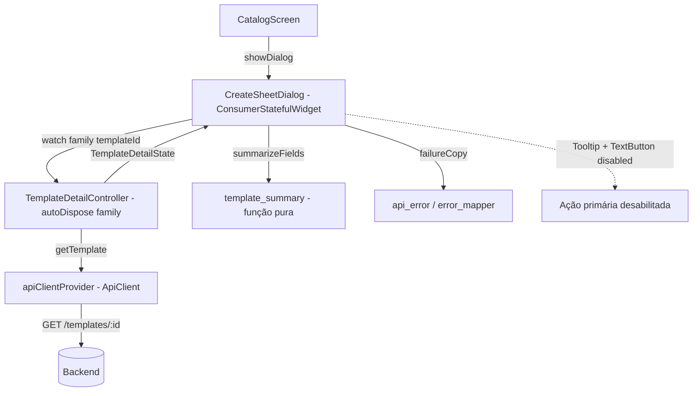

# [Front End] Fase 2 — Detalhe do template e diálogo de criação Design

**Spec**: `.specs/features/front-end-phase-2-template-detail-dialog/spec.md`
**Status**: Approved

---

## Architecture Overview

A superfície de criação é um diálogo modal (overlay, não rota) que busca `GET /templates/:id` a cada abertura, via um provider Riverpod **family autoDispose** keyed pelo `templateId`. Como o provider é criado quando o diálogo monta e descartado quando ele desmonta, cada abertura gera exatamente uma requisição nova (TPL-15) e nunca reaproveita resumo de um template anterior (TPL-04). O resumo por prefixo é uma função pura sobre a árvore `FieldGroup` (TPL-05); o diálogo apenas renderiza o estado (loading / erro mapeado + Retry / detalhe) e mantém o campo de nome como estado local — nenhuma mutação sai da superfície (TPL-13).



---

## Code Reuse Analysis

### Existing Components to Leverage

| Component | Location | How to Use |
| --------- | -------- | ---------- |
| `ApiClient.getTemplate(id)` | `desktop/lib/api/api_client.dart` | Único endpoint desta spec; retry-once e envelope já resolvidos (FE1) |
| `ApiClient` via `apiClientProvider` | `desktop/lib/api/api_client_provider.dart` | Ponto único de override de transporte nos testes |
| `TemplateDetail` / `FieldGroup` / `FieldNode` / `FieldSchema` | `desktop/lib/api/models/template.dart` | Árvore folha/grupo já decodificada; `fields` entra intacto no estado (TPL-06) |
| `failureCopy(Object)` | `desktop/lib/api/api_error.dart` | Copy mapeada para domínio (4xx/5xx, offline) e parse (JSON quebrado / sem `data`) — TPL-07/09/10 |
| `ApiErrorKind` + `errorCopy` | `desktop/lib/api/error_mapper.dart` | Kinds do backend (inclui `NOT_FOUND` → notFound) |
| `CreateSheetDialog` (placeholder) | `desktop/lib/catalog/create_sheet_dialog.dart` | Substituído pelo conteúdo real; contrato de navegação (CAT-15/16/17) preservado |
| `CatalogScreen._openCreationDialog` | `desktop/lib/catalog/catalog_screen.dart:186` | Fluxo de abertura/fecho já marca `ShellSurface.creationDialog` — sem mudança |
| Tokens de tema | `desktop/lib/theme/tokens.dart` | Espaçamento, tipografia e altura de controle; sem números mágicos |
| Testes com `MockClient` | `desktop/test/catalog/catalog_provider_test.dart` | Mesmo harness de transporte fake e contagem de chamadas |
| `MockClient` + `pumpCatalog` | `desktop/test/catalog/create_sheet_navigation_test.dart` | Harness que passa a rotear `/templates/:id` (ver Riscos) |
| Codegen Riverpod | `desktop/lib/*.g.dart` | `dart run build_runner build --delete-conflicting-outputs` |
| `AppLocalizations` | `desktop/lib/l10n/` | Toda string de UI; `lookupAppLocalizations(const Locale('en'))` fora de widget |

### Integration Points

| System | Integration Method |
| ------ | ------------------ |
| `CatalogScreen` → diálogo | `showDialog(barrierDismissible: true, builder: (…) => CreateSheetDialog(templateId: …))` — inalterado |
| `ProviderScope` | Testes sobrescrevem `apiClientProvider` com `ApiClient` sobre `MockClient` |
| Diálogo → provider | `ref.watch(templateDetailControllerProvider(templateId))` |
| `MaterialApp` | `localizationsDelegates` / `supportedLocales` já ligados; nenhuma mudança de wiring |

---

## Components

### `lib/catalog/template_summary.dart`

- **Purpose**: derivar o resumo por prefixo a partir da árvore `FieldGroup`, sem lista de prefixos hardcoded (TPL-02/03/05).
- **Location**: `desktop/lib/catalog/`
- **Interfaces**:
  - `typedef FieldSummary = ({String prefix, int leafCount})` — uma linha do resumo.
  - `List<FieldSummary> summarizeFields(FieldGroup fields)` — uma entrada por chave de topo, na ordem de inserção do mapa (ordem devolvida pela API); `fields` vazio → lista vazia.
  - `_countLeaves(FieldNode node) → int` (privada) — folha (`schema != null`) → 1; grupo (`children != null`) → soma recursiva das folhas; nó sem schema nem children → 0.
- **Dependencies**: `FieldGroup`, `FieldNode` de `api/models/template.dart`.
- **Reuses**: árvore folha/grupo da Fase 1; nenhum literal de prefixo.

### `lib/catalog/template_detail_provider.dart`

- **Purpose**: estado do detalhe + política de busca (on-demand, sem cache entre aberturas, Retry exatamente uma vez por ativação).
- **Location**: `desktop/lib/catalog/`
- **Interfaces**:
  - `class TemplateDetailState { final TemplateDetail? template; final bool isLoading; final String? errorMessage; bool get hasTemplate; }` — imutável, com `copyWith`.
  - `@riverpod class TemplateDetailController extends _$TemplateDetailController` — **autoDispose** (sem `keepAlive`), family por `templateId`:
    - `TemplateDetailState build(String templateId)` — guarda o id, `ref.watch(apiClientProvider)`, agenda `load()` via `Future.microtask` e retorna `TemplateDetailState(isLoading: true)`.
    - `Future<void> load()` — guarda de single-flight (`_inFlight`); zera para `isLoading` no início (nunca mostra resumo obsoleto, TPL-04); sucesso → `TemplateDetailState(template: ...)`; falha → `TemplateDetailState(errorMessage: failureCopy(error))`; `if (!ref.mounted) return` após o await (o diálogo pode fechar em voo, TPL-14).
- **Dependencies**: `apiClientProvider`, `ApiClient.getTemplate`, `failureCopy`.
- **Reuses**: estado imutável + notifier no padrão do `Catalog` (LGN-96); `ref.mounted` (riverpod 3.4.3) para descarte em voo.

### `lib/catalog/create_sheet_dialog.dart`

- **Purpose**: a Tela 3 — identidade do template, resumo por prefixo, campo de nome e ação primária desabilitada (TPL-01…TPL-14).
- **Location**: `desktop/lib/catalog/`
- **Interfaces**:
  - `class CreateSheetDialog extends ConsumerStatefulWidget` — `templateId` de entrada; `TextEditingController` local do nome (descartado no `dispose`).
  - Conteúdo (sem `AlertDialog.title` — o wireframe Tela 3 não tem título, e isso mantém um único `"Create sheet"` no diálogo, a ação primária):
    - identidade: label `createSheetTemplateLabel` ("Template", caption) + `templateId` com `Key('create-sheet-template-id')` (body) — preserva o contrato CAT-15; nome do template (`emphasis`) quando o detalhe carrega (TPL-02).
    - área de detalhe: `isLoading` → `LinearProgressIndicator` + `templateDetailLoading`; `errorMessage != null` → mensagem mapeada inline + `OutlinedButton` `actionRetry` chamando `load()` (TPL-07/08/09/10); sucesso → uma linha `"prefixo: contagem"` por chave de topo (TPL-02/03) ou a linha `templateNoFields` quando `fields` é vazio.
    - nome: label `createSheetNameLabel` + `TextField` vazio com `hintText` `createSheetNamePlaceholder` (TPL-11).
    - ações: `Tooltip(message: createSheetCreateTooltip)` envolvendo `TextButton(onPressed: null, child: Text(createSheetPrimaryAction))` (TPL-12) + `TextButton` `actionClose` (CAT-16).
- **Dependencies**: `templateDetailControllerProvider`, `summarizeFields`, `failureCopy`, `AppLocalizations`, tokens.
- **Reuses**: `errorCopy`/`failureCopy`, tokens de tema, padrão de erro inline do `CatalogScreen`.

### `lib/l10n/app_en.arb`

- **Purpose**: strings novas e remoção da chave órfã.
- **Interfaces** (novas): `createSheetNameLabel` ("Sheet name"), `createSheetNamePlaceholder` ("e.g. My Character"), `createSheetPrimaryAction` ("Create sheet"), `createSheetCreateTooltip` ("Sheet creation arrives in a later phase."), `templateDetailLoading` ("Loading template..."), `templateNoFields` ("This template has no fields.").
- **Remoção**: `createSheetTitle` — órfã após a remoção do título do diálogo. `createSheetTemplateLabel` e `actionClose` permanecem.

---

## Data Models

### `TemplateDetailState`

```dart
class TemplateDetailState {
  const TemplateDetailState({
    this.template,
    this.isLoading = false,
    this.errorMessage,
  });

  // Detalhe decodificado (id, name, fields intactos) após o sucesso — TPL-06.
  final TemplateDetail? template;

  // Requisição de detalhe em voo (carga inicial ou Retry).
  final bool isLoading;

  // Copy mapeada da última falha; null após sucesso.
  final String? errorMessage;

  bool get hasTemplate => template != null;

  TemplateDetailState copyWith({TemplateDetail?, bool?, String?});
}
```

**Relationships**: `TemplateDetail` já existe (`api/models/template.dart`); o estado apenas o embrulha com os sinalizadores de render. Não há persistência.

---

## Error Handling Strategy

| Error Scenario | Handling | User Impact |
| -------------- | -------- | ----------- |
| Transport failure (offline/timeout) | `ApiClient` retenta 1×; falha → `ApiDomainException(kind: offline)` → `failureCopy` → `errorOffline` | Mensagem inline no diálogo + Retry; diálogo continua aberto (TPL-07) |
| 4xx/5xx com envelope válido | Kind mapeado (`serverError`, `notFound`, …) → copy do kind | Mensagem inline + Retry |
| `NOT_FOUND` (template desconhecido) | `kind: notFound` → `errorNotFound` | Mensagem inline + Retry; nunca fecha nem crasha (TPL-09) |
| 2xx sem `data` / shape inválido | `ApiParseException` → `errorParse` via `failureCopy` | Mensagem inline + Retry; nunca resumo meio-renderizado (TPL-10) |
| Fecho do diálogo durante carga | Provider autoDispose descartado; `load` aborta em `ref.mounted` | Sem erro de "use after dispose" |

---

## Risks & Concerns

| Concern | Location (file:line) | Impact | Mitigation |
| ------- | -------------------- | ------ | ---------- |
| Acoplamento dos testes existentes de navegação: abrir o diálogo passa a emitir também `GET /templates/:id`, o que muda a contagem total de requisições | `desktop/test/catalog/create_sheet_navigation_test.dart:89`, `desktop/test/app_boot_test.dart:118` | As asserções `recorded hasLength(1)` (que provam "nenhuma chamada nova de lista") quebram, pois agora há lista + detalhe | T3 atualiza o harness para rotear `/templates/:id` e contar apenas requisições de catálogo (path `/templates`), preservando a intenção original (CAT-16/18) — sem enfraquecer asserções |
| `Tooltip` sobre `TextButton` desabilitado: botões desabilitados não recebem hover de forma confiável | `desktop/lib/catalog/create_sheet_dialog.dart` | Tooltip pode não aparecer no hover (viola TPL-12 na prática) | Teste de hover real (gesture mouse) + asserção do `Tooltip.message`; se o hover não disparar, envolver num wrapper que mantém o `Tooltip` no caminho do hit-test |
| Descarte do provider em voo (autoDispose) ao fechar o diálogo | `desktop/lib/catalog/template_detail_provider.dart` | `state =` após dispose lançaria erro | Guarda `if (!ref.mounted) return;` após o await; teste de fecho durante carga |
| Cobertura de resumo limitada ao fixture `fantasy_v1` | `desktop/test/catalog/template_summary_test.dart` | Um bug de recursão passaria despercebido | Fixtures sintéticas: grupo aninhado, folha de topo, chave inesperada, `fields` vazio, chave com 0 folhas |

---

## Tech Decisions

| Decision | Choice | Rationale |
| -------- | ------ | --------- |
| Política de cache do detalhe | Provider family **autoDispose** (sem `keepAlive`) | Cada abertura recria o provider → GET fresco (TPL-15) e estado limpo (TPL-04); sem política de invalidação para acertar |
| Forma do resumo | `List<({String prefix, int leafCount})>` ordenada | Ordem de inserção do mapa = ordem da API (TPL-02); record imutável e testável; sem rótulo humanizado nem bucket inventado |
| Título do diálogo | Removido | O wireframe Tela 3 não tem título; o título `"Create sheet"` colidiria com o texto da ação primária (o teste CAT-15 exige um único `"Create sheet"` no diálogo) |
| Identidade do template | Mantém label "Template" + id (key CAT-15) e adiciona o nome | Preserva o contrato de navegação da Fase 2 e satisfaz TPL-02 (nome) sem quebrar testes existentes |
| Retry | `load()` com guarda de single-flight | "exatamente uma vez por ativação" (TPL-08); duplo-toque absorvido |

> **Project-level decisions:** nenhuma. `.specs/STATE.md` não existe neste repositório e as fases anteriores não registraram decisões `AD-NNN`; as escolhas acima são locais a esta feature.
