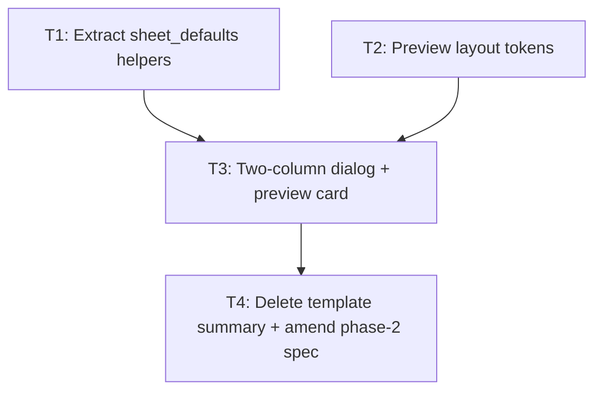

---
# tasks.md — front-end-phase-3-sheet-preview (LGN-100)
# Read-only preview of sheet fields with base values in the create-sheet dialog.
# Draft → validate (`validate_tasks.py --strict`) → present for approval → Execute.
---

# Tasks: Read-only sheet preview in the create-sheet dialog (LGN-100)

Feature: `front-end-phase-3-sheet-preview` · Jira: LGN-100 (In Progress)
Spec: `.specs/features/front-end-phase-3-sheet-preview/spec.md` (13 requirements, Approved 2026-10-01)
Design: `.specs/features/front-end-phase-3-sheet-preview/design.md`

Scope: a two-column preview inside the create-sheet dialog, rendering every top-level
group and leaf read-only (label or humanized key + base value from `FieldSchema.defaultValue`),
derived entirely from `FieldSchema` — no per-system hardcoding, no mutations, no `POST /sheets`.
Deletes the phase-2 text summary (amended out of the phase-2 spec). Depends on LGN-99
for the reserved-group flag (To Do → all groups render until then).

Contract facts (verified against the tree, not assumed):
- `FieldSchema.defaultValue` is a required `double` (`api/models/template.dart:76`); a leaf
  cannot have a missing default, so the preview always has a value for every leaf.
- `SheetForm` is `fields` + `data` + `onChanged`; read-only = `onChanged: null`
  (`engine/sheet_form.dart:17-31`). There is no `readOnly` parameter.
- `SheetFieldControl` disables its `TextField`/`Switch` when `onChanged == null`
  (`engine/field_control.dart:119,156`) and renders non-editable fields as read-only text.
- `TemplateDetailController` is `@riverpod` (autoDispose) and single-flight; one GET per
  activation, fresh on reopen (`catalog/template_detail_provider.dart:30-51`).

Conventions: table-driven tests, `Happy path:` / `Edge:` / `Error:` case prefixes,
`flutter_test` matchers, tests co-located by feature area under `desktop/test/`, English only.

## Test Coverage Matrix

| Req | Cases | Type | File | Task |
|-----|-------|------|------|------|
| PRV-01 | happy: one labeled section per top-level key in API order, incl. `config`/`derived`/`modifiers`; edge: group with no leaves omitted | widget | `test/catalog/create_sheet_preview_test.dart` | T3 |
| PRV-02 | happy: each leaf shows display name (schema label, else humanized key) + `defaultValue`; edge: blank schema label → humanized key | widget | `test/catalog/create_sheet_preview_test.dart` | T3 |
| PRV-03 | edge: synthetic template with unknown prefixes/types renders with no code change | widget | `test/catalog/create_sheet_preview_test.dart` | T3 |
| PRV-04 | edge: in-flight → loading in the preview area, no stale sections from a prior template | widget | `test/catalog/create_sheet_preview_test.dart` | T3 |
| PRV-05 | edge: the Phase-2 summary text (`Stats: …`) is absent from the dialog | widget | `test/catalog/create_sheet_dialog_test.dart` | T3 |
| PRV-06 | edge: no preview control is enabled; transport carries only GET requests | widget | `test/catalog/create_sheet_preview_test.dart` | T3 |
| PRV-07 | error: 500 / 404 / undecodable payload → mapped copy + Retry inline, dialog open | widget | `test/catalog/create_sheet_dialog_test.dart` | T3 |
| PRV-08 | happy: Retry re-requests exactly once and swaps to sections | widget | `test/catalog/create_sheet_dialog_test.dart` | T3 |
| PRV-09 | edge: empty `fields` (and groups-only-without-leaves) → localized "no fields" line in the preview area | widget | `test/catalog/create_sheet_preview_test.dart` | T3 |
| PRV-10 | happy: many leaves → card scrolls within a bounded height; name field and actions stay reachable | widget | `test/catalog/create_sheet_preview_test.dart` | T3 |
| PRV-11 | happy: opening issues at most one `GET /templates/:id` | widget | `test/catalog/create_sheet_dialog_test.dart` | T3 |
| PRV-12 | edge: reopen → fresh GET (2 total), no cached reuse | widget | `test/catalog/create_sheet_dialog_test.dart` | T3 |
| PRV-13 | edge: typing in the name field leaves the preview unchanged and issues no request | widget | `test/catalog/create_sheet_dialog_test.dart` | T3 |
| (T1) | `seedDefaults`: seeds every leaf’s `defaultValue` incl. `0`; nested dotted paths; `setPathValue` creates intermediate maps and overwrites | unit | `test/engine/sheet_defaults_test.dart` | T1 |
| (T2) | `AppSizes.createSheetDialogWidth` 720 · `previewCardWidth` 360 · `previewCardMaxHeight` 420 | unit | `test/theme/tokens_test.dart` | T2 |

## Gate Check Commands

| Level | Command | When |
|-------|---------|------|
| Quick | `export PATH="$HOME/flutter/bin:$PATH" && cd desktop && flutter test` | After every task |
| Full | `export PATH="$HOME/flutter/bin:$PATH" && cd desktop && flutter analyze && flutter test` | T1, T2, T4 (Gate: full) |
| Build | `export PATH="$HOME/flutter/bin:$PATH" && cd desktop && flutter pub get && flutter gen-l10n` | Before the first widget-test run that consumes the new l10n key (T3) |
| Spec | `python3 .claude/skills/tlc-spec-driven/scripts/validate_spec.py .specs/features/front-end-phase-3-sheet-preview --strict` | Once (already 0/0) |

Baseline before Execute: `flutter test` → 246 passed, 4 skipped; `flutter analyze` → no issues.

## Execution Plan

- **Ordering rationale**: extract the shared default-seeding logic first (T1) so the preview
  and the sheet screen share one source; tokens (T2) are inert constants; the dialog
  restructure (T3) depends on both; deletion + phase-2 spec amend (T4) happens only after the
  replacement UI is proven (T3).
- **Dependencies**: T3 → T1, T2; T4 → T3; T1 and T2 independent.
- **Parallelization**: T1 ∥ T2 allowed (disjoint files); everything else sequential.
- **Scope boundaries**: no save-path changes (the disabled primary action is untouched), no
  `SheetForm`/`SheetFieldControl` modifications (read-only via `onChanged: null`), no shell or
  right-panel changes, no LGN-99 flag consumption (renders all groups), no `POST /sheets`.
- **Auto-Dispatch (parallel)**: `review/conventions` targets Go conventions and no Dart rules
  are configured — **skip**; `review/duplication` after T3 (preview builders vs
  `SheetForm`/`FieldGroup` rendering) — **run**.

## Task Breakdown

### T1: Extract shared default-seeding helpers to `engine/sheet_defaults.dart`

**What**: move `sheet_screen.dart`'s `_seedDefaults` and `_setValue` into
`lib/engine/sheet_defaults.dart` as `seedDefaults(FieldGroup)` / `setPathValue(map, path, value)`;
refactor `SheetScreen` to call them (behavior-identical). Source: `sheet_screen.dart:147-171`.
**Why**: the preview must seed its read-only values from `FieldSchema.defaultValue` through the
same code path as the real form defaults (PRV-02), one source, no drift.
**Files**: `desktop/lib/engine/sheet_defaults.dart` (new), `desktop/lib/sheet/sheet_screen.dart`,
`desktop/test/engine/sheet_defaults_test.dart` (new).
**Depends on**: —
**Spec**: PRV-02 (foundation).
**Tests**: (write first) `sheet_defaults_test.dart` — `Happy path: seeds every leaf default` (nested
groups + top-level leaf, paths `a.b.c`), `Edge: keeps a zero default`, `Edge: nested defaults land
under their dotted path`, `Edge: setPathValue creates missing intermediate maps`, `Edge: setPathValue
overwrites an existing leaf`, `Edge: empty tree yields an empty map`.
**Gate**: full · **Commits**: `feat(LGN-100): extract shared sheet default-seeding helpers`
**Status**: ✅ Done — suite 254 passed / 4 skipped; `flutter analyze` clean

### T2: Add layout tokens for the dialog preview

**What**: add `createSheetDialogWidth` (720.0), `previewCardWidth` (360.0) and
`previewCardMaxHeight` (420.0) to `AppSizes` in `lib/theme/tokens.dart`; no other styling.
**Why**: PRV-10 (bounded inner scroll, dialog never exceeds the window) and the AGENTS rule that
widgets carry no magic numbers; clustered with the other layout dimensions.
**Files**: `desktop/lib/theme/tokens.dart`, `desktop/test/theme/tokens_test.dart`.
**Depends on**: —
**Spec**: PRV-10.
**Tests**: (write first) `Happy path: preview tokens use the design sizes` —
`createSheetDialogWidth == 720`, `previewCardWidth == 360`, `previewCardMaxHeight == 420`.
**Gate**: full · **Commits**: `feat(LGN-100): add preview layout tokens`
**Status**: ✅ Done — suite 255 passed / 4 skipped; `flutter analyze` clean

### T3: Two-column dialog with always-visible read-only preview card

**What**: turn the dialog content into a `SizedBox(width: createSheetDialogWidth)` + `Row`:
left column keeps template identity and the sheet-name field; right column holds a `Card`
(caption header `createSheetPreviewLabel`, hairline border, `AppRadius.panel`, no elevation)
whose body is `ConstrainedBox(maxHeight: previewCardMaxHeight)` +
`SingleChildScrollView(shrinkWrap: true)` over `SheetForm(fields: template.fields,
data: seedDefaults(template.fields), onChanged: null)`. The loading / mapped-error+Retry / empty
("no fields") states render inside the same card. Remove the `TemplateSummary` usage and import.
Add l10n `createSheetPreviewLabel`.
**Why**: the feature itself (PRV-01 … PRV-13).
**Files**: `desktop/lib/catalog/create_sheet_dialog.dart`, `desktop/lib/l10n/app_en.arb`,
`desktop/lib/l10n/app_pt_BR.arb` (if present), `desktop/test/catalog/create_sheet_preview_test.dart`
(new), `desktop/test/catalog/create_sheet_dialog_test.dart` (rewrite summary assertions).
**Depends on**: T1, T2
**Spec**: PRV-01 … PRV-13.
**Tests**: (write first) the matrix rows above; in `create_sheet_dialog_test.dart` replace the
summary assertions with preview assertions and **invert** (do not delete) the reserved-groups test
(line 136) so `config`/`derived`/`modifiers` are now expected; keep the PRV-06 no-mutation,
PRV-07/08 error+Retry, PRV-11/12 request-count and PRV-13 typing tests.
**Gate**: build (l10n) + full · **Commits**:
`feat(LGN-100): render read-only field preview in the create dialog`

### T4: Delete the Phase-2 template summary widget and amend the Phase-2 spec

**What**: delete `lib/catalog/template_summary.dart` + `test/catalog/template_summary_test.dart`
(orphaned by T3); amend the Phase-2 spec so TPL-02/03/04/05 reference the preview instead of the
summary, and mark the three summary assumption rows as superseded by the LGN-100 amend.
**Why**: superseded UI must not linger (no dead code); the Phase-2 spec must stop describing a
component that no longer exists.
**Files**: `desktop/lib/catalog/template_summary.dart` (delete),
`desktop/test/catalog/template_summary_test.dart` (delete),
`.specs/features/front-end-phase-2-template-detail-dialog/spec.md` (amend).
**Depends on**: T3
**Spec**: PRV-05 (dialog lists fields only through the preview).
**Tests**: full suite stays green after the deletions (the dialog tests no longer import the summary).
**Gate**: full · **Commits**:
`refactor(LGN-100): remove the phase-2 template summary superseded by the preview`

## Phase Execution Map

- Phase 1: T1 · exit: `sheet_defaults_test` green, analyze clean, screen refactor behavior-identical.
- Phase 2: T2 · exit: token test green, no UI change yet.
- Phase 3: T3 → T4 · exit: full suite green (baseline + preview tests), summary deleted, phase-2 spec amended.
- Final: full gate + Verifier (automatic after the last task).

## Task Granularity Check

| Task | ≤4 files (code+test) | Est. diff | Independent test run | Reversible |
|------|----------------------|-----------|----------------------|------------|
| T1 | ✅ 3 | ~110 lines | ✅ `flutter test test/engine/sheet_defaults_test.dart` | ✅ revert restores the screen-local helpers |
| T2 | ✅ 2 | ~20 lines | ✅ `flutter test test/theme/tokens_test.dart` | ✅ revert removes the constants |
| T3 | ✅ 5 | ~250 lines | ✅ `flutter test test/catalog/` | ✅ revert restores the summary rendering |
| T4 | ✅ 3 (2 delete + 1 amend) | ~-120 lines | ✅ full suite | ✅ `git revert` restores the files |

## Diagram-Definition Cross-Check

- Graph declares 4 nodes / 3 edges (T1→T3, T2→T3, T3→T4) — matches every task's `Depends on`.
- Every `### Tn:` header appears as a node; every declared dependency is an arrow; no orphans.

## Test Co-location Validation

| Task | Code file | Test file | Same commit |
|------|-----------|-----------|-------------|
| T1 | `lib/engine/sheet_defaults.dart` | `test/engine/sheet_defaults_test.dart` | ✅ |
| T2 | `lib/theme/tokens.dart` | `test/theme/tokens_test.dart` | ✅ |
| T3 | `lib/catalog/create_sheet_dialog.dart` (+ l10n) | `test/catalog/create_sheet_preview_test.dart`, `test/catalog/create_sheet_dialog_test.dart` | ✅ |
| T4 | delete `lib/catalog/template_summary.dart` | delete `test/catalog/template_summary_test.dart` + amend the Phase-2 spec | ✅ |

## Assumptions

- LGN-99 (group flag) stays To Do → the preview renders every group; when the flag lands the
  preview inherits it through the shared `buildSections` header condition, no preview-specific work.
- `SheetForm(onChanged: null)` is sufficient for PRV-06: the controls read `onChanged == null`
  before enabling inputs, and non-editable leaves render as plain text (verified in `field_control.dart`).
- The three layout constants are design sizes (720/360/420), recorded here so the token test is
  spec-anchored rather than echoing the implementation.

## Open Questions

- None — all gray areas were settled in `context.md` (surface, always-on visibility, summary
  removal, reserved groups).
