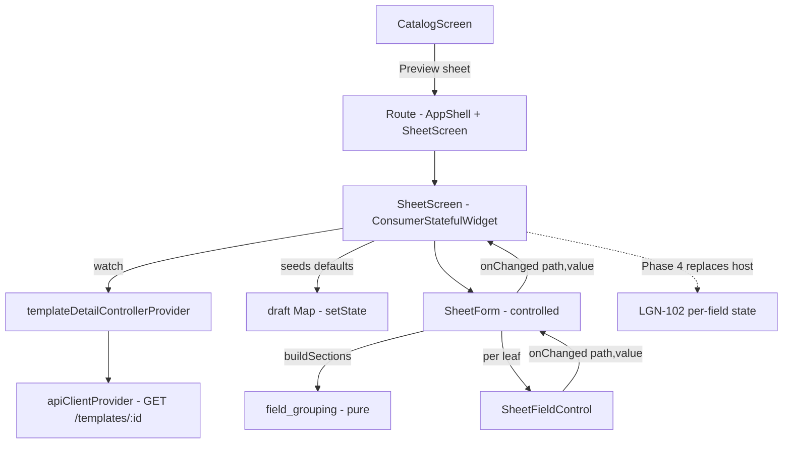

# [Front End] Fase 3 — Renderização da ficha (Tela 2) Design

**Spec**: `.specs/features/front-end-phase-3-sheet-rendering/spec.md`
**Status**: Approved

---

## Architecture Overview

O UI Engine é uma camada de **apresentação pura e controlada**: recebe a árvore de campos do template (`FieldGroup`) mais um mapa de valores e devolve widgets. Ele não guarda estado, não fala com a rede e não decide o que salvar.

Três peças, em ordem de dependência:

1. `buildSections(fields)` (derivação pura) transforma a árvore em seções por prefixo de topo, cada uma com suas folhas (caminho pontilhado + `FieldSchema`) e um label derivado do schema/chave.
2. `SheetFieldControl` desenha **um** campo por regra do schema (input numérico/texto, toggle, read-only "Calculated"), com um `value` de entrada e um `onChanged` de saída — sem estado de domínio.
3. `SheetForm` compõe as seções e as linhas, resolve cada valor do mapa por caminho pontilhado e repassa as edições pelo `onChanged` do formulário.

A Tela 2 (`SheetScreen`) é o **host de demonstração**: busca o detalhe do template pelo provider da Fase 2, semeia um mapa local a partir dos `default` do schema, mantém esse mapa por `setState` e renderiza o `SheetForm`. É o único ponto com estado (volátil), e existe porque ainda não há ficha real — a Fase 4 troca esse host pelo estado da ficha e [LGN-102](https://paulovalleriotedev.atlassian.net/browse/LGN-102) troca o `setState` por isolamento por campo.



**Approaches considered** (delivery scope was already decided with the maintainer: navigable Screen 2 + controlled engine):

1. **Renderer controlado + host de rascunho local (chosen)** — o engine fica testável por widget sem provider nem rede; o host local dá uma superfície interativa já neste card. Mantém [LGN-102](https://paulovalleriotedev.atlassian.net/browse/LGN-102) (isolamento por campo) e a Fase 4 (commit) com fronteiras limpas: eles substituem o host, não o engine.
2. **Engine com estado Riverpod embutido** — anteciparia [LGN-102](https://paulovalleriotedev.atlassian.net/browse/LGN-102) e obrigaria o engine a conhecer salvar/reidratar; rejeitado: viola o escopo do card e mistura render com estado.
3. **Só o engine, sem superfície** — o mantenedor pediu a Tela 2 navegável; uma camada sem superfície não é demonstrável e adiaria a validação visual do Marco M2.

---

## Code Reuse Analysis

### Existing Components to Leverage

| Component | Location | How to Use |
| --------- | -------- | ---------- |
| `FieldGroup` / `FieldNode` / `FieldSchema` | `desktop/lib/api/models/template.dart:6-77` | Entrada do engine; `schema.label`, `type`, `formula`, `isEditable`, `defaultValue` dirigem tudo |
| Humanização de chave + label | `desktop/lib/catalog/template_summary.dart:53-74` (`_displayName`/`_humanize`) | **Extraída** para `fieldDisplayName` público no engine e reusada pelo resumo (um mecanismo só, RND-04/RND-05) |
| Resolução de caminho pontilhado | `desktop/lib/api/models/sheet.dart:59-75` (`Sheet.valueAt`) | **Extraída** para `valueAtPath(data, path)` top-level; `Sheet.valueAt` passa a delegar (RND-16, sem duplicar traversal) |
| `templateDetailControllerProvider` + `failureCopy` | `desktop/lib/catalog/template_detail_provider.dart`, `desktop/lib/api/api_error.dart` | Fonte de dados da Tela 2 e copy mapeada do erro (RND-15/17), sem HTTP novo |
| `AppShell` + `Header`/`LeftNav`/`RightPanel` | `desktop/lib/shell/app_shell.dart` | A rota da Tela 2 monta o shell persistente com `content: SheetScreen(...)` (nav persistente, `desktop/AGENTS.md`) |
| `CatalogScreen` card + `showDialog` pattern | `desktop/lib/catalog/catalog_screen.dart:129-204` | Adiciona a ação secundária e o `Navigator.push` no mesmo ponto que abre o diálogo |
| Tokens + tema | `desktop/lib/theme/tokens.dart`, `desktop/lib/theme/app_theme.dart` | Toda dimensão/cor sai dos tokens (`AppSpacing`, `AppSizes`, `AppRadius`) e do `ColorScheme` |
| Generated l10n | `desktop/lib/l10n/app_en.arb` + `flutter gen-l10n` | 1 chave nova (`fieldCalculated`) e a ação do catálogo (`catalogPreviewAction`) |

### Integration Points

| System | Integration Method |
| ------ | ------------------ |
| `Sheet.valueAt` (`sheet.dart`) | Novo helper `valueAtPath` público; o método delega — contrato de erro (`InvalidPathException`) inalterado, testes da Fase 1 seguem verdes |
| `summarizeFields` (`template_summary.dart`) | Passa a chamar `fieldDisplayName` do engine; comportamento idêntico (testes TPL seguem verdes) |
| Catálogo card | Nova `TextButton` "Preview sheet" ao lado de "Create sheet"; `Navigator.push` com `MaterialPageRoute` de `AppShell(content: SheetScreen)` |
| `TemplateDetailController` | Reusado como está (single-flight, on-demand, sem cache) — a Tela 2 não cria provider novo |
| Riverpod codegen / gen-l10n | Sem arquivos `@riverpod` novos; a arb muda → `flutter gen-l10n` e artefatos commitados |

---

## Components

### `lib/engine/field_grouping.dart`

- **Purpose**: derivar as seções da ficha a partir da árvore de campos, de forma pura e sem hardcode (RND-01…RND-05).
- **Location**: `desktop/lib/engine/`
- **Interfaces**:
  - `typedef SheetField = ({String path, FieldSchema schema})` — folha com caminho pontilhado (`stats.dexterity`) e schema.
  - `typedef SheetSection = ({String key, String label, List<SheetField> leaves})` — seção de topo.
  - `List<SheetSection> buildSections(FieldGroup fields)` — uma seção por chave de topo visível, na ordem da API; grupos flatted recursivamente em folhas; grupo sem folhas é omitido; folha de topo vira seção de uma folha. `label` = `fieldDisplayName(key, null)`.
  - `String fieldDisplayName(String key, FieldSchema? schema)` — `schema.label.trim()` quando não vazio, senão humanização da chave (movida do `template_summary`).
- **Dependencies**: `package:legnaris/api/models/template.dart`.
- **Reuses**: `_humanize`/`_displayName` da Fase 2 (extração), `_leaves` do resumo (mesma recursão).

### `lib/engine/field_control.dart`

- **Purpose**: desenhar um campo por regra do schema (RND-06…RND-13).
- **Location**: `desktop/lib/engine/`
- **Interfaces**:
  - `class SheetFieldControl extends StatefulWidget` — `{ required String path, required FieldSchema schema, required Object? value, required ValueChanged<Object?>? onChanged }`.
  - Regra de renderização, avaliada nesta ordem:
    1. `!schema.isEditable` → valor read-only + destaque `fieldCalculated`; `formula != null` envolve o valor num `Tooltip` com a fórmula (RND-10/11).
    2. `schema.type == 'bool'` ou primeiro segmento de `path == 'config'` → `Switch` (RND-08/09). `config.*` emite `1`/`0`; `bool` emite `true`/`false`.
    3. `schema.type == 'number'` → `TextField` numérico (teclado decimal), valor formatado; edição emite `num` (RND-06).
    4. `schema.type == 'text'`/`'string'` → `TextField` de texto; edição emite `String` (RND-07).
    5. qualquer outro `type` → read-only (fallback, RND-13).
  - Estado interno: `TextEditingController` + `FocusNode` do input. O controller ressincroniza no `didUpdateWidget` quando o valor externo muda de verdade (o host controlado não devolve o que o widget emitiu) e o marcador de eco é atualizado junto, para nunca ficar obsoleto; ao perder o foco, texto numérico que o draft não representa (intermediário `-`, parse inválido) é restaurado para o valor armazenado.
  - `_formatValue(Object?)` — num inteiro sem parte fracionária vira inteiro (`16`, não `16.0`); o resto usa `toString()`; `null` → vazio.
- **Dependencies**: `flutter/material.dart`, `theme/tokens.dart`, l10n (`fieldCalculated`), `api/models/template.dart`.
- **Reuses**: tokens de controle (`controlHeight`, `rowHeight`, `radius`), `Tooltip` nativo.

### `lib/engine/sheet_form.dart`

- **Purpose**: compor as seções e as linhas e casar valores/edições por caminho (RND-01, RND-12, RND-16).
- **Location**: `desktop/lib/engine/`
- **Interfaces**:
  - `class SheetForm extends StatelessWidget` — `{ required FieldGroup fields, required Map<String, Object?> data, ValueChanged<...>? onChanged }`.
  - Constrói `buildSections(fields)`; por seção, cabeçalho (`titleSmall`, 15) + `Divider`; por folha, linha `Row(label, control)` com `label` em `bodyMedium` e o `SheetFieldControl` resolvendo `valueAtPath(data, field.path)`.
  - `onChanged` repassa `(path, value)`. Sem estado, sem I/O.
- **Dependencies**: `field_grouping.dart`, `field_control.dart`, `api/models/sheet.dart` (`valueAtPath`), tokens.
- **Reuses**: `valueAtPath` extraído; padrão de linhas alinhadas do `desktop/AGENTS.md` (tabela).

### `lib/sheet/sheet_screen.dart`

- **Purpose**: a Tela 2 navegável — host volátil que busca o detalhe, semeia defaults e deixa o `SheetForm` editar (RND-14…RND-19).
- **Location**: `desktop/lib/sheet/`
- **Interfaces**:
  - `class SheetScreen extends ConsumerStatefulWidget` — `{ required String templateId }`.
  - `build`: `ref.watch(templateDetailControllerProvider(templateId))`; header com back (`IconButton`, tooltip `MaterialLocalizations.backButtonTooltip`) + nome/id do template; corpo = loading / erro mapeado + Retry / `SheetForm` / linha "This template has no fields.".
  - Semeia `_data` uma vez, no primeiro sucesso, com `leaf.defaultValue` para cada folha (chave = caminho pontilhado).
  - `onChanged`: atualiza `_data` por `setState` (rascunho local, sem persistência).
- **Dependencies**: `template_detail_provider.dart`, `sheet_form.dart`, `field_grouping.dart`, l10n, tokens.
- **Reuses**: `TemplateDetailController` (single-flight/Retry da Fase 2), `failureCopy` + `actionRetry`, `templateNoFields`.

### Wiring (`catalog_screen.dart`, `app_en.arb`)

- `CatalogScreen`: `TextButton` "Preview sheet" no card → `Navigator.push(MaterialPageRoute(builder: (_) => const AppShell(content: SheetScreen(templateId: ...))))`. Sem tocar no fluxo de criação (RND-14/18).
- `app_en.arb`: `fieldCalculated` ("Calculated") e `catalogPreviewAction` ("Preview sheet"), cada uma com `@`-description citando o requisito.

---

## Data Models

### SheetField / SheetSection (novos, em `field_grouping.dart`)

```dart
typedef SheetField = ({String path, FieldSchema schema});
typedef SheetSection = ({String key, String label, List<SheetField> leaves});
```

**Relationships**: derivados de `FieldGroup` (Fase 1); consumidos só pelo `SheetForm`/`SheetFieldControl`. `SheetField.schema` é o `FieldSchema` recebido — nenhum campo novo de modelo.

### `valueAtPath` (extração em `sheet.dart`)

```dart
Object? valueAtPath(Map<String, Object?> data, String path);
```

Mesma semântica de `Sheet.valueAt` (FE1-12…14): segmento ausente → `null`; caminho vazio/segmento vazio → `InvalidPathException`.

---

## Error Handling Strategy

| Error Scenario | Handling | User Impact |
| -------------- | -------- | ----------- |
| Falha do `GET /templates/:id` (transporte/4xx/5xx/parse) | `TemplateDetailController` já resolve para `errorMessage` mapeado; a Tela 2 renderiza inline + Retry (RND-17) | Mensagem mapeada na Tela 2, que continua aberta |
| `fields` vazio | `buildSections` devolve `[]`; a Tela 2 mostra `templateNoFields` | Linha única localizada, sem área em branco ambígua |
| Valor ausente no mapa `data` | `valueAtPath` → `null`; controle renderiza vazio/off | Nenhuma exceção; a linha aparece vazia |
| Input numérico limpo/inválido | `_parseNumber` → `null`; `onChanged(path, null)` | O valor é limpo, nunca vira lixo silencioso |
| Input numérico com lixo (`NaN`, `Infinity`, `0x10`, `1e999`, letras) | `_NumericTextFormatter` rejeita a edição (reverte ao valor anterior); `_parseNumber` também barra shape inválido e não-finitos (fallback) | O campo nunca exibe nem emite valor não-finito/hex — `jsonEncode` do Phase 4 nunca recebe `NaN`/`Infinity` |
| Intermediário de digitação (`-`, `.`) abandonado | Sem emissão (mantém o valor armazenado); ao perder o foco, `_restoreStoredValueOnBlur` restaura o texto do valor armazenado | Sem divulgância tela × draft: em repouso o texto é sempre o que seria salvo |
| `type` desconhecido | Fallback read-only (RND-13) | O campo aparece como valor, sem quebrar a tela |
| Grupo de topo sem folhas | Seção omitida | Nenhuma seção vazia |

---

## Risks & Concerns

| Concern | Location (file:line) | Impact | Mitigation |
| ------- | -------------------- | ------ | ---------- |
| `TemplateDetailController` é `autoDispose` e dispara `load()` no `build`; a Tela 2 empurrada como rota mantém o provider vivo enquanto a rota existe | `desktop/lib/catalog/template_detail_provider.dart:34-43` | Se a rota montar/desmontar o provider, um segundo `GET` poderia escapar da contagem | Teste de navegação conta requisições por path (`/templates/fantasy_v1` = 1) e o single-flight do controller absorve duplo disparo |
| `didUpdateWidget` resetando o `TextEditingController` durante a digitação (host rebuilda o form a cada tecla) | `desktop/lib/engine/field_control.dart` | Cursor pulando / texto resetando | Ressincroniza só quando o valor externo difere do último valor emitido pelo próprio widget |
| Empurrar um `AppShell` como rota duplica o shell (header/connection indicator) na árvore enquanto a Tela 2 está no topo | `desktop/lib/catalog/catalog_screen.dart` + `app_shell.dart` | Asserções de shell (`find.text('Legnaris')`) passam a achar 2 widgets nessa rota | Testes da Tela 2 usam `findsWidgets` onde o shell se duplica; os testes existentes do catálogo não navegam para a Tela 2 |
| `fieldDisplayName` extraído do `template_summary` | `desktop/lib/catalog/template_summary.dart:53-74` | Regressão no resumo da Fase 2 | Extração mecânica; os testes `template_summary_test.dart` (TPL-02/03/05) continuam como rede |
| `valueAtPath` extraído do `Sheet.valueAt` | `desktop/lib/api/models/sheet.dart:59-75` | Regressão no acesso por caminho (FE1-12…14) | `Sheet.valueAt` passa a delegar; `sheet_model_test.dart` segue cobrindo a semântica |
| Sem `step` no `FieldSchema`, o AC "numérico com step" fica no limiar | spec das premissas | Campo numérico sem incremento explícito | Premissa registrada: sem stepper na V1 (Material defaults); o Verifier pode marcar como spec-precision gap, aceito |
| Nenhum `STATE.md` no projeto | `.specs/` | Design não tem restrições de AD existentes | Não há decisão de projeto nova; tudo é feature-local (ver Tech Decisions) |

---

## Tech Decisions

| Decision | Choice | Rationale |
| -------- | ------ | --------- |
| Fronteira render vs estado | Engine controlado (`data` + `onChanged`), estado só no host da Tela 2 | Mantém [LGN-102](https://paulovalleriotedev.atlassian.net/browse/LGN-102) (isolamento por campo) e a Fase 4 (commit) como substitutos do host, não do engine |
| `config.*` | Regra por prefixo de caminho (`config`), com constante documentada | O nó proxy 0/1 é contrato do backend (TDD § Regras), não literal de sistema; caminhos fora de `config` seguem a regra por `type` |
| Read-only | Texto simples + caption `fieldCalculated`; fórmula em `Tooltip` | O wireframe mostra o valor sem caixa; o hover entrega a fórmula sem poluir a linha (desktop-first) |
| Fallback de tipo | Read-only para tipo desconhecido | Preserva o Marco M2 (qualquer template renderiza) sem inventar editores |
| Seções | Uma por chave de topo; grupo sem folhas omitido | Casa com o wireframe (STATS/MODIFIERS/DERIVED/CONFIG) sem criar estrutura nova; grupos vazios são ruído |
| Host da Tela 2 | `ConsumerStatefulWidget` com `Map` de rascunho + `setState` | Suficiente para uma superfície de validação; o rebuild global é justamente o que [LGN-102](https://paulovalleriotedev.atlassian.net/browse/LGN-102) otimiza |
| Navegação | Rota `MaterialPageRoute` montando `AppShell(content: SheetScreen)` | Preserva a nav persistente do `desktop/AGENTS.md` sem refatorar o shell (`LegnarisApp.home` fixo) |
| Reuso de label/traversal | `fieldDisplayName` e `valueAtPath` extraídos e reusados | Evita um segundo mecanismo para o mesmo job (`desktop/AGENTS.md`) |
| Nenhum `AD-NNN` | — | Decisões são feature-local; nenhuma convenção nova para features futuras |

---

## Requirement Mapping

| Req | Component(s) | Primary test |
| --- | ------------ | ------------ |
| RND-01 | `buildSections` + `SheetForm` (headers) | `test/engine/field_grouping_test.dart`, `test/engine/sheet_form_test.dart` |
| RND-02 | `buildSections` recursão | `field_grouping_test.dart` (árvore aninhada) |
| RND-03 | `buildSections` folha de topo | `field_grouping_test.dart` |
| RND-04 | `buildSections`/`fieldDisplayName` | `field_grouping_test.dart` (label vazio → humanizado; prefixo exótico) |
| RND-05 | `fieldDisplayName` + `SheetFieldControl` | `field_grouping_test.dart`, `field_control_test.dart` |
| RND-06 | `SheetFieldControl` branch número | `field_control_test.dart` (input numérico + `onChanged` numérico) |
| RND-07 | `SheetFieldControl` branch texto | `field_control_test.dart` (input de texto + `onChanged` String) |
| RND-08 | `SheetFieldControl` branch `config` | `field_control_test.dart` (Switch 1/0) |
| RND-09 | `SheetFieldControl` branch bool | `field_control_test.dart` (Switch true/false) |
| RND-10 | `SheetFieldControl` branch read-only | `field_control_test.dart` (sem input + "Calculated") |
| RND-11 | `SheetFieldControl` Tooltip | `field_control_test.dart` (fórmula exposta) |
| RND-12 | `SheetFieldControl` → `SheetForm` → `SheetScreen` `onChanged` | `field_control_test.dart`, `sheet_form_test.dart`, `sheet_screen_test.dart` (sem mutação) |
| RND-13 | `SheetFieldControl` fallback | `field_control_test.dart` (tipo exótico read-only) |
| RND-14 | `CatalogScreen` ação | `test/sheet/sheet_navigation_test.dart` |
| RND-15 | `SheetScreen` watch do detail | `sheet_screen_test.dart` (loading + 1 request) |
| RND-16 | `SheetScreen` seed + `SheetForm` | `sheet_screen_test.dart` (defaults renderizados) |
| RND-17 | `SheetScreen` erro inline + Retry | `sheet_screen_test.dart` (500 → copy + Retry) |
| RND-18 | `SheetScreen` back | `sheet_navigation_test.dart` (volta ao catálogo) |
| RND-19 | Ausência de mutação por construção | `sheet_screen_test.dart` / `sheet_navigation_test.dart` (nenhum POST/PATCH no transporte) |
