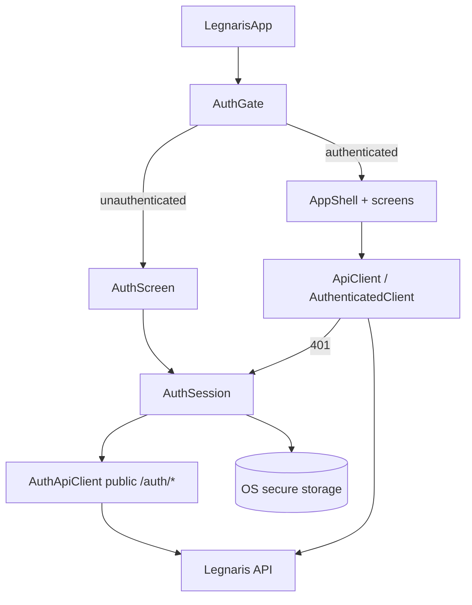

# Front End Fase 6 — Session Auth Design

**Spec**: `.specs/features/front-end-phase-6-auth/spec.md`
**Status**: Draft

---

## Architecture Overview

The V1 client deliberately isolated the HTTP transport "so V2 adds headers/tokens without rewriting features" (`docs/TDD-desktop-mvp.md` §Solução Técnica). This design uses exactly that seam: a session notifier owns the tokens, and an `AuthenticatedClient` decorator wraps the single injected `http.Client` to add the bearer header and to refresh-and-replay on `401`. Domain screens are unchanged except for a gate in front of them and the switch from the local library to `GET /sheets`.

The one cycle to break: the transport needs the access token and a refresh action, while the session needs the transport to log in. Splitting the client resolves it — the **domain client** is authenticated and delegates token concerns to the session, and the **auth client** is a plain transport that only calls the public `/auth/*` routes (which the decorator never authenticates or retries).



---

## Code Reuse Analysis

### Existing Components to Leverage

| Component | Location | How to Use |
| --------- | -------- | ---------- |
| Injected transport seam | `desktop/lib/api/api_client_provider.dart` | Wrap the injected `http.Client` in the decorator; keep the provider as the single override point |
| Envelope + apperr mapping | `desktop/lib/api/envelope.dart`, `error_mapper.dart` | Reuse for auth and `GET /sheets`; extend the code map if needed |
| Open sheet + edit flow | `desktop/lib/sheet/sheet_open_provider.dart`, `sheet_screen.dart` | Reuse to open the server sheet returned by `GET /sheets` (AD-005) |
| Create flow | `desktop/lib/catalog/create_sheet_dialog.dart` | Reuse for the `404` branch |
| Riverpod codegen providers | `desktop/lib/**/*.g.dart` | Follow the `@Riverpod` pattern; `keepAlive` for the session |
| l10n ARB | `desktop/lib/l10n/*.arb` | Add auth strings in both locales |
| Error mapping in UI | `error_mapper.dart` + screen messages | Same mapped-message pattern as open/save |

### Integration Points

| System | Integration Method |
| ------ | ------------------ |
| `POST /auth/login` / `register` / `refresh` / `logout` | Auth client; returns `TokenPair` in the body; refresh via `X-Refresh-Token` |
| `GET /sheets` | Domain client; resolves the single owned sheet or `404` |
| OS secure storage | `flutter_secure_storage`; stores only the refresh token |
| App root | `main.dart` swaps `home: AppShell(...)` for `home: AuthGate()` |

---

## Components

### `SecureTokenStore`

- **Purpose**: Persist and clear the refresh token in OS secure storage.
- **Location**: `desktop/lib/auth/secure_token_store.dart`
- **Interfaces**:
  - `Future<String?> read()`, `Future<void> write(String token)`, `Future<void> clear()`
  - An injectable provider so tests supply an in-memory fake (the platform channel is unavailable in tests)
- **Dependencies**: `flutter_secure_storage`.
- **Reuses**: the injected-directory/provider convention from AD-003.

### `AuthApiClient` (public transport)

- **Purpose**: Call the unauthenticated `/auth/*` endpoints without the decorator.
- **Location**: `desktop/lib/api/auth_api_client.dart`
- **Interfaces**: `login`, `register`, `refresh(refreshToken)`, `logout(refreshToken)` returning the decoded body or a mapped error.
- **Dependencies**: a plain `http.Client`.
- **Reuses**: `envelope.dart`, `error_mapper.dart`, `api_config.dart`.

### `ApiClient` (domain transport, extended)

- **Purpose**: Add `getMySheet()` and expose the auth methods used by the session; keep the six existing endpoint methods unchanged.
- **Location**: `desktop/lib/api/api_client.dart`
- **Interfaces**: existing methods; plus `Future<Sheet?> getMySheet()` (`GET /sheets`, `null` on `404`).
- **Dependencies**: the injected transport (now the decorator).
- **Reuses**: the `_get`/`_decode` helpers.

### `AuthenticatedClient` (decorator)

- **Purpose**: Add `Authorization: Bearer`, detect `401`, refresh once (single-flight), replay once, and never touch public routes. A rejected refresh (`401`) ends the session; a transient failure is kept.
- **Location**: `desktop/lib/api/authenticated_client.dart`
- **Interfaces**: `http.BaseClient.send`; constructed with the inner `http.Client` and a `SessionDelegate` (`currentAccessToken`, `refresh`, `onUnauthorized`).
- **Dependencies**: inner client, session delegate.
- **Reuses**: `http.BaseClient`.

### `AuthSession` (notifier)

- **Purpose**: Own the in-memory access token, restore/login/register/logout/refresh, and implement `SessionDelegate`.
- **Location**: `desktop/lib/auth/auth_session.dart`
- **Interfaces**: `AuthState` (unauthenticated / authenticating / authenticated); `restore()`, `login()`, `register()`, `logout()`, `refresh()`, `currentAccessToken()`.
- **Dependencies**: `SecureTokenStore`, `AuthApiClient`.
- **Reuses**: Riverpod `AsyncNotifier` pattern.

### `AuthScreen` + `AuthGate`

- **Purpose**: Login/register form behind a gate that decides between the auth screen and the shell.
- **Location**: `desktop/lib/auth/auth_screen.dart`
- **Interfaces**: `AuthGate` widget (mounted at `home`); `AuthScreen` form.
- **Dependencies**: `AuthSession`, l10n, theme tokens.
- **Reuses**: the desktop form/footer patterns and `desktop/AGENTS.md` tokens.

### Sheet resolution

- **Purpose**: After authentication, resolve the user's single sheet and route to open/create.
- **Location**: `desktop/lib/auth/authenticated_home.dart`
- **Interfaces**: watches the session, calls `getMySheet()`, opens it via the AD-005 open seam or shows the create flow on `404`.
- **Reuses**: `SheetOpenController`, `create_sheet_dialog.dart`.

---

## Data Models

```dart
class TokenPair {
  final String accessToken;
  final String refreshToken;
}

sealed class AuthState {}
class AuthUnauthenticated extends AuthState {}
class AuthAuthenticating extends AuthState {}
class AuthAuthenticated extends AuthState { final String accessToken; }
```

---

## Error Handling Strategy

| Error Scenario | Handling | User Impact |
| -------------- | -------- | ----------- |
| Invalid login/register | Mapped error from `error_mapper` | Inline message; fields kept |
| Expired access token | Decorator refreshes once and replays | Transparent |
| Revoked refresh family | Session clears storage, state → unauthenticated | Back to auth screen |
| Transient refresh failure (offline / `5xx`) | `refresh` rethrows; session and stored token kept; the call surfaces the mapped offline/server error | Retry the action |
| `GET /sheets` 404 | Show create flow | Create sheet |
| `GET /sheets` 5xx / offline | Mapped message + Retry; session kept | Retry |
| Secure storage unavailable | In-memory session only | Works this run; login next launch |
| Logout while in flight | Session version guard discards late responses | Stays logged out |

---

## Risks & Concerns

| Concern | Location (file:line) | Impact | Mitigation |
| ------- | -------------------- | ------ | ---------- |
| New dependency `flutter_secure_storage` | `desktop/pubspec.yaml` | Violates the no-new-package default if unjustified | TDD §V2 requires OS secure storage; the PR justifies it |
| Secure storage platform channel unavailable in tests | `desktop/test/**` | Tests hang or throw | Injectable `SecureTokenStore` with an in-memory fake |
| Transport/session cycle | `api_client_provider.dart:12` | Provider init deadlock | Split auth (plain) and domain (decorated) clients |
| Existing widget tests assume the app renders without a session | `desktop/test/catalog/**`, `desktop/test/sheet/**` | Suite breaks once the gate mounts | Tests override the session provider to authenticated; done in the gate task |
| Local library now redundant with `GET /sheets` | `desktop/lib/library/**` | Dead code / double source of truth | Feature stops depending on it; removal tracked as a follow-up |
| Refresh stampede | `authenticated_client.dart` | Multiple concurrent refreshes revoke the family | Single-flight refresh (FE6-11) |
| Desktop TDD still says "httpOnly cookie" | `docs/TDD-desktop-mvp.md:237` | Stale contract | Follow LGN-111 (`X-Refresh-Token`); note in the PR |

---

## Tech Decisions (only non-obvious ones)

| Decision | Choice | Rationale |
| -------- | ------ | --------- |
| Where auth logic lives | A decorator over the injected `http.Client`, not in endpoint methods | Matches the documented FE1-07 extension point; features stay untouched |
| Public vs protected routing | The decorator skips `/auth/*` and `/health` | Prevents refreshing during login and avoids attaching tokens to public calls |
| Cycle break | Separate plain `AuthApiClient` for `/auth/*` | Keeps the authenticated client from calling itself during refresh |
| Access token storage | Memory only | TDD §V2 — Auth |
| Post-login sheet source | `GET /sheets` replaces the local library as the source of truth | Backend enforces one sheet per user |
| Login/register surface | One screen with a mode switch | Fewest surfaces; no verification step exists |

> **Project-level decisions:** none - feature-local and driven by the backend contract.
