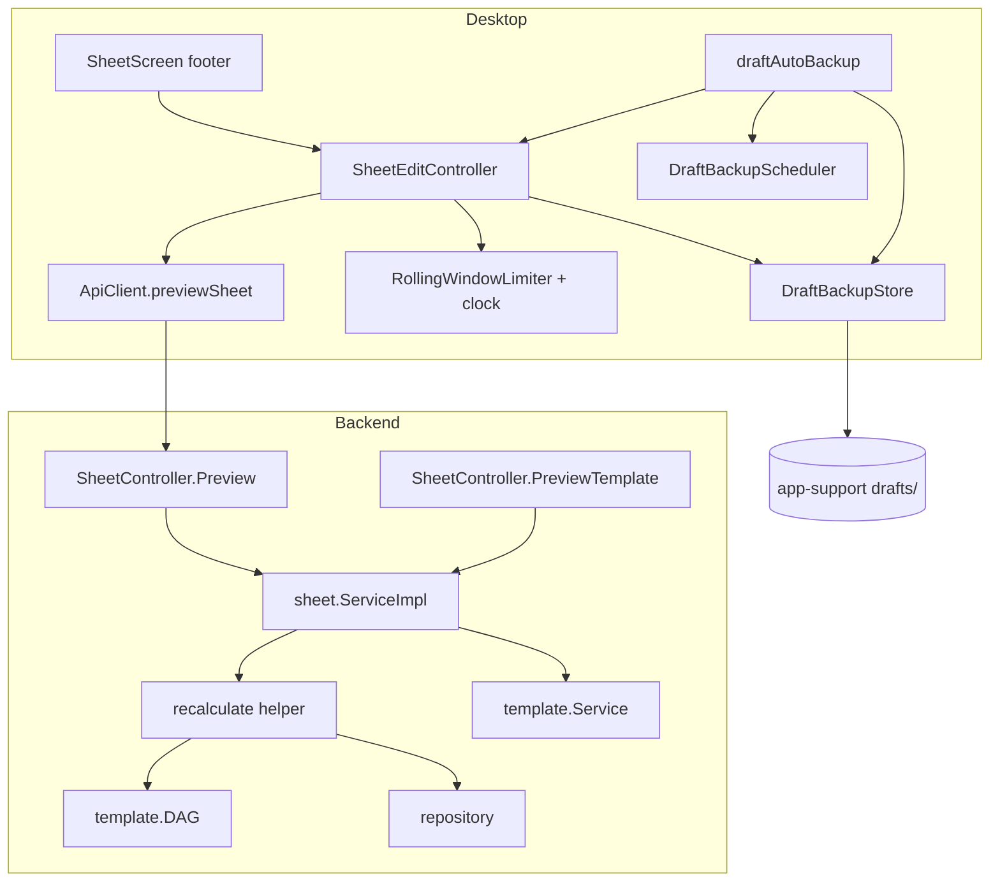

# Sheet Preview Dry-Run Design

**Spec**: `.specs/features/lgn-103-104-sheet-preview-dry-run/spec.md`
**Status**: Draft

---

## Architecture Overview

The backend gains two stateless preview routes that reuse one recalculation helper; persistence stays in `PartialUpdate`. The desktop gains a Preview action on Screen 2 backed by an extended `SheetEditController`, plus a per-sheet draft backup with an injected scheduler and clock.



### Approach choice

| Approach | Trade-off | Verdict |
| -------- | --------- | ------- |
| **A (chosen)** — both previews on `sheet.Service`, one shared `recalculate` helper; desktop extends `SheetEditController` and adds a `DraftBackupStore` + injected scheduler/clock | Sheet service already holds `template.Service`, the DAG provider and `buildNestedAllFields`; one recalc path; one edit-state family keeps AD-001/AD-004/AD-005 scope consistency | Adopt |
| B — `PreviewTemplate` on `template.Service`; a separate desktop `SheetPreviewController` family | Template package has no DAG provider and must stay `apperr`-free; a second edit-state family would resolve in the parent container and read an unseeded state (AD-004) | Reject |
| C — desktop re-implements the formula preview locally | Duplicates the DAG/engine in Dart, diverges from the backend contract | Reject |

---

## Code Reuse Analysis

### Existing Components to Leverage

| Component | Location | How to Use |
| --------- | -------- | ---------- |
| PATCH recalculation | `internal/sheet/service.go:148` (`PartialUpdate`) | Extract the fetch → flatten → `NormalizeAndRecalculate` → merge steps into one helper the previews call |
| Template seed | `internal/sheet/service.go:322` (`buildNestedAllFields`) | Seed the template preview exactly like `Create` |
| DAG entry point | `internal/sheet/template/dag.go:614` (`NormalizeAndRecalculate`) | Single-lock validate + normalize + recalc; unchanged |
| Error translators | `internal/sheet/service.go:204` (`translateTemplateErr`, `translateDAGErr`, `translateMapErr`, `translateRepoErr`) | Reused verbatim by the previews so errors are 1:1 with PATCH |
| Success envelope | `shared/response/response.go` (`OK`) | Preview handlers return the cascade through it, like PATCH |
| Cascade merge | `desktop/lib/engine/sheet_defaults.dart:41` (`mergeCascade`) | Merge the preview cascade into the draft; same helper the save uses |
| Sheet seeding | `desktop/lib/engine/sheet_defaults.dart:32` (`seedFromSheet`) | Restore overlays the draft on the stored sheet |
| Atomic file write | `desktop/lib/library/sheet_library_store.dart:151` (temp + rename) | Same pattern for the draft store |
| Injected periodic clock | `desktop/lib/connection/health_scheduler.dart` | Same interface/provider shape for the draft backup scheduler |
| Field editability | `desktop/lib/engine/field_grouping.dart:38` (`buildSections().leaves`, `FieldSchema.isEditable`) | Filter a restored draft to editable leaves |
| App-support directory | `desktop/lib/library/sheet_library_provider.dart:15` (`appSupportDirectoryProvider`) | Root the drafts directory |

### Integration Points

| System | Integration Method |
| ------ | ------------------ |
| `POST /sheets/:id/preview` | New `ApiClient.previewSheet` posts `{"data": delta}` on the existing `_post` (no retry, same envelope decode) |
| `POST /templates/:id/preview` | Registered through `SheetController` on the `/templates` group; no desktop consumer yet |
| Draft storage | `<appSupport>/drafts/<sheet_id>.json`; the library store's directory seam is injected at bootstrap |
| Draft lifecycle hooks | `SheetEditController.save` success, screen discard confirms, `SheetOpenController._evict`, `library_section` removal |

---

## Components

### Backend: shared recalculation helper

- **Purpose**: Evaluate a delta against a stored sheet once, returning the normalized update, the cascade and the merged data.
- **Location**: `internal/sheet/service.go`
- **Interfaces**:
  - `recalculate(ctx, sheetID string, data map[string]any) (*recalculation, error)` — require ID, fetch sheet, resolve DAG, flatten, `NormalizeAndRecalculate`, deep-merge; no write.
- **Dependencies**: `repository`, `DAGProvider`, `maputils`, `translate*` helpers.
- **Reuses**: the exact sequence inside `PartialUpdate`.

### Backend: `sheet.Service` preview methods

- **Purpose**: Expose the helper as the two preview operations.
- **Location**: `internal/sheet/service.go` (interface + impl), command in `internal/sheet/service.go`
- **Interfaces**:
  - `Preview(ctx, cmd PartialUpdateSheetCommand) (map[string]any, error)` — helper + `nestedCascadingEffects`, no persist.
  - `PreviewTemplate(ctx, cmd PreviewTemplateCommand) (map[string]any, error)` — `FetchTemplate` + DAG + `buildNestedAllFields` + seed recalc + `NormalizeAndRecalculate` over the seed, no persist.
- **Dependencies**: `template.Service`, `DAGProvider`.
- **Reuses**: `buildNestedAllFields`, `nestedCascadingEffects`, the translators.

### Backend: preview routes

- **Purpose**: HTTP surface for both previews.
- **Location**: `internal/app/sheet.go` (handlers), `internal/app/router.go` (registration)
- **Interfaces**:
  - `SheetController.Preview` → `POST /sheets/:id/preview`
  - `SheetController.PreviewTemplate` → `POST /templates/:id/preview`, registered on the `/templates` group
- **Dependencies**: `sheet.Service`, `shared/json`, `shared/response`.
- **Reuses**: `decodeError`, the PATCH handler shape.

### Desktop: API client preview

- **Purpose**: One typed method for the dry-run.
- **Location**: `desktop/lib/api/api_client.dart`
- **Interfaces**: `Future<Map<String, Object?>> previewSheet(String sheetId, Map<String, Object?> delta)`.
- **Dependencies**: `_post`, `_decode`.
- **Reuses**: `patchSheet`'s decode and the no-retry POST transport.

### Desktop: draft backup store

- **Purpose**: Read, atomically write, and delete one per-sheet draft delta.
- **Location**: `desktop/lib/sheet/draft_backup_store.dart`
- **Interfaces**:
  - `Map<String, Object?>? read(String sheetId)` — null on missing/corrupt.
  - `void write(String sheetId, Map<String, Object?> delta)` — atomic temp + rename; typed failure.
  - `void delete(String sheetId)` — best-effort.
- **Dependencies**: injected `Directory`.
- **Reuses**: `SheetLibraryStore`'s temp-file + rename pattern and versioned envelope.

### Desktop: draft backup scheduler

- **Purpose**: Fire a callback every 60 seconds while a draft is dirty.
- **Location**: `desktop/lib/sheet/draft_backup_scheduler.dart`
- **Interfaces**: `DraftBackupScheduler.start(void Function() onTick)` / `cancel()`; `PeriodicDraftBackupScheduler(interval = 60s)`; `draftBackupSchedulerProvider` (keepAlive, cancels on dispose).
- **Dependencies**: `dart:async`.
- **Reuses**: `HealthScheduler`'s interface/provider shape.

### Desktop: rate limiter and cooldown scheduler

- **Purpose**: Rolling 60-second windows for preview and save, and a one-shot to re-enable a blocked action.
- **Location**: `desktop/lib/sheet/action_rate_limiter.dart`
- **Interfaces**:
  - `RollingWindowLimiter({maxRequests, window, now})` — `isBlocked`, `record()`, `nextFreeAt()`.
  - `CooldownScheduler.schedule(Duration, void Function())` / `cancel()`; provider (keepAlive).
  - `clockProvider` — `DateTime Function()`; overridden in tests.
- **Dependencies**: `dart:async`, Riverpod.
- **Reuses**: the injected-clock pattern of `SheetLibraryStore(now:)`.

### Desktop: edit controller preview + rate-limit state

- **Purpose**: Own the preview cycle, the rate limits, the restored draft and the draft deletion.
- **Location**: `desktop/lib/sheet/sheet_edit_provider.dart`
- **Interfaces**:
  - `SheetEditState` gains `revision`, `previewedRevision`, `isPreviewing`, `previewError`, `isPreviewBlocked`, `isSaveBlocked`, `isBusy`.
  - `canPreview` (pending + revision advanced + not busy/blocked), `canSave`.
  - `preview()` — single-flight, sends one dry-run, merges the cascade without touching the baseline, records the revision, records the attempt.
  - `build` restores the draft backup (editable leaves only); `_applySaved` deletes the backup on success; `save()` guards on `isSaveBlocked`.
- **Dependencies**: `apiClientProvider`, `DraftBackupStore`, `RollingWindowLimiter`, `clockProvider`.
- **Reuses**: `mergeCascade`, `pendingDelta`, `failureCopy`.

### Desktop: draft auto-backup coordinator

- **Purpose**: Write the current delta on each tick while the sheet is dirty.
- **Location**: `desktop/lib/sheet/draft_auto_backup.dart`
- **Interfaces**: `draftAutoBackup(sheetId)` provider watching `isPending`; starts the scheduler when pending, cancels otherwise; on tick writes `pendingDelta`.
- **Dependencies**: `draftBackupSchedulerProvider`, `draftBackupStoreProvider`, `sheetEditControllerProvider`.
- **Reuses**: the `select`-based listener pattern (AD-001).

### Desktop: footer Preview action and draft cleanup hooks

- **Purpose**: Render Preview next to Save with the disabled tooltips, protect the in-flight state, and delete the draft on discard/eviction/removal.
- **Location**: `desktop/lib/sheet/sheet_screen.dart`, `desktop/lib/sheet/sheet_open_provider.dart`, `desktop/lib/catalog/library_section.dart`
- **Interfaces**: `sheet-preview` button + preview tooltips; `_leave`/`_refreshTemplate` delete the draft on confirm; `_evict` and library removal delete the draft.
- **Dependencies**: `sheetEditControllerProvider`, `draftBackupStoreProvider`, `AppLocalizations`.
- **Reuses**: the existing footer `Consumer`, the discard confirmations, `libraryRemoveAction`.

---

## Data Models

### Draft backup file (`<appSupport>/drafts/<sheet_id>.json`)

```json
{
  "schema_version": 1,
  "sheet_id": "0190a...-uuid-v7",
  "delta": { "stats": { "dexterity": 16 } },
  "saved_at": "2026-10-04T13:00:00.000Z"
}
```

**Relationships**: One file per sheet id; `delta` mirrors the PATCH payload (editable leaves only).

### `SheetEditState` additions

```dart
final int revision;              // increments on every data-changing edit
final int? previewedRevision;    // revision at the last successful preview (null after save)
final bool isPreviewing;         // dry-run in flight
final String? previewError;      // mapped copy of the last preview failure
final bool isPreviewBlocked;     // preview rate limit reached
final bool isSaveBlocked;        // save rate limit reached
bool get isBusy => isSaving || isPreviewing;
```

---

## Error Handling Strategy

| Error Scenario | Handling | User Impact |
| -------------- | -------- | ----------- |
| Preview unknown field / derived / conflict / too deep | `translateDAGErr` → same `apperr` code as PATCH | Mapped copy inline in the footer |
| Preview sheet missing / malformed id | `requireSheetID` + `translateRepoErr` → `400` / `404` | Mapped copy; edits kept |
| Template preview missing/malformed/unknown | `translateTemplateErr` / DAG lookup → `400` / `404` | Mapped copy (no desktop consumer yet) |
| Preview transport failure | Client throws `ApiDomainException(offline)` | Mapped copy; edits kept; Preview stays enabled |
| Rate limit reached | Action disabled + limit tooltip | Action re-enables after the window |
| Draft write failure | Swallowed best-effort | Editing continues, no error |
| Draft read/corrupt | `read` returns null | Clean seed from the stored sheet |
| Restored draft key no longer editable | Filtered out against `buildSections` | Key ignored, no phantom delta |

---

## Risks & Concerns

| Concern | Location (file:line) | Impact | Mitigation |
| ------- | -------------------- | ------ | ---------- |
| Preview merging an older cascade over a newer baseline | `desktop/lib/sheet/sheet_edit_provider.dart` | Drifted draft | Shared single-flight: any in-flight preview/save disables both actions (SVE-01) |
| Restored draft carrying a stale/unknown leaf | `desktop/lib/sheet/sheet_edit_provider.dart:96` (`build`) | `UNKNOWN_FIELD` on the next save | Filter the restored delta to `buildSections(template.fields)` editable leaves (DRB-07) |
| Keep-alive scheduler shared by an autoDispose controller | `desktop/lib/sheet/draft_auto_backup.dart` | Leaked timer after leaving | Coordinator cancels when `isPending` flips false and on dispose; one open sheet only |
| Rate limit re-enable needs a timer, and tests must not wait | `desktop/lib/sheet/action_rate_limiter.dart` | Flaky tests | Injectable `clockProvider` + `CooldownScheduler`; tests drive both |
| Reading the draft in `build` after a failed save | `desktop/lib/sheet/sheet_edit_provider.dart:96` | A discarded field re-appearing | The backup is only written while dirty and deleted on save/discard; a failed save legitimately keeps it |
| `PartialUpdate` refactor changing PATCH behavior | `internal/sheet/service.go:148` | Regression on the stable endpoint | T1 extracts the helper without contract change and keeps the existing PATCH tests green |
| `preview` returns only the cascade; a client merging it must not treat it as a full sheet | `desktop/lib/sheet/sheet_edit_provider.dart` | Missing derived keys stay at their last value | `mergeCascade` is incremental by contract; tests assert untouched keys survive |

---

## Tech Decisions (only non-obvious ones)

| Decision | Choice | Rationale |
| -------- | ------ | --------- |
| Preview shares the PATCH recalc path | One private `recalculate` helper; persistence only in `PartialUpdate` | Card requirement; a copy would drift |
| Preview idempotency by edit revision | Integer `revision` instead of deep map equality | Cheap, deterministic, no `package:collection` dependency |
| Single shared in-flight guard | `isBusy` blocks Preview and Save together | Prevents out-of-order cascade merges |
| Timers/clock injected via providers | `draftBackupSchedulerProvider`, `cooldownSchedulerProvider`, `clockProvider` | Deterministic tests, no new package (`fake_async`) |
| Draft filter on restore | Keep only editable leaves present in the loaded template | A template can change between runs |

> **Project-level decisions:** recorded in `.specs/STATE.md` as AD-007 (stateless preview reuses the PATCH recalculation path) and AD-008 (per-sheet atomic draft backups under the app-support directory with injected clock/scheduler).
