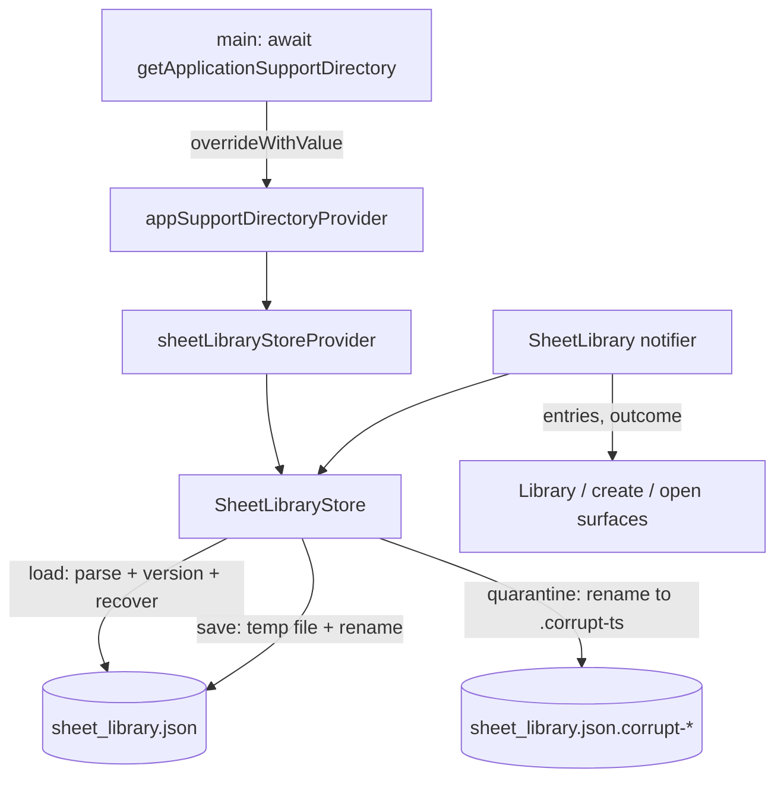

# Local Sheet Library Design

**Spec**: `.specs/features/lgn-107-local-sheet-library/spec.md`
**Status**: Draft

---

## Architecture Overview

A single versioned JSON file in the OS application-support directory holds the sheet index. All file access sits behind `SheetLibraryStore`, injected with a `Directory` so unit tests never touch the `path_provider` platform channel. A `keepAlive` Riverpod notifier owns the in-memory index, performs `upsert`/`remove` as pure list operations, and calls `store.save(...)` write-through: state is replaced only after the file is written, so a failed write leaves memory equal to what is on disk.



---

## Code Reuse Analysis

### Existing Components to Leverage

| Component | Location | How to Use |
| --------- | -------- | ---------- |
| Riverpod codegen notifier pattern (`@Riverpod(keepAlive: true) class X extends _$X`) | `desktop/lib/catalog/catalog_provider.dart` | Apply the same shape to `SheetLibrary` |
| Provider override-for-tests pattern | `desktop/test/sheet/sheet_edit_provider_test.dart` (overrides `apiClientProvider`) | Override `appSupportDirectoryProvider` with a `Directory.systemTemp` subdir in tests |
| Typed exception mirroring `ApiError` | `desktop/lib/api/api_error.dart` | Model `SheetLibraryException` after it (kind + message) |
| JSON encode/decode | `desktop/lib/api/envelope.dart` | Same `dart:convert` usage for the envelope |
| Model with `id` / `name` / `templateId` / `createdAt` | `desktop/lib/api/models/sheet.dart` | Field names and ISO-8601 handling; the entry is a lean copy without the `data` payload |

### Integration Points

| System | Integration Method |
| ------ | ------------------ |
| App bootstrap (`desktop/lib/main.dart`) | Resolve the support directory before `runApp` and override `appSupportDirectoryProvider` |
| Riverpod (`flutter_riverpod` 3.x codegen) | New `lib/library/` providers, generated via `build_runner` |
| Create / open / library surfaces (later cards) | Call `ref.read(sheetLibraryProvider.notifier).upsert(...)`, `.remove(id)`; watch `sheetLibraryProvider` for the list |

---

## Components

### SheetLibraryEntry (model)

- **Purpose**: One stored index entry, exactly the four persisted fields.
- **Location**: `desktop/lib/library/sheet_library_entry.dart`
- **Interfaces**:
  - `factory SheetLibraryEntry.fromJson(Map<String, Object?> json)` — reads `id`, `name`, `template_id`, `created_at`; throws `FormatException` on a missing/invalid field.
  - `Map<String, Object?> toJson()` — writes `created_at` as ISO-8601 UTC.
  - `bool get isValid` — `id`, `name`, and `templateId` are all non-empty.
  - Fields: `String id`, `String name`, `String templateId`, `DateTime createdAt`.
- **Dependencies**: `dart:convert` only.
- **Reuses**: field naming from `Sheet`; deliberately not `Sheet` itself (no `data`).

### LibraryLoadOutcome / LibraryLoadResult

- **Purpose**: Report how the store loaded without throwing (LIB-14 … LIB-19).
- **Location**: `desktop/lib/library/sheet_library_store.dart`
- **Interfaces**:
  - `enum LibraryLoadOutcome { loaded, quarantined, empty }`
  - `class LibraryLoadResult { final LibraryLoadOutcome outcome; final List<SheetLibraryEntry> entries; }`
- **Dependencies**: none.

### SheetLibraryException

- **Purpose**: Typed failure for the write path (LIB-11, LIB-20).
- **Location**: `desktop/lib/library/sheet_library_exception.dart`
- **Interfaces**:
  - `enum SheetLibraryErrorKind { writeFailed, invalidEntry }`
  - `class SheetLibraryException implements Exception { final SheetLibraryErrorKind kind; final String message; }`
- **Dependencies**: none.
- **Reuses**: the kind + message shape of `ApiError`.

### SheetLibraryStore

- **Purpose**: The persistence boundary: load with versioning/recovery, save atomically. Stateless over entries; the caller passes the complete list.
- **Location**: `desktop/lib/library/sheet_library_store.dart`
- **Interfaces**:
  - `SheetLibraryStore({required Directory directory, String fileName = 'sheet_library.json'})`
  - `LibraryLoadResult load()` — steps below; never throws for bad input, only returns an outcome.
  - `void save(List<SheetLibraryEntry> entries)` — validates, encodes `{schema_version, sheets}`, writes `<file>.<pid>.tmp` (per process), then `rename` over `<file>`; throws `SheetLibraryException` on failure.
  - `static const int currentSchemaVersion = 1;`
  - `static const Map<int, JsonMigrator> migrations = {};` with `typedef JsonMigrator = Map<String, Object?> Function(Map<String, Object?> envelope)` keyed by the version migrated from.
- **load() steps**:
  1. Target file absent → `LibraryLoadResult(empty, const [])`.
  2. Delete leftover `<file>[.<pid>].tmp` files (crash residue from this or an earlier process), ignore their absence.
  3. Read + `jsonDecode`. Empty/whitespace body, invalid JSON, non-object root, non-int `schema_version`, malformed `sheets`, or any entry that fails `fromJson`/`isValid` → **quarantine** and return `empty`.
  4. `schema_version > currentSchemaVersion` → **quarantine**, return `empty`.
  5. `schema_version < currentSchemaVersion` → apply `migrations` from the stored version up to current; a missing step → **quarantine**, return `empty`.
  6. Otherwise return `LibraryLoadResult(loaded, entries)`.
  - **quarantine()**: `renameSync('<file>.corrupt-<UTC compact timestamp>')` in the same directory (preserves the original bytes). If the rename itself fails, still return `empty` (best effort) and leave the file in place, to be overwritten on the next successful `save`.
- **Dependencies**: `dart:io`, `dart:convert`, `SheetLibraryEntry`.
- **Reuses**: none (first local persistence in the app).

### appSupportDirectoryProvider

- **Purpose**: Supply the injected support directory; the test seam for the platform channel.
- **Location**: `desktop/lib/library/sheet_library_provider.dart`
- **Interfaces**:
  - `@Riverpod(keepAlive: true) Directory appSupportDirectory(Ref ref)` — body throws `StateError('appSupportDirectoryProvider must be overridden at bootstrap')`. `main()` and every test override it.
- **Dependencies**: `dart:io`, Riverpod codegen.

### sheetLibraryStoreProvider

- **Purpose**: Build the store from the injected directory.
- **Location**: `desktop/lib/library/sheet_library_provider.dart`
- **Interfaces**:
  - `@Riverpod(keepAlive: true) SheetLibraryStore sheetLibraryStore(Ref ref) => SheetLibraryStore(directory: ref.watch(appSupportDirectoryProvider));`

### SheetLibrary (notifier) + SheetLibraryState

- **Purpose**: The in-memory index and the only state the surfaces read.
- **Location**: `desktop/lib/library/sheet_library_provider.dart`
- **Interfaces**:
  - `class SheetLibraryState { final List<SheetLibraryEntry> entries; final LibraryLoadOutcome outcome; }` where `entries` is the sorted "list" view (created_at descending, reverse-insertion tie-break).
  - `@Riverpod(keepAlive: true) class SheetLibrary extends _$SheetLibrary`
    - `SheetLibraryState build()` — `store.load()`, keep the insertion order privately, publish the sorted entries and the outcome.
    - `void upsert(SheetLibraryEntry entry)` — replace by `id` or append in insertion order; `store.save(next)`; on success publish the new sorted state, on failure rethrow with state unchanged (LIB-11, LIB-23).
    - `void remove(String id)` — absent → return without saving (LIB-06); present → `store.save(next)`, publish.
    - `SheetLibraryEntry? entryFor(String id)` — lookup for the open flow (LIB-07).
- **Dependencies**: `sheetLibraryStoreProvider`, `SheetLibraryEntry`.
- **Reuses**: `Catalog`'s `keepAlive` notifier pattern.

---

## Data Models

### Persisted envelope (`sheet_library.json`)

```json
{
  "schema_version": 1,
  "sheets": [
    {
      "id": "01920f3a-...",
      "name": "Aria",
      "template_id": "fantasy_v1",
      "created_at": "2026-10-02T15:31:28.401Z"
    }
  ]
}
```

`created_at` is the API sheet's value stored verbatim as ISO-8601 UTC. The `data` payload is never part of this model.

---

## Error Handling Strategy

| Error Scenario | Handling | User Impact |
| -------------- | -------- | ----------- |
| Store file never written | `load()` returns `empty`, no error | Library shows no sheets; creation works |
| Empty or corrupt JSON, malformed shape, bad entry | Quarantine the file, return `empty` (LIB-17) | Library starts empty; original file preserved as `.corrupt-*` |
| `schema_version` newer than supported | Quarantine, return `empty` (LIB-18) | App keeps running; bad file preserved |
| `schema_version` older, migration registered | Apply migration chain, return `loaded` (LIB-15) | Index survives the format change |
| `schema_version` older, no migration | Quarantine, return `empty` (LIB-16) | Library starts empty; file preserved |
| Disk/permission failure on save | Throw `SheetLibraryException.writeFailed`; notifier state unchanged (LIB-11) | Caller (create/save flow) maps and shows the error; in-memory list stays consistent |
| Invalid entry supplied | Throw `SheetLibraryException.invalidEntry`; no write (LIB-20) | Caller rejects the mutation |

---

## Risks & Concerns

| Concern | Location (file:line) | Impact | Mitigation |
| ------- | -------------------- | ------ | ---------- |
| `path_provider` uses platform channels, unusable in widget tests | new `lib/library/sheet_library_provider.dart` | Tests crash or hang if the channel is hit | `appSupportDirectoryProvider` throws a clear `StateError` and every test overrides it with a temp dir; the store only takes a `Directory` |
| Synchronous file I/O inside provider `build()` | new `sheet_library_store.dart` | UI stall if the file is large | Index holds IDs/names only, a few KB; the file was resolved at bootstrap anyway. Revisit if the index ever grows |
| Windows rename replace semantics | new `sheet_library_store.dart` | Temp+rename could leave the target untouched or throw | Verified `dart:io File.rename` removes an existing destination first; temp and target share one directory/filesystem |
| Crash between temp write and rename | new `sheet_library_store.dart` | A stale `.tmp` remains | `load()` deletes leftover `<file>[.<pid>].tmp` files; the target keeps its previous valid content |
| Quarantine rename itself fails | new `sheet_library_store.dart` | Bad file not moved aside | Recovery still returns `empty` and never crashes; the next successful `save` overwrites the file. Documented behavior |
| No desktop logging mechanism exists | new `lib/library/sheet_library_provider.dart` | Recovery is silent | The store reports `LibraryLoadOutcome` in state; a later logging card can consume it without changing the store |
| Test coverage gap for the new layer | `desktop/test/library/` | Untested recovery paths | Add store tests (temp dir) + provider tests (override) covering LIB-01 … LIB-23 |

---

## Tech Decisions (only non-obvious ones)

| Decision | Choice | Rationale |
| -------- | ------ | --------- |
| Storage backend | `path_provider: ^2.1.6` (`getApplicationSupportDirectory`) + a `dart:io` JSON file | The spec requires atomic replace and a byte-preserving quarantine of the bad file; `shared_preferences` hides its backing file, so those contracts cannot be guaranteed. `path_provider` is the strictly necessary first-party package for a portable writable app directory (`desktop/AGENTS.md` allows it) |
| Store API shape | Synchronous `load()` / `save()` | Dart's single isolate serializes calls within one process, so mutations cannot interleave (a second app instance is out of scope for this increment; the single-instance guard is deferred to the write-flows story) and no async state machine is needed; the file is tiny and the directory is resolved before the first frame |
| Directory injection | Resolve in `main()` via `WidgetsFlutterBinding.ensureInitialized()` + `getApplicationSupportDirectory()`, override `appSupportDirectoryProvider` | Keeps providers synchronous and keeps the platform channel out of tests |
| Envelope shape | Top-level `{schema_version: int, sheets: [...]}` | Matches the spec AC, gives a single place to key future migrations |
| Quarantine naming | `<fileName>.corrupt-<UTC compact timestamp>` | Distinct name per event, same directory (atomic rename), original bytes preserved |
| Persisted order | Insertion order | Keeps the reverse-insertion tie-break deterministic across restarts; the sorted view is computed for reads |

> **Project-level decision:** the local-persistence convention here (file-backed JSON in the app-support dir behind an injectable, versioned store) will be reused by the dev base-URL override and UI preferences. Recorded as `AD-003` in `.specs/STATE.md`.
