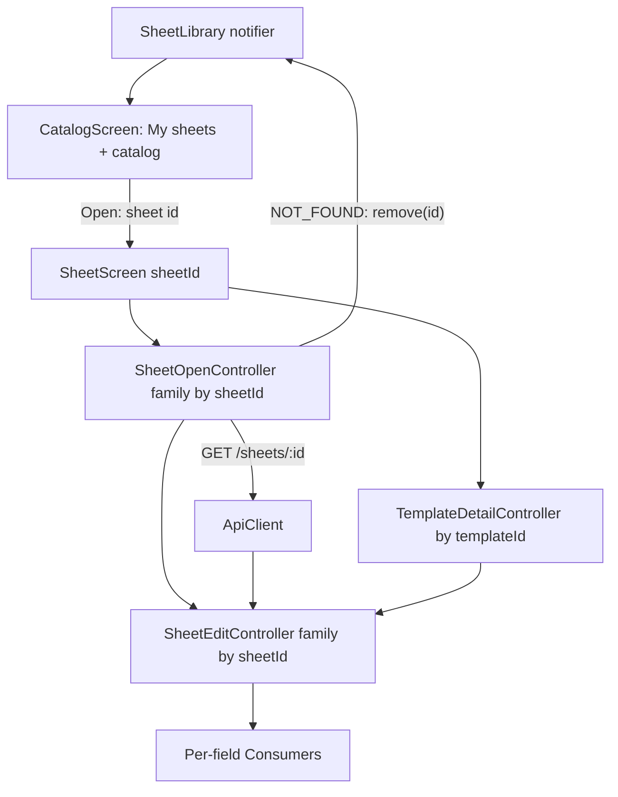

# Open Sheet from the Library Design

Source: [LGN-108](https://paulovalleriotedev.atlassian.net/browse/LGN-108). Spec: `.specs/features/lgn-108-open-sheet/spec.md`.

## Context

Four pieces already exist and are reused unchanged: `ApiClient.getSheet` (`desktop/lib/api/api_client.dart`, FE1-…), the local index `SheetLibrary` with `remove`/`entries` (`desktop/lib/library/sheet_library_provider.dart`, LGN-107), the mapped error copy `failureCopy` (`desktop/lib/api/api_error.dart`), and the edit state / discard guards (`desktop/lib/sheet/*`, LGN-102 + AD-004). The creation flow (LGN-109) already injects the `201` payload through `openedSheetProvider` into Screen 2.

The card changes Screen 2's identity from a *template* to an *opened sheet* and adds the "My sheets" surface on Screen 1. Per the confirmed user decisions (2026-10-03): Screen 2 owns the single `GET /sheets/:id`; `NOT_FOUND` removes the entry and shows a mapped message with no Retry; the "Preview sheet" action is removed.

## Architecture Overview

Screen 1 renders the local index and a catalog. Opening an entry pushes Screen 2 with the **sheet id**. A new `SheetOpenController` family (autoDispose, keyed by sheet id) owns the single GET, the loading/error state and the `NOT_FOUND` eviction. Screen 2 watches it, resolves the template id from the loaded sheet, then the existing `TemplateDetailController` renders the fields. The edit state family is retargeted from template id to **sheet id** and seeds each schema leaf from the schema default, overlaid by the sheet's stored values.



## Decision: the open seam

Add `desktop/lib/sheet/sheet_open_provider.dart`:

```dart
class SheetOpenState {
  const SheetOpenState({this.sheet, this.isLoading = false, this.errorMessage, this.isNotFound = false});
  final Sheet? sheet;
  final bool isLoading;
  final String? errorMessage;
  final bool isNotFound;
}

@riverpod
class SheetOpenController extends _$SheetOpenController {
  bool _inFlight = false;
  @override
  SheetOpenState build(String sheetId) { /* injected-or-GET, below */ }
  Future<void> load() async { /* single GET, error mapping, NOT_FOUND eviction */ }
}
```

- **Injected path (LGN-109)**: `build` first reads `openedSheetProvider`; when it carries a sheet whose `id == sheetId`, it returns `SheetOpenState(sheet: injected)` and schedules no GET (OPN-04/09). The creation route already overrides `openedSheetProvider` and the edit family in one nested `ProviderScope` (AD-004), so this holds with no new wiring.
- **Library path**: with no injection, `build` schedules `load()` and starts in `isLoading` (OPN-05). `load` is single-flight (`_inFlight`) and calls `getSheet(sheetId)`.
- **Error mapping**: on `ApiDomainException` with `kind == notFound` it calls `sheetLibraryProvider.notifier.remove(sheetId)` (best-effort, swallowed on `SheetLibraryException`) and publishes `isNotFound: true` with the missing-sheet copy (OPN-06). Any other failure publishes the `failureCopy` message and keeps the entry (OPN-07). Retry is the same `load()`; the single-flight guard makes rapid activations one request (OPN-08).
- **Disposal**: the family is autoDispose, so popping Screen 2 discards the open state and its edit state (OPN-16); a reopen re-issues the GET with no cache.

### Why screen 2 owns the GET

The card title places the request on Screen 2 and requires a loading state on open. Doing it in the route's provider keeps `NOT_FOUND` eviction next to the failure it belongs to and leaves Screen 1 a pure list. The preview action is removed so Screen 2 has exactly one mode: a stored sheet.

### Alternatives rejected

- **Fetch on Screen 1 before navigating** — the card title and AC place the loading state on Screen 2; Screen 1 would need a per-row in-flight state and the `NOT_FOUND` removal would happen away from the surface showing the error.
- **Keep the template-id family and add a second provider for sheets** — two edit states for one screen; the card explicitly retargets to sheet id.
- **Keep "Preview sheet"** — rejected by the user decision; it would force Screen 2 to support a second, fabricated-data mode.

## Components

### `desktop/lib/engine/sheet_defaults.dart` (change)

Add the per-key fallback derivation reused by the edit controller and unit-tested in isolation:

```dart
Map<String, Object?> seedFromSheet(FieldGroup fields, Map<String, Object?> data);
```

- Builds `seedDefaults(fields)`, then deep-overlays `data`: a stored value replaces the default at its path, a key absent in `data` keeps the schema default, and a stored key absent from the schema is carried over (OPN-10).
- Shares `setPathValue`/`seedValue`; no new mechanism.

### `desktop/lib/sheet/sheet_open_provider.dart` (new)

As above. Reuses `apiClientProvider`, `openedSheetProvider`, `failureCopy`, `sheetLibraryProvider.remove`, `ApiErrorKind.notFound`.

### `desktop/lib/sheet/sheet_edit_provider.dart` (change)

- Retarget the family argument to the **sheet id** and update the doc comment: the state is the edit session of one opened sheet (OPN-05).
- `build(String sheetId)` watches `sheetOpenControllerProvider(sheetId)`; once a sheet is present it watches `templateDetailControllerProvider(sheet.templateId)` and seeds `defaults`/`data` from `seedFromSheet(template.fields, sheet.data)` (OPN-10, OPN-11).
- `openedSheetProvider` keeps its role but its doc now reads: the creation flow injects the `201` payload; the library path leaves it null and the sheet is fetched by id. `setPath`/`setExclusive`/`isPending` are unchanged, so the guards keep working (OPN-16/17).

### `desktop/lib/sheet/sheet_screen.dart` (change)

- `SheetScreen({required this.sheetId})`; the template id is no longer a parameter (it comes from the loaded sheet).
- Watch `sheetOpenControllerProvider(sheetId)`. Body: loading while the sheet resolves or while the template detail loads after it; on `isNotFound` render the missing-sheet copy with no Retry; on any other sheet or template failure render `failureCopy` + Retry; otherwise the existing `SheetForm` (OPN-05/06/07/08).
- The form's field consumers switch to `sheetEditControllerProvider(widget.sheetId)`; the header title is `open.sheet?.name ?? ''`; the local-edits marker and both discard guards read the sheet-id provider (OPN-16/17/18).
- `activeSheetIdProvider.set(widget.sheetId)` registers the open sheet for F5 dispatch; `_refreshTemplate` resolves the template id from the loaded sheet. No mutation is ever issued (OPN-19).

### `desktop/lib/catalog/library_section.dart` (new)

One widget for the Screen 1 section, taking `onOpen(SheetLibraryEntry)` and reading `sheetLibraryProvider`:

- Header "My sheets", then one 32px row per entry: `name` + `template_id` + Open (primary, calls `onOpen`) + Remove (destructive, `colorScheme.error`) (OPN-01/03).
- Empty: one localized line, no rows (OPN-02).
- Remove opens the confirmation dialog stating the local-only consequence; confirm calls `sheetLibraryProvider.notifier.remove(id)` and issues zero API requests; cancel keeps the row (OPN-12/13/14). A `SheetLibraryException` renders an inline local-library error and the row stays (OPN-15).

### `desktop/lib/catalog/catalog_screen.dart` (change)

- Embed `LibrarySection` above the catalog inside one shared scroll region so a long library never pushes the catalog off screen (design assumption).
- Remove the "Preview sheet" action and its handler; the only card action is Create sheet (OPN-20/21).
- `_openSheet(context, entry)` pushes `AppShell(content: SheetScreen(sheetId: entry.id))` with no override (library path fetches).
- `_openCreationDialog` still consumes `showDialog<Sheet>`; on a created sheet it pushes `SheetScreen(sheetId: created.id)` wrapped in the existing route-scoped `ProviderScope` overriding `openedSheetProvider` and the edit family, so no second GET is issued (OPN-04/09).

### l10n (`desktop/lib/l10n/app_en.arb` + regenerated)

New keys: `librarySectionTitle`, `libraryEmpty`, `libraryOpenAction`, `libraryRemoveAction`, `libraryRemoveDialogTitle`, `libraryRemoveDialogMessage`, `libraryRemoveConfirmAction`, `libraryRemoveCancelAction`, `libraryRemoveFailed`, `sheetLoading`, `sheetMissingMessage`. The obsolete `catalogPreviewAction` is removed.

## Data flow — open from the library

```
Screen 1 row [Open]
  → push AppShell(SheetScreen(sheetId))
      → SheetOpenController(sheetId): GET /sheets/:id   (loading)
          ├─ 200: SheetOpenState(sheet)
          │     → templateId = sheet.template_id
          │     → GET /templates/:id  (fields)
          │     → SheetEditController(sheetId) seeds defaults← schema, overlay← sheet.data
          │     → SheetForm renders; title = sheet.name; isPending = false
          ├─ 404: library.remove(sheetId) → SheetOpenState(error, isNotFound)
          │     → mapped message, no Retry, entry already gone from Screen 1
          └─ network/5xx: SheetOpenState(error) → mapped message + Retry (single-flight)
```

## Failure handling

| Failure | Behavior |
| ------- | -------- |
| `GET /sheets/:id` 404 | Remove the entry from the library (best-effort), show the missing-sheet message, no Retry (OPN-06) |
| `GET /sheets/:id` network/5xx/parse | Keep the entry, show `failureCopy` + Retry; Retry is one further GET (OPN-07/08) |
| `GET /templates/:id` failure after the sheet loaded | Show `failureCopy` + Retry, keep the entry and the loaded sheet (edge case) |
| Library write failure on removal | Keep the entry; inline `libraryRemoveFailed`; zero API requests (OPN-15) |
| Library write failure on `NOT_FOUND` eviction | Swallowed; the missing-sheet message still renders; no crash (edge case) |
| Creation flow `201` | Inject via `openedSheetProvider`; no `GET /sheets/:id` (OPN-09) |

## Testing strategy

| Layer | Test | What it proves |
| ----- | ---- | -------------- |
| Seed derivation | `desktop/test/engine/sheet_defaults_test.dart` | Per-key fallback: stored value wins, missing key keeps default, unknown stored key carried (OPN-10) |
| Open controller | `desktop/test/sheet/sheet_open_provider_test.dart` | Injected short-circuit, one GET + loading, 404 removal + `isNotFound`, 5xx no removal + Retry single-flight (OPN-05/06/07/08/09) |
| Edit controller | `desktop/test/sheet/sheet_edit_provider_test.dart` | Family keyed by sheet id; seeding from sheet data over schema defaults; `isPending == false`; injection path (OPN-10/11) |
| Screen 2 | `desktop/test/sheet/sheet_screen_test.dart` | Loading, stored values over defaults, title, 404 message without Retry, 5xx + Retry, unchanged guards on a sheet id (OPN-05…18) |
| Library section | `desktop/test/catalog/library_section_test.dart` | Order, empty state, remove dialog + zero API, cancel, write failure (OPN-01/02/03/12/13/14/15) |
| Catalog + navigation | `desktop/test/catalog/catalog_screen_test.dart`, `desktop/test/catalog/create_sheet_navigation_test.dart` | No preview action; Open pushes Screen 2 and issues one sheet GET; create flow issues zero sheet GETs (OPN-04/09/20/21) |

Library and open assertions override `appSupportDirectoryProvider` with a fresh `Directory.systemTemp` (LGN-107 pattern) so no platform channel is hit.

## Risks & Concerns

| Concern | Location (file:line) | Impact | Mitigation |
| ------- | -------------------- | ------ | ---------- |
| Retargeting the edit family touches many existing tests | `desktop/test/sheet/sheet_screen_test.dart` (1441 lines) | Silent regressions if assertions are weakened | Mechanical `templateId` → sheet id change; keep every existing assertion, only the seed source parameter changes |
| `NOT_FOUND` removal inside a provider build/load | new `sheet_open_provider.dart` | Side effect during a read | Removal runs only in `load()` after a response, is idempotent (LIB-06), and is swallowed on write failure |
| Screen 1 tests do not override the support directory today | `desktop/test/catalog/catalog_screen_test.dart` | `StateError` once the library section mounts | Add `appSupportDirectoryProvider.overrideWithValue(tempDir)` to those test helpers |
| `seedFromSheet` sharing nested maps between `defaults`/`data` | `desktop/lib/engine/sheet_defaults.dart` | Cross-state mutation | `setPath` already copy-on-write clones the whole tree before writing; overlay creates new maps for overridden branches |

## Tech Decisions (only non-obvious ones)

| Decision | Choice | Rationale |
| -------- | ------ | --------- |
| Open-state provider shape | `SheetOpenState { sheet, isLoading, errorMessage, isNotFound }` in an autoDispose family keyed by sheet id | Mirrors `TemplateDetailState`; `isNotFound` distinguishes the no-Retry branch from the retryable one |
| Edit family key | Sheet id | Card scope; one edit session per stored sheet; autoDispose discards it on pop |
| Seeding | `seedFromSheet(fields, data)` = schema defaults overlaid by stored data | Card scope ("fallback ao default do schema quando a chave faltar"); keeps the UI Engine deriving fields generically |
| Preview removal | Delete the action and the template-only Screen 2 path | User decision; Screen 2 always renders a real sheet |
| Template fetch trigger | After the sheet resolves, from `sheet.template_id` | One source of truth for the template identity; the card's "1 GET" constrains the sheet request only |

> **Project-level decision:** the edit family is now keyed by the opened sheet id rather than the template id, and Screen 2 always renders a stored sheet loaded from the library (with the creation flow injecting the `201` payload). Recorded as `AD-005` in `.specs/STATE.md`.
