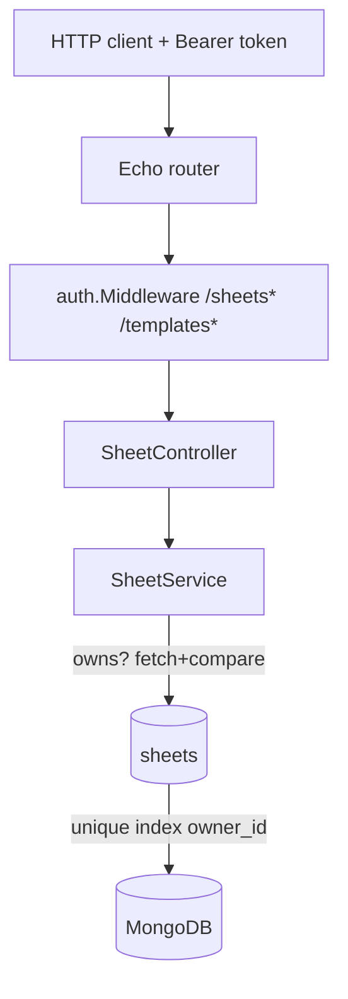

# Fase 2 — Ownership Design

**Spec**: `.specs/features/lgn-7-ownership/spec.md`
**Status**: Draft

---

## Architecture Overview

Ownership is enforced in three layers that already exist, so no new package is introduced: the JWT middleware (Fase 1) resolves the user id, the sheet service checks possession before touching a document, and a unique Mongo index makes "one sheet per user" a database invariant rather than a service convention.



The dependency direction is unchanged: `app → sheet → repository`; the middleware sits in front of the route groups and writes the user id into the Echo context, which the controller reads through `auth.UserID(c)`.

---

## Code Reuse Analysis

### Existing Components to Leverage

| Component | Location | How to Use |
| --------- | -------- | ---------- |
| JWT middleware | `internal/auth/middleware.go` | Apply to `/sheets` and `/templates` groups; read `auth.UserID(c)` in controllers |
| `TokenManager` | `internal/auth/token.go` | Already built in bootstrap; expose through `AuthModule` so the router can build the middleware |
| `apperr` boundary translation | `internal/sheet/service.go` (`translateRepoErr`, `translateTemplateErr`, `translateDAGErr`) | Extend `translateRepoErr` with the duplicate-owner case |
| `recalculate` helper | `internal/sheet/service.go:172` | Add the ownership check here so PATCH and preview both inherit it |
| Index bootstrap | `shared/db/indexes.go` | Add the `sheets.owner_id` unique index beside the auth indexes |
| Integration harness | `internal/app/integration_test.go` (`newIntegrationRouter`, `doRequest`) | Extend with an auth helper: register + login + authorized request |
| Mockery setup | `.mockery.yaml`, `internal/sheet/mocks/` | Regenerate after the `Repository`/`Service` interfaces change |

### Integration Points

| System | Integration Method |
| ------ | ------------------ |
| MongoDB | New unique index on `sheets.owner_id`; duplicate-key (11000) mapped at the repository boundary |
| Auth module | `AuthModule` gains the `TokenManager`; `NewRouter` applies the middleware to the two protected groups |
| HTTP layer | Two new routes (`GET /sheets`, `DELETE /sheets/:id`) on the existing `SheetController` |

---

## Components

### `Sheet` model

- **Purpose**: Own the sheet document shape, including its owner.
- **Location**: `internal/sheet/sheet.go`
- **Interfaces**: adds `OwnerID string` with bson tag `owner_id`.
- **Dependencies**: none.
- **Reuses**: existing struct.

### `SheetDTO`

- **Purpose**: API representation; deliberately unchanged.
- **Location**: `internal/sheet/dto.go`
- **Interfaces**: `ToDTO()` keeps its current field set (no `owner_id` on the wire).
- **Dependencies**: `shared/maputils` (deep copy).

### `Repository`

- **Purpose**: Persist and read sheets, and surface the duplicate-owner condition as a typed error.
- **Location**: `internal/sheet/repository.go`
- **Interfaces**:
  - `Create(ctx, sheet) error` — maps Mongo duplicate key on `owner_id` to `ErrSheetOwnerExists`.
  - `FetchByID(ctx, id) (*Sheet, error)` — unchanged.
  - `FetchByOwnerID(ctx, ownerID) (*Sheet, error)` — new; `ErrSheetNotFound` when none.
  - `PartialUpdate(ctx, id, dbUpdates) error` — unchanged.
  - `DeleteByID(ctx, id) error` — new; `ErrSheetNotFound` when zero documents matched.
- **Dependencies**: `mongo`, `shared/logger`.
- **Reuses**: existing collection handle and error sentinels.

### `Service`

- **Purpose**: Enforce ownership and the one-sheet rule; translate typed errors to `apperr`.
- **Location**: `internal/sheet/service.go`
- **Interfaces**:
  - `Create(ctx, cmd)` — `CreateSheetCommand` gains `OwnerID`; pre-check `FetchByOwnerID`, persist with the owner, map duplicate to `409 SHEET_LIMIT_REACHED`.
  - `FetchMySheet(ctx, ownerID)` — new; `FetchByOwnerID`, `404` when none.
  - `FetchByID(ctx, id, ownerID)` — owner-checked.
  - `PartialUpdate(ctx, cmd)` / `Preview(ctx, cmd)` — commands gain `OwnerID`; ownership checked inside `recalculate`.
  - `Delete(ctx, cmd)` — new; `DeleteSheetCommand{SheetID, OwnerID}`; owner-checked then `DeleteByID`.
  - `PreviewTemplate(ctx, cmd)` — unchanged (auth-only, no sheet).
- **Dependencies**: `Repository`, `template.Service`, `DAGProvider`.
- **Reuses**: `recalculate`, `requireSheetID`, the `translate*` helpers.

### `SheetController`

- **Purpose**: Read the authenticated user id and hand it to the service; expose the two new routes.
- **Location**: `internal/app/sheet.go`
- **Interfaces**: `FetchMySheet` (`GET ""`), `Delete` (`DELETE "/:id"`); existing handlers pass `auth.UserID(c)`.
- **Dependencies**: `sheet.Service`, `auth` (for `UserID`), `shared/json`, `shared/response`.
- **Reuses**: existing decode/response patterns.

### Router + bootstrap

- **Purpose**: Gate the protected groups behind the JWT middleware.
- **Location**: `internal/app/router.go`, `internal/app/bootstrap.go`
- **Interfaces**: `AuthModule.TokenManager`; `NewRouter` wraps `/sheets` and `/templates` with `auth.Middleware(tm)`.
- **Reuses**: Fase 1 `auth.Middleware`.

### Error codes

- **Purpose**: Give the limit violation its own wire code.
- **Location**: `shared/apperr/err.go`
- **Interfaces**: `CodeSheetLimitReached Code = "SHEET_LIMIT_REACHED"` mapping to `409`.

---

## Data Models

### Sheet (extended)

```go
type Sheet struct {
	ID         string         `bson:"_id,omitempty"`
	TemplateID string         `bson:"template_id"`
	OwnerID    string         `bson:"owner_id"`
	Name       string         `bson:"name"`
	Data       map[string]any `bson:"data"`
	CreatedAt  time.Time      `bson:"created_at,omitempty"`
	UpdatedAt  time.Time      `bson:"updated_at,omitempty"`
}
```

**Relationships**: `OwnerID` references `users._id`; it is never serialized to the API.

### Index

```go
database.Collection("sheets").Indexes().CreateOne(ctx, mongo.IndexModel{
	Keys:    bson.D{{Key: "owner_id", Value: 1}},
	Options: options.Index().SetUnique(true).SetName(sheetsOwnerIDUniqueIndex),
})
```

---

## Error Handling Strategy

| Error Scenario | Handling | User Impact |
| -------------- | -------- | ----------- |
| No / invalid bearer on a protected route | `auth.Middleware` → `apperr.CodeUnauthorized` (401) | `401 UNAUTHORIZED` |
| Second create for the same owner | `ErrSheetOwnerExists` → `CodeSheetLimitReached` (409) | `409 SHEET_LIMIT_REACHED` |
| Concurrent create losing the index race | same as above | `409 SHEET_LIMIT_REACHED` |
| `GET /sheets` with no owned sheet | `ErrSheetNotFound` → `CodeNotFound` (404) | `404 NOT_FOUND` |
| Foreign or missing sheet id | `ErrSheetNotFound` → `CodeNotFound` (404) | `404 NOT_FOUND` |
| Missing user id at the service boundary | `CodeUnauthorized` (401) | `401 UNAUTHORIZED` |
| Any other repository/Mongo error | `CodeInternal` (500) | `500 INTERNAL_ERROR` |

---

## Risks & Concerns

| Concern | Location (file:line) | Impact | Mitigation |
| ------- | -------------------- | ------ | ---------- |
| Integration tests call every sheet/template route without a token | `internal/app/integration_test.go:220` onward | Every existing sheet test fails `401` once the middleware lands | The wiring task updates the harness with a register/login helper and authorized requests in the same commit |
| `translateRepoErr` is generic and would collapse the duplicate-owner case into `500` | `internal/sheet/service.go:309` | A limit violation would surface as a server error | Add an explicit `ErrSheetOwnerExists` branch mapped to `SHEET_LIMIT_REACHED` |
| Desktop client sends no auth header | `desktop/lib/api/api_client.dart` | The Flutter app breaks against the protected API | Companion feature `front-end-phase-6-auth` (spec written alongside); recorded in Out of Scope |
| `FetchByID` then compare is a TOCTOU window | `internal/sheet/service.go:177` | A concurrent delete could let a write proceed against no document | Writes match by `_id`; a delete race yields `ErrSheetNotFound` from `DeleteByID` and the write no-ops — acceptable for V1 |
| Template preview `POST /templates/:id/preview` shares the templates group | `internal/app/router.go:32` | It becomes auth-gated (intended) but has no ownership concept | Documented: templates are read-only for every authenticated user (TDD §Autorização) |
| Legacy dev sheets have no `owner_id` | `sheets` collection (unique index at `shared/db/indexes.go:57`) | One legacy row becomes unreachable; 2+ rows block boot instead — the unique `owner_id` index build fails with `E11000` on duplicate `null` keys and `cmd/api.go:47` exits | Accepted: TDD prefers a dev-DB reset; no production data (Fase 6 pending) |

---

## Tech Decisions (only non-obvious ones)

| Decision | Choice | Rationale |
| -------- | ------ | --------- |
| Foreign-sheet response | `404`, identical to a missing sheet | Does not leak existence (LGN-22) |
| Which error code for the limit | New `SHEET_LIMIT_REACHED` (409) | Matches the TDD response contract instead of the generic `CONFLICT` |
| Where the owner check runs | In the service, by fetch + compare | Keeps the repository owner-agnostic and preserves the existing `translateRepoErr` 404 path |
| Where duplicate-key mapping runs | Repository (typed error) then service (`apperr`) | Keeps `apperr` out of the repository per `shared/db/AGENTS.md` |
| Delete semantics | Owner-checked, `204` on success, `404` on second call | Idempotent-by-response without a silent double delete |
| Middleware token manager source | `AuthModule.TokenManager` | The route builder needs the manager; bootstrap already constructs it |

> **Project-level decisions:** none - the choices above are feature-local and follow the TDD contract.

---

## Tips

- The unique index is the only real defense against the create race; the pre-check is UX only.
- Keep the ownership check before any recalculation so a foreign sheet is never computed.
- Update mocks (`make mocks`) in the same task that changes an interface.
