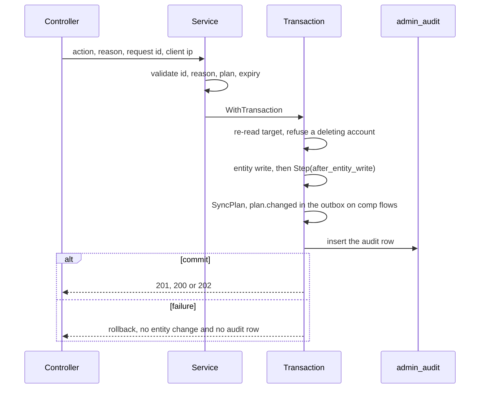

# Admin

## Purpose

The backoffice is the operator-only, API-only surface under `/admin/*`: read an
account's plan, subscription and quotas, grant or revoke a comp, reset today's
generation counter, queue a refund. Every write appends an `admin_audit` row.

## Why

- **API only** over a UI because the surface is small and rarely used, and a UI
  would duplicate session handling and drift; cost: curl and database access.
- **A boot-time allow-list** over a role model because users carry no roles; cost:
  every admin is all-powerful, and a change needs a restart.
- **404 for every identity or routing failure** over 403/405 because anything else
  confirms the routes exist and the caller is not allowed; cost: a stale token
  looks like a wrong path.
- **The audit inside the mutation transaction** over a follow-up write because the
  row is the only record of who moved a paying account, and a crash between the
  two writes would lie either way; cost: MongoDB transactions, and a failing audit
  aborts the operation.
- **The refund queue** over a synchronous provider call because refunds already
  retry and dead-letter; cost: `202 requested` is all the operator sees.

## Flows

The gate is the same for every route: an unmatched method or path, a missing or
invalid bearer token, an id outside `ADMIN_USER_IDS` and a missing or deleting
admin all answer `404 NOT_FOUND`. Only a store failure (500) and the per-user
limiter (429) answer differently. Reads write no audit row.

## Contracts

- **Apex domain for AdSense.** `ROOT_DOMAIN` (required deploy key, e.g. `paulovalleriote.io`) gets two Traefik routers: `root-ads-txt` serves `/ads.txt` from the web container (priority 1000), and `root` answers every other path with a 301 to `WEB_DOMAIN` (`root-to-web` redirectRegex). AdSense only accepts the apex domain, reads its `ads.txt` there and reviews whatever the apex serves. `root-www` applies the same redirect to `www.<ROOT_DOMAIN>` as a separate router, so a `www` certificate failure cannot block the apex certificate. Both DNS names must resolve to the VPS so Let's Encrypt can issue the certificates.

- **Deploy health gate excludes Prometheus.** `deploy/vps/deploy.sh` runs `up --wait --wait-timeout 180` on every service except `prometheus`, then starts `prometheus` without waiting: its WAL replay can outlast the gate, and monitoring must not roll back a healthy release.

- **Traefik dynamic config is a directory mount.** `deploy/traefik/` is mounted read-only at `/etc/traefik/dynamic` and watched by the file provider, so a deploy that replaces `dynamic.yml` (new inode) reaches the running proxy without a restart; a single-file bind mount would keep serving the old file.

- **AdSense settings (LGN-335).** `ADSENSE_CLIENT` and `ADSENSE_SLOT_{CATALOG,CAMPAIGNS,LANDING}` are optional deploy env keys (commented in `deploy/.env.example`, so the CD key check never requires them) passed to the web container, which writes them into `/config.json` and publishes `/ads.txt`; empty or invalid values turn ads off. The Traefik `web-security-headers` CSP admits the Google ad and CMP origins (`script-src`, `connect-src`, `frame-src`, `img-src https:`) and must stay identical to `web/config/security_headers.ts`.

- **Generation timeout and lease (LGN-384).** `LLM_TIMEOUT` is an optional deploy key, commented in `deploy/.env.example` and defaulted to `120s` in `deploy/docker-compose.yml`. The worker refuses a non-positive value and derives the job budget and the claim lease from it — 751.5 s at the default — so the setting must cover the slowest accepted model's schema and transport retries.

- **Generation breaker keys (LGN-448).** `LLM_BREAKER_THRESHOLD` (default 5) and `LLM_BREAKER_PROBE_INTERVAL` (default 60 s) are optional deploy keys, commented in `deploy/.env.example` and passed only to the worker. The environment check refuses non-positive values; the breaker opens after that many consecutive provider outages, admits one probe after the interval, closes on its success and fails a job fast as `provider_unavailable` while open.

| Method | Path | Body | Success |
| --- | --- | --- | --- |
| GET | `/admin/users/{id}` | — | 200 consolidated view |
| GET | `/admin/users?email=` | — | 200 consolidated view |
| POST | `/admin/users/{id}/comp` | `planId`, optional `expiresAt`, `reason` | 201 subscription |
| POST | `/admin/users/{id}/comp/revoke` | `reason` | 200 `{"status":"canceled"}` |
| POST | `/admin/users/{id}/quota/reset` | `reason` | 200 `{"status":"reset"}` |
| POST | `/admin/users/{id}/refund` | `override`, `reason` | 202 `{"status":"requested"}` |

**Allow-list.** `ADMIN_USER_IDS` is comma-separated canonical user ids (the
`users._id` value), trimmed with blanks dropped; unset or empty disables every
route. Each id is validated at boot and a malformed, uppercase or non-v7 value
makes the API refuse to start, naming the value. Requests authenticate with a
normal access token in `Authorization: Bearer`, not the cookie session.

**Errors.**

| Status | Code | When |
| --- | --- | --- |
| 400 | `INVALID_REQUEST` | malformed id, blank reason, reason over 500 runes or with control/format characters, free or unknown plan, expiry under an hour ahead, missing or malformed e-mail |
| 400 | `INVALID_JSON` / `UNKNOWN_FIELD` | unreadable body or unknown body field |
| 404 | `NOT_FOUND` | bad or missing token, id outside the allow-list, missing or deleting admin, unknown user, no live comp, unknown `/admin` path, wrong method, any `OPTIONS` |
| 409 | `CONFLICT` | target deleting, live subscription in `pending`/`active`/`past_due`, live subscription not a comp, comp changed concurrently |
| 409 | `REFUND_NOT_ELIGIBLE` | `details.reason` is `window_expired`, `already_used`, `not_subscribed` or `comp_not_refundable` |
| 429 | `RATE_LIMITED` | `/admin/*` shares the other user routes' per-user budget |
| 500 | `INTERNAL_ERROR` | store, plan-sync or transaction failure; nothing committed |

**Reason.** Mandatory on every write, trimmed, one to 500 runes, no control or
format characters, stored verbatim.

**View.** `user{id,email}`, `plan` from `users.plan` (the single source of truth),
`subscription` (null when none) and
`daily_quota{limit,used,remaining,resets_at}`. A Free account reports zero
remaining; AI generation is paid-only. The e-mail lookup tries the canonical
lowercase address, then the parsed spelling.

**Operations.** `planId` must be a real non-free plan and `expiresAt` at least one
hour ahead; an expired comp is CAS-canceled before the new one is inserted.
Revoke cancels the live comp immediately, and repeating it after a concurrent
cancel still answers 200 with a fresh audit row. Quota reset deletes today's
counter (idempotent). `override` skips only the refund window,
never a second refund, a missing paid subscription or a comp.

**Audit.** `_id` (UUID v7), `actor_user_id`, `action` (`comp.grant`,
`comp.revoke`, `quota.reset`, `refund.request`), `target_user_id`, `payload`,
`reason`, `request_id`, `client_ip`, `created_at`. `request_id` is the
server-generated `X-Request-ID` (a client value is ignored) and `client_ip` the
resolved client address. There is no update or delete path; boot indexes
`created_at`, target plus `created_at` and actor plus `created_at`.

## Code map

- `backend/internal/admin` — types, ports and messages in `admin.go`, operations
  in `service.go`, the insert-only audit store in `store.go`.
- `backend/internal/app` — `admin.go` routes, `router.go` group and 404 masks,
  `bootstrap.go` assembly; `backend/internal/auth/admin.go` the two gates.
- `backend/shared/env/env.go` for `ADMIN_USER_IDS`, `backend/shared/db/indexes.go`
  for the `admin_audit` indexes.
- `backend/internal/billing` — `comp_expiry.go`, `refund.go`, `store_comp.go`,
  `store_refund.go`, `plan_sync.go`: the rules the backoffice reuses.
- `deploy/grafana/dashboards/` — the provisioned API, load-test, email, funnel and `llm-generation` dashboards; the funnel one covers home visits, hero CTA clicks and the 24-hour first-Sheet activation baseline, and `llm-generation` covers provider latency, tokens, cost, invalid output, schema retries and the breaker.
- `.github/workflows/ci.yml` — the always-running `gate` job checks every
  tracked `.md` against `context/markdown-allowlist.txt` through
  `backend/cmd/markdown-check`; the same command backs the Claude Code
  `PreToolUse` hook in `.claude/settings.json`.
- `.github/workflows/prompt-evals.yml` — the generation prompt eval, manual and
  nightly only, never on a pull request; it reads the `OPENROUTER_API_KEY`
  secret and fails when the 90% gate or the US$ 1.00 cost cap is not met.

## Tools & dependencies

- MongoDB with replica-set transactions; one `db.Transactor` guards the entity
  write, the plan sync and the audit row.
- The billing ledger and plan sync, quota store, plan source, events outbox, the
  relay queues `billing_refunds` and `billing_comp_expiry`, `idgen`, `apperr`,
  `json` and the per-user limiter; no admin UI or external backoffice SDK.

## Known limits

- Production exposure and per-admin step-up are still open (LGN-262, LGN-263):
  treat `/admin/*` as reachable only from an operator network until both land.
- No role model, per-action permission or read auditing; the allow-list is
  all-or-nothing and only changes on restart.
- Raw database reads go through Mongo Express at `ops/mongo`, read-only on
  `legnaris` as `legnaris_view` with admin mode off: no server stats and no
  other databases (LGN-321).
- The audit has no retention or rotation; it grows forever and is queryable only
  through the database.
- The limiter can answer 429, the one gate failure not masked as 404.
- Refunds are asynchronous: 202 means queued on `billing_refunds`; re-read the
  account to confirm the provider refund and cancellation.
- Comp expiry is a system transition: `billing_comp_expiry` cancels expired comps
  hourly without an audit row, so a plan change can have no `admin_audit` entry.
- One account per call; no bulk operation and no search beyond an exact e-mail.
