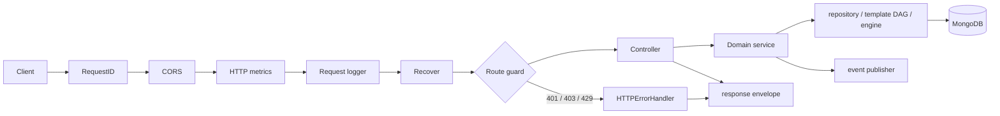
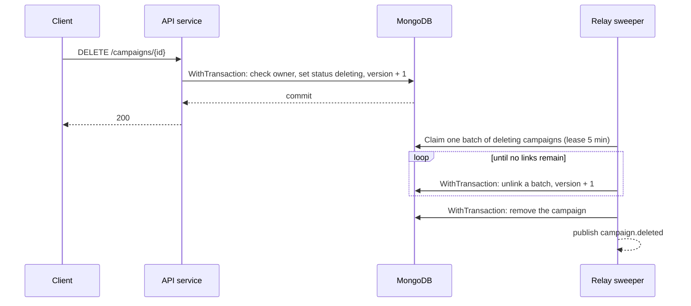

# Architecture

## Purpose

Legnaris is one Go module that builds three long-running processes from the
same code — the HTTP API, a relay that publishes mail and sweeps pending work,
and a worker that sends mail and, when enabled, runs generation — plus one-off
migration commands. The backend is a modular monolith: domain packages under
`backend/internal/`, reusable primitives under `backend/shared/`, and every
adapter built in one composition root. This file describes the layering, the
wiring, the shared primitives and the cross-cutting middleware that every area
inherits.

## Why

- **Modular monolith over services** because one repository, one database and
  one deployable image keep the operational surface small for a small team; the
  cost is that the import direction is held by review and this map, not by the
  network.
- **Composition in code over package globals** because `app.NewModules` takes
  its collaborators and returns modules, so a binary picks its adapters and a
  test picks doubles; the cost is one large constructor and module options when
  a binary needs different wiring.
- **Separate API, relay and worker over one process** because a broker outage,
  a mail provider incident or a slow language model must not reach HTTP, and
  each loop needs its own lifecycle; the cost is three deployments from one
  image and a metrics endpoint per loop.
- **Templates in code with a boot registry over template documents** because
  the DAGs are compiled once at startup and a sheet update reads no template
  collection; the cost is that changing a rule means a new template ID, and
  every old ID must stay readable while a sheet still references it.
- **A single-member replica set with transactions over standalone MongoDB and
  sagas** because flows write several documents and standalone cannot make them
  atomic, while three members on one host would share its failure domain; the
  cost is oplog disk, a replica set in every environment and integration tests,
  plus the rule that transactions on one aggregate bump its version.
- **Pending work on the entity plus one sweeper over events used as jobs**
  because the pending status is inspectable, retries and leases live next to
  the data, and a relay restart loses nothing; the cost is status, lease and
  attempt fields on each owning entity and a queue per workflow.
- **UUID v7 over v4 or ObjectId** because the time prefix makes lexicographic
  order equal creation order, so listings sort by `_id` and the index stays
  append-mostly; the cost is that ordering across instances depends on clock
  sync, and validation must reject every non-canonical encoding.
- **Typed errors translated at the boundary over HTTP-aware services**
  because services stay transport-agnostic and one handler serializes every
  failure; the cost is that a new lower-layer sentinel must be translated or it
  silently becomes a 500.
- **Redis counters over MongoDB counters, or accepting an N-times cap**
  because several API replicas need one exact sliding window per key and one
  round trip per guarded request; the cost is one stateless dependency whose
  counters vanish on restart.
- **Fail-open over fail-closed when the counter store is down** because a cache
  outage must not lock every player out of login; the cost is that during the
  outage the effective cap is the per-replica one.
- **Strict JSON decoding over permissive decoding** because unknown fields and
  oversized bodies fail where the mistake is; the cost is that every accepted
  field must be declared and clients must follow the contract.

## Flows

### HTTP request

The process-wide chain is installed once in `app.NewRouter`, in that order.
Route groups then add `auth.Middleware`, `auth.RejectDeleting` and the
per-user limiter; a route can add an address or account limiter of its own.
Guards return typed `apperr` values, which `HTTPErrorHandler` turns into the
single error envelope and sets `Retry-After` on any error that carries one.

`PATCH /sheets/:id` is the representative write: the controller decodes the
body with `shared/json`, takes the owner from the auth context and calls
`sheet.Service.PartialUpdate`. The service validates the id, loads the owned
sheet, asks the DAG to validate and recalculate the delta, validates the dice
block against the Template, then writes the merged data and the block in one
compare-and-swap update. The response carries only the cascade; a lost race is
a 409 the client resends as a new request.

`POST /sheets/:id/resets/:actionId` is the owner-only action write: the
controller decodes `{"request_id"}` and passes the path ids to
`sheet.Service.Reset`. The service checks ownership (a foreign or missing sheet
is 404), then the Template's declared action (unknown, 404), then the request
id (missing or not canonical, 400), all before the one compare-and-swap save.
A lost race is the usual 409; replaying the last applied id is a 200 carrying
the stored assigned and derived values with no write and no event.

### Transaction with pending work

A campaign deletion request only records the intent and releases the owner's
owned-campaign slot. The relay's `Sweeper` claims due work with a lease, runs
the queue handler, and either marks the item done, reschedules it for the next
pass, or marks it dead after the attempt cap.
The same shape covers account deletion, campaign deletion, generation
republish and reaping, refunds and the event outbox. `oldest_pending_seconds`
and `failed_total`, labelled by queue, are the operational contract.

## Contracts

- **Import direction** — `backend/cmd/*` imports `internal/app`, domain
  packages, `internal/platform/*` and `shared/*`. `internal/app` imports domain
  packages, platform and shared. A domain package imports the sibling domain
  packages it builds on (campaign uses sheet, generation uses sheet, template,
  llm and plan) plus shared primitives; `sheet/template` imports `engine`;
  `engine`, `dice` and `plan` are leaves. `shared/*` imports no domain package,
  and `platform` imports a domain package only to implement an interface that
  domain declares (metrics implements the auth, billing and sweeper observers).
  No production code under `internal/` imports `internal/app` or `cmd`.
- **Composition root** — each command builds its infrastructure and adapters in
  `main`/`run`: the API through `app.NewModules` and `app.NewRouter`, the relay
  and worker through their own dependency tables. It closes what it opened.
  There is no package-level singleton and no wiring in `init`.
- **Browser boundary** — CORS uses an explicit origin allowlist with
  credentials, allows `X-CSRF-Token`, exposes `X-Request-ID` and `ETag`, and
  names every accepted method. The API and the web client are separate origins,
  so cookie-bearing requests need an exact origin and an explicit preflight;
  the cost is that a new verb or header is a deliberate edit on both sides.
- **HTTP shape** — success is `{"data": ...}`; failure is
  `{"error": {"code", "message", "details?"}}`. Request bodies are capped at
  1 MiB, unknown fields and trailing data are rejected, and malformed JSON is
  `INVALID_JSON` rather than a controller-specific error.
- **Errors** — services and controllers produce `apperr.Error` with a settled
  `Code`, a user-facing message and either no cause or a lower-layer typed
  error. The handler maps the code to the status, defaults an unmapped code to
  500, and keeps `RetryAfter` on the response. Repositories, engine, json, db
  and idgen declare their own sentinels and do not import `apperr`.
- **IDs** — every server-generated ID is a canonical lowercase UUID v7 from
  `shared/idgen`. Client-provided ids pass `idgen.Validate` before the first
  repository call and map to a 400. Client-supplied request ids pass
  `idgen.ValidateRequestID` (canonical form, any RFC 4122 version) and map to a
  400. Template IDs are code-defined slugs and have their own validator.
- **Transactions** — a service receives a transactor (the `db.Transactor` or a
  small local interface), never opens a session. Every repository call inside
  the callback uses the callback context; the callback has no side effects
  outside the database because the driver may re-run it. Commitment is
  `w: majority` on the primary, one call is capped at 10 s, and
  `ErrTransactionAborted`/`ErrTransactionFailed` are translated at the service
  boundary.
- **Rate limiting** — guards depend on `ratelimit.Allower`, are attached per
  route, and refuse with 429 `RATE_LIMITED` plus `Retry-After`. With
  `REDIS_URL` set the allower uses an atomic Lua sliding window and the Redis
  clock; without it, or on a store error, it falls back to the per-process
  limiter. Liveness, readiness and metrics never take a limiter.
- **Observability** — domain logs go through one structured JSON logger with
  secret-key redaction, and HTTP access lines carry the request id. Each
  process has its own Prometheus registry: the API serves `/metrics`, and the
  relay and worker serve separate metrics listeners. Health is a static
  `/health`; readiness is a Mongo ping with a timeout.
- **Startup** — environment parsing is shared and warns on a missing or
  malformed optional value; the deployment marks `DATABASE_URI`, `JWT_SECRET`
  and `EMAIL_CODE_SECRET` required, and the API refuses to build without the
  last two. Mongo refuses a URI without a replica set or credentials. The API
  and the relay ensure indexes before they serve.

## Code map

| Path | Role |
| --- | --- |
| `backend/cmd/api.go` | API process: Mongo, indexes, registry, publishers, modules, router, graceful shutdown, and the `healthcheck` subcommand used by container probes. |
| `backend/cmd/relay/main.go` | Relay process: email outbox publisher, event outbox relay, sweeper queues and billing reconciliation. |
| `backend/cmd/worker/main.go` | Worker process: mail delivery consumer and, when enabled, the generation consumer. |
| `backend/cmd/canonicalize-emails/main.go` | One-off migration that reports and optionally applies email canonicalisation. |
| `backend/cmd/migrate-sheet-kinds/main.go` | One-off migration for sheet kinds, pending event payloads and counters. |
| `backend/cmd/markdown-check/main.go` | Markdown allow-list check used by CI and the Claude Code `Write` hook. |
| `backend/internal/app/bootstrap.go` | Composition root that builds repositories, services, controllers, limiters and closers; it wires no email-verification hook since the Free trial was removed. |
| `backend/internal/app/router.go` | Process-wide middleware, route groups, guards and the HTTP error handler; the public `POST /funnel/home` and `POST /csp-report` routes sit behind address-keyed `PublicLimiter` guards. |
| `backend/internal/app/funnel.go` | Public home funnel handler: validates the `visit` or `cta_click` event and increments the aggregated counter, with no cookie, identifier or stored record. |
| `backend/internal/app/ratelimit.go` | Per-route guard middleware: address, account and user keys, refusal and metric hook. |
| `backend/internal/app/limiters.go` | Builds an in-process or Redis-backed limiter and the throttled store-failure warning. |
| `backend/internal/app/errors.go` | Decode and template errors mapped to typed application errors. |
| `backend/internal/platform/cors` | Origin allowlist, credentials, allowed methods and exposed headers. |
| `backend/internal/platform/health` | `/health`, `/ready` and the container probe helper. |
| `backend/internal/platform/metrics` | Prometheus registry, HTTP middleware and domain observer implementations. |
| `backend/internal/platform/ratelimit` | `Allower`, in-process sliding window, Redis store and fail-open wrapper. |
| `backend/internal/platform/clientip` | Resolves the real client address through trusted proxy ranges. |
| `backend/internal/platform/breaker` | Provider circuit breaker used by generation and email delivery. |
| `backend/internal/sweeper/sweeper.go` | Queue contract, lease-based claim loop, attempt cap and `dead` transition. |
| `backend/shared/apperr` | Typed error codes, status mapping and retry metadata. |
| `backend/shared/idgen` | UUID v7 generation and canonical validation. |
| `backend/shared/json` | Bounded, strict request decoding and internal byte decoding. |
| `backend/shared/logger` | Structured logger, attributes, redaction and truncation. |
| `backend/shared/response` | Success and error envelopes. |
| `backend/shared/db` | Mongo connection, indexes, transactions, step hooks and the test fixture. |
| `backend/shared/env` | Environment parsing, defaults and validation. |
| `backend/shared/maputils` | Nested map access, flattening and numeric equality. |
| `backend/shared/requestcache` | Per-request memo scope, opened by the auth middleware and used by the cached user repository. |
| `backend/internal/contextdocs` | Test-enforced context file template, path map and markdown allow-list. |

## Tools & dependencies

- Go and the standard library, with Echo v5 for routing, middleware and
  request binding, and `log/slog` for JSON logging.
- MongoDB driver v2 for persistence, transactions and TTL indexes.
- `go-redis/v9` for the optional shared rate-limit store.
- `prometheus/client_golang` for the per-process registries and HTTP metrics.
- `google/uuid` for UUID v7, wrapped by `shared/idgen`.
- `rabbitmq/amqp091-go` for confirmed publishing and consumption; Resend for
  email; Stripe for billing; expr-lang behind `internal/engine` for formulas.
- `testify`, mockery and miniredis in tests; `yaml.v3` for the context map.

## Known limits

- MongoDB is a single-node replica set on one host. Transactions give
  multi-document atomicity, not high availability; losing the host loses the
  primary, the oplog and the data.
- Snapshot isolation does not prevent write skew. An aggregate whose invariants
  span documents must bump its version in every such transaction; a missed bump
  is a correctness bug that tests, not the database, catch.
- A transaction is capped at 10 s and must not call an external provider. Work
  that needs an external effect is recorded on the entity and finished by the
  sweeper, so some flows are eventually consistent and refunds are asynchronous.
- Without `REDIS_URL`, rate limits are per process; with a Redis outage the same
  degraded cap applies and the warning is throttled, so the configured cap is
  not globally enforced during that window.
- Readiness checks MongoDB only. A missing broker, Redis, Stripe or language
  model does not fail `/ready`; those failures surface through features and
  metrics instead.
- There is no distributed tracing: correlation stops at the request id, and
  background work is followed through queue metrics and logs.
- Storage is schemaless. Changes to persisted shapes rely on tolerant readers
  and one-off commands, not on a migration runner; a migration that must touch
  every document is manual and has no rollback.
- The worker and relay share one image but not one lifecycle. A stuck relay
  queue shows as a growing oldest-pending age; the worker has no readiness
  probe and shows only in its send counters.
- Template IDs are permanent. Removing a template would strand sheets that
  still reference it, so the catalog only grows.
