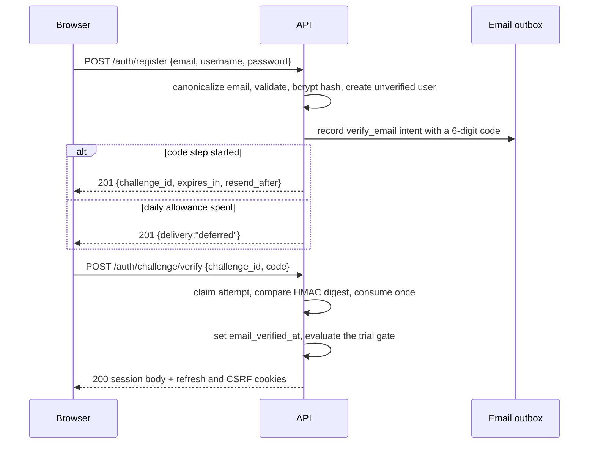
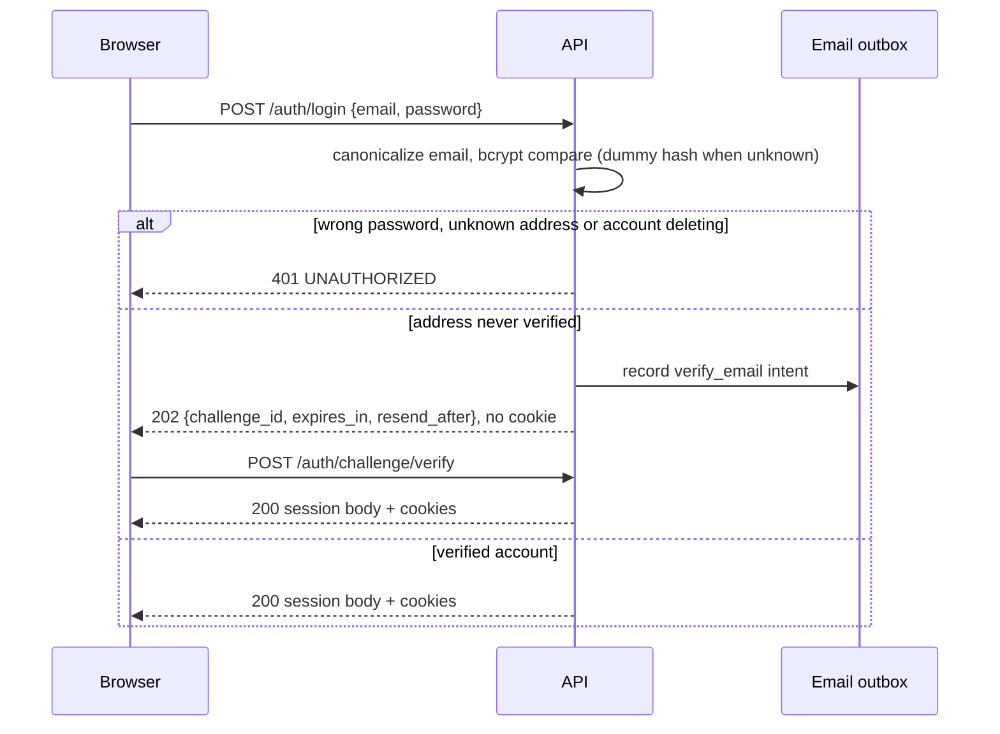

# Auth

## Purpose

Owns account lifecycle and access control: registration with email verification, sign-in, email code challenges, the access/refresh session, CSRF and origin protection on cookie-bound calls, ownership checks on every authenticated route, and two-step account deletion. Every other backend area receives its caller identity from this area and never reads an identity from the request body.

## Why

- **Refresh credential in a `__Host-` HttpOnly cookie, access token in memory.** The browser client cannot hold a long-lived credential in JavaScript-readable storage without handing it to any XSS; a cookie the script cannot read plus a short in-memory JWT removes that target. Cost: the cookie is ambient, so refresh/logout need CSRF and Origin checks, and the host-only cookie forces the app host to fetch the CSRF token over HTTP.
- **Short access token over a server-side session lookup.** Transparent HMAC JWT verification keeps protected routes storage-free and horizontally scalable. Cost: a JWT cannot be revoked before it expires, so logout only stops renewal and the access-token TTL (15 minutes by default) is the real revocation bound.
- **Rotating refresh families over a fixed long-lived token.** Each refresh consumes the presented row and mints a successor in the same family; presenting a consumed row revokes the family. Cost: a legitimate double refresh (two tabs) revokes that whole session, so the client must single-flight.
- **Uniform credential failures over precise ones.** An unknown email, a bad password and a deleting account all answer the same `401`, and the unknown-email path spends a dummy bcrypt comparison; registration answers the same shape for a fresh and an already-verified address. Cost: the client cannot explain the cause, and a registration against a verified address produces a code step that can never succeed.
- **Email verification gates the first session only.** An account with no verification timestamp gets a `verify_email` code instead of a session; a verified account signs in with the password alone. Cost: a stolen password is sufficient after the first verification; benefit: sign-in never depends on the daily email allowance.
- **Deferred registration over a `503` when the daily allowance is spent.** The account is still created unverified and the answer is `201 {"delivery":"deferred"}` with no challenge handle, cookie or session, so a retry after the UTC reset can activate it. Cost: the person leaves without a code and the client can only show a notice.
- **A resource the caller does not own answers `404`, not `403`.** A sheet or campaign the caller does not own or belong to is indistinguishable from a missing one, so the API leaks no existence. Cost: clients cannot tell "not yours" from "deleted", and there is no support view.
- **Two-step deletion with an email code over a one-click delete.** The code proves mailbox possession before an irreversible cascade; the account is marked first and erased asynchronously. Cost: deletion depends on email delivery again and cannot be cancelled once marked.
- **CSRF token served over HTTP when the cookie is unreadable.** Because `__Host-` cookies belong to the API host, the web app on its own host fetches the token from `GET /auth/csrf` instead of reading the cookie directly. Cost: one extra request before the first refresh/logout after a reload.
- **Free trial granted at verification, capped per client address.** The trial follows proven mailbox ownership, and 3 accounts per IP per 24 hours limits farming. Cost: shared addresses (offices, campuses) hit the cap together.

## Flows

### Register → verify



An address that already belongs to a verified account gets the same `201` shape with a challenge identity no code can redeem; the owner receives a code-free `account_exists` notice, paced to one per window. An unverified account is claimed instead: its username and password are replaced, its refresh tokens revoked, and a fresh verification code is sent.

### Login → challenge → session



### Refresh rotation

```mermaid
sequenceDiagram
  participant B as Browser
  participant A as API
  B->>A: POST /auth/refresh (refresh cookie + X-CSRF-Token)
  A->>A: allowed origin, session rate limit, CSRF bound to family
  A->>A: load token by SHA-256 hash; revoked -> revoke family, 401
  A->>A: load account; missing, unverified or deleting -> revoke family, 401
  A->>A: issue access JWT and a successor refresh in the same family
  A->>A: revoke the presented row with a compare-and-set
  alt lost the rotation race
    A-->>B: 401 UNAUTHORIZED
  else
    A-->>B: 200 session body + rotated cookies
  end
```

The client calls `refresh()` single-flight: concurrent `401`s share one request, and a session-version bump makes a response from an ended session harmless. A replay of the old cookie after rotation revokes the family, so that session ends and the person must sign in again.

### Account deletion

```mermaid
sequenceDiagram
  participant B as Browser
  participant A as API
  participant O as Email outbox
  participant R as Relay sweeper
  B->>A: POST /auth/me/deletion (Bearer)
  A->>O: record delete_account intent
  A-->>B: 202 {challenge_id, expires_in, resend_after}
  B->>A: DELETE /auth/me {challenge_id, code}
  A->>A: consume challenge; purpose and user must match
  A->>A: mark the account deleting
  A-->>B: 202 {status:"deleting"}
  R->>R: settle billing and campaigns, then cascade and emit user.deleted
```

A deletion code of another purpose or account is refused without being consumed, and it can never sign in through `/auth/challenge/verify`. Once marked, the routes with the active gate answer `403` and renewal revokes the family.

## Contracts

### Endpoints

Every success body wraps its payload in `{"data": ...}`; every failure is `{"error":{"code","message","details?"}}`, with `Retry-After` when the error carries a hint.

| Endpoint | Credential | Answer |
| --- | --- | --- |
| `POST /auth/register` | none | `201` challenge `{challenge_id, expires_in, resend_after}` or `{delivery:"deferred"}`; never a cookie |
| `POST /auth/login` | none | `200` session for a verified account; `202` challenge for an unverified one; `401` uniform |
| `POST /auth/challenge/verify` | none | `200` session and cookies; `401 OTP_INVALID` for every code failure |
| `POST /auth/challenge/resend` | none | `202 {resend_after}`; indistinguishable for unknown, consumed or expired handles |
| `POST /auth/refresh` | refresh cookie, CSRF, origin | `200` session and rotated cookies |
| `GET /auth/csrf` | refresh cookie, origin | `200 {csrf_token}`, `Cache-Control: no-store` |
| `POST /auth/logout` | refresh cookie, CSRF, origin | `204`; no cookie is a `204` no-op |
| `GET /auth/me` | Bearer | `200 {id, email, username, email_verified, created_at}` |
| `POST /auth/me/deletion` | Bearer | `202` `delete_account` challenge |
| `DELETE /auth/me` | Bearer | `202 {status:"deleting"}` |

The session body is `{access_token, token_type:"Bearer", expires_in}`; the refresh token never appears in a body. The access token is HS256, subject = account UUID, `jti` = UUID v7, TTL `JWT_ACCESS_TTL` (15 minutes).

### Challenge kinds

- `verify_email` — registration and sign-in for an unverified account; verifying it signs in and sets `email_verified_at` when absent.
- `delete_account` — account deletion only; `/auth/challenge/verify` refuses it.
- `account_exists` — a code-free notice sent when registration targets a verified address; it is never redeemable.

A code is six digits from `crypto/rand`, stored as an HMAC-SHA256 digest over a version marker, user id, purpose and code, keyed by `EMAIL_CODE_SECRET` (required, at least 32 bytes). By default one active challenge exists per user and purpose, with 5 attempts, a 10-minute lifetime capped at 30 minutes total; resend reuses the code, extends the deadline up to the ceiling and respects a 60-second cooldown. A code never appears in a response, log line or error; logs identify challenge and purpose and mask the address.

### Cookies and CSRF

- `__Host-legnaris_refresh`: opaque 32-byte token, stored as SHA-256, `HttpOnly`, `Secure`, `SameSite=Strict`, `Path=/`, no `Domain`, `Max-Age` = `AUTH_REFRESH_TTL`.
- `__Host-legnaris_csrf`: same attributes but readable by script, because the web app echoes it in `X-CSRF-Token`.
- The CSRF token is a random nonce plus an HMAC bound to the refresh family and the server secret; it is stateless and lives as long as the family.
- `refresh`, `csrf` and `logout` reject a missing or foreign `Origin`/`Referer` with `403`; the allowed list is `CORS_ALLOWED_ORIGINS`.
- The web client sends `credentials: 'omit'` by default and opts into `include` only for `/auth/*`, so no ambient cookie reaches a domain request.

### Statuses and error codes

| Status | Codes |
| --- | --- |
| `400` | `INVALID_REQUEST`, `INVALID_JSON`, `UNKNOWN_FIELD`, `DISPOSABLE_EMAIL` |
| `401` | `UNAUTHORIZED` (credential, token, refresh), `OTP_INVALID` (any code failure) |
| `403` | `FORBIDDEN` (CSRF, origin, account deleting) |
| `409` | `CONFLICT` (taken username, other registration collision) |
| `429` | `RATE_LIMITED` with `Retry-After` |
| `503` | `EMAIL_UNAVAILABLE` with `Retry-After` until the UTC day resets |
| `500` | `INTERNAL_ERROR` |

Registration validates a canonical address (at most 254 bytes), a username of 1–50 characters matching `^[a-zA-Z0-9_-]+$`, and a password of 8–72 bytes. Every wrong-password or unknown-address answer costs one bcrypt comparison, and `AUTH_REGISTER_MIN_DURATION` pads the registration path to a floor.

### Rate-limit scopes

| Scope | Key | Default |
| --- | --- | --- |
| register | client IP / canonical email | 5/h / 3/h |
| login, challenge verify and resend | client IP | 30/1m |
| login | canonical email | 10/1m |
| refresh, csrf, logout | client IP | 120/1m |
| most authenticated routes (generation has its own buckets) | user id | 80/1m |
| code issuance per account | user id | 10/h |
| trial grant | client IP | 3/24h |
| email sends | global, per UTC day | 80; resends capped at 30% |

The limits are shared through Redis when `REDIS_URL` is set and fall back to a per-process counter (with a warning) when it is not. For a rate-limit refusal, `Retry-After` is the remaining window.

### Ownership

The bearer subject is the only identity: controllers copy `auth.UserID(c)` into the service command, and services never accept an owner from the body. Every domain group (`/templates`, `/sheets`, `/campaigns`, `/generations`, `/me*`, `/billing`) requires the bearer middleware; the active-account gate and the per-user limiter are applied route by route, and generation uses its own buckets. A missing owner at a service boundary is `401`; a resource owned by another account is translated to `404 NOT_FOUND`, byte-identical to a missing one. Campaign membership follows the same invisibility rule (`404` for a non-member), while an insufficient role answers `403 CAMPAIGN_FORBIDDEN`. A deleting account is refused with `403` on the routes that carry the active gate.

### Configuration

| Keys | Default | Effect |
| --- | --- | --- |
| `JWT_SECRET` (required), `JWT_ACCESS_TTL` | —, 15m | access-token signing and lifetime |
| `AUTH_REFRESH_TTL`, `AUTH_BCRYPT_COST` | 720h, 12 | refresh lifetime and password work factor |
| `EMAIL_CODE_SECRET` (required) | — | code digest key, at least 32 bytes |
| `AUTH_OTP_TTL`, `AUTH_OTP_CEILING`, `AUTH_OTP_MAX_ATTEMPTS`, `AUTH_OTP_RESEND_COOLDOWN` | 10m, 30m, 5, 60s | code lifetime, absolute ceiling, attempts and resend cooldown |
| `AUTH_OTP_USER_WINDOW`, `AUTH_OTP_USER_LIMIT` | 1h, 10 | challenges per account window |
| `AUTH_OTP_DAILY_SEND_CAP`, `AUTH_OTP_RESEND_CAP_RATIO` | 80, 0.30 | daily send ceiling and resend share |
| `AUTH_REGISTER_MIN_DURATION`, `AUTH_DISPOSABLE_EMAIL_CHECK` | 500ms, on | registration timing floor; disposable-address refusal, forced on in production |
| `AUTH_RATE_LIMIT_*`, `SESSION_RATE_LIMIT_*`, `AUTH_ACCOUNT_RATE_LIMIT_*` | 30/1m, 120/1m, 10/1m | credential, session and account buckets |
| `AUTH_REGISTER_IP_RATE_LIMIT_*`, `AUTH_REGISTER_EMAIL_RATE_LIMIT_*` | 5/1h, 3/1h | registration buckets |

## Code map

- `backend/internal/auth/` — `service.go` (register, login, refresh, logout, sessions), `challenge*.go` (policy, repository, issuance, verify, resend, notices, observer), `code.go` (HMAC digest and generator), `cookie.go`, `csrf.go`, `token.go`, `refresh_repository.go`, `middleware.go` (bearer and active-account gate), `password.go`, `deletion.go`, `profile.go`, `errors.go`, `events.go`.
- `backend/internal/user/` — account record and DTO, canonical email, repository and unique-key translation, cached repository, deletion store.
- `backend/internal/trial/` — gate that grants the free trial on first verification and caps accounts per client address.
- `backend/internal/accountdeletion/` — deletion cascade and the `users_deleting` sweeper queue.
- `backend/internal/app/` — `auth.go` and `auth_challenge.go` (HTTP controllers and cookie handling), `router.go` (route wiring), `ratelimit.go` and `limiters.go`, `origin.go`, `trial.go`, `email_intent.go`.
- `backend/shared/env/env.go` — keys and defaults; `backend/shared/db/indexes.go` — unique and TTL indexes; `backend/internal/platform/ratelimit/`, `clientip/`, `metrics/` — shared limiter, trusted-proxy client address, auth metrics.
- `backend/internal/email/outbox/` and `backend/cmd/relay` — asynchronous delivery and the deletion sweeper; owned by `events-and-email`.
- `web/src/auth/` — `auth_session.ts` (state machine, single-flight refresh/logout, pending code step), `auth_gate.tsx`, `auth_screen.tsx`, `auth_code_screen.tsx`, `auth_stage.tsx`, `next_path.ts`.
- `web/src/api/` — `auth_api.ts` (auth operations and CSRF header), `csrf.ts`, `authenticated_transport.ts` (Bearer, one refresh and replay on `401`), `error_mapper.ts` (auth codes to failure kinds).
- `web/src/app/providers.tsx` — session and transport wiring; `web/src/library/session_data.ts` — session-local data sweep; `web/src/account/account_screen.tsx` — account surface (plan, consent, privacy; no deletion controls).

## Tools & dependencies

- `github.com/golang-jwt/jwt/v5` for HS256 access tokens; `golang.org/x/crypto/bcrypt` for passwords.
- MongoDB collections `users`, `refresh_tokens`, `auth_challenges`, `email_notices`: unique email and username, unique active challenge per user/purpose, TTL indexes on refresh expiry, challenge expiry and notice claims.
- `backend/shared/idgen` for every server-generated id (UUID v7); no ad-hoc UUIDs.
- Resend behind the email outbox and RabbitMQ relay/worker; the API only records an intent. See `events-and-email`.
- Redis-backed shared rate limiter (or the in-process fallback) and the trusted-proxy client-address policy from `platform`.
- Prometheus counters for login failures, refresh-token reuse, codes issued/verified/resent, send-cap blocks and rate-limit blocks.
- Captured API fixtures in `web/src/api/fixtures/` are real responses with any access token redacted (`redacted-access-token`).
- React `useSyncExternalStore` for the session snapshot and the typed fetch transport; no state library.

## Known limits

- Mandatory email 2FA on every sign-in is not implemented; only an unverified account goes through a code, and a verified account is password-only.
- No password reset, email change, TOTP or backup codes, device/session list, account switcher, or admin role. Access control is owner-only plus campaign roles.
- `GET /auth/me` is served and tested but the web client does not consume it; verification state is not rendered.
- No web surface for account deletion or for starting the deletion challenge; both endpoints exist and are only exercised by API tests.
- A registration against a verified address leaves the person on a code step that cannot succeed; only the address owner learns of the attempt, and the anti-enumeration design accepts that dead end.
- Deferred registration leaves an unverified account with no code until a later sign-in after the UTC reset; there is no automatic retry.
- Deletion is asynchronous and cannot be cancelled. A cascade failure is retried with backoff and can end in `deletion_dead`, requiring operator attention.
- A legitimate concurrent refresh loses the compare-and-set, gets `401` and revokes the family; client single-flight prevents the common case only.
- Rate limits fall back to per-replica memory when Redis is unavailable, so the effective limit multiplies by the replica count.
- A leaked access token stays valid until its expiry (15 minutes by default); logout and rotation only stop renewal. CSRF tokens are stateless and become useless with the refresh family, not on a timer.
- The registration timing floor is padding, not a constant-time guarantee; the bcrypt comparison dominates but does not fully equalize server-side work.
