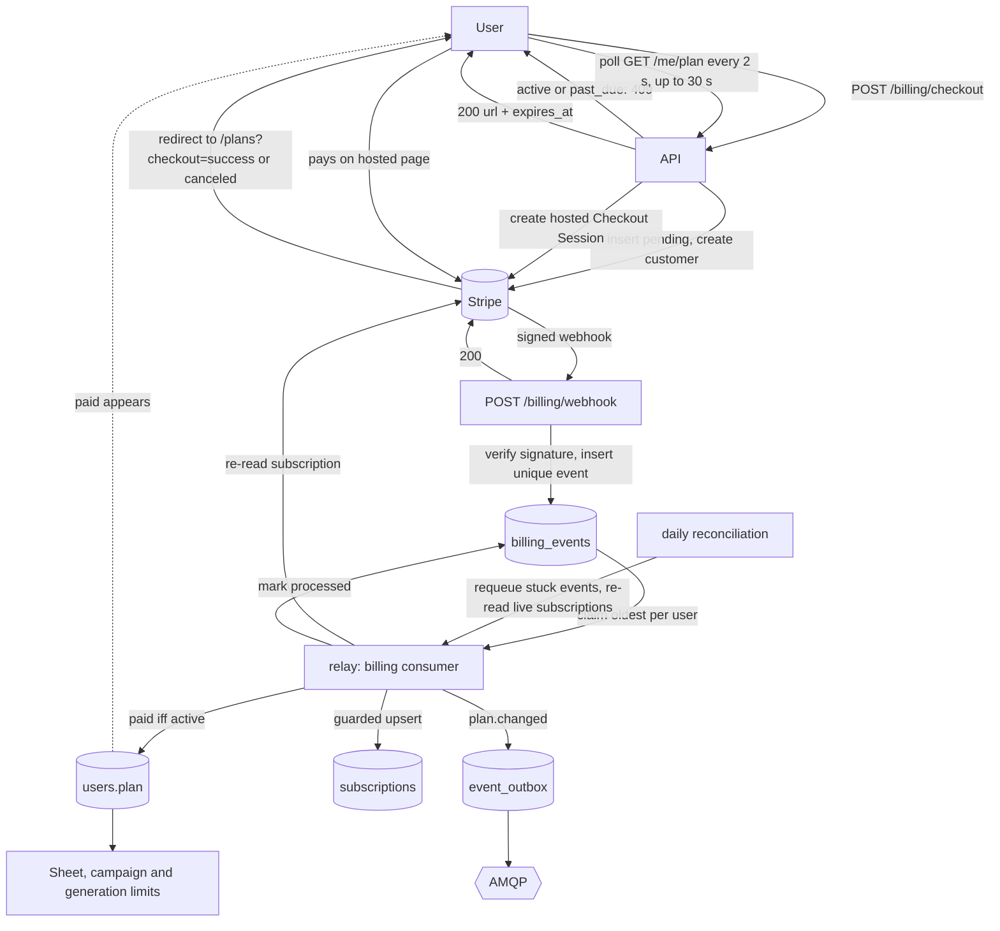
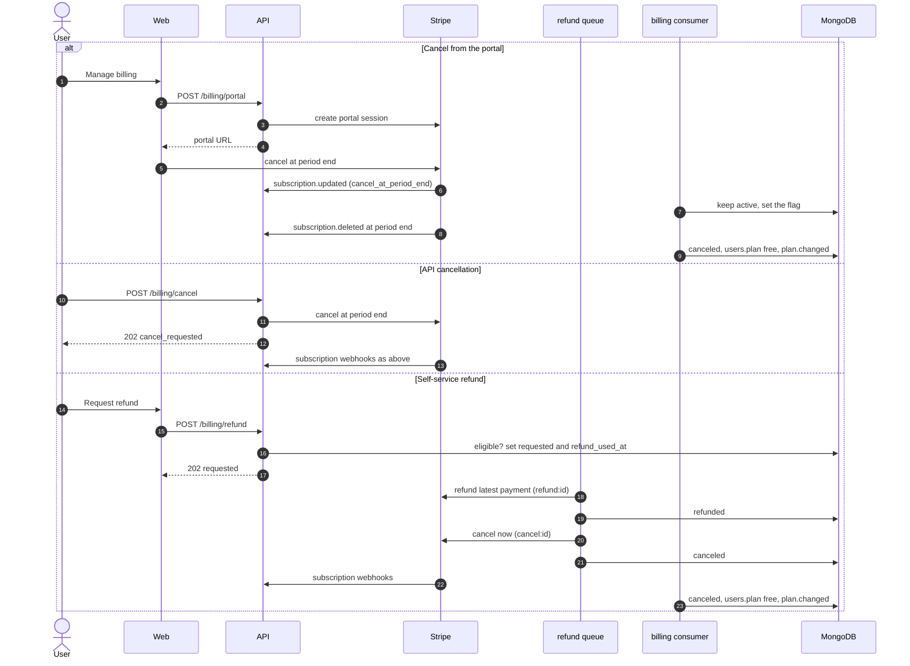

# Billing

## Purpose

Billing turns a payment into a Plan. It owns the single paid monthly Plan, provider checkout and portal, the signed webhook inbox, the subscription lifecycle, refunds, and the enforcement data the rest of the API reads. A user's Plan lives in `users.plan`; nothing else stores or interprets a subscription status.

## Why

- **Our `subscriptions` collection over the provider's live state on every request because enforcement must be fast and provider-agnostic; cost is a projection that can lag and needs reconciliation.**
- **Webhooks over the checkout redirect because a redirect can be lost or forged; cost is a relay process, an inbox and eventual Plan changes.**
- **Re-reading the subscription from the provider over trusting event payloads because providers do not guarantee order; cost is a provider call per event.**
- **An inbox keyed by provider event ID over in-memory deduplication because webhooks retry; cost is a collection whose raw payloads expire after 90 days.**
- **Per-user serialization, a transactional snapshot and a `provider_synced_at` guard over last-write-wins because stale events must not regress a subscription; cost is complexity plus a daily reconciliation for what the transaction cannot cover.**
- **Provider-neutral statuses over raw provider statuses because the domain must survive a provider swap; cost is an adapter mapping table.**
- **One monthly Plan, with cancellation as the only downgrade, over proration and switching because no paid-to-paid change exists; cost is that upgrading means a new subscription.**
- **Hosted checkout and portal over a card form because card data stays out of PCI scope; cost is redirects and dashboard setup that code cannot enforce.**
- **No grace period on failed renewal because no payment means no paid Plan; cost is an immediate drop to Free until a retry succeeds.**
- **Paid-only AI generation over a Free allowance because every call costs money; cost is that Free users hit an upgrade modal instead of getting a draft.**
- **An asynchronous refund queue over a synchronous refund because provider calls fail or time out; cost is eventual state, including a refund whose cancellation fails.**
- **Keeping subscription records five years for fiscal retention while erasing the account; cost is a retained subscription row after deletion.**

## Flows

### Checkout to entitlement

An unexpired pending checkout is reused; an expired pending row is canceled first. A unique partial index allows one live subscription per user (`pending`, `active`, `past_due`), so concurrent checkouts lose the race and retry before `CONFLICT`.

### Return from checkout

`BILLING_SUCCESS_URL` points at `/plans?checkout=success` and `BILLING_CANCEL_URL` at `/plans?checkout=canceled`. The return is a hint, never an entitlement: only the webhook consumer writes `users.plan`.

- `checkout=success` with a paid Plan in `/me/plan` — the screen states `Plan <name> activated.` at once.
- `checkout=success` with a Free Plan — the plan cards are replaced by `Confirming your payment…`, with no subscribe or manage action, and `/me/plan` is polled every two seconds for at most thirty seconds, composed with the refund poll. Free is never presented as the final state.
- A paid Plan on a later poll — the activation notice appears and `checkout` is removed with a replaced history entry.
- Thirty seconds without a paid Plan — the screen states the payment was received and is being processed, offers `Check again` and stops polling. That button re-reads `/me/plan` on its own, not because of the parameter, which is already gone.
- `checkout=canceled` — the previous Plan is shown as usual, with no message, and the parameter is removed.

If the webhook never lands, the return cannot grant the Plan; `Check again` or the next visit reports whatever `/me/plan` holds.

### Cancellation and refund

A failed renewal arrives as `past_due`; the Plan drops to Free immediately, a successful card retry restores `active`, and exhausted retries end as `canceled`. A refund is offered only while active, within seven days of the first paid date, once per user ever, and with an empty or failed refund state. Refund and charge webhooks are ignored: the queue's state transitions are the refund record.

The Plans screen reads `/me/plan`: Subscribe and Manage post to checkout or portal and then redirect the whole page; a return from checkout confirms the change by polling `/me/plan` (see above); the refund dialog polls `/me/plan` every five seconds while the state is `requested`; the shell shows a payment-issue banner when `payment_issue` is true.

Account deletion settles billing first: live provider subscriptions are canceled now, provider customers are scrubbed of personal data, and subscription rows are marked `canceled` with an expiry five years out.

## Contracts

### Endpoints

All routes except the webhook require an authenticated, non-deleting user and the per-user rate limit. Success bodies use `{ "data": ... }`.

| Method and path | Result |
| --- | --- |
| `POST /billing/checkout` | `200` with `url`, `expires_at`; `409 ALREADY_SUBSCRIBED` for `active` or `past_due`; `409 CONFLICT` when retries run out. |
| `POST /billing/portal` | `200` with `url`; `404 NO_SUBSCRIPTION` without a provider customer. |
| `POST /billing/cancel` | `202` `status: cancel_requested`; `404 NO_SUBSCRIPTION` without an active provider subscription. |
| `POST /billing/refund` | `202` `status: requested`; `409 REFUND_NOT_ELIGIBLE` with `details.reason`. |
| `POST /billing/webhook` | `200` empty body for a stored, duplicate or ignored event; `Stripe-Signature` header; 64 KiB body cap. |
| `GET /me/plan` | Plan view; with a subscription it adds `subscription_status`, `current_period_end`, `cancel_at_period_end`, `payment_issue`, `refund_eligible`, `refund_state`. |

### Webhook events

| Event | Handling |
| --- | --- |
| `checkout.session.completed` | `subscription.changed` only for subscription-mode sessions carrying a subscription. |
| `customer.subscription.created` | `subscription.changed`. |
| `customer.subscription.updated` | `subscription.changed`; renewals, failures and `cancel_at_period_end` arrive here. |
| `customer.subscription.deleted` | `subscription.changed`. |
| Anything else | Stored once as `ignored` and marked processed. |

An event whose owner cannot be resolved from metadata, subscription ID or customer ID is stored as ignored. The inbox returns `200` even when it does nothing.

### States

| Field | Values and rule |
| --- | --- |
| `users.plan` | `free`, `paid`; `paid` if and only if a subscription is `active`. Only enforcement input. |
| `subscriptions.status` | `pending`, `active`, `past_due`, `canceled`. Mapping: `incomplete` to `pending`; `active` to `active`; `past_due` and `paused` to `past_due`; `unpaid`, `incomplete_expired`, `canceled` to `canceled`. |
| `subscriptions.refund_state` | empty, `requested`, `refunded`, `canceled`, `failed`. Only the refund flow advances it; `failed` may retry, `refunded` and `canceled` are terminal. |
| `billing_events.status` | `received`, `processed`, `failed`. Reconciliation requeues failures with attempts reset. |

### Entitlements

| Entitlement | Free | Paid |
| --- | --- | --- |
| AI generations | none (upgrade modal) | 30 per UTC day (`generation_usage`) |
| Character / NPC / enemy sheets | 1 / 2 / 2 | 10 / 50 / 50 |
| Owned campaigns | 1 | 5 |

Free accounts cannot generate or accept LLM consent: every attempt returns `403 PLAN_UPGRADE_REQUIRED`. A paid generation spends one unit of the daily counter, reserved before a generation and refunded on failure. Limits apply when a sheet or campaign is created or duplicated; existing rows are neither deleted nor locked when the Plan drops.

### Errors

| Code | HTTP | When |
| --- | --- | --- |
| `ALREADY_SUBSCRIBED` | 409 | Checkout with an active or past-due subscription. |
| `BILLING_UNAVAILABLE` | 503 | Provider unavailable or unconfigured for checkout, portal or webhook verification. |
| `NO_SUBSCRIPTION` | 404 | Portal without a customer; cancellation without an active provider subscription. |
| `INVALID_SIGNATURE` | 400 | Webhook signature rejected. |
| `REFUND_NOT_ELIGIBLE` | 409 | `details.reason` is `window_expired`, `already_used` or `not_subscribed`. |
| `PLAN_UPGRADE_REQUIRED` | 403 | Generation or LLM consent attempted on a Free Plan. |
| `QUOTA_EXCEEDED` | 429 | Paid daily quota exhausted; `Retry-After` points to the next UTC day. |
| `SHEET_LIMIT_REACHED` | 409 | Creating or duplicating past the sheet limit. |
| `PLAN_LIMIT_REACHED` | 403 | Creating past the owned-campaign limit. |

Provider rejections on checkout or portal surface as `500 INTERNAL_ERROR`; timeouts and connection failures as `BILLING_UNAVAILABLE`. A malformed but correctly signed webhook is `400 INVALID_REQUEST`. Refund provider failures are retried asynchronously instead of reaching the HTTP client.

### Invariants

- Only a verified webhook turns a payment into a paid Plan; the browser redirect never does.
- Customer, checkout, refund and cancel calls carry stable provider idempotency keys.
- A duplicate `(provider, provider_event_id)` is a no-op.
- A snapshot is written only if its provider read is newer than `provider_synced_at`, so out-of-order events cannot regress status.
- The Plan change and its `plan.changed` outbox entry commit with the snapshot.
- A refund is once per user ever, enforced by the eligibility check and a unique partial index on `refund_used_at`.

## Code map

- `backend/internal/billing` — service, inbox, consumer, queues, reconciliation, deletion settlement, summaries, status derivation and Mongo stores.
- `backend/internal/billing/stripe` — Stripe adapter: customers, Checkout, status mapping, webhook parsing, portal, cancel, refund and customer scrubbing.
- `backend/internal/billing/billingtest` — fake provider and ledger.
- `backend/internal/plan` — Plan IDs and sheet and campaign limits.
- `backend/internal/quota` — paid daily quota, reserve and refund.
- `backend/internal/user/plan_source.go` — reads `users.plan`.
- `backend/internal/app/billing.go`, `billing_portal.go` — `/billing/*` and webhook controllers; `plan.go` — `/me/plan` billing fields; `router.go`, `bootstrap.go` — wiring and provider selection.
- `backend/internal/accountdeletion` — deletion queue that calls billing settlement.
- `backend/shared/db/indexes.go` — live-subscription, provider-ID, refund, event and TTL indexes.
- `web/src/plans` — Plan cards, checkout, return-from-checkout confirmation and polling, portal, cancellation notice, refund dialog and polling; `web/src/billing/redirect.ts` — provider redirect.
- `web/src/api/models/billing.ts`, `plan.ts` — parsing; `client.ts`, `error_mapper.ts` — calls and error copy; `web/src/shell/payment_banner.tsx` — payment-issue banner.

## Tools & dependencies

- **Stripe** through `stripe-go` v87: hosted Checkout and portal, signed webhooks, subscription retrieval, refunds and customer updates.
- **MongoDB** collections `subscriptions`, `billing_events`, `billing_user_locks`, `event_outbox`, `users`, `generation_usage`.
- **The relay process** — billing consumer, refund queue, daily reconciler and deletion settlement.
- **The event outbox and AMQP** — `plan.changed` to downstream consumers.
- **Prometheus** — reconciliation corrections by kind.
- **Environment keys** — `STRIPE_SECRET_KEY`, `STRIPE_WEBHOOK_SECRET`, `STRIPE_PRICE_ID_USD`, `BILLING_SUCCESS_URL`, `BILLING_CANCEL_URL`; deployment passes them to the API and the relay.
- **Web** — React, TanStack Query, `Intl.DateTimeFormat`, shared localization and error mapping.

## Known limits

- Go-live is blocked until the charging entity, taxes and fiscal invoice handling are settled; automatic tax stays disabled until then.
- Stripe must be listed as a processor in the privacy policy.
- The charged amount comes from `STRIPE_PRICE_ID_USD`, while the web independently displays USD 6.79 per month; nothing keeps the two in sync.
- Dashboard setup is required: a recurring monthly Price, an endpoint subscribed to checkout and subscription events, and cancellation enabled in the portal. A missing secret key or Price ID makes checkout and portal answer `503`; a missing webhook secret makes verification answer `503`, and an unconfigured relay leaves refunds requested but unprocessed.
- BRL and currency logic are post-MVP; USD, card and monthly only, with no proration, paid-to-paid switching or partial refunds.
- The web offers cancellation only through the portal. `POST /billing/cancel` has no web control, so cancellation depends on the portal being enabled.
- Failed renewals have no grace period; the account is Free at `past_due`, and a banner is the only in-product warning.
- Refunds cover the latest paid payment and are anchored to the first paid date. If the refund succeeds but the immediate cancellation keeps failing, the refund is marked dead with `refund_state=refunded`: the money is returned but the subscription must be canceled manually.
- Webhook delivery is eventually consistent. A provider or queue outage delays Plan changes until retries or the daily reconciliation, which is only as good as the provider's current state.
- Raw payloads expire after 90 days; account deletion keeps the scrubbed customer and canceled subscription rows for five years, with no self-service export.
- Mongo-backed billing integration tests require a replica set and self-skip without `DATABASE_URI`, so a plain unit run does not exercise transaction paths.
