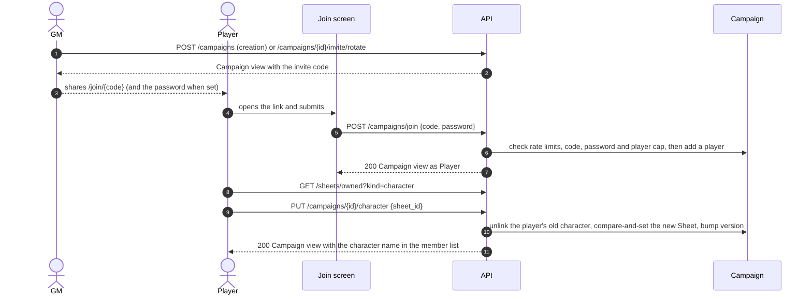
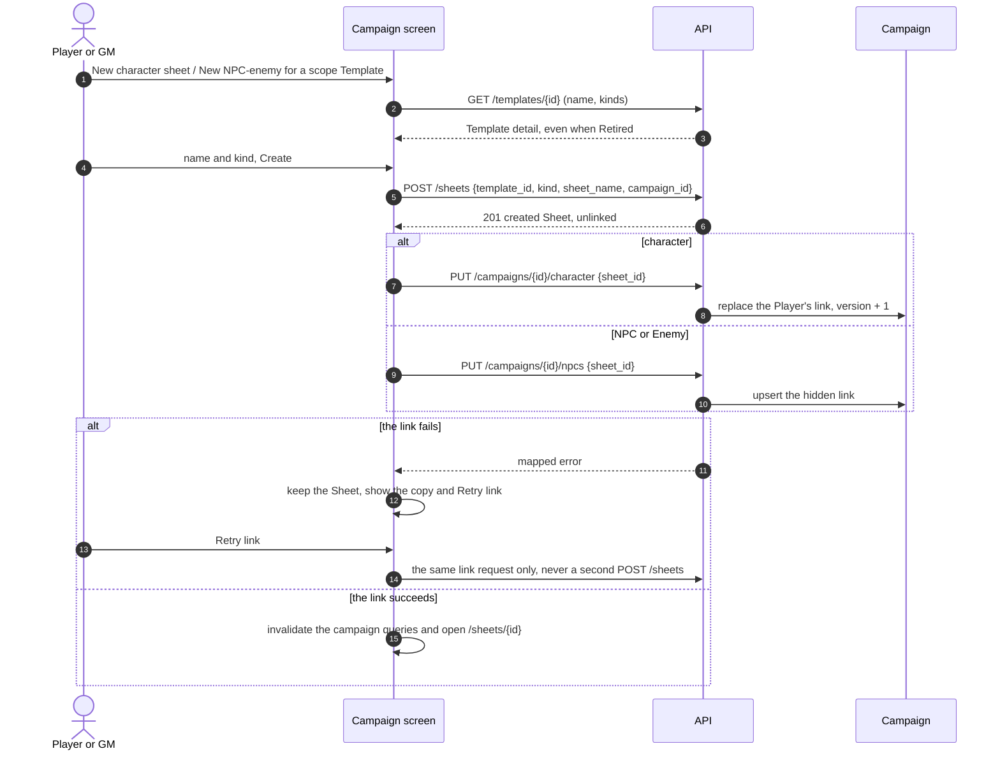
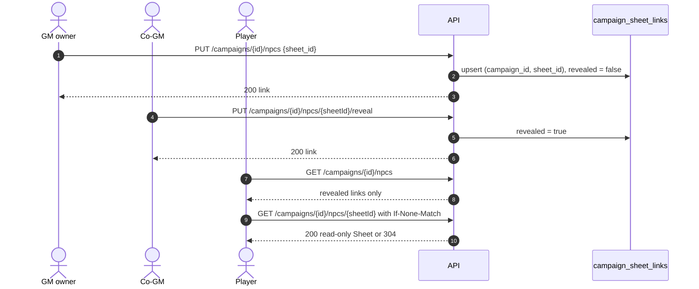
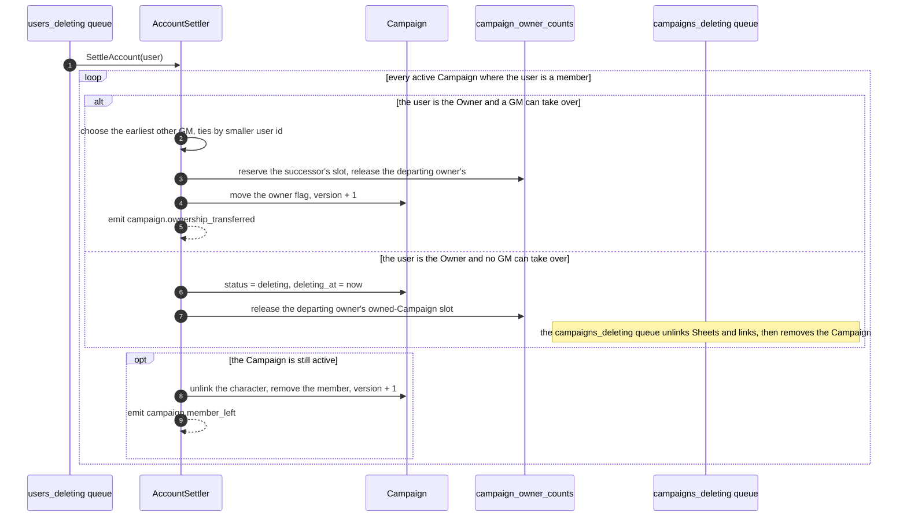
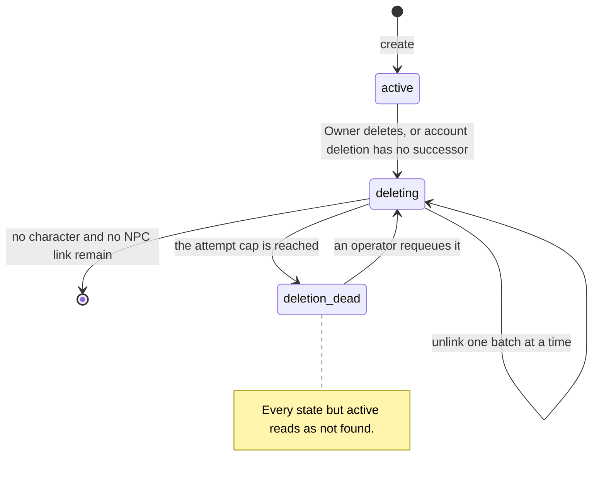

# Campaigns

## Purpose

A Campaign is a shared table for one game system: it fixes a Game system or a Template that has none, groups one Owner, up to two other Game Masters and up to ten Players, and lets a Player link one character Sheet while GMs read every linked character and share NPC and Enemy Sheets with the table. A member can also create a Sheet from a Retired Template the Campaign includes, and the Campaign screen offers a Player a new character and a GM a new NPC or Enemy from each Template in scope that accepts the kind, linking the created Sheet afterwards. The area also owns the invite code and optional password, the asynchronous deletion of a Campaign, and the account-deletion settlement that passes ownership on.

## Why

- **A Campaign fixes a Game system, or a Template that has none,** because a fifth-edition Campaign must hold 5E Character and 5E Stat Block Sheets, the Game system's Templates resolve at read time so the list never goes stale when a Template joins the system, and a slug is an identifier, not a declaration. It is stored as `game_system` or `template_id`, never both; existing Campaigns keep `template_id` with no backfill, and links test membership in `template_ids` with unchanged kind rules and the same `template_mismatch` code. Creation refuses an unknown id, a Retired Template, a Draft outside local development and a Game system with no creatable Template; a stored scope is resolved tolerantly so an unknown Template still reads. Cost: two fields to interpret, and a Template can never change its Game system under the same slug.
- **Membership inside the Campaign document over a memberships collection** because role changes, counters and the Owner flag then move in one versioned write; cost is a bounded array of at most thirteen members, rewritten on every change, and a multikey index to list a person's Campaigns.
- **One shared invite code over per-person email invites** because it needs no pending, expiry or resend state and rotating it revokes every old link at once; cost is no targeted invitation and no record of who was invited.
- **Joining always as a Player over choosing a role at join time** because a stranger with a code must not grant themselves GM access; cost is a separate promotion by the Owner.
- **An `owner` flag on a GM over a third role** because every Owner is also a GM and the role matrix stays two-valued; cost is two fields to interpret on every member.
- **Characters linked by `campaign_id` on the Sheet over a link collection** because a character belongs to at most one Campaign and a conditional update on that field makes two concurrent links impossible; cost is a second, different mechanism for NPCs and Enemies.
- **NPC and Enemy links as separate documents over an array on the Sheet** because reveal is state of one Campaign's view, not of the Sheet; cost is a link collection, per-link reveal and orphan reconciliation.
- **Create-then-link on the Campaign screen over one combined call** because `POST /sheets` deliberately stores no link and the link routes already own the role and kind rules; the screen reads each `template_ids` entry through `GET /templates/:id` — so a Retired Template still offers its button — and a Player sees only Templates that accept `character` while a GM sees only those that accept `npc` or `enemy`. The dialog offers no generation entry because a generated Sheet would not link, and a failed link keeps the created Sheet and retries the link alone. Cost is two requests in sequence and one Template read per scope entry.
- **Asynchronous deletion through a `deleting` state over a synchronous cascade** because unlinking an unbounded number of Sheets in one request would time out and a crash halfway would leave dangling links; cost is a Campaign that still exists while invisible, a sweeper queue and a dead-letter state.
- **A deterministic successor over any willing GM** because a retried account deletion must choose the same person; cost is that the longest-standing GM receives ownership even if a newer GM is more active.
- **A version bump on every Campaign-scoped write, including link changes, over last-write-wins** because concurrent joins, role changes, links and deletion must serialize and every event carries a monotonic aggregate version; cost is a `CONFLICT` for the loser.
- **Sixty-second polling over a live connection** because values change a few times per scene and a persistent socket per GM is not worth the operational load; cost is up to a minute of stale values and an explicit "Values may not reflect real time" caption.

## Flows

### Invite, join and link a character

Creation already returns an invite code; a GM can rotate it later. The code never expires, and the optional password is checked before the player is added.

### Create and link from the Campaign screen

The Campaign screen reads every Template detail named by `template_ids` and offers `New character sheet` to a Player and `New NPC/enemy` to a GM, one button per Template whose `kinds` include a kind the role may create; a role with no such Template gets no button. The dialog carries `campaign_id` on `POST /sheets`, then links the created Sheet with the character route or the NPC route. A failed link leaves the Sheet created and offers a retry of the link alone.

### Reveal an NPC or Enemy

Any GM can reveal or hide any link; only the Sheet owner can link or unlink it. Hiding takes effect on the Player's next read or poll.

### Account deletion settles Campaigns

Each Campaign is settled in its own transaction and every step re-reads it, so a retry after a crash finds only what is still left to do. The account deletion job runs every minute and removes the account only after billing and Campaign settlement succeed. The cascade that follows deletes the user's own Sheets and every remaining NPC link they owned.

### Deletion states

The web list at `/campaigns` orders owned Campaigns first, then GM roles, then Player roles, shows the owned count against the Plan limit, and blocks creation at the limit with a link to the Plans screen. Each row and the detail header show the Campaign's `scope_name` from the payload, so a Retired Template's name survives the catalog no longer listing it. The create picker derives its scopes from `GET /templates`: one option per distinct Game system (named after the system) plus each Template without one (named after the Template), under the "Game system" label, and `POST /campaigns` sends exactly the matching `game_system` or `template_id`. The web holds no Game system rule: a Player may link a character, and a GM an NPC or Enemy, whenever the Sheet's Template is in the Campaign's `template_ids`. The detail screen grants Owner and GM panels by `viewer_role` and `viewer_owner`; a Player gets the character link form, the members list, leave and the revealed NPC list. `/join/:code` submits the code from the URL, reveals a password field only after `PASSWORD_REQUIRED`, and then reports the joined Campaign. The GM Sheet and NPC screens are read-only, poll every minute and offer a manual refresh. A Record list in a GM or NPC Sheet draws as the same table the owner sees, with plain values and no Add, Move or Remove control. NPC and Enemy kind labels on the detail screen use the shared `kind.npc` and `kind.enemy` copy that the sheet stat block header also uses.

## Contracts

- **Ad slot on the campaign list.** The campaign list (`campaigns_screen.tsx`) ends with an `AdSlot` (`campaigns` surface) shown only to Free accounts; the campaign detail, play session and shared sheets never show ads (see web-client Ads).

All routes are under `/campaigns` behind authentication, an active account and the per-user rate limit. `POST /campaigns/join` also has an IP limiter middleware.

| Method and path | Caller | Result |
| --- | --- | --- |
| `POST /campaigns` | any user | `201` Campaign view; name is 1–80 runes and exactly one of `game_system` or `template_id` is set |
| `GET /campaigns` | any user | active Campaigns where the caller is a member, oldest first |
| `GET /campaigns/:id` | member | `200` Campaign view; `404` when missing, deleting, dead or not a member |
| `POST /campaigns/join` | any user | `200` Campaign view as Player; body `{code, password?}` |
| `POST /campaigns/:id/leave` | non-owner member | `204`; unlinks the character and deletes the GM's NPC links |
| `DELETE /campaigns/:id` | Owner | `202 {"status":"deleting"}` |
| `POST /campaigns/:id/members/:userId/promote` | Owner | `200` Campaign view; Player becomes GM and loses the character link |
| `POST /campaigns/:id/members/:userId/demote` | Owner | `200` Campaign view; GM becomes Player and loses their NPC links |
| `POST /campaigns/:id/members/:userId/remove` | Owner, or GM for a Player | `200` Campaign view |
| `PUT /campaigns/:id/character` | Player | `200` Campaign view; body `{sheet_id}`; replaces the player's character |
| `DELETE /campaigns/:id/character` | Player | `200` Campaign view; idempotent |
| `GET /campaigns/:id/sheets` | GM | linked character summaries |
| `GET /campaigns/:id/sheets/:sheetId` | GM, or the owning Player | Sheet plus `ETag`, or `304` |
| `PUT /campaigns/:id/npcs` | GM who owns the Sheet | `200` NPC link; idempotent upsert |
| `DELETE /campaigns/:id/npcs/:sheetId` | GM who owns the Sheet | `204`; idempotent |
| `PUT /campaigns/:id/npcs/:sheetId/reveal` | any GM | `200` NPC link, revealed |
| `DELETE /campaigns/:id/npcs/:sheetId/reveal` | any GM | `200` NPC link, hidden |
| `GET /campaigns/:id/npcs` | member | all links for a GM; revealed links for a Player |
| `GET /campaigns/:id/npcs/:sheetId` | member | Sheet plus `ETag`, or `304`; a Player gets `404` while hidden |
| `POST /campaigns/:id/invite/rotate` | GM | `200` Campaign view with the new code; the old code stops working |
| `PUT /campaigns/:id/password` | GM | `200` Campaign view; body `{password}`, 8–128 runes |
| `DELETE /campaigns/:id/password` | GM | `200` Campaign view; members stay |

- **Scope:** `POST /campaigns` takes exactly one of `game_system` or `template_id`; both or neither, an unknown id, a Retired Template, a Draft outside development, the `template_id` of a Template that has a Game system, and a Game system with no creatable Template are 400 `INVALID_REQUEST`. The stored scope is resolved through a port implemented over the Template registry: `template_ids` is the Game system's Templates (Drafts only in development, Retired included) or the stored Template alone, and a stored unknown Template still reads with `scope_name` equal to its id and `template_ids` `[that id]`. For a known Template `scope_name` is the Template name; for a Game system it is the Game system name. There is no backfill and no migration.
- **Retired Template creation inside a Campaign:** a member may call `POST /sheets` with `campaign_id` to create a Sheet from a Retired Template the Campaign includes. The Campaign must be active and its `template_ids` must contain the Template; a malformed id, an unknown, foreign or non-member Campaign, a deleting Campaign and a Template outside the scope all return one 400 `INVALID_REQUEST` that reveals nothing about the Campaign. For an Active Template the field is ignored. The Sheet is created unlinked and the client links it afterwards; the check enters the Sheet service through a `CampaignScope` port implemented over `Service.Fetch` in the app layer.
- **Campaign creation surface:** the detail screen offers `New character sheet` to a Player and `New NPC/enemy` to a GM, one button per Template in `template_ids` whose `kinds` include `character` (Player) or `npc`/`enemy` (GM), named from `GET /templates/:id`; a Retired Template included in the scope still offers its button although `GET /templates` omits it. The one dialog carries `campaign_id` on `POST /sheets`, filters the Template kinds to the role's and offers no generation entry, since a generated Sheet would not link. It links the created Sheet through the existing `PUT /campaigns/:id/character` or `PUT /campaigns/:id/npcs` route, invalidates the campaign, character-sheet or NPC-link queries and then opens the owner Sheet. A failed link keeps the created Sheet, states it in the dialog and offers a retry that repeats only the link; a Player with a linked character sees the replace warning before Create, and Create sends at most one request.
- **Roles:** `gm` and `player`, mutually exclusive; exactly one GM carries `owner`. The Owner controls deletion, promotion, demotion and removal of GMs, and can remove any non-owner member. A GM can remove Players. The Owner cannot leave, be demoted, be removed or be promoted. Everyone else can leave. A GM has no character in a Campaign they run; a Player has at most one character per Campaign.
- **Caps:** at most 3 GMs (Owner included) and 10 Players per Campaign, independent of Plan. A Plan limits owned Campaigns only: Free 1, Paid 5. Participation and links are not capped by Plan. `GET /plan` exposes `owned_campaigns {used, limit}` from the `campaign_owner_counts` collection.
- **Invite:** the code is 24 URL-safe characters from 18 random bytes, unique and sparse-indexed, and never expires. The optional password is stored as an argon2id hash; when set, the join needs code and password. An unknown, rotated or inactive code and a wrong password all return `INVALID_INVITE`, and a failed lookup still runs a dummy password check to keep timing flat.
- **Character link:** own Sheet only, kind `character`, Template in the Campaign's `template_ids`, and not linked to another active Campaign. A `campaign_id` pointing at a missing or non-active Campaign is treated as unlinked. The write is a compare-and-set on the previous `campaign_id`, so two concurrent links cannot both win.
- **NPC and Enemy link:** own Sheet only, kind `npc` or `enemy`, Template in the Campaign's `template_ids`, and only while the caller is a GM. One Sheet can be linked to many Campaigns; the pair `(campaign_id, sheet_id)` is unique. A new link is hidden. Reveal belongs to the link, not the Sheet. A Retired Template never affects a link.
- **States:** a Campaign is `active`, `deleting` or `deletion_dead`. Campaign-scoped reads and writes return `CAMPAIGN_NOT_FOUND` for anything but `active`, and lists simply omit it. `deleting` is invisible and stops counting toward the Owner's limit at once. `deletion_dead` means the sweeper exhausted its retries; an operator must requeue it. A link is a document with a `revealed` boolean and no status of its own.
- **Concurrency:** every Campaign mutation through the transaction helper writes with the expected `version` and increments it, including a link or unlink; deletion batches touch the version atomically. A stale write returns `CONFLICT`.
- **Errors:** `INVALID_INVITE` 404; `PASSWORD_REQUIRED` 403; `CAMPAIGN_NOT_FOUND` 404; `CAMPAIGN_FULL` 409; `CAMPAIGN_FORBIDDEN` 403; `CONFLICT` 409 for an existing member or a stale version; `TEMPLATE_MISMATCH` 422; `SHEET_ALREADY_LINKED` 409; `SHEET_KIND_MISMATCH` 422 for a `character` sent to the NPC route; `NOT_FOUND` 404 for a Sheet the caller does not own or a hidden or unlinked NPC; `PLAN_LIMIT_REACHED` 403; `RATE_LIMITED` 429; `INVALID_REQUEST` 400 for a malformed id, an invalid name, a missing invite code, a password length outside the range, a creation scope that is missing, doubled or refused, and a `template_id` that is not a slug.
- **Events:** `campaign.created`, `campaign.member_joined`, `campaign.member_left` (`left` or `removed`), `campaign.role_changed`, `campaign.ownership_transferred`, `campaign.deleted`, `campaign.sheet_linked`, `campaign.sheet_unlinked` (`unlinked`, `owner_left` or `sheet_deleted`), `campaign.sheet_revealed` and `campaign.sheet_hidden`. Payloads carry ids, roles, kinds and the stored scope (`game_system` or `template_id`); never a name, password, invite code or Sheet value. Unlinking during Campaign deletion emits nothing because `campaign.deleted` covers it.
- **Campaign view:** every member sees the name, `scope_name`, `template_ids`, `game_system` `{id, name}` when set, `template_id` only when stored, status, `version`, counters, their own role and owner flag, and the member list with username and character name. Only a GM also receives `invite_code` and `password_set`. A list summary carries the id, name, `scope_name`, `template_ids`, `game_system` when set, `template_id` only when stored, version, the viewer's role and owner flag, and `updated_at`, with neither code nor members. The web decoder accepts both the legacy `template_id`-only shape and the scoped shape, falling back to `template_id` for a missing `scope_name` and `[template_id]` for missing `template_ids`.
- **Persisted shapes:** `campaigns` stores `_id`, `name`, exactly one of `game_system` or `template_id`, `status`, `invite_code`, `password_hash`, `version`, counters, `members[]`, timestamps and deletion bookkeeping (`deleting_at`, attempts, next attempt, lock, last error). `campaign_sheet_links` stores `_id`, `campaign_id`, `sheet_id`, `owner_id`, `revealed`, `linked_at`.
- **Env keys:** `CAMPAIGN_JOIN_IP_RATE_LIMIT_ATTEMPTS` and `CAMPAIGN_JOIN_IP_RATE_LIMIT_WINDOW` default to 20 attempts per 10 minutes per IP; `CAMPAIGN_JOIN_RATE_LIMIT_ATTEMPTS` and `CAMPAIGN_JOIN_RATE_LIMIT_WINDOW` default to 10 attempts per 10 minutes per Campaign.

## Code map

- `backend/internal/campaign/campaign.go`, `service.go`, `repository.go`, `tx.go` — model, service contract, Mongo repository and the versioned transaction helper.
- `backend/internal/campaign/scope.go` — the `ScopeResolver` port, the stored-scope fallback and the creation-scope refusals.
- `backend/internal/campaign/members.go`, `rules.go` — leave, promote, demote, remove and the role matrix.
- `backend/internal/campaign/invite.go`, `join.go`, `password.go` — invite code and password, join, rotation and the rate-limit hooks.
- `backend/internal/campaign/characters.go` — character link, unlink, GM list and linked-character read with `ETag`.
- `backend/internal/campaign/links.go`, `links_store.go` — NPC and Enemy link, unlink, reveal, list, read, owner-exit cleanup and Sheet-deletion cleanup.
- `backend/internal/campaign/deletion.go`, `deletion_store.go` — Owner deletion, `deleting` state, batch unlink and the `campaigns_deleting` sweeper queue.
- `backend/internal/campaign/settle.go` — account-deletion settlement, deterministic successor and deletion when no GM can take ownership.
- `backend/internal/campaign/orphans.go` — daily reconciliation of character links and NPC links.
- `backend/internal/campaign/limits.go`, `ownership_counter.go` — owned-Campaign Plan limit and the `campaign_owner_counts` counter.
- `backend/internal/campaign/events.go`, `etag.go` — event types and the `sheet_version.layout_version.role` tag.
- `backend/internal/app/campaign.go`, `campaign_scope.go`, `router.go`, `bootstrap.go` — HTTP routes, handlers, scope resolution over the Template registry, the `CampaignScope` gate over `Service.Fetch` and wiring; `backend/internal/accountdeletion/queue.go` — the `users_deleting` consumer that calls the settler.
- `backend/cmd/relay/main.go` — registers `campaigns_deleting`, `campaigns_orphan_links` and `users_deleting`; `backend/shared/db/indexes.go` — Campaign and link indexes; `backend/shared/apperr/err.go` — error-to-status mapping.
- `backend/internal/sheet/repository.go` — conditional character link and batch unlink; `backend/internal/sheet/service.go` — Sheet writes remain owner-only.
- `web/src/campaign/campaigns_screen.tsx` — list, create dialog and its scope picker, owned limit and ordering (Owner, GM, Player).
- `web/src/campaign/campaign_screen.tsx`, `campaign_view.ts`, `campaign_queries.ts` — detail, the scope option and sheet-eligibility helpers, role-aware actions, character and NPC sections, the per-Template create buttons (`allowedKindsFor`, `hasLinkedCharacter`) and their create-and-link flow, polling keys.
- `web/src/catalog/create_sheet_dialog.tsx` — the creation surface shared with the catalog: optional `campaignId`, `allowedKinds`, `replaceWarning` and `onCreated` switch it to the Campaign create-and-link flow, drop the generation entry and keep the created Sheet when the link fails.
- `web/src/campaign/campaign_settings.tsx`, `invite_panel.tsx` — password, delete and invite rotation panels.
- `web/src/campaign/gm_sheet_screen.tsx` — read-only GM and NPC Sheet views with the caption, the shared read-only Record table, manual refresh and the Template name with its notice link (`web/src/catalog/template_name.tsx`).
- `web/src/join/join_screen.tsx`, `web/src/app/router.tsx`, `web/src/app/routes.ts` — `/join/:code` and the Campaign routes.
- `web/src/api/client.ts`, `web/src/api/models/campaign.ts`, `web/src/api/error_mapper.ts` — request paths, payload validation and error copy.

## Tools & dependencies

MongoDB through the shared replica-set transactor (Campaign settlement and every versioned mutation are transactions), with indexes from `backend/shared/db`. The shared rate limiter for joins. `golang.org/x/crypto/argon2` for the Campaign password. The shared event publisher (RabbitMQ in the API and the relay) for Campaign events, and the sweeper framework run by `backend/cmd/relay` for deletion and orphan reconciliation. The web side uses React Query for caching, the one-minute poll and `If-None-Match`, and the typed API client for all routes.

## Known limits

- There is no endpoint to transfer ownership by hand; succession exists only in account deletion, and a Campaign whose Owner's account is deleted without a successor is deleted.
- Deleting a Campaign is irreversible and gives no export or grace period; the Campaign disappears from lists and reads before its rows are gone.
- A Campaign stuck in `deletion_dead` needs an operator to reset the fields by hand; there is no automatic revive.
- Orphan cleanup is daily and eventual: a Sheet may briefly point at a missing Campaign, and a link left by an out-of-band deletion may briefly outlive its Sheet; reads already treat both as gone.
- Removal is not a ban: a removed Player can rejoin with a valid code and password, and rotating the code or password is the only way to keep them out.
- GMs cannot edit a Player's Sheet, and layout, Pins and dice choices stay with the owner. There is no per-Field reveal for NPCs and Enemies, only whole-Sheet reveal.
- There is no public Campaign directory, no email or push invitation, and no real-time update; the GM view can be up to a minute behind.
- The Campaign scope is fixed at creation; changing game system means creating a new Campaign and relinking Sheets.
- A Retired Template is creatable only through an active Campaign that includes it; the creation request stores no link, so a client that stops before linking leaves an unlinked Sheet. The Campaign screen retries a failed link in the dialog, but closing it leaves the Sheet unlinked for a later link from the character form.
