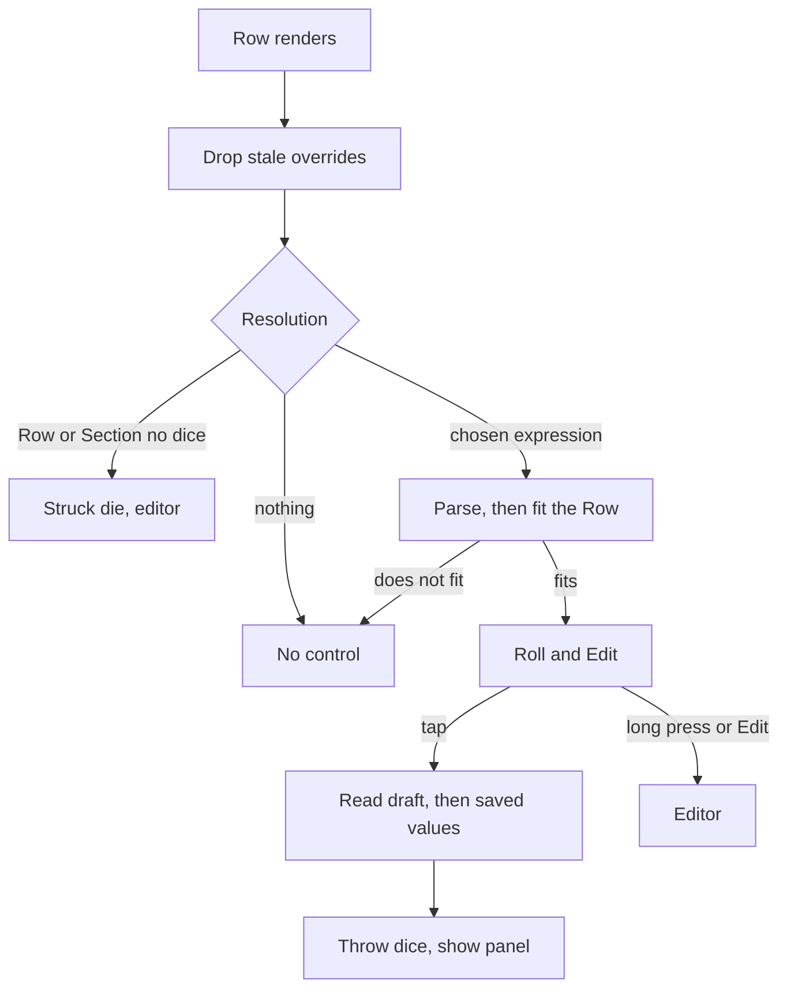
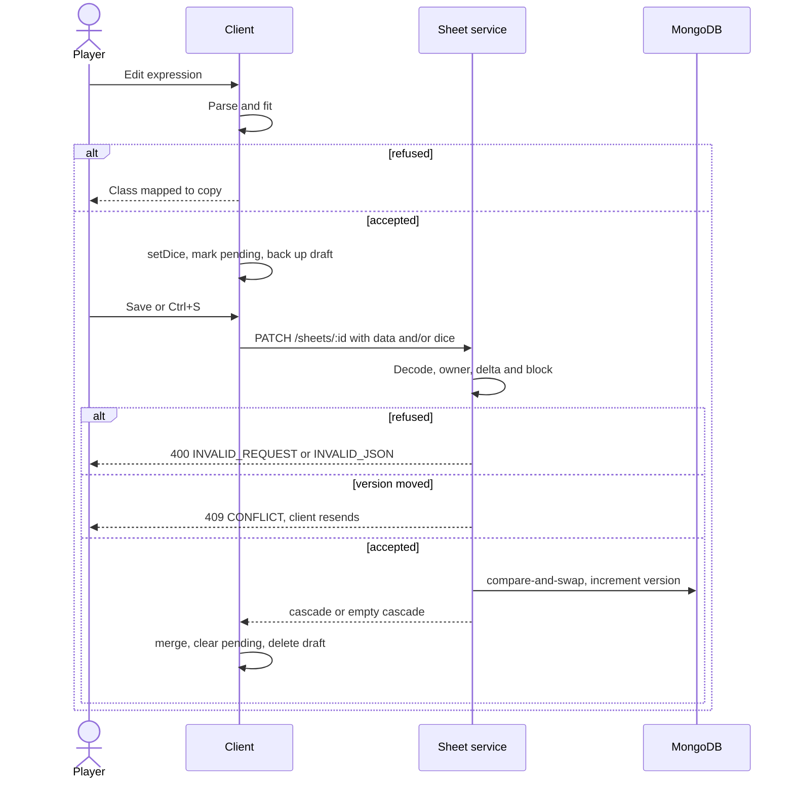

# Dice

## Purpose

Dice expressions attach a roll to a Row or a whole Section. A Template supplies the defaults; a player replaces one, adds one, or turns rolling off on their own sheet. The backend owns the grammar and the save contract, the web client resolves and rolls locally, and no Roll is ever stored.

## Why

- **Roll modes stay a client evaluation option over a keep token in the grammar because** the client already throws, keeps and shows both dice and the server never rolls. A Template can mark a Row or Section whose dice are not d20 tests, so a d20 Hit Die offers no advantage. Cost: a stored expression cannot pin advantage, and a Template author must mark the exceptions.
- **Planned (LGN-380): dice sized by numeric Fields, with a minimum total, over literal `NdM` only because** stat block hit points and Hit Point Dice take their count or size from the Sheet. Multiplication stays out of the grammar: a product is a derived Field. Cost: a grammar change in both implementations and their shared vectors, and range errors that can only appear at roll time.
- **An own grammar over expr-lang** because the expression is typed by a player and the formula engine must never evaluate user text, while the dice needs its own syntax. Cost: a second parser and evaluator.
- **Two implementations over one server implementation** because the client rolls with no round trip and the server validates what it stores. Cost: shared vectors and two suites that must move together.
- **Client Rolls over server Rolls** because a Roll needs no audit trail in V1 and works without a network. Cost: no server authority over a result and no history to replay.
- **Dice saved with the sheet over a dedicated endpoint** because a choice is pending work like a value: reviewed, discarded and saved with the values being edited, under one write and one conflict path. Cost: full-block replacement and a dice-only save that still advances the version.
- **Template defaults authored in code, resolved specificity-first** because a typo fails boot instead of the first Roll, and a Template Row default was put there on purpose: a Section-wide choice must not silently replace it. Cost: changing a default needs a release, and the player edits that Row instead.
- **Strict on write, tolerant on read** because a Template can change under a stored block. Cost: readers ignore stale keys, and `GET` returns them until a save rewrites the block.

## Flows

### Resolve a Row, then roll it



The precedence is: player's Row expression, player's Row "no dice", player's Section "no dice", Template Row default, player's Section expression, Template Section default, then nothing. Only own keys count; an absent key falls through and `null` means "no dice". The chosen expression is judged against the Row once: a Row it does not fit is not rollable, and no later step is tried.

### Edit dice, then save with the sheet



A pending choice lights the footer, counts for the leave guard and `F5`, is reverted by discard and is backed up in the local draft. Setting it back to the saved value clears it. A failed save keeps it pending; a 409 is retried by the client, never by the service.

## Contracts

### Grammar

One to eight terms joined by `+` or `-`, with an optional leading sign; a term is `NdM` or `dM`, an ASCII whole number, a Field path, `@` or `@.<column>`. Limits: 64 characters, 8 terms, 1–20 dice, 1–1000 faces, whole numbers 0–9999.

- Length is Unicode code points, checked first: over-long is `too_long` even when also blank or garbage; blank of at most 64 is `empty`.
- Whitespace is space and tab only, around terms and operators. A newline, a non-breaking space or a space inside a term is `unreadable_term`.
- `d20` means `1d20`; `D` is read like `d`. The canonical form uses a lower-case `d`, an explicit count, single spaces around operators and no leading zeros or `+`.
- Paths are case-sensitive ASCII, dot-separated, each segment `[A-Za-z][A-Za-z0-9]*`; `@` takes at most one column.
- A bare `d` / `D`, or a bare keep token `kh` / `kl` (any case) optionally followed by digits, is `unreadable_term`, never a Field. Look-alikes such as `khazad`, `stats.kl`, `@.kh1` and `dexterity` parse.
- Digits are ASCII; leading zeros are allowed and arbitrarily long digits are a range error, not an overflow. Parse errors go term by term left to right and the term count is checked after every term has been read.

Parse is syntax only: a well-formed path that is not a Field is accepted by Parse and refused at fit time, so validate through the Row or Section check before storing.

### Fit

The schema maps a dotted path to `number`, `text` or `bool`; every Field a term names must exist and be numeric. `@` resolves to the Row key and `@.<column>` to `<row>.<column>`. A table Row key such as `skills.acrobatics` is not itself a Field, so bare `@` does not fit it while `@.total` can. A Section expression fits when it fits at least one Row; no Rows is `no_rows`, and none fitting carries the class of the first Row's problem.

### Evaluation

Dice are thrown in expression order, each yielding 1..faces. Numbers are literal and Field values are floored toward minus infinity before being added, so a Roll may total below zero. The result carries the total and one part per term with its sign, label, value and, for a die, the individual rolls. `no_value` means a Field is absent, null, non-numeric, NaN or infinite; `overflow` means finite Field values sum past the float64 range; `no_roller` (Go only) means a die was evaluated with no roller.

A keep mode (`highest` / `lowest`) is a client evaluation option, not grammar: every d20 term throws one extra die and keeps the best or worst of the count it names, while every other die throws exactly as written. The part then carries all thrown dice plus the `discarded` indices, so a result can show both dice and mark the kept one. Advantage maps to `highest` and disadvantage to `lowest`; Go has no keep mode because the server never rolls.

A Template marks the Rows or Sections whose dice are not d20 tests. A marked Row offers no keep mode: no choice dialog, no popup semantics, Shift and Alt throw normally, and a long press or the Context Menu key throws exactly one die. A Section marking covers every Row of that Section; a Row marking and a Section marking both count. The marking is Template data, so it still holds when the player replaces that Row's expression.

### Error classes

| Stage | Classes |
| --- | --- |
| Parse | `empty`, `too_long`, `too_many_terms`, `dice_count`, `dice_faces`, `number_range`, `missing_term`, `unreadable_term` |
| Fit | `unknown_field`, `non_numeric_field`, `no_rows` |
| Evaluate | `no_value`, `overflow`; Go also `no_roller` |
| Client resolution | `no_dice`, `turned_off` (never sent to the server) |

Go declares `*dice.Error` with a `Class` and `Err*` sentinels; it imports neither `apperr` nor the template package. The sheet service maps every save-side class, unknown key and cap violation to 400 `INVALID_REQUEST`; malformed JSON, a wrong value type or an unknown key is 400 `INVALID_JSON`. A foreign or missing sheet is 404 once the body decodes.

### The `dice` block

`PATCH /sheets/:id` accepts an optional block next to the value delta:

```json
{
  "data": { "stats": { "strength": 15 } },
  "dice": {
    "section": { "skills": "1d20 + @.total", "saves": null },
    "row": { "stats.strength": "1d20 + @.modifier" }
  }
}
```

- `section` is keyed by Section name, `row` by Row key. `null` is an explicit "no dice"; an absent key means "use the Template".
- A present block replaces the whole stored block and is idempotent; an empty block clears it and is stored as none; an absent or `null` block leaves the stored block untouched.
- A body with neither a non-empty `data` nor a block is 400 `INVALID_REQUEST`. A dice-only save skips the DAG and returns an empty cascade.
- The block is capped at 64 entries across both maps, `null` included; every key must name a Section or Row of the sheet's Template.
- Every non-null expression is parsed; a Row override must fit its Row and a Section override at least one of its Rows.
- A save carrying a block advances `version` and `updated_at`.
- `GET /sheets/:id` always returns `dice`, an untouched sheet reading as `{"section":{},"row":{}}`. Reads are tolerant: an override whose Row or Field the Template no longer has is returned as stored and must be ignored.

### Template defaults

`Template.SectionDice` and `Template.RowDice` are code-defined and ship as `dice: {section, row}` on the template detail; the block is omitted when both maps are empty, and an empty side is omitted too. They are never written into a Sheet. Boot validation rejects an unknown Section or Row key, a refused expression, a Row default that does not fit its Row, and a Section default that fits none of its Rows, checking Sections before Rows and keys alphabetically so the error is stable.

`Template.NotD20Sections` and `Template.NotD20Rows` name the Sections and Rows whose dice are not d20 tests. They ship inside the same `dice` object as `not_d20: {section: [...], row: [...]}`, with an empty side omitted; `dice` itself is emitted when either a default or a marking exists. Boot validation rejects an unknown Section, a Section without Rows, or a Row that is no Row of any Section, checking Sections before Rows. A marking is Template data: it survives a player's expression override and is never written to a Sheet.

### Shared vectors

`testdata/dice/vectors.json` is the cross-language contract. Its `version`, `limits`, `fields`, `valid`, `invalid`, `fit`, `sections` and `evaluate` keys are read by both suites. Go asserts every vector in `backend/internal/dice` and its decoder rejects unknown keys, so every key must be read by a test; the web suite asserts them through `web/src/test/dice_vectors.ts`. Class strings and limits are part of the contract.

A grammar change starts in the vectors: add or amend the cases (bump `version` for an incompatible format change), then move both implementations until their suites pass. Changing one side alone leaves the other suite red.

## Code map

- `backend/internal/dice/` — `parse.go` (limits, terms, canonical form), `fit.go` (`Schema`, fit and Section validation), `evaluate.go` (`Roller`, parts, totals), `errors.go` (classes and `ClassOf`).
- `backend/internal/sheet/template/dice_defaults.go` — boot validation and `ValidateSheetDice`; `not_d20.go` — the not-a-d20-test declaration validator; `seeders.go` holds the `fantasy_v1` defaults; `dto.go` emits the template block.
- `backend/internal/sheet/service.go` — `validatedDice`, `translateDiceErr` and the one compare-and-swap save; `sheet.go` holds the stored block; `dto.go` always serializes it on `GET`.
- `backend/internal/app/sheet.go` — the `PATCH /sheets/:id` route.
- `testdata/dice/vectors.json` — the shared vectors.
- `web/src/dice/` — `parse.ts`, `fit.ts`, `resolve.ts` (precedence), `roll.ts` (`performRoll`, `dieFromWords`, crypto source, keep modes), `errors.ts`.
- `web/src/sheet/dice_view.ts` — schema, pruning, error keys, Roll summary and the Template's not-a-d20-test marking; `dice_store.ts` — local check and `setDice`; `sheet_edit.ts` — saved and pending blocks, drafts and the save.
- `web/src/sheet/dice_row.tsx` — Roll/Edit controls, Section button and editor; `roll_mode.tsx` — the Normal/Advantage/Disadvantage choice and its click and context-key mapping; `dice_panel.tsx` — the floating result with its recent-roll history (`dice_history.ts` keeps the last three, newest first, with each entry's mode); `die_icon.tsx`, `dice.css` — shapes.
- `web/src/api/models/dice.ts`, `web/src/api/client.ts` — wire parsing and body.
- `web/src/test/dice_*.test.ts`, `web/src/test/sheet_dice_*.test.*` — vector, resolution, Roll, store and screen suites.

## Tools & dependencies

- The package uses only the Go standard library (`regexp`, `strconv`, `unicode/utf8`, `math`); its tests use testify like the rest of the repo, and it deliberately uses neither expr-lang nor `apperr`.
- No dice library on the web either: plain TypeScript for parsing, fitting, resolution, evaluation and the unbiased word-to-die conversion.
- Web Crypto (`crypto.getRandomValues`) is the only randomness; `dieFromWords` redraws words above the largest multiple of the face count and gives up after 16 attempts.
- The UI uses React, `createPortal`, the shared `Dialog`/`Button`/icon primitives and the l10n table, and adds no dependency; copy and errors resolve by class through `src/l10n/strings.ts`.
- MongoDB stores the block on the sheet; both test suites read the vectors file directly.

## Known limits

- The grammar has no keep tokens: a stored expression is always plain `NdM`, and advantage/disadvantage are an evaluation option of the client Roll (each d20 term throws one extra die and keeps the best or worst), so they need no grammar or save-contract change. The grammar has only `+`/`-`, with no multiplication, exploding dice or per-die modifiers.
- The not-a-d20-test marking is Row- or Section-wide and only excludes the roll modes: it cannot mark a single expression inside a marked Section back into a d20 test, and it never changes the dice a normal Roll throws.
- No Roll history on the server and no server-side Roll: a result cannot be audited or replayed, and refreshing loses the in-memory history.
- Dice attach to Rows and Sections, never to an individual Field; a free-text field such as an attack's damage is not a Dice default.
- A Row with no applicable expression has no editor of its own; adding dice where the Template gave none happens at Section level.
- A Section expression only serves the Rows it fits; the others show no Roll button.
- The client checks the grammar and Row/Section fit but not the 64-entry cap; an over-cap block is refused by the server at save.
- `GET` returns stale overrides untouched; only the client prunes them, so they remain stored until a later save rewrites the block.
- A dice-only save advances the version and `updated_at`, so it conflicts with a concurrent value save like any other write.
- A random source that never yields a word inside the die range throws instead of returning a Dice error; the panel has no class to show for it.
