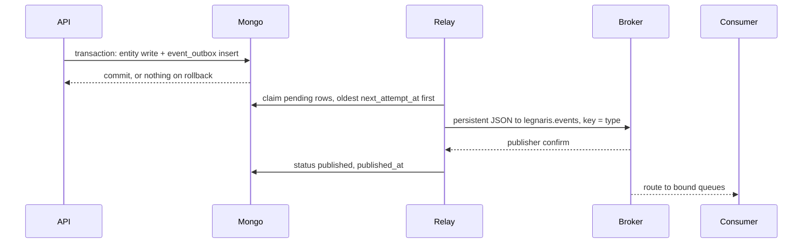
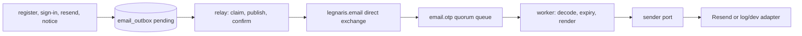
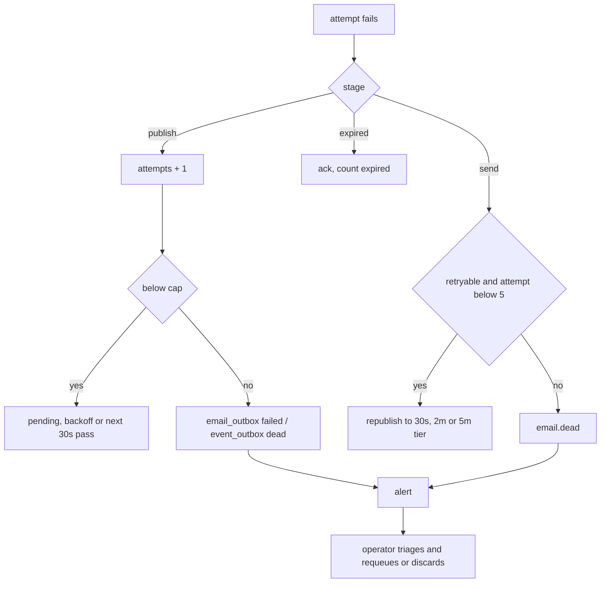

# Events and email

## Purpose

Publish domain facts without blocking the request, deliver the few facts a consumer
cannot lose, and turn a stored email intention into a message at the configured
provider. The area owns both outboxes, the relay process, the RabbitMQ topology,
the email worker, the sweeper that drives pending work, and their metrics.

## Why

- **Outbox instead of dual writes.** A guaranteed event is inserted in the same
  MongoDB transaction as the entity change, so a rollback emits nothing and a
  commit always leaves a row to publish. A crash cannot lose the event; the cost
  is an extra insert and a relay to run.
- **Two tiers, deliberately.** Facts no domain rule depends on (`sheet.*`,
  `campaign.*`, `user.registered`) use an in-process buffered publisher; the
  request never waits for RabbitMQ and an outage drops and counts them. Only
  `plan.changed` and `user.deleted` take the outbox because a consumer's state
  depends on them. The cost is approximate analytics and a
  `legnaris_events_dropped_total` series that is expected to move.
- **Facts, not jobs.** An event reports something already happened; work that
  must finish later is a status and lease on the entity, driven by the sweeper.
  Retry state stays next to its data and no event is used as a queue; the cost is
  one adapter per pending-work type.
- **IDs only.** Payloads never carry Sheet values, codes, addresses or usernames;
  consumers that need values read the API. An event alone cannot reconstruct a
  document.
- **Lease-based claims.** Relays and sweepers claim rows with a lease, not a
  global lock, so replicas can run without publishing twice; a dead process's
  claim expires. The cost is a window during which a crashed row is invisible.
- **At-least-once, deduplicated by identity.** A crash between confirm and mark
  can republish; the envelope id is the AMQP `MessageId`, the email idempotency
  key and the consumer's key. Ordering is not promised, so consumers use
  `aggregate.version`; duplicates are normal.
- **Email is a durable intention.** The API writes `email_outbox` before
  reporting acceptance and never contacts the provider or broker; the relay
  publishes and confirms, the worker consumes and sends. A code arrives only
  when relay, broker and worker are healthy.
- **Provider behind a port.** One `Sender` contract has Resend, log and
  development adapters, so callers and tests never depend on the provider; every
  provider outcome becomes transient, permanent, rate-limited or quota-exhausted.
- **Delay tiers in the broker.** Retries wait in queues whose TTL dead-letters
  back to the work exchange, with no plugin or scheduler; the cost is fixed tier
  names and a retry budget carried on the message.
- **Separate processes, one sweeper table.** The API, relay and worker boot
  independently: the API serves with the broker down, the worker sends without
  MongoDB. Each sweeper queue has its own interval and cap; `event_outbox` runs
  every 30 seconds. The cost is three processes and one shared lease duration.

## Flows

**Guaranteed event: entity write and outbox in one transaction, then relay, broker and consumer.**



**Email: request to provider.**



The relay publishes, waits for the broker confirm and only then marks the row
published; the worker acknowledges only after a send, a dead-letter, or expiry.

**Failure: retry, dead, operator.**



An unconfirmed republish leaves the original unacknowledged for redelivery; an
expired message is acknowledged and counted, never dead-lettered.

## Contracts

**Event envelope (version 1).** JSON, persistent, content type `application/json`.
`id` is a canonical UUID v7 and the AMQP `MessageId`; `type` matches
`<aggregate>.<past_tense_verb>`, uses lower snake case and is the routing key;
`version` is `1`; `occurred_at` is UTC; `actor_id` is a user UUID or `null` when
the system acts; `aggregate` is `{type,id,version}` with the entity version, or
`0` when none exists; `data` carries IDs, changed keys and metadata only. The
encoder rejects non-UUID ids, a malformed type, a non-UUID actor and a negative
version; decoders tolerate unknown fields.

**Event catalog.**

| Type | `data` | Tier |
| --- | --- | --- |
| `sheet.created` | `template_id` | best-effort |
| `sheet.updated` | `changed_keys`, `sheet_version` | best-effort |
| `sheet.deleted`, `user.registered` | `{}` | best-effort |
| `campaign.created`, `campaign.deleted` | `template_id` | best-effort |
| `campaign.member_joined`, `campaign.member_left` | `user_id`, plus `role` on join, `reason` (`left`/`removed`) on leave | best-effort |
| `campaign.role_changed`, `campaign.ownership_transferred` | `user_id`, `from`, `to`; or `from_user_id`, `to_user_id` | best-effort |
| `campaign.sheet_linked`, `campaign.sheet_unlinked`, `campaign.sheet_revealed`, `campaign.sheet_hidden` | `sheet_id`; NPC events add `kind`, `owner_id`; unlink adds `reason`, a character unlink uses `user_id` | best-effort |
| `plan.changed` | `from`, `to` | guaranteed |
| `user.deleted` | `{}` | guaranteed |

A layout write emits `sheet.updated` with `changed_keys: ["layout"]` and does not
bump `sheet_version`. Campaign deletion is pending work on the Campaign, not an
event; `campaign.deleted` follows the removal.

**Event broker topology.** `legnaris.events` is a durable topic exchange whose
routing key is the event type and whose alternate exchange is the durable fanout
`legnaris.events.unrouted`; that feeds the durable quorum queue `events.unrouted`
on an empty key. Publishers declare this on connect; no consumer queue exists in
this repository, so an unbound event is retained. The best-effort publisher
buffers 1024 events on one goroutine with a 5-second confirm timeout and drain;
drop reasons are `buffer_full`, `broker_unavailable`, `publish_failed`,
`shutdown` and `invalid_event`.

**Email message.** JSON, persistent, `MessageId` equal to `id`:

```json
{"id":"<uuidv7>","type":"email.otp","to":"player@example.com","template":"verify_email","data":{"code":"123456","expires_in_minutes":10,"purpose":"verify_email"},"created_at":"2026-11-18T12:00:00Z","attempt":0}
```

Purposes are `verify_email`, `login_otp`, `account_exists` and `delete_account`;
`account_exists` carries no code. The id is the provider idempotency key. The
worker rejects a body that is not JSON, has a non-UUID id, is not `email.otp`, or
lacks a code for a code-carrying purpose.

**Email broker topology.** `legnaris.email` and `legnaris.email.retry` are durable
direct exchanges. `email.otp` is a quorum work queue capped at 10000 with
`reject-publish` overflow and dead-letters to `legnaris.email.retry` key `30s`;
`email.retry.30s`, `.2m` and `.5m` are quorum queues whose TTLs dead-letter back
to `legnaris.email` key `email.otp`; `email.dead` is a quorum queue bound to
`legnaris.email` key `email.dead`. TTLs are configurable through
`EMAIL_RETRY_DELAY_FIRST`, `_SECOND` and `_LATER`; queue and key names are fixed.
Email publishes are mandatory and confirmed, so an unroutable message fails.

**Persisted rows.** `email_outbox` uses `pending`/`published`/`failed`;
`event_outbox` uses `pending`/`published`/`dead`. Both store `attempts`,
`next_attempt_at`, `locked_until`, `locked_by`, `last_error` and `published_at`;
`event_outbox` also stores `event_type` and `body`. Both have a `status` +
`next_attempt_at` index and a TTL index on `published_at` using
`EMAIL_OUTBOX_RETENTION` (default `168h`); pending, failed and dead rows have no
`published_at`, so retention never removes work.

**Retry and dead schedule.** The email relay retries after 5s, 15s, 1m and 5m,
polls every 1s, leases 30s and marks `failed` at `EMAIL_RELAY_MAX_ATTEMPTS` (5).
The `event_outbox` sweeper retries on its next 30-second pass, leases 5 minutes
and marks `dead` at the same cap; a non-canonical id is dead at once. The worker
republishes a retryable failure to the 30s, 2m, then 5m tier and dead-letters at
`EMAIL_WORKER_MAX_ATTEMPTS` (5); an expired code is acknowledged and counted
without a send. The worker counts attempts already made, so a delivery arriving
with `attempt` equal to the cap is dead-lettered without another send. Other
queues (`generation`, `generation_lease`, `users_deleting`, `campaigns_deleting`,
`campaigns_orphan_links`, `billing_events`, `billing_refunds`) have their own
interval and cap.

**Sweeper.** One process, one queue table. Each entry has an interval, batch,
attempt cap and a store with claim, reschedule, mark-dead and oldest-pending. The
lease is fixed at 5 minutes. The oldest pending age is reported before claiming;
a permanent error or `attempts + 1` reaching the cap marks the job dead.

**Metrics.** The relay exposes `legnaris_email_outbox_backlog` and
`legnaris_email_publish_total{result}` on `:9100`; the worker exposes
`legnaris_email_send_total{result}`, `legnaris_email_send_duration_seconds`,
`legnaris_email_dead_total`, `legnaris_email_expired_total`,
`legnaris_email_breaker_open` and `legnaris_email_breaker_opened_total` on
`:9101`. The relay also exposes `legnaris_sweeper_oldest_pending_seconds{queue}`
and `legnaris_sweeper_failed_total{queue}`; the API and relay expose
`legnaris_events_dropped_total{type,reason}`; the broker exposes
`rabbitmq_queue_messages_ready{vhost,queue}` and
`rabbitmq_queue_consumers{vhost,queue}`. The API, relay and worker share one
metrics package, so the API also exposes the other series at zero; rules must
select the owning job. Email alerts cover a non-empty `email.dead`, no consumer,
a work queue that stays non-empty, the outbox backlog, publication failures,
provider retries, the daily cap, verification failures, missing series, register
bursts and an early cap. The sweeper and event alerts cover an item older than an
hour, an old refund, a failed sweep and a non-empty `events.unrouted`. The breaker
opens after five consecutive transient outages and probes after 60 seconds;
rate-limit and quota outcomes are neutral.

## Code map

| Path | Role |
| --- | --- |
| `backend/internal/events/event.go` | event and envelope shapes, version, validation, encode/decode |
| `backend/internal/events/amqp/`, `outbox/`, `relay/` | best-effort publisher, event topology, `event_outbox` repository and sweeper queue |
| `backend/internal/email/message.go`, `destination.go`, `sender.go` | message contract, retry destinations, sender port |
| `backend/internal/email/outbox/`, `relay/` | `email_outbox` repository, relay loop, backoff and marking |
| `backend/internal/email/amqp/` | email topology, confirmed mandatory publishing, consumer, broker supervision |
| `backend/internal/email/worker/` | delivery loop, expiry, render, send, retry, dead-letter, drain |
| `backend/internal/email/factory/`, `resend/`, `templates/`, `disposable/`, `emailtest/` | provider selection, Resend adapter, quota gate, embedded templates, domain check and test senders |
| `backend/internal/sweeper/` | queue definition, lease, reschedule/dead transitions, run loop |
| `backend/cmd/api.go`, `backend/cmd/relay/main.go`, `backend/cmd/worker/main.go` | publishers, both relays, sweeper, reconciler, metrics listeners and the `app/email_intent.go` writer |
| `backend/internal/platform/metrics/metrics.go` | event, email and sweeper series |
| `backend/shared/db/indexes.go`, `transaction.go` | outbox indexes/TTLs and the transaction helper |
| `deploy/prometheus/rules.yml`, `rules-f1a.yml`, `deploy/rabbitmq/rabbitmq.conf` | alerts, console prefix and broker metrics |

Event emitters live in `backend/internal/sheet/events.go`,
`backend/internal/auth/events.go`, `backend/internal/campaign/events.go`,
`backend/internal/billing/consumer.go` and
`backend/internal/accountdeletion/cascade.go`; `auth/service.go` writes intents.

## Tools & dependencies

- **RabbitMQ 4.x** with quorum queues, publisher confirms, alternate exchanges
  and per-message TTL; **`github.com/rabbitmq/amqp091-go`** with recovery on the
  email broker, while event publishers reconnect on demand.
- **MongoDB** (replica set) for both outboxes and every sweeper queue; the
  transaction helper is `backend/shared/db`. **Resend** over HTTPS is the real
  provider; `log` and `dev` adapters run locally and a recorder runs in tests.
- **Prometheus and the broker's Prometheus plugin**, read by Grafana and the
  alert rules; **`zerolog`** through `backend/shared/logger`. The shared env
  surface requires no relay or worker key for the API to boot.

## Known limits

- **At-least-once only.** A crash between provider acceptance and acknowledgement
  can send twice; the provider deduplicates by message id. Events have no order.
- **Best-effort events can disappear.** A full buffer, an unavailable broker or a
  shutdown drain drops an event; only `legnaris_events_dropped_total` records it.
- **No event consumer in this repository.** No queue binds `legnaris.events` yet,
  so every event reaches `events.unrouted` and the alert fires until a consumer
  declares its queue and bindings.
- **Dead items need a person.** `event_outbox` rows in `dead`, `email_outbox`
  rows in `failed` and messages in `email.dead` are never retried automatically,
  and no replay command exists. The TTL covers `published_at` only, so these rows
  persist. The operator procedure lives in `deploy/README.md`.
- **No bounce or complaint handling.** Provider webhooks are not consumed; a hard
  bounce matters only if the provider returns a permanent error at send time.
- **The worker cannot revoke a code.** Expiry comes from the message's creation
  time and advertised lifetime; a consumed or superseded code may still be
  delivered once, harmless because codes are single-use.
- **The code travels in the clear.** The broker and console hold queued codes;
  access is limited to the delivery vhost and operator route, not encryption.
- **Fixed lease and tier names.** Every sweeper queue holds a five-minute lease,
  and changing a delay changes the TTL, not the `email.retry.*` name.
