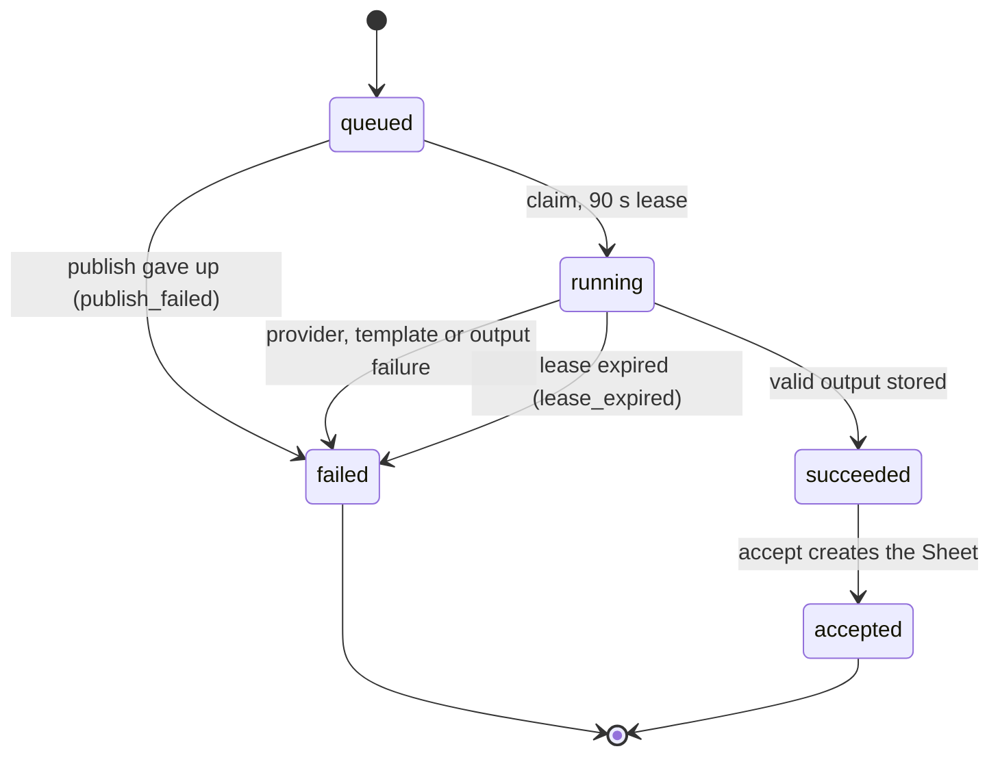

# Generation

## Purpose

Generation turns a short free-text concept into a draft of values for a Template using an external LLM. The player reviews and edits the draft; a Sheet exists only after an accept with a name. The area also owns consent, quotas, the global daily job cap and the kill switch.

## Why

- **An asynchronous draft over a synchronous request:** reasoning takes 10–40 s, too long to hold a mobile request through proxies; the cost is a job state machine, a lease reaper, a republish sweep and a polling client.
- **A draft over creating the Sheet immediately:** discarding or regenerating must not spend a Sheet slot or leave an unwanted Sheet; the cost is an accept step and an idempotent repeat accept.
- **RabbitMQ over polling Mongo for work:** the broker is already deployed, confirms publishes and routes by kind; the cost is a second job mechanism, a dead-letter queue and a sweeper for lost publishes.
- **OpenRouter over calling DeepSeek directly:** one OpenAI-compatible adapter, provider fallbacks and per-request routing without several integrations; the cost is an extra processor in the data path and a disclosure that names it.
- **The paid, pinned model over a `:free` variant:** free endpoints may log or train on prompts; the cost is a higher price, and boot refuses a `:free` model.
- **Default routing over a strict zero-retention filter:** the concept is free text the player chooses to send, not sensitive personal data; the cost is that each provider's retention and training terms apply and the request may be processed outside Brazil, including China. Consent discloses this, and a gateway, model or routing change is a consent change.
- **A strict JSON Schema plus Go validation over trusting the prompt:** prompt injection cannot change the answer's shape, only its content; the cost is retries and an occasional terminal `invalid_output`.
- **Versioned explicit consent over burying it in the terms:** a transfer abroad needs a specific basis and separate revocation; the cost is one modal before the first generation and again after a version bump.
- **Excluding the player name over asking the model for it:** the model cannot know it, so it never enters the prompt or schema; the field stays editable and seeds empty, and the Sheet name is suggested only from the character name.
- **Keeping concept and output out of logs over rich debugging:** both may hold the player's text; the cost is logs limited to identifiers, counters, timing and classified errors.
- **One open job plus a global daily cap over per-user limits alone:** both bound provider spend and keep the UI unambiguous; the cost is that a second request conflicts and a shared cap can refuse everyone for a day.
- **Paid-only generation over a Free allowance:** every call costs money; the cost is that a Free account sees an upgrade modal instead of a draft.

## Flows

```mermaid
sequenceDiagram
    participant W as Web
    participant A as API
    participant M as MongoDB
    participant Q as RabbitMQ
    participant K as Worker
    participant L as OpenRouter
    W->>A: GET /me/plan
    A-->>W: consent required?, paid quota, active generation
    opt consent missing or outdated
        W->>A: PUT /me/llm-consent {version}
        A->>M: set llm_consent_at, llm_consent_version
    end
    W->>A: POST /generations {template_id, kind, concept}
    A->>A: kill switch, shape, template/kind, consent, Sheet room, one job
    A->>M: transaction: reserve daily cap, reserve quota, insert queued job
    A->>Q: publish generation.<kind>.requested (confirm)
    A-->>W: 202 {id}
    Q->>K: deliver job
    K->>M: claim queued -> running (90 s lease)
    K->>L: system prompt, concept, strict JSON Schema
    L-->>K: JSON values, usage, finish reason
    K->>K: validate, expand exclusive groups, seed and recalculate
    alt valid
        K->>M: running -> succeeded with values
    else invalid after 2 retries or provider failure
        K->>M: transaction: running -> failed, refund quota
    end
    loop every 5 s, up to 120 s
        W->>A: GET /generations/{id}
        A->>M: find owned job
        A-->>W: status, kind, template_id, values/error_code, suggested_name
    end
    W->>W: edit locally; preview recalculates through the Template
    W->>A: POST /generations/{id}/accept {sheet_name, values}
    A->>M: transaction: reserve Sheet slot, create Sheet, mark accepted
    A-->>W: 201 {sheet_id} (200 with the same id on repeat)
```

`DELETE /me/llm-consent` clears both consent fields, refunds every queued or running reservation and deletes all generation documents for the user in one transaction. A worker whose document disappeared acks and writes nothing.



## Contracts

### Endpoints

| Endpoint | Success | Contract |
| --- | --- | --- |
| `POST /generations` | `202 {id}` | Body `{template_id, kind, concept}`; `kind` is `character`, `npc` or `enemy` and `concept` is 10–1000 runes after sanitizing. Gates: kill switch, shape, Template accepts the kind, paid Plan, consent, read-only Sheet limit, no open job, then one transaction for cap, quota and the `queued` insert. The publish follows the commit; a failed publish still answers 202. A Free account is refused with 403 `PLAN_UPGRADE_REQUIRED` before any reservation. |
| `GET /generations/{id}` | `200` | `{id, status, kind, template_id, values?, error_code?, suggested_name, created_at}`. `values` appears on `succeeded`/`accepted`, `error_code` on `failed`, and `suggested_name` is always present, `null` when absent. A missing or foreign id is 404. |
| `POST /generations/{id}/accept` | `201 {sheet_id}`, `200` on repeat | Body `{sheet_name, values}`. Values go through the normal DAG path used by a Sheet create; derived (non-editable) leaves sent back from the preview are dropped and recalculated, while unknown keys are still refused, then the slot is reserved and the Sheet created in one transaction. A job that is not `succeeded` is 409. |
| `PUT`/`DELETE /me/llm-consent` | `204` | `PUT {version}` records consent idempotently; another version is 400 `VALIDATION` and a Free Plan is 403 `PLAN_UPGRADE_REQUIRED`. `DELETE` clears consent, refunds open reservations and deletes the user's generation documents. |
| `GET /me/plan` | `200` | Adds `llm_consent_required`, `llm_consent_at`, `llm_consent_version` and `active_generation_id` beside the paid daily counter. A Free account returns only `plan: "free"`: no counter and no `llm_consent_required`. `active_generation_id` lets the screen resume polling. |

Create and accept share 5 requests/min per user (`GENERATION_CREATE_RATE_LIMIT_*`); reads allow 30/min (`GENERATION_READ_RATE_LIMIT_*`); refusals are 429 `RATE_LIMITED` with `Retry-After`.

### Statuses and errors

Statuses are `queued`, `running`, `succeeded`, `failed` and `accepted`. Failure codes stored on the document are `publish_failed`, `provider_unavailable`, `provider_failed`, `invalid_output`, `template_unavailable` and `lease_expired`.

API errors: `INVALID_REQUEST` and `INVALID_JSON` 400; `UNAUTHORIZED` 401; `LLM_CONSENT_REQUIRED` 403; `PLAN_UPGRADE_REQUIRED` 403 for a Free account requesting a generation or accepting consent; `NOT_FOUND` 404; `SHEET_LIMIT_REACHED` 409 with `{kind, limit}`; `GENERATION_IN_PROGRESS` 409; `CONFLICT` 409 for an accept that is not ready; `QUOTA_EXCEEDED` 429 and `GENERATION_CAP_REACHED` 503 with `Retry-After` until the next UTC midnight; `PROVIDER_UNAVAILABLE` 503 for the kill switch or no eligible provider; `VALIDATION` 400 for a consent version mismatch.

### Persisted shapes and indexes

- `generations` — UUID v7 id, `user_id`, `template_id`, `kind`, sanitized `concept`, `status`, `active_user_id`, `attempts`, `lease_until`, `publish_lease_until`, `publish_attempts`, `reap_attempts`, `values`, `error_code`, `sheet_id`, `quota {kind, day_utc}`, `created_at`, `expires_at`. A sparse unique index on `active_user_id` enforces one open job per user; a TTL index on `expires_at` removes the document 24 h after creation.
- `generation_cap` — one row per UTC day with `count`, expiring after 48 h; the cap is reserved atomically before the insert and is never refunded.
- `generation_usage` — `{user_id, day_utc, count}` for the paid daily quota, unique per user and day, expiring after 48 h. `users` carries `llm_consent_at` and `llm_consent_version`.

### Quotas

Paid accounts spend 30 per UTC day. Only a paid Plan may generate: a Free request is refused before any reservation with 403 `PLAN_UPGRADE_REQUIRED`. The quota is reserved in the job's insert transaction and refunded when a job ends `failed` (provider, invalid output, expired lease or exhausted publish). Schema and transport retries are free, republishing is free, and regenerating is a new job that spends one. The global cap defaults to 200 jobs per UTC day (`GENERATION_DAILY_CAP`) and is shared by every kind and Plan.

### Consent and legal copies

The consent version is the constant `3`. `docs/legal/llm-consent.json` is the source of truth for the version and wording (English and pt-BR): OpenRouter as gateway, DeepSeek V4.1 Flash as model, transfer outside Brazil including China, 24 h retention in Legnaris, each provider's own retention and training terms, and how to revoke. Consent is offered and accepted only on a paid Plan: a Free account cannot record it and is never asked, because `llm_consent_required` is set only when the Plan can generate. A copy lives in `backend/internal/llmconsent/llm-consent.json` beside the version constant, and the web imports `web/src/generate/llm_consent.json`. Both copies must match the source: `TestVersionMatchesDisclosure` compares the backend copy byte-for-byte and the constant's version, while `llm_consent_sync.test.ts` compares the web copy's parsed JSON. Bump the version and all three copies whenever provider, model, region, retention or revocation changes. `docs/legal/privacy-policy.en.md` and `privacy-policy.pt-BR.md` are equally authoritative, with web copies pinned by `privacy_policy_sync.test.ts`.

### Prompt, schema and validation

The system prompt is fixed English: it names what the kind represents, lists every generatable leaf with label, type and bounds (with `prefer_default` rendered as "keep <default> unless the concept states otherwise"), turns each exclusive group into a single-choice list, forbids published works and says the concept is a description, not instructions. It never asks for `identity.playerName`. The user message wraps the sanitized concept in `<concept>` tags (angle brackets replaced) and labels it with the kind; retries append validation problems. The schema is nested like the Template, covers only leaves generatable for the kind, requires every property, forbids additional properties and represents exclusive groups as enums.

Output is parsed as strict JSON (1 MiB bound), rejected on unknown keys, checked for type, finiteness, range and rune length, expanded into 0/1 exclusive flags, then seeded and recalculated as a preview would. Invalid output is retried twice with the problems sent back; transient transport failures get one retry after 500 ms, and an open circuit breaker fails fast. A terminal failure stores its code and refunds the quota.

### Template metadata

`FieldSchema` carries `Generatable`, `GeneratableKinds`, `PreferDefault`, `Min`, `Max` and `MaxLength`; `Template` carries `NameLeaf`. Boot (`BuildRegistry`, in API and worker) rejects a generatable leaf that is not editable, kinds on a non-generatable leaf or outside the known kinds, `prefer_default` on a non-generatable leaf or outside its bounds, `Min > Max`, bounds on a non-number, a non-positive `MaxLength` and `MaxLength` on a non-text leaf; a non-empty `NameLeaf` must resolve to a text leaf. In `fantasy_v1` every editable leaf is generatable except `rules.*` and `identity.playerName`; `level`, `xp` and `proficiencyBonus` prefer their defaults so a concept without a stated level yields a starting character.

### Configuration and boot checks

`GENERATION_ENABLED` (default false) is the kill switch: the API answers 503 `PROVIDER_UNAVAILABLE` before reserving anything, and the worker does not open the LLM consumer. `GENERATION_DAILY_CAP` (default 200) must not be negative. `LLM_PROVIDER` is `openrouter`; the other keys are `LLM_BASE_URL`, `LLM_API_KEY` (worker only), `LLM_MODEL` (default `deepseek/deepseek-v4.1-flash`), `LLM_TIMEOUT` (default 60 s) and `LLM_REASONING_EFFORT` (empty for the provider default, or `none`, `minimal`, `low`, `medium`, `high`, `xhigh`). The environment check refuses a `:free` model, a negative cap and an unknown effort; building the worker client additionally refuses an unknown provider or a missing key, model or logger, a non-HTTP base URL and a non-positive timeout.

## Code map

- `backend/internal/generation` — service, worker, prompt/schema/validation, assembly, Mongo store, lease reaper, republish queue and shared types.
- `backend/internal/generation/amqp` — confirmed publisher and consumer (prefetch 4); declares the exchange, quorum queues and dead-letter topology.
- `backend/internal/llm` — `Client` port, request/response types and transient/permanent/unavailable errors.
- `backend/internal/llm/factory` and `backend/internal/llm/openrouter` — adapter selection and the OpenAI-compatible HTTP client, routing and logging.
- `backend/internal/llmconsent` — consent service, Mongo stores, version check and the embedded disclosure.
- `backend/internal/quota` — paid daily counter, reservation and refund.
- `backend/internal/sheet` — `create_values.go` (accept) and `limits.go` (limit check and slot reservation).
- `backend/internal/sheet/template` — generation metadata, name leaf, seeding and the registry.
- `backend/internal/app` — `generation.go`, `llm_consent.go`, `plan.go`, `router.go` and `bootstrap.go`.
- `backend/cmd/worker` — builds the LLM client, registry, worker and consumer when generation is enabled; `backend/cmd/relay` runs the sweeper queues.
- `backend/shared/db/indexes.go`, `backend/shared/env/env.go`, `backend/shared/apperr/err.go` and `backend/internal/platform/{breaker,metrics}` — indexes, config, error codes, circuit breaker and cap gauges.
- `web/src/generate` — concept screen, consent modal, polling, preview editing and accept; `generation_flow.ts` holds the pure length and wait rules; `web/src/api` holds the calls, models and error-kind mapping.
- `deploy/.env.example`, `deploy/docker-compose.yml` and `deploy/prometheus/rules-f1a.yml` — keys, process placement and the 80% alert.

## Tools & dependencies

- **OpenRouter** chat completions with strict `json_schema` response format; every request carries `provider.require_parameters` and `allow_fallbacks`, with no retention or provider filter. A plain `http.Client` applies `LLM_TIMEOUT`.
- **DeepSeek V4.1 Flash** (`deepseek/deepseek-v4.1-flash`), the pinned paid model.
- **RabbitMQ** topic exchange `generation`, key `generation.<kind>.requested`, quorum queue `generation.requests`, dead-letter queue `generation.dead`, publisher confirms and unroutable detection.
- **MongoDB** transactions for cap, quota and insert and for terminal failure plus refund; sparse unique and TTL indexes.
- **Prometheus/Grafana** for `legnaris_generation_cap_used`, `..._cap_limit` and `..._cap_used_ratio`, feeding the 80% alert.
- **Web**: React Query for plan invalidation, the shared API client and the Field/Dialog/Notice primitives; consent copy is a bundled JSON import.

## Known limits

- There is no moderation call, no output denylist and no output filter; the published-works rule is enforced by the prompt only.
- Prompt-injection defense is the schema plus validation, not content filtering; the model can still produce inaccurate or unwanted text.
- There is no streaming and no cancel endpoint; regenerate is a new paid job.
- Only one generation may be open per user, so a second request conflicts even when the first is nearly done.
- No Campaign data reaches the prompt, because it may hold other users' data that the consent does not cover.
- Generation is paid-only; a Free account sees an upgrade modal and every request is refused with `PLAN_UPGRADE_REQUIRED`.
- The cap and quota are shared across kinds; there is no per-kind budget, and the cap is not refunded for failed jobs.
- Provider availability and routing are outside Legnaris' control; there is no zero-retention guarantee, and an outage or refusal ends the job with a refund.
- Generation documents disappear only when Mongo's TTL monitor runs, so 24 h is a floor rather than an exact deadline; deletion and revocation remove them explicitly.
- If the publish fails, recovery depends on the relay sweeper (queued jobs older than 10 s, up to 5 attempts), not on the API response.
- Cap gauges refresh only when a reservation is attempted, so they can be stale after UTC midnight until the first generation of the day.
