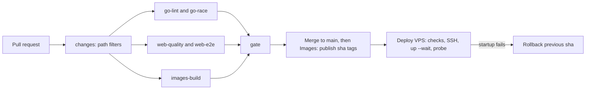
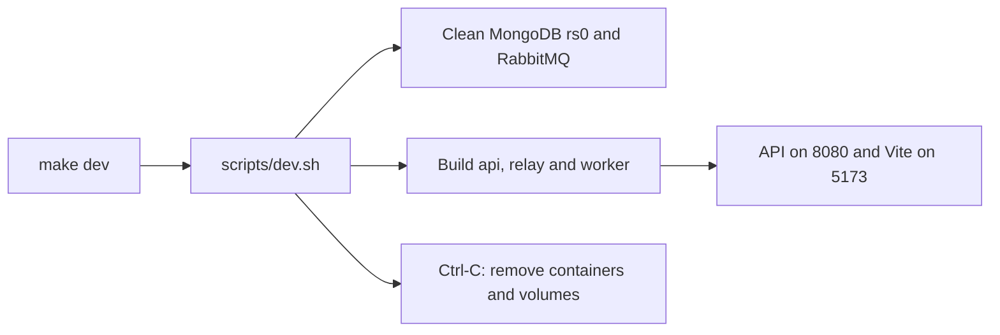

# Platform

## Purpose

Legnaris runs on one VPS as a Docker Compose stack behind Traefik, and every
change reaches it through a pull request that passes one CI gate and a deploy
that pins an immutable image. This file explains that machine, the pipeline that
feeds it, the observability that watches it, and the tools that build and check
the code. It is the place to record a tool change: a new linter, a replaced
scanner or a new CI job is documented here in the same pull request.

## Why

- **One VPS with Compose over a k3s cluster with Argo CD.** A single host, one
  database volume and one operator do not earn a control plane, sync controller,
  sealed secrets and a second deploy path. Compose files are reviewable, and a
  deploy is a checkout plus an image pull, so failures are visible in
  `docker compose ps` and logs. Cost: no scheduler, no self-healing across nodes
  and no rolling update beyond recreating a container; host loss is total
  downtime and the volumes stay tied to it. The earlier GitOps setup was built,
  then removed.
- **Images built once in CI, never on the host.** The API, web and broker images
  are published to GHCR under the commit SHA, and the VPS only pulls them.
  Building on the host would tie production to its toolchain and make a rollback
  a rebuild. Cost: a failed publish blocks every deploy, and the stack is only
  as reproducible as the registry.
- **One application image, several binaries.** `/app`, `/relay`, `/worker`,
  `/canonicalize-emails` and `/migrate-sheet-kinds` share a build and version
  because they share domain code; cost: a bump rebuilds all and the image is
  larger.
- **A single-member MongoDB replica set with a keyfile.** Transactions and
  change streams require a replica set, so production runs `rs0` even on one
  host, and the keyfile turns authorization on. Cost: no failover; the replica
  set buys consistency features, not availability.
- **Traefik with a file provider and no Docker socket.** Routing is a committed
  file that can be reviewed and tested, and the edge proxy never receives the
  Docker API. TLS comes from Let's Encrypt over HTTP-01. Cost: adding a service
  means editing and reloading the file, and one unsupported option disables
  every route.
- **Path-filtered CI on a metered plan.** A `changes` job decides whether the
  Go, web or image suites are needed, and the only required check is a `gate`
  that always runs; a skipped suite counts as passed, so a docs-only pull
  request spends almost nothing. Cost: a filter that misses a dependency can
  skip a suite, so the list is reviewed like code.
- **Actions pinned by commit, Dependabot monthly.** A retagged action cannot
  execute in the pipeline, and Dependabot proposes the bumps instead of a
  floating major tag doing it silently. Cost: bumps are manual and batched.
- **Deploy only after the artifact and configuration are proven.** The pipeline
  refuses a commit that is not on `main`, images that were not published, and a
  production environment whose keys do not match the example. The SSH key is a
  forced command, the environment file travels on standard input, and the host
  writes it at mode 600. There is no approval gate because there is one
  maintainer; cost: merging to `main` is the production action.

## Flows

### Pull request to production

A pull request runs only the suites its diff needs, plus the gate; the merge runs
no new tests because the tree already passed it. The merge publishes the images,
and that is what triggers the deploy.

A failed deploy rolls back to the SHA recorded on the VPS and exits non-zero. A
manual redeploy or forward rollback is a `Deploy VPS` run with a SHA already on
`main` and published, with the same checks; runs are serialized, never cancelled
midway.

### Local development

Local development starts no Traefik, OAuth proxy or observability stack. The dev
sender prints one-time codes, and every run starts from empty data.

## Contracts

- **Required check.** Branch protection on `main` requires the `gate` job only.
  `gate` runs even when every other job is skipped and fails when any job that
  ran failed or was cancelled; skipped suites count as passed.
- **Path filters.** The `changes` job classifies the diff as `go` (Go files,
  `backend/**`, `testdata/**`, `deploy/**`, `scripts/**`, `.githooks/**`, the
  module and lint files, the workflow), `web` (`web/**` and the workflow) or
  `images` (both Dockerfiles and ignore files, `deploy/rabbitmq/**`, the module
  files, the workflow). A new path a suite must see goes into the filter.
- **Image identity.** Published images are `ghcr.io/<owner>/legnaris-app`,
  `legnaris-web` and `legnaris-rabbitmq`. The immutable tag is
  `sha-<full 40-hex commit>`; `v*` tags add a version. The VPS override requires
  `IMAGE_TAG` and drops every `build:` section, so an unset tag fails rather
  than falling back to `latest`.
- **Deploy trigger and checks.** `Deploy VPS` runs when `Images` completes
  successfully for a push to `main`, or by manual dispatch with a SHA; a failed
  publication never reaches the host. It uses the `production` environment and
  the secrets `VPS_HOST`, `VPS_USER`, `VPS_SSH_KEY`, `VPS_KNOWN_HOSTS` and
  `PRODUCTION_ENV`, and proves before SSH that the SHA is an ancestor of `main`,
  that the three image manifests exist for `sha-<SHA>`, and that `PRODUCTION_ENV`
  has exactly the active keys of `deploy/.env.example` (comment-only keys are
  optional). A failure stops with the VPS untouched.
- **Restricted channel.** The CI key's authorized line runs
  `deploy/vps/ssh-entry.sh` under `restrict` and a forced command. It accepts
  only `deploy <40-hex sha>` or `deploy <40-hex sha> env`; the second form writes
  the environment file from standard input atomically at mode 600 before handing
  over to `deploy/vps/deploy.sh`. The key cannot open a shell.
- **Host deploy.** `deploy.sh` refuses a SHA that is not on `origin/main`, checks
  it out detached, pulls the images, runs
  `docker compose up -d --remove-orphans --wait --wait-timeout 180`, and records
  the SHA in `deploy/.deployed_sha` only on success; on failure it redeploys the
  previous SHA.
- **Post-deploy probe.** The run checks
  `https://api-legnaris.paulovalleriote.io/health` and the web root with 12
  attempts, 10 seconds apart and a 10-second timeout each, so a green run means
  the public endpoints answered.
- **Edge and topology.** `legnaris.paulovalleriote.io` serves the web client and
  `api-legnaris.paulovalleriote.io` the API, both public.
  `ops-legnaris.paulovalleriote.io` serves `/grafana`, `/prometheus`, `/mongo`,
  `/rabbitmq` and the OAuth callback behind oauth2-proxy's GitHub login and the
  `GITHUB_USER` allowlist. The project is `legnaris-prod`; only ports 80 and 443
  are published, `web` joins `edge` alone, and the database, Redis, broker,
  relay, worker, exporter and observability sit on `internal` only. `/health`
  is public and rate limited; `/ready` and `/metrics` are not publicly routed.
- **Data services.** MongoDB provisions three least-privileged accounts on every
  start (`legnaris_app` read/write, `legnaris_exporter` server metrics,
  `legnaris_view` read-only); no service connects as root. RabbitMQ keeps
  delivery queues in the `legnaris` vhost with an application account that
  cannot open the console and a separate operator account that can. Redis is
  memory-only with `noeviction` and the limiters fall back to per-process
  counting when it is unreachable.
- **Runtime configuration.** Processes read the environment through
  `backend/shared/env`; keys and defaults are in `.env.example`,
  `deploy/.env.example` and the owning context files. Production receives the
  whole file as one GitHub environment secret; rotation is editing it and
  redeploying.
- **No credential in the repository.** The only repository secret is none: the
  pipeline uses the automatic `GITHUB_TOKEN` (`packages: write` on the image
  job, push events only) plus the deploy environment secrets above, and a job
  that needs anything else documents it in its own workflow header.

## Code map

| Path | What it owns |
| --- | --- |
| `.github/workflows/` | The pull-request pipeline and gate, the image publish and the VPS deploy. |
| `.github/workflows-disabled/`, `.github/dependabot.yml` | The advisory AI review and monthly update pull requests. |
| `deploy/docker-compose.yml` | The production stack, networks, volumes and health checks. |
| `deploy/docker-compose.vps.yml` | Override that swaps local builds for SHA-tagged GHCR images. |
| `deploy/docker-compose.dev-observability.yml`, `deploy/docker-compose.loadtest.yml` | Dev Prometheus and Grafana, plus the throwaway load-test overlay. |
| `deploy/traefik/` | Static flags, routes, middlewares, headers and the OAuth gate. |
| `deploy/mongodb/` | Keyfile, `rs0` initiation and user provisioning. |
| `deploy/rabbitmq/` | Pinned broker image, Prometheus plugin, vhost and accounts. |
| `deploy/prometheus/`, `deploy/grafana/`, `deploy/loki/`, `deploy/alloy/` | Scrape targets, alerts, dashboards, log store and Docker-log collector. |
| `deploy/vps/` | Bootstrap, forced-command entry and deploy/rollback scripts. |
| `deploy/cd/` | Ancestry, image, environment-key and probe helpers. |
| `deploy/.env.example` | The key contract checked against the production environment. |
| `Dockerfile`, `web/Dockerfile` | The application image (five binaries, distroless) and the nginx web image. |
| `Makefile`, `scripts/dev.sh`, `scripts/loadtest-dev.sh`, `loadtest/k6/` | Local entry points and the k6 scenarios. |
| `.golangci.yml`, `.mockery.yaml`, `.githooks/pre-commit` | Linter set, mock targets and the local format hook. |
| `web/vite.config.ts`, `web/playwright.config.ts`, `web/e2e/` | Vitest coverage gates and the browser suite. |
| `backend/shared/env`, `backend/internal/platform`, `backend/internal/sweeper` | Configuration parsing, health, metrics, rate limiting, CORS, client IP and background cleanup. |
| `.opencode/agents/review/`, `.opencode/commands/`, `.claude/skills/` | Review subagents, spec commands and the Jira skill. |

## Tools & dependencies

- **Go 1.26.10** (`go.mod`, also the image builder) and **Node 24**
  (`web/.nvmrc`). Both are pinned so a local run and CI compile the same code.
- **golangci-lint v2.13** with the error, vet, static analysis, unused code,
  complexity (15), duplication (150 tokens) and repeated-literal linters, plus
  **gofmt** and **`go mod tidy -diff`**. Tests are exempt from the size linters
  and the module files must stay canonical.
- **shellcheck** over the deploy, script and hook shell files. They run as
  root-equivalent on the host or gate local work, where quoting bugs are costly.
- **mockery v2**, a Go tool in `go.mod` configured by `.mockery.yaml` that
  generates the `mocks/` packages used with `NewMockX(t)`; hand-written mocks
  drift, while generated ones fail to compile when the interface changes.
- **ESLint 9, Prettier 3, TypeScript 6 and Vite 8**, with the React, hooks,
  accessibility, `no-unsanitized` and security plugins. The anti-XSS and a11y
  rules are why web lint blocks, and Prettier removes formatting debate.
- **Vitest 5** with jsdom, Testing Library and `@vitest/coverage-v8`; coverage
  thresholds (about 90% of lines and statements) fail on a regression.
- **Playwright 1.64** with Chromium and `@axe-core/playwright`, covering
  accessibility, PWA installability and offline, security headers, responsive
  layout and auth. Screenshot comparison was removed: baselines failed on every
  visual change and anti-aliasing noise without catching regressions.
- **k6 0.57.0** from the `grafana/k6` image, for the PATCH, capacity, stress,
  soak, concurrency, onboarding and auth-storm scenarios with optional
  Prometheus remote write; the pinned image keeps results comparable.
- **Docker Compose 2.24 or newer**, because the VPS override uses the `!reset`
  tag. CI also runs `docker compose config` against `deploy/.env.example`,
  proving every required variable is wired into a service.
- **GitHub Actions, GHCR and Dependabot.** Actions are pinned by commit with the
  human version in a comment; Dependabot proposes npm and action updates
  monthly. GHCR stores the immutable images and the package is public.
- **The pre-commit hook** (`.githooks/pre-commit`, enabled by `make setup`)
  formats staged Go and web files and re-stages them, staying fast enough that
  nobody reaches for `--no-verify`.
- **Claude and OpenCode tooling.** The repository commits review subagents, spec
  commands and the Jira skill; harness hooks are not versioned here. The only
  Claude hook that runs during authoring is the operator's global Impeccable
  design check after UI edits, and it is advisory. The AI PR review workflow
  lives in `workflows-disabled/` only.
- **Local security scan.** `make sec-scan` runs `npm audit`, signature and
  lockfile integrity checks and, when installed, gitleaks. It is a developer
  command, not CI: the metered plan runs no SCA, SAST, DAST, Lighthouse or image
  scan.
- **Pinned runtime images.** Traefik v3.3, oauth2-proxy v7.8.0, MongoDB 7.0,
  Redis 7.4-alpine, RabbitMQ 4.4.0, Prometheus v3.1.0, Grafana 11.4.0, Loki
  3.3.2, Alloy v1.17.1 and the Percona MongoDB exporter 0.40.0. The broker tag is
  bumped in its Dockerfile and nowhere else.

## Known limits

- One host and one database member: no failover, no horizontal scaling and no
  maintenance window without downtime, so a host failure takes the site,
  observability and data together.
- Backups are manual volume copies; there is no scheduled backup, restore drill
  or off-host copy of `mongo_data`, `prometheus_data`, `loki_data`, `grafana_data`
  and `rabbitmq_data`.
- There is no staging environment. Every merge to `main` publishes images and
  deploys them, and the only pre-production signal is the pull-request gate.
- Images are not scanned, signed or pinned by digest. A compromised registry tag
  would be pulled as-is, and the scanning of earlier pipelines is not enforced.
- `go.mod` and the Docker base images are not covered by Dependabot, and no
  scheduled CI run exists, so drift in either is found only when someone looks.
- Alerts have no notification channel: nothing pages the operator. Adding
  Alertmanager or a Grafana contact point is an explicit, unconfigured step.
- Alloy mounts the Docker socket read-only to collect container logs. A
  read-only mount still allows driving the Docker API, so compromising Alloy
  compromises the host's Docker API; the edge proxy does not mount it.
- Redis is memory-only and the rate limiters fail open when it is unreachable;
  in that window each process enforces its own cap and the effective limit is
  higher than configured.
- The deploy recreates containers with `up -d --wait`; there is no blue-green
  deploy or draining beyond the stop grace period, and a rollback restores code
  and images, not data.
- The load-test acceptance for PATCH at 100 req/s with p95 under 200 ms and
  under 0.1% errors has no recorded pass. The DAG benchmark is the measured
  baseline: a 200-field full cascade at about 0.12 ms per operation sequentially
  and 0.055 ms in parallel, a `fantasy_v1` edit at about 0.069 ms, and p95 far
  below the 50 ms budget, roughly 400 times of headroom. The stress and auth
  runs are laptop numbers showing the shape of degradation (flat until
  saturation, then a sharp climb, with recovery and no errors at the top
  steps), not deployment capacity.
- The ops surface trusts one GitHub account allowlist and a shared operator
  broker account, with no further role separation.
