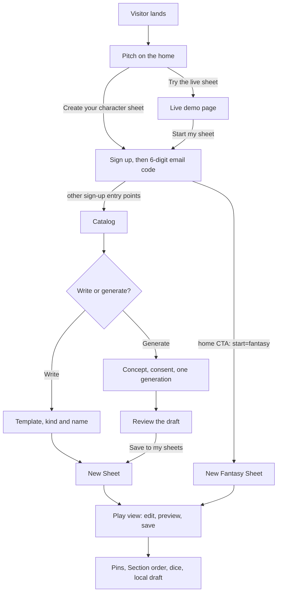
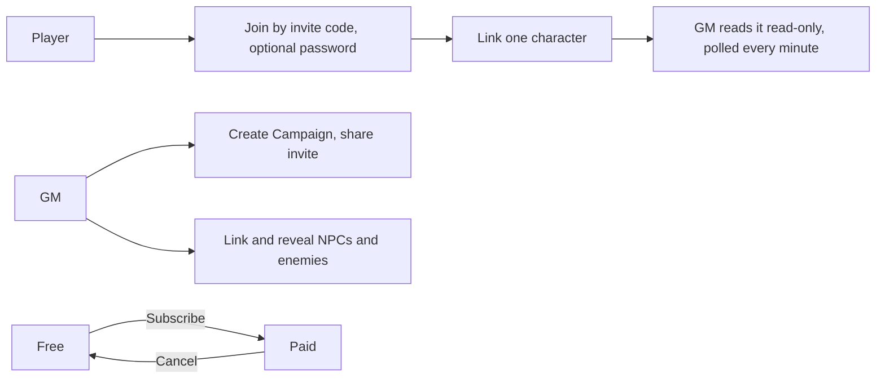

# Product

## Purpose

Legnaris is a character-sheet manager for tabletop RPGs. It models generic, code-defined
Templates (typed Fields, declarative formulas, a dependency graph) instead of one
published game, so derived values recalculate themselves. The primary user is a player
at a live session, often on a phone in one hand. Game Masters are secondary: they run a
Campaign, read Players' Sheets and show NPCs and enemies. Success is a player who trusts
the Sheet during play and never calculates a modifier by hand.

## Why

- **Planned, first increment (LGN-380 to LGN-386): faithful Templates first, one Game
  system at a time,** over generic Templates with little behaviour, mechanic families now,
  or Pathfinder 2e next, because a sheet that does not derive every number fails player
  trust at the table, families add a Template shape with no demand behind it, and
  Pathfinder 2e fails the gate today (ORC terms for a paid app unverified; degrees of
  success need Roll results to feed Fields). The engine stays generic. The first Game
  system is fifth edition through SRD 5.2.1 (CC-BY-4.0, attribution on a public `/srd`
  page, "5E" and never the publisher's trademarks). Every Template follows the coherence
  rule: it automates every value its rules derive, and anything else is plain entry, never
  an approximation; Roll modes stay the player's choice. The next Game system needs an open
  license that allows a paid app, engine coverage that keeps the coherence rule, and a real
  demand signal; a Mechanic family is the reserved fallback for a popular system without an
  open license. Cost: until another Game system passes that gate, players of other games
  are knowingly not served.
- **Planned (LGN-386): one cutover pull request over a coordinated release of several**
  because every push to `main` deploys, so "the same deploy" can only mean the same merge:
  the lifecycle flip, the landing and the `/demo` switch travel together, while `/srd` and
  the unmounted demo are prepared earlier (LGN-385). Cost: one larger final pull request.
- **Planned (LGN-386): `fantasy_v1` becomes a Retired Template with no migration** over
  keeping it beside the new Templates, hiding it everywhere, migrating its Sheets or porting
  its preset, because new users would otherwise keep landing on the half-automated sheet,
  its own Campaigns must still gain Sheets, and any mapping loses data (non-SRD skills,
  fixed attack and spell slots). Cost: the half-automation remains for existing
  `fantasy_v1` users, and the frozen `fantasy` preset gets bug fixes only.
- Code-defined Templates on one generic engine, with 0/1 `config.*` flags and `rules.*`
  tuning, over user-authored or hardcoded systems because one reviewed mechanism can
  express different systems. `fantasy_v1` carries no licensed text; the planned faithful
  Templates above may carry only openly licensed material, with attribution. Cost: another
  system needs a release, users cannot add one, and authors write rules as formulas and
  switches.
- A compiled dependency graph with cascading recalculation over spreadsheets and
  editable PDFs because the player should not do arithmetic at the table; cost: only
  reviewed editable Fields accept input, and derived values change only through preview
  or save.
- An installable PWA over a desktop or native app because the design target is a phone at
  the table and one codebase serves every screen; cost: a browser cookie session, drafts
  in browser storage, and installability that varies by browser. The stored Sheet stays
  server-owned with a local draft over a local-first editor because a crash must not cost
  the evening; cost: no offline editing, no draft across devices, and concurrent saves
  conflict.
- Read-only Campaign access for Game Masters over shared editing because concurrent
  writes and unclear ownership would corrupt a Player's Sheet; cost: the GM view can be
  a minute behind.
- AI generation as an asynchronous draft the player accepts over creating a Sheet
  directly because a generation takes tens of seconds and a discarded concept should not
  take a Sheet slot; cost: versioned consent, polling, a quota, and 24-hour retention.
- Paid-only AI generation over a Free allowance because every call costs money; cost:
  Free users see an upgrade modal instead of a draft.
- Plans derived from provider webhooks over the checkout redirect because a redirect can
  be spoofed or lost while a signed webhook can be replayed safely; cost: the Plan
  changes asynchronously, with a reconciliation pass for drift.
- Self-hosted delivery with no third-party scripts, styles or fonts over a managed-only
  product because a strict same-origin policy needs no content exceptions and the owner
  can run the service; cost: the operator carries deployment and backups.

## Flows

The first journey takes a visitor to a played Sheet.

The second journey covers the table and the paid Plan.

## Contracts

- **Ads only on Free (LGN-335, LGN-349).** Free accounts see manual Google AdSense units, only on passive screens: the catalog (sheet list/dashboard) and the campaign list. The home carries no ad slot, and no visitor sees ads on a sheet, dice, a play session, generation, plans or checkout; no Auto ads and no interstitials. "No ads" is a paid advantage shown on the Plans page and in the upgrade dialog.
- **Anonymous home funnel (LGN-346).** The landing reports one visit when it opens and one sign-up CTA click, each a fire-and-forget `POST /funnel/home` carrying only the event name. No cookie, identifier or per-user record is created, so the privacy policy needs no change; the counts feed the Prometheus dashboard `deploy/grafana/dashboards/legnaris-funnel.json`.
- **Proof before sign-up.** The hero now carries the live hit-points card and makes `Try the live sheet` the primary action; sign-up is secondary, and the sign-up form links back to the demo.
- **The live sheet has its own page (LGN-348).** The home hero stays a static pitch (headline, lead, primary sign-up and a secondary `Try the live sheet` link); the full interactive Fantasy sheet, its contextual sign-up CTA and the sticky mobile CTA live at the public `/demo` page, so the landing keeps its flow. The demo page ships as its own lazy chunk and loads the existing in-memory `DemoSheet`; every demo conversion action uses `signUpCtaPath('fantasy')` and reports a `cta_click`. The demo Template now declares all three Sheet kinds and its edit store supports Reset, but the demo draws neither a Reset bar nor a Record list, so what a visitor can change there is unchanged.
- **The home sign-up starts a Fantasy Sheet (LGN-350).** Every sign-up CTA on the landing links to `/sign-up?start=fantasy` through `signUpCtaPath` in `web/src/landing/start_intent.ts`, and the intent survives the credential and email-code steps. After authentication the client creates one normal persisted `character` Sheet from `fantasy_v1` through `POST /sheets`, seeds it into the cache and opens it, ready to fill in. The sheet is not special: it counts toward the plan's character limit and the first-sheet metric. Sign-up entry points without the intent and any failed creation keep the catalog flow; the intent is ignored on the sign-in path.

Every user has exactly one Plan, Free by default.

| Entitlement | Free | Paid |
| --- | --- | --- |
| Character / NPC / Enemy Sheets | 1 / 2 / 2 | 10 / 50 / 50 |
| Owned Campaigns | 1 | 5 |
| AI generations | none (upgrade modal) | 30 per UTC day |
| Price | none | USD 6.79 per month, card only |

- Limits are enforced when a Sheet or an owned Campaign is created, never on read. A
  downgrade locks nothing: existing objects stay usable, but new ones over the limit are
  refused. A Plan is Paid only while its subscription is `active`; a failed payment drops
  the user to Free at once, a retry restores it, and cancellation ends at the close of
  the paid period. The first payment is refundable once per account, within 7 days, and
  the Paid Plan ends when the refund completes. There is no free period on the Paid Plan.
- AI generation is paid-only: a Free account sees an upgrade modal and cannot send a
  concept or accept LLM consent. A paid generation sends only the concept, returns values
  for editable Fields, becomes a Sheet only on accept, lives at most 24 hours, and
  refunds its quota on failure.
- A Sheet kind is set at creation and never changes. A character belongs to at most one
  Campaign; an NPC or enemy belongs to its owner, can be linked to several Campaigns,
  and is revealed per Campaign and as a whole Sheet.
- A Campaign fixes one Template at creation and holds at most 10 Players and 3 GMs;
  joining always creates a Player. Only the Owner deletes it, transfers ownership or
  changes GM roles. The invite code never expires until a GM rotates it, and the
  optional password adds a second requirement to join without removing anyone.
- Registration needs a 6-digit email code; later sign-ins use email and password. The
  session is an HttpOnly refresh cookie plus an in-memory access token. Account deletion
  is confirmed by an emailed code and erases the account's personal data, except billing
  records kept for the fiscal retention period.
- The name is Legnaris. Visual values and their accessibility contract live in
  `web/DESIGN.md`: AA contrast in both themes, a visible focus ring and a keyboard path
  through every surface. No separate voice guide exists.

## Code map

- `web/src/landing/`, `web/src/legal/`, `web/src/catalog/` and `web/src/generate/` —
  the home pitch, the public live-demo page and its sheet, privacy policy, Template list,
  creation dialog, the reusable sign-up CTA intent and its post-auth Fantasy sheet starter,
  and the AI draft.
- `web/src/sheet/`, `web/src/library/` and `web/src/plans/` — play view, edit, preview,
  layout, dice, local drafts, Plan display, checkout, cancellation and refund.
- `web/src/campaign/` and `web/src/join/` — Campaign management, invite and GM view.
- `backend/internal/generation/` — asynchronous draft pipeline and validation, on the
  Plans and counters in `backend/internal/plan/` and `backend/internal/quota/`.
- `backend/internal/sheet/` and `backend/internal/sheet/template/` — Sheets, the code
  catalog, recalculating saves and per-kind limits.
- `backend/internal/campaign/`, `backend/internal/billing/` and `backend/internal/auth/`
  — membership, links and reveal; subscriptions and refunds; accounts and sessions.

## Tools & dependencies

- React, TypeScript and Vite build the installable PWA; a same-origin service worker
  caches the shell, never authenticated responses.
- A Go REST API stores users, Sheets, Campaigns and billing state in MongoDB; RabbitMQ
  carries generation and email work.
- Stripe hosts card payment, the customer portal and refunds (with no keys its endpoints
  answer unavailable and the app stays Free); OpenRouter routes AI generation to the
  pinned paid model after versioned consent.
- Redis, when configured, shares rate limits across replicas; deployment is self-hosted
  behind Traefik with its own email, metrics and logging stack.

## Known limits

- Legnaris targets fifth-edition players once the first increment ships (LGN-380 to
  LGN-386); another Game system joins only through the gate in Why.
- The catalog ships one reviewed Template. There is no user-authored Template, gallery
  or Template editor; another system needs a code change and a release.
- Sheets cannot be exported or imported, and the client has no complete library of
  owned Sheets; a Sheet is reopened from its URL, the single "Your sheet" view, or a
  Campaign link.
- The interface is English only (the privacy policy is also Portuguese); broader
  localisation and accessibility beyond the `web/DESIGN.md` baseline are undecided.
- There is no offline editing or synchronisation, and no real-time collaboration. Drafts
  are per device and cover only pending edits; a GM's view polls once a minute and is
  labelled as possibly stale, and GMs never edit a Player's Sheet.
- Campaigns are the only sharing mechanism: Players cannot read each other's Sheets, an
  NPC or enemy is revealed whole, and a Player has at most one character per Campaign.
- A character belongs to only one Campaign at a time, and only NPC and enemy Sheets can
  be duplicated.
- AI generation depends on an external provider and a global daily cap. It has no
  history beyond 24 hours, no moderation pass, and can be disabled entirely.
- The Paid Plan is one monthly USD price, card only. There is no BRL price, annual
  option, proration or free period.
- No testimonials, usage data or published benchmarks exist; none may be invented.
