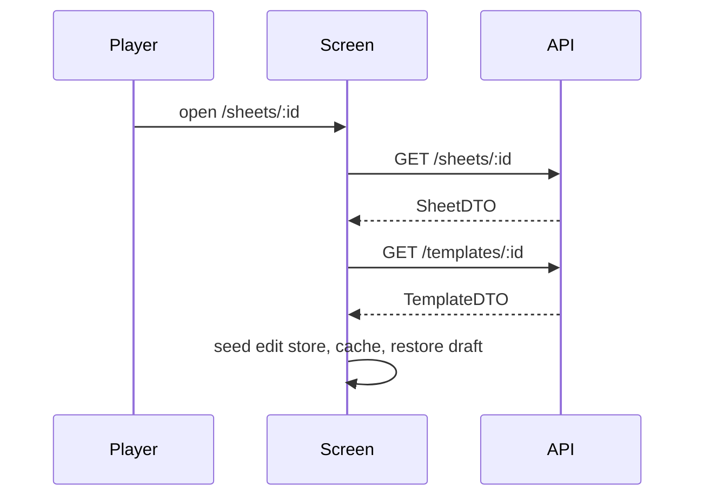
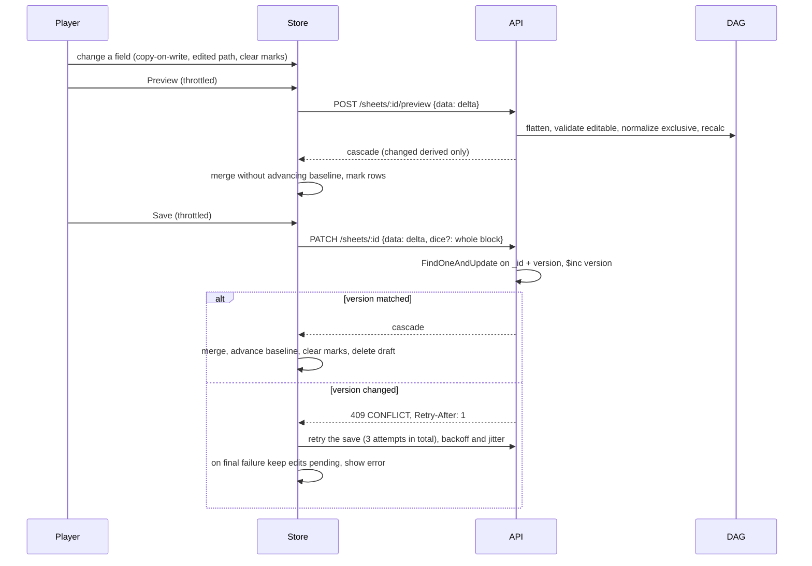
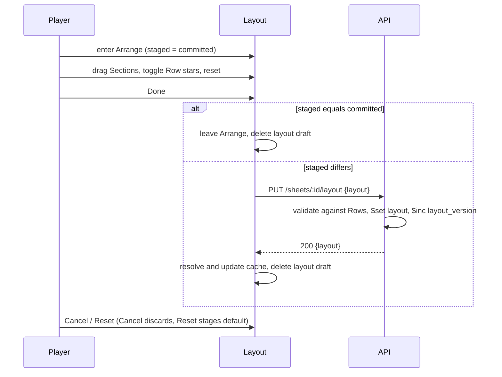

# Sheets

## Purpose

A sheet is one character, NPC or enemy: the values of a template's field tree, the player's
Dice choices and the player's Section order and pins. Templates are defined in code and served
read-only; the server validates writes, recalculates derived fields and stores a MongoDB
document, while the web client renders any template from its schema, edits only the changed
delta and keeps drafts locally. This file covers the template catalog, sheet
create/read/update/preview, layout and Arrange mode, and the web rendering and edit cycle.

## Why

- **Templates as code over a `template` collection because** a template is reviewed content and
  no user-supplied game content may ship; the registry and its DAGs are built once at boot, so a
  read costs neither a query nor a compile. Cost: a template change is a deploy, an incompatible
  change needs a new slug (`fantasy_v1` → `fantasy_v2`), and users cannot author templates.
- **Dotted DAG keys with a validated alphabet over raw template keys because** formulas read
  identifiers such as `stats_dexterity` while documents and errors use `stats.dexterity`;
  restricting every segment to `^[A-Za-z][A-Za-z0-9]*$` makes the encodings collision-free.
  Cost: field names cannot contain `_` or `.`, and every template is checked at boot.
- **One read-lock acquisition per recalculation over three separate calls because** validation,
  exclusive normalization and the topological walk must see the same frozen graph, and a
  recursive `RLock` deadlocks once a writer is queued. Cost: a larger critical section, and
  callers must not nest DAG methods that lock.
- **Returning only changed derived fields over the whole sheet because** the client merges a small
  cascade and a no-op update writes nothing derived. Cost: change detection uses a relative
  epsilon (`1e-9 × max(1, |a|, |b|)`), so absolute slack grows with magnitude and integers above
  2^53 are indistinguishable in `float64`; this is unsuitable for exact large values, and a no-op
  PATCH never repairs an already-stale derived value.
- **Numeric 0/1 proxies for exclusive groups over an enum field because** one schema drives the
  formula environment and the single-choice control. Cost: members are numbers, a non-numeric
  member is a 400, and turning the chosen member off does not choose a sibling.
- **A compare-and-swap write over a server-side merge or lock because** it is one conditional
  `FindOneAndUpdate` with no lost writes and an honest conflict. Cost: a lost race spends a
  request on a 409, the version stays internal, and the client resends the delta.
- **Layout as user data on the sheet, with its own endpoint, over template variants or a `data`
  field because** the arrangement belongs to the player, survives devices and never enters the
  flatten/editability/DAG path. Cost: a second write path, a row-key grammar defined twice, and
  readers that tolerate stale keys. Rows pin instead of moving because a table Row owns its
  columns; cost: no arbitrary Row order and no page-level pinned zone.
- **No state library, with per-path subscriptions because** typing in one field must rebuild one
  control, not the whole sheet; `useSyncExternalStore` gives that without a dependency. Cost:
  stores are wired by hand, and the screen subscribes to coarse signals for the footer and marks.
- **A delta for edit, preview and save over a snapshot because** the server owns derived values
  and preview returns the same cascade a save would. Cost: the client tracks edited paths and a
  baseline, and a stale baseline yields a 409.
- **Best-effort local records over a durable offline database because** drafts and layout staging
  must survive a crash without becoming a second source of truth. Cost: no offline open, older
  records are discarded rather than migrated, and every local failure is silent.

## Flows

### Open a sheet

A sheet created from the catalog is seeded into the `['sheet', id]` query, so opening it makes no
second sheet fetch. A 404 evicts the cached sheet and its drafts; a restored draft is laid over
stored values and filtered to editable leaves.

### Edit → preview → save

A new edit clears the preview marks. An offline save or preview writes the pending delta to the
draft immediately; the normal cadence is 60 seconds.

### Arrange → commit layout

Nothing is sent while staging. A failed `PUT` keeps the staging and shows the mapped copy; `Done`
retries. A pending arrangement counts as unsaved work for the leave guard and `F5`; arranging
never marks values as unsaved and `Ctrl+S` saves nothing.

## Contracts

### Template DTO

`GET /templates` returns an array and `GET /templates/:id` one object; both require an
authenticated, active account and share the per-user rate limit.

`TemplateDTO` is `{id, name, default, fields, dice?}`. A node carries either `schema` (leaf) or
`children` (group); a group may carry `label` and `columns`; a leaf schema is `{type, label,
is_editable, default, formula?, depends_on?, exclusive_group?, option_label?, column_label?,
generatable?, generatable_kinds?, prefer_default?, min?, max?, max_length?}`. `default` stays
numeric for every type, so a text leaf shows `0`. `dice` is omitted when the template has no
defaults. Sections follow the template's `SectionOrder` and children their declared `Order`;
unlisted keys are alphabetical. Template IDs are slugs (`^[a-z][a-z0-9_]*$`); a malformed ID is
400, an unknown one 404.

### Sheet DTO and endpoints

`SheetDTO` is `{id, template_id, kind, name, data, layout?, dice, campaign_id?, created_at,
updated_at}`. `kind` is `character`, `npc` or `enemy`. `layout` appears only when set; `dice` is
always present (`{"section": {}, "row": {}}` when empty); `version` and `layout_version` are
never exposed.

| Method and path | Body | Success |
| --- | --- | --- |
| `POST /sheets` | `{template_id, kind, sheet_name}` | 201 sheet |
| `GET /sheets/owned?kind=character` | — | 200 array, oldest first |
| `GET /sheets/:id` | — | 200 sheet |
| `PATCH /sheets/:id` | `{data?, dice?}` | 200 cascade |
| `POST /sheets/:id/preview` | `{data}` | 200 cascade, no write |
| `PUT /sheets/:id/layout` | `{layout}` | 200 `{layout}` |
| `POST /sheets/:id/duplicate` | — | 201 sheet (NPC and enemy only) |
| `DELETE /sheets/:id` | — | 204 |

Every JSON success is wrapped in `{"data": ...}`. A malformed id is 400; a missing sheet and a
foreign sheet are both 404. Creating reserves a per-owner, per-kind plan slot and inserts in one
transaction; deleting releases it. Free plans allow 1 character, 2 NPCs and 2 enemies; paid plans
allow 10/50/50. Duplicating a character is 422 `SHEET_KIND_MISMATCH`; exceeding the plan on create
is 409 `SHEET_LIMIT_REACHED` and on duplicate 403 `PLAN_LIMIT_REACHED`.

### PATCH and preview

`data` is a nested map of editable leaves, flattened to DAG dot-keys. An unknown key or group
prefix is 400 `UNKNOWN_FIELD`; a derived leaf is 400 `INVALID_REQUEST`. Each touched exclusive
group may have at most one non-zero member in the payload: two is 400, a non-numeric member is
400, and a member set to zero leaves siblings unchanged.

`dice` is `{"section": {sectionKey: expr | null}, "row": {rowKey: expr | null}}`. A present block
replaces the whole block (an empty block clears it); an absent or `null` block leaves it
untouched. `null` means "no dice", an absent key means "use the template default". The block is
capped at 64 entries, keys must name a Section or Row, expressions must parse, a Row expression
must fit its Row and a Section expression at least one Row. Dice-only saves skip the DAG and
return `{"data": {}}`. A body with neither a top-level non-empty `data` nor a `dice` block is 400.
Preview reads `data` only and never writes; the Dice grammar and both implementations are in
[dice](dice.md).

The response is only the changed derived leaves, nested. A PATCH whose values do not change
returns `{}` and recomputes nothing. Sheets nest at most five levels; deeper input is 400.

### Layout

Body: `{"layout": {"section_order": [...], "pinned": [...]}}`; `{"layout": null}` or empty lists
reset it to none. The write is a full replacement and idempotent. An order equal to the
template's is stored as given when sent; the web sends only the lists that deviate and `null`
when none does. A partial list is valid: missing Sections fall back to template order, stale keys
are ignored on read, an unknown Section or pin is 400, and a duplicate within one list is 400.
Pins never reorder Rows across Sections: a pinned Row is drawn at the top of its own Section in
pin order. `PUT` does not touch `version` or `updated_at`, so it never conflicts with a save.

### Row-key grammar (backend and web)

A Row key is derived only from the template:

- lone leaf → dotted path (`stats.dexterity`)
- group with a resolvable `columns` child → its path (`skills.acrobatics`); its columns and any
  exclusive members below it are not Rows
- editable leaves sharing a non-empty `exclusive_group` in one Section → `<parent path>#<group id>`
  (`config#armorClassAbility`); a one-member group stays a lone leaf

Sections follow `SectionOrder`; children follow their declared `Order`, then alphabetical; a
Section with no leaf is omitted. The backend definition is `template.SectionRowKeys`; the web
definition is `buildRows`/`rowKey` in `web/src/engine/field_grouping.ts`. They must change together.
A pinned key must be one of these Rows.

### Optimistic locking

`version` counts saved value and Dice changes. The CAS filter is `_id` + expected version, where
expected 0 matches a missing field as well as 0 (pre-versioning sheets). A match `$set`s `data`
when the save carries a delta, `dice` when it carries a block, and `updated_at`, then `$inc`s
`version`. A mismatch is 409 `CONFLICT` with `Retry-After: 1`; the service does not retry. The web
treats 409 as retryable: up to three attempts, exponential backoff with jitter, never shorter
than the hint, capped at five seconds, then the footer keeps the edits and shows the conflict
copy. Because the version is hidden, two open tabs find a conflict only on save.

### Errors

| Code | Status | Raised when |
| --- | --- | --- |
| `INVALID_JSON` | 400 | malformed body, wrong value type, unknown body key |
| `INVALID_REQUEST` | 400 | non-editable field, invalid layout or dice, exclusive conflict or non-numeric member, nesting too deep, nothing to update, invalid kind or template/kind mismatch on create, malformed sheet id |
| `UNKNOWN_FIELD` | 400 | data key or group prefix absent from the DAG |
| `NOT_FOUND` | 404 | sheet or template missing, including a foreign sheet |
| `CONFLICT` | 409 | value/Dice save lost the version race; `Retry-After: 1` |
| `SHEET_LIMIT_REACHED` | 409 | create would exceed the plan; details carry `kind` and `limit` |
| `PLAN_LIMIT_REACHED` | 403 | duplicate would exceed the plan |
| `SHEET_KIND_MISMATCH` | 422 | duplicate of a character sheet |
| `RATE_LIMITED` | 429 | shared per-user budget (`USER_RATE_LIMIT_*`, 80 per minute) |

### Web local records

IndexedDB database `legnaris-sheets` (`SCHEMA_VERSION` 3) with stores `sheets`, `drafts` and
`layoutDrafts`. Every record is an envelope `{schemaVersion, id, ...}`; a different version or id
reads as missing rather than being migrated. The draft holds only the pending editable delta plus
the whole Dice block, never a credential. View state (collapsed Sections, pinned filter,
explainer seen, settings open) lives in `localStorage` under `lg.sheet-view.<sheetId>`, record
version 1, local to the viewer and never sent. Every local write and delete is best-effort.

## Code map

Backend:

- `backend/internal/sheet/template/template.go` — `Template`, `FieldGroup`, `FieldNode`,
  `FieldSchema`, seed values; `dag.go` — DAG build, topological order, cycle detection,
  exclusive normalization and change detection.
- `backend/internal/sheet/template/registry.go`, `seeders.go` — boot registry and the
  `fantasy_v1` catalogue; `layout.go` — `SectionRowKeys`, `ValidateLayout`;
  `dice_defaults.go`, `name_leaf.go`, `generation_metadata.go`, `dto.go` — boot validators and
  JSON shape.
- `backend/internal/sheet/service.go`, `create_values.go` — create, fetch, patch, preview,
  layout, delete, seeding and `CreateWithValues` for generation.
- `backend/internal/sheet/repository.go` — reads, CAS PATCH, layout write and plan counters;
  `duplicate.go`, `limits.go`, `migrate.go`, `dto.go`, `events.go` — duplicate rules, limits,
  migration, DTO and events.
- `backend/internal/engine/engine.go` — expr-lang wrapper and `floor`/`max`;
  `backend/internal/app/template.go`, `sheet.go`, `router.go`, `errors.go` — routes, decoding
  and boundary translation.
- `backend/internal/dice` — Dice grammar used by defaults and choices; see [dice](dice.md).

Web:

- `web/src/catalog/catalog_screen.tsx`, `create_sheet_dialog.tsx`, `queries.ts` — catalog,
  creation surface and query keys.
- `web/src/engine/field_grouping.ts` — schema → Sections and Rows, row keys; `layout.ts`,
  `arrange_ops.ts` — arrangement resolution, view and staging.
- `web/src/engine/sheet_form.tsx`, `field_control.tsx`, `exclusive_control.tsx`,
  `sheet_defaults.ts`, `sheet_mark.ts`, `dependents.ts` — stateless rendering core, seed/merge
  and marks.
- `web/src/sheet/sheet_open.ts` — open situation; `sheet_edit.ts` — edit store, delta, marks,
  throttle and restore; `save_retry.ts` — 409 retry.
- `web/src/sheet/sheet_screen.tsx` — mounted screen, footer and guards; `layout_store.ts` —
  committed/staged layout, commit and backup.
- `web/src/sheet/view_store.ts`, `sheet_view.tsx`, `section_index.tsx` — local view state,
  collapse/filter and section strip; `dice_store.ts`, `dice_row.tsx`, `dice_panel.tsx`,
  `dice_view.ts` — Dice choices over the edit store (see [dice](dice.md)).
- `web/src/library/sheet_store.ts`, `idb_sheet_store.ts`, `sheet_library.ts`, `draft_backup.ts`,
  `session_data.ts` — local cache, drafts, cadence, sign-out.

## Tools & dependencies

- **expr-lang/expr** evaluates formulas; the engine exposes `floor` and `max` and coerces numeric
  types. Formulas compile once per template at boot.
- **MongoDB** stores `sheets` and the `sheet_counts` plan counters; a conditional
  `FindOneAndUpdate` is the only concurrency control for values.
- **React, TanStack Query and React Router** drive the catalog and sheet screens; query keys are
  `['templates']`, `['template', id]` and `['sheet', id]`.
- **idb** is the only IndexedDB dependency (imported only by `idb_sheet_store.ts`);
  **@dnd-kit core, sortable and utilities** are the only drag dependency, mounted only while
  arranging. They touch the DOM through React props and CSSOM, so the production CSP needs no
  relaxation.
- **No state library** (per-path subscriptions use `useSyncExternalStore`), **no template
  database** and no template mutation endpoint.

## Known limits

- No sheet import or export endpoint exists; the server is the only backup.
- Users cannot create or edit templates; the registry is frozen at boot and only `fantasy_v1`
  ships. A template change requires a deploy and, if incompatible, a new ID.
- No offline open: the IndexedDB sheet copy is written and evicted but never read as a fallback,
  so a failed `GET /sheets/:id` fails the screen. A draft can be restored only after a successful
  open.
- No live sync between tabs or devices. `version` is internal and the owner sheet endpoints send no
  ETag, so a stale tab discovers a conflict only when it saves.
- Preview marks are ephemeral: a new edit, a save or a discard clears them, and a dice-only change
  cannot be previewed. Preview and save are each limited to three requests per rolling minute on
  the client.
- The relative epsilon and `float64` formulas make the engine unsuitable for exact currency or
  experience arithmetic; values above 2^53 lose precision.
- A layout is seeded at open, so a template refresh that changes Sections within the same session
  does not reseed it. Row order inside a Section is template-defined; only pins lift a Row, and
  there is no pin cap.
- Collapsed Sections and the pinned filter are local to one browser profile and one sheet; they
  are not part of the layout and are not exported.
- `GET /sheets` still returns one arbitrary owned sheet for the legacy `/your-sheet` surface; the
  catalog uses `GET /sheets/owned` with an explicit kind.
- Character sheets cannot be duplicated; only NPCs and enemies can. Campaign-linked sheets are
  read through the campaign routes and rendered read-only there; see [campaigns](campaigns.md).
