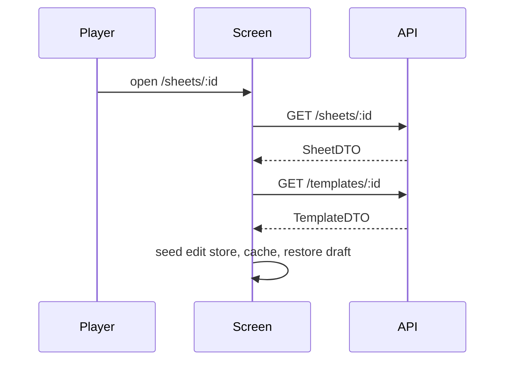
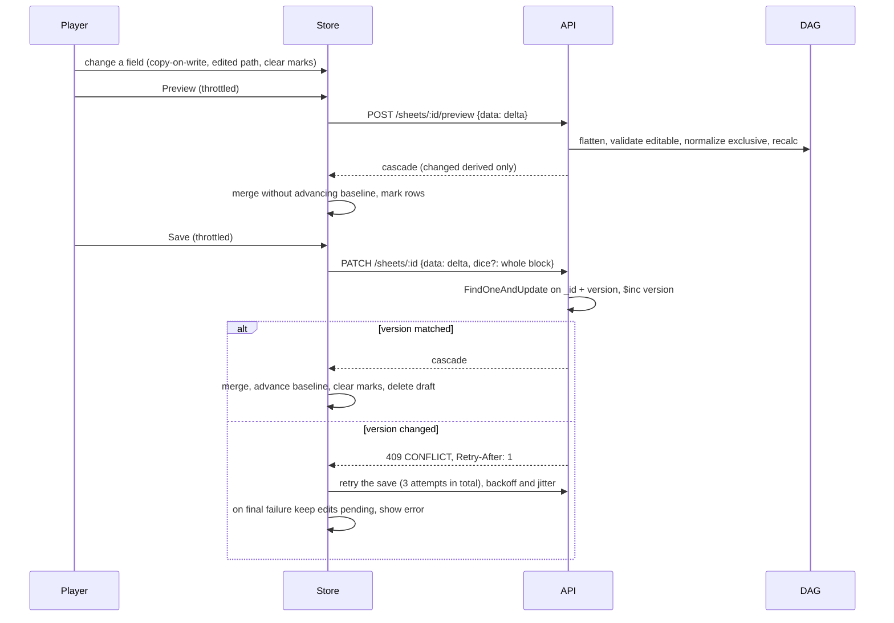
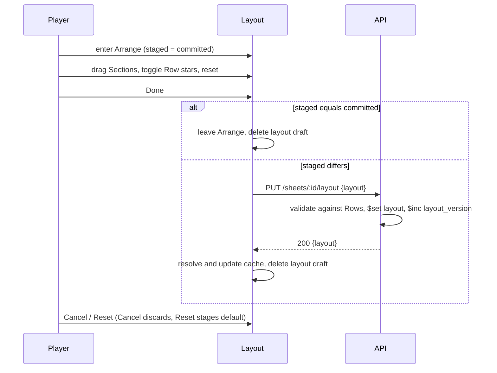

# Sheets

## Purpose

A sheet is one character, NPC or enemy: the values of a template's field tree, the player's
Dice choices and the player's Section order and pins. Templates are defined in code and served
read-only; the server validates writes, recalculates derived fields and stores a MongoDB
document, while the web client renders any template from its schema, edits only the changed
delta and keeps drafts locally. This file covers the template catalog, sheet
create/read/update/preview, layout and Arrange mode, and the web rendering and edit cycle.

## Why

- **Templates as code over a `template` collection because** a template is reviewed content and
  no user-supplied game content may ship; the registry and its DAGs are built once at boot, so a
  read costs neither a query nor a compile. Cost: a template change is a deploy, an incompatible
  change needs a new slug (`fantasy_v1` → `fantasy_v2`), and users cannot author templates.
- **Dotted DAG keys with a validated alphabet over raw template keys because** formulas read
  identifiers such as `stats_dexterity` while documents and errors use `stats.dexterity`;
  restricting every segment to `^[A-Za-z][A-Za-z0-9]*$` makes the encodings collision-free.
  Cost: field names cannot contain `_` or `.`, and every template is checked at boot.
- **One read-lock acquisition per recalculation over three separate calls because** validation,
  exclusive normalization and the topological walk must see the same frozen graph, and a
  recursive `RLock` deadlocks once a writer is queued. Cost: a larger critical section, and
  callers must not nest DAG methods that lock.
- **Returning only changed derived fields over the whole sheet because** the client merges a small
  cascade and a no-op update writes nothing derived. Cost: change detection uses a relative
  epsilon (`1e-9 × max(1, |a|, |b|)`), so absolute slack grows with magnitude and integers above
  2^53 are indistinguishable in `float64`; this is unsuitable for exact large values, and a no-op
  PATCH never repairs an already-stale derived value.
- **Numeric 0/1 proxies for exclusive groups over an enum field because** one schema drives the
  formula environment and the single-choice control. Cost: members are numbers, a non-numeric
  member is a 400, and turning the chosen member off does not choose a sibling.
- **A compare-and-swap write over a server-side merge or lock because** it is one conditional
  `FindOneAndUpdate` with no lost writes and an honest conflict. Cost: a lost race spends a
  request on a 409, the version stays internal, and the client resends the delta.
- **Layout as user data on the sheet, with its own endpoint, over template variants or a `data`
  field because** the arrangement belongs to the player, survives devices and never enters the
  flatten/editability/DAG path. Cost: a second write path, a row-key grammar defined twice, and
  readers that tolerate stale keys. Rows pin instead of moving because a table Row owns its
  columns; cost: no arbitrary Row order and no page-level pinned zone.
- **No state library, with per-path subscriptions because** typing in one field must rebuild one
  control, not the whole sheet; `useSyncExternalStore` gives that without a dependency. Cost:
  stores are wired by hand, and the screen subscribes to coarse signals for the footer and marks.
- **A delta for edit, preview and save over a snapshot because** the server owns derived values
  and preview returns the same cascade a save would. Cost: the client tracks edited paths and a
  baseline, and a stale baseline yields a 409.
- **Best-effort local records over a durable offline database because** drafts and layout staging
  must survive a crash without becoming a second source of truth. Cost: no offline open, older
  records are discarded rather than migrated, and every local failure is silent.

## Flows

### Open a sheet

A sheet created from the catalog is seeded into the `['sheet', id]` query, so opening it makes no
second sheet fetch. A 404 evicts the cached sheet and its drafts; a restored draft is laid over
stored values and filtered to editable leaves.

### Edit → preview → save

A new edit clears the preview marks. An offline save or preview writes the pending delta to the
draft immediately; the normal cadence is 60 seconds.

### Arrange → commit layout

Nothing is sent while staging. A failed `PUT` keeps the staging and shows the mapped copy; `Done`
retries. A pending arrangement counts as unsaved work for the leave guard and `F5`; arranging
never marks values as unsaved and `Ctrl+S` saves nothing.

## Contracts

- **Ad slot on the catalog.** The catalog (`catalog_screen.tsx`, the sheet list) ends with an `AdSlot` (`catalog` surface) shown only to Free accounts; the sheet screen, dice and Arrange mode never show ads (see web-client Ads).

### Template DTO

`GET /templates` returns an array and `GET /templates/:id` one object; both require an
authenticated, active account and share the per-user rate limit.

`TemplateDTO` is `{id, name, default, fields, dice?}`. A node carries either `schema` (leaf) or
`children` (group); a group may carry `label` and `columns`; a leaf schema is `{type, label,
is_editable, default, formula?, depends_on?, exclusive_group?, option_label?, column_label?,
generatable?, generatable_kinds?, prefer_default?, min?, max?, max_length?}`. `default` stays
numeric for every type, so a text leaf shows `0`. `dice` is omitted when the template has no
defaults. Sections follow the template's `SectionOrder` and children their declared `Order`;
unlisted keys are alphabetical. Template IDs are slugs (`^[a-z][a-z0-9_]*$`); a malformed ID is
400, an unknown one 404.

### Sheet DTO and endpoints

`SheetDTO` is `{id, template_id, kind, name, data, layout?, dice, campaign_id?, created_at,
updated_at}`. `kind` is `character`, `npc` or `enemy`. `layout` appears only when set; `dice` is
always present (`{"section": {}, "row": {}}` when empty); `version` and `layout_version` are
never exposed.

| Method and path | Body | Success |
| --- | --- | --- |
| `POST /sheets` | `{template_id, kind, sheet_name}` | 201 sheet |
| `GET /sheets/owned?kind=character` | — | 200 array, oldest first |
| `GET /sheets/:id` | — | 200 sheet |
| `PATCH /sheets/:id` | `{data?, dice?}` | 200 cascade |
| `POST /sheets/:id/preview` | `{data}` | 200 cascade, no write |
| `PUT /sheets/:id/layout` | `{layout}` | 200 `{layout}` |
| `POST /sheets/:id/duplicate` | — | 201 sheet (NPC and enemy only) |
| `DELETE /sheets/:id` | — | 204 |

Every JSON success is wrapped in `{"data": ...}`. A malformed id is 400; a missing sheet and a
foreign sheet are both 404. Creating reserves a per-owner, per-kind plan slot and inserts in one
transaction; deleting releases it. Free plans allow 1 character, 2 NPCs and 2 enemies; paid plans
allow 10/50/50. Duplicating a character is 422 `SHEET_KIND_MISMATCH`; exceeding the plan on create
is 409 `SHEET_LIMIT_REACHED` and on duplicate 403 `PLAN_LIMIT_REACHED`.

### PATCH and preview

`data` is a nested map of editable leaves, flattened to DAG dot-keys. An unknown key or group
prefix is 400 `UNKNOWN_FIELD`; a derived leaf is 400 `INVALID_REQUEST`. A text leaf longer than its
schema `max_length` (counted in runes) is 400 `INVALID_REQUEST`, checked on every PATCH and preview
that carries the leaf; stored text is never re-validated, so a legacy sheet still saves an unrelated
delta. Each touched exclusive group may have at most one non-zero member in the payload: two is 400,
a non-numeric member is 400, and a member set to zero leaves siblings unchanged.

`dice` is `{"section": {sectionKey: expr | null}, "row": {rowKey: expr | null}}`. A present block
replaces the whole block (an empty block clears it); an absent or `null` block leaves it
untouched. `null` means "no dice", an absent key means "use the template default". The block is
capped at 64 entries, keys must name a Section or Row, expressions must parse, a Row expression
must fit its Row and a Section expression at least one Row. Dice-only saves skip the DAG and
return `{"data": {}}`. A body with neither a top-level non-empty `data` nor a `dice` block is 400.
Preview reads `data` only and never writes; the Dice grammar and both implementations are in
[dice](dice.md).

The response is only the changed derived leaves, nested. A PATCH whose values do not change
returns `{}` and recomputes nothing. Sheets nest at most five levels; deeper input is 400.

### Layout

Body: `{"layout": {"section_order": [...], "pinned": [...]}}`; `{"layout": null}` or empty lists
reset it to none. The write is a full replacement and idempotent. An order equal to the
template's is stored as given when sent; the web sends only the lists that deviate and `null`
when none does. A partial list is valid: missing Sections fall back to template order, stale keys
are ignored on read, an unknown Section or pin is 400, and a duplicate within one list is 400.
Pins never reorder Rows across Sections: a pinned Row is drawn at the top of its own Section in
pin order. `PUT` does not touch `version` or `updated_at`, so it never conflicts with a save.

### Row-key grammar (backend and web)

A Row key is derived only from the template:

- lone leaf → dotted path (`stats.dexterity`)
- group with a resolvable `columns` child → its path (`skills.acrobatics`); its columns and any
  exclusive members below it are not Rows
- editable leaves sharing a non-empty `exclusive_group` in one Section → `<parent path>#<group id>`
  (`config#armorClassAbility`); a one-member group stays a lone leaf

Sections follow `SectionOrder`; children follow their declared `Order`, then alphabetical; a
Section with no leaf is omitted. The backend definition is `template.SectionRowKeys`; the web
definition is `buildRows`/`rowKey` in `web/src/engine/field_grouping.ts`. They must change together.
A pinned key must be one of these Rows.

### Optimistic locking

`version` counts saved value and Dice changes. The CAS filter is `_id` + expected version, where
expected 0 matches a missing field as well as 0 (pre-versioning sheets). A match `$set`s `data`
when the save carries a delta, `dice` when it carries a block, and `updated_at`, then `$inc`s
`version`. A mismatch is 409 `CONFLICT` with `Retry-After: 1`; the service does not retry. The web
treats 409 as retryable: up to three attempts, exponential backoff with jitter, never shorter
than the hint, capped at five seconds, then the footer keeps the edits and shows the conflict
copy. Because the version is hidden, two open tabs find a conflict only on save.

### Errors

| Code | Status | Raised when |
| --- | --- | --- |
| `INVALID_JSON` | 400 | malformed body, wrong value type, unknown body key |
| `INVALID_REQUEST` | 400 | non-editable field, text longer than its `max_length`, invalid layout or dice, exclusive conflict or non-numeric member, nesting too deep, nothing to update, invalid kind or template/kind mismatch on create, malformed sheet id |
| `UNKNOWN_FIELD` | 400 | data key or group prefix absent from the DAG |
| `NOT_FOUND` | 404 | sheet or template missing, including a foreign sheet |
| `CONFLICT` | 409 | value/Dice save lost the version race; `Retry-After: 1` |
| `SHEET_LIMIT_REACHED` | 409 | create would exceed the plan; details carry `kind` and `limit` |
| `PLAN_LIMIT_REACHED` | 403 | duplicate would exceed the plan |
| `SHEET_KIND_MISMATCH` | 422 | duplicate of a character sheet |
| `RATE_LIMITED` | 429 | shared per-user budget (`USER_RATE_LIMIT_*`, 80 per minute) |

### Play and Edit presentation

A sheet whose template id has a preset opens in **Play**; every other template opens in **Edit**,
today's form. The preset registry maps a template id to a header component, an optional
kind-selected stat block and ordered section slots, so later gameplay surfaces are additions to the
preset rather than branches in the screen.
The `fantasy_v1` preset currently draws the hero header, the combat strip, the attack cards, the
ability medallions, the spellcasting panel and the table-rules disclosure. A preset declares an
ordered body layout: full-width Section blocks and column blocks, plus an optional narrow layout. The
fantasy body draws the combat strip across the top, then three columns (abilities / saving throws
with skills / attacks with spells), then the table rules; the columns fall to two around 1100px and
to one on a phone, without a horizontal scroll at 360px. In both narrower layouts an ability
medallion stacks its name above the medal and lets the name wrap instead of ellipsising it, so no
ability name is cut; the three-column desktop layout is unchanged. On a phone (`max-width: 40rem`,
the same `NARROW_QUERY` as every preset media query) the narrow layout replaces the columns with a
flat, mobile-first order — combat, attacks, spells, abilities, saves, skills, rules — so the DOM and
the keyboard tab order follow the visual order; the 1440 and 1100 arrangements keep their columns.
The narrow sections are wrapped in `data-preset-section` slots, and a Section that renders nothing
(no spells, no attacks, no rules) leaves an empty slot that is not drawn. A preset that declares
`sectionNav.after` (`combat` for `fantasy_v1`) also draws a phone-only section chip row under that
slot (`preset/section_nav.tsx` over the pure `preset/section_nav_targets.ts`): it lists, in layout
order, only the Sections that rendered a heading, leaving out the strip the player is already under.
Each chip is a full `--lg-size-control` tab stop in a horizontally scrolling `nav`; tapping one
scrolls its heading into view with `scroll-margin-block-start` (the vitals bar's own scroll padding
is not stacked) and moves focus to the heading, which reduced motion lands instantly. A scroll and
resize listener marks the Section whose heading last crossed the landing line, and marks the last
Section once the page reaches the bottom, so a short final Section still marks itself. The ability
Section grows a phone-only heading (hidden in the desktop columns) so it can be a jump target.
On a phone the hero comes
before the sheet action group (desktop keeps the actions above it), so the title starts within the
first 80 px of a 390 px viewport. The title is
`identity.characterName` with
the sheet name as its empty fallback, then `ancestry`, `origin`, `Level N` with a stepper and
`played by <player>` on one wrapping line (they share the row at 390px, and long values wrap inside
the line instead of overflowing), then the proficiency badge (an inline edit clamped to 2–6 by the pure
`fantasy/identity.ts`). The hero also carries the experience bar
(`fantasy/xp_panel.tsx` over the pure `fantasy/xp_progress.ts`): a `progressbar` running from the
current level's floor to the next 5e threshold, whose disclosure shows the `identity.xp` total as an
inline edit and adds a positive gain to it in the pending delta (the total and the gain round to
whole XP and floor at zero, with no upper cap); when the total reaches the threshold it offers
`Level up to N?`, which writes the next `identity.level` in the pending delta. Level 20 draws a
full bar and never offers a level. Under it the combat strip holds the armor class
shield, the initiative and speed tiles and the hit-points card (below), then the six
`stats.<ability>` scores render as medallions: the `modifiers.<ability>Mod`
derived value is the large, read-only roll target through `rollable_value.tsx`,
rolling the `stats.<ability>` Row through the Dice store and its sheet overrides, while the raw
score sits in an `inline_edit.tsx` badge whose writes go to the pending delta; the two are separate
targets. The `derived.passiveAwareness` pill closes the column. `RollableValue` and the `useRowRoll`
hook it uses are the reusable roll surface for later gameplay sections. Every rollable total shares
one affordance: text colour, a dashed accent (`--lg-color-link`) underline, and an accent fill with
on-accent text on hover or focus. Filled accent is reserved for the proficiency dot and the primary
action, so "proficient" and "rollable" never look alike; the style follows the value rather than its
sign, so a zero or negative modifier keeps it. A d20 rollable also carries the roll mode: Shift-click
rolls with advantage and Alt-click with disadvantage (Shift wins when both are held), while a long
press, the Context Menu key or Shift+F10 opens one small dialog choosing Normal, Advantage or
Disadvantage, so a phone and a keyboard reach the same choice. Only an expression with a d20 term
reacts; a damage expression and every other non-d20 roll throws exactly its own dice. No Play label
falls below `--lg-type-11` on a desktop
or `--lg-type-12` on a phone (hero badge, HP, AC and combat chips, spellcasting, ability and skill
labels). The attack cards, saving throws, skills, spellcasting panel and table-rules disclosure
follow (see below). Edit keeps the generic form, Arrange and the pinned filter; Play ignores the
layout and the view filters.

The combat strip (`fantasy/combat_strip.tsx`) is the container later gameplay cards extend; it
holds the armor class shield, the initiative tile, the speed tile and the hit-points card
(`fantasy/hp_card.tsx`) at the top of the Play view and is sticky on a desktop only (a media
query turns it static and the strip into a three-column grid on a phone, with the card across
all three). The shield (`fantasy/ac_breakdown.tsx`) reads `derived.armorClass` and opens a
breakdown popover with `role="dialog"`: the base armor (`combat.baseArmorClass`) as an inline
edit clamped to 1–30 and a 44px target on a phone, the AC ability as DEX/CON segmented buttons
that write the
`armorClassAbility` exclusive group through `setExclusive` (`config.acUsesDex` /
`config.acUsesCon`, exactly one non-zero member in the delta), that ability's
`modifiers.<ability>Mod` and the derived total. It closes on Escape, on an outside click and on
its close button, returns focus to the shield and keeps focus in the panel while open; the
derived value itself only changes after Preview, since the client evaluates no formula. On a
phone the same panel is a fixed bottom sheet so a scrolling container cannot clip it. The
initiative tile is the large, read-only roll target over the `combat.initiative` Row, drawing a
decorative d20 beside the signed total at all times, with the accessible name and title
`Roll initiative, <signed value>`; its inline edit pencil waits for hover or focus on a desktop, is
a full `--lg-size-control` target on a phone and is named `Edit initiative` (the inline editor keeps
the field label as its name). The rollable total's dashed underline uses a tighter
`text-underline-offset` than a text link, so it stays inside the value's line box and clear of the
label under it. The
speed tile inline-edits `combat.speed` (clamped to 0–120). `fantasy/armor_class.ts` owns the
paths, the 1–30 / 0–120 / −5–20 parsing and the exactly-one-ability selector. The hit-points card reads
`combat.hitPoints`, `combat.hitPointsMax` and `combat.hitPointsTemp`, draws the bar as a
`role="meter"` with
`aria-valuemin`/`aria-valuemax`/`aria-valuenow`, colours the fill by percentage (green above 50,
amber at 25–50, red under 25), adds a temporary-points segment and offers an amount input with
Damage and Heal; the three values are themselves inline edits (`parseHitPointsCurrent`,
`parseHitPointsMaximum`, `parseHitPointsTemp`). Each rounds to a whole number and floors at zero
(the maximum at 1); a larger typed value is kept rather than silently capped, and the parsers share
the pure `parse_number.ts` clamp with the other Play edits, as does the amount input (a fractional
amount rounds to a whole one). The card draws every value clamped to the maximum: an inline current
above it is written back as the maximum, and committing a maximum below the current value also
writes `current = max`. Damage and Heal call the pure `fantasy/hit_points.ts` with that clamped
current, so `10 / 10 → max 6 → 2 damage` leaves `4 / 6`: damage spends temporary
points first and floors the current value at zero, healing caps at the maximum, and a zero,
negative or unreadable amount changes nothing. The two writes go to the pending delta through
`setPath` without a save; until the baseline advances the bar draws the difference as a hatched
segment, red for a loss and green for a gain, and the card spells the change out as
`<before> → <after> (<signed delta>)`, with a second `temp …` line whenever the temporary points
move (a loss that stays inside them lists only that line). The pure `hitPointsPreview` decides
each changed line and the overall direction, and `formatHitPointsDelta` writes the sign (`+5`,
`−7`). Pressing Enter in the amount field applies damage, and an empty or zero amount does
nothing.

Above the amount field the card offers the quick actions `−5`, `−1`, `+1`, `+5` and `+ Temp`, one
tap through the same pending flow. The four signed buttons apply their amount to the current
values and leave the amount field alone, so repeated taps accumulate into one pending line; damage
spends temporary points first and healing caps at the maximum, exactly like the named actions.
`+ Temp` takes its value from the amount field (disabled while that is empty or zero, cleared once
applied) and writes the higher of the current temporary points and the amount, so a lower value
never reduces them; it writes only `combat.hitPointsTemp` and never rewrites the current value.
Each button states its effect as its accessible name (`Damage 5`, `Heal 1`, `Add temporary hit
points`). The Damage and Heal buttons and the quick strip sit on `--lg-size-control-compact` on a
desktop and `--lg-size-control` at phone widths, the quick buttons as 44px squares, in the combat
strip and in the stat block alike. On a phone the actions sit in one full-width,
min-width-zero track, so the quick strip and the amount/Damage/Heal row wrap and stay inside the
card at 320 and 390 instead of running past its right edge, and both rows start on the same left
edge. The stat block folds the card into one
row (numbers, bar, then a 74px amount field with Damage and Heal under the quick strip, with any
pending line across the full width), so the vitals band stays compact; on a phone the actions drop
to their own row under the numbers. `hit_points.ts`
also owns the percentage
and band helpers, and both the card and the math are exported for the NPC and enemy stat block.

The phone keeps those vitals reachable once the strip leaves the viewport. `fantasy/vitals_bar.tsx`
is registered as the preset's optional `Vitals` and draws a fixed bar under the top safe-area inset
(about `--lg-space-48` tall) with AC, current/maximum hit points and a thin bar, plus one
`Damage or heal` disclosure that opens the amount field and 44px Damage/Heal actions. It exists only
at phone widths and measures the strip's `data-vitals-anchor` rect on scroll and resize, so it
appears once the strip has passed the top edge and hides when it returns; a zero-height or missing
anchor keeps it hidden, and a short sheet that never scrolls the strip out never shows it. AC comes
from `derived.armorClass`. The bar reuses `fantasy/hit_points_view.ts` (`useHitPointsView`), the
shared view over the pure hit-point math that the card also uses, so damage, healing, temporary
points, the amount field and the pending delta follow exactly the card's flow. A pending change adds
one line spelling out `<before> → <after> (<delta>)` in the danger or success tone, with the same
hatched segment on the bar. The hatch is one shared `.lg-pending-stripe` class (`preset.css`) that
both the bar and the hit-points card take, so the danger and success stripes are declared once.
Escape closes the disclosure only. The bar's height is reserved through
`scroll-padding-block-start`, so a focused field scrolls clear of it, and reduced motion drops its
slide-in.

Saving throws and skills follow as two card sections (`saves_skills.tsx`). On a phone each row draws
at 36px while its proficiency dot, rollable total and bonus edit keep a 44px square target; the two
lists carry an `--lg-space-8` row gap, so every row sits on a 44px pitch and the targets of a
row touch their neighbours without overlapping. The targets of a row stay apart horizontally,
and the drawn proficiency mark stays a 14px dot inside its 44px target. Each panel header carries a
first-time legend: the saving throws title repeats
the row dot (the same `lg-prof-dot__mark` mark, filled through the `--on` modifier) beside
`proficient`, and the skills title says
`Tap a number to roll`; both strings resolve through `sheet.play.proficient` /
`sheet.play.rollHint` and sit in the shared `.lg-play-section__note` at the label floor (11px
desktop, 12px phone). The panels exist only in Play, so Edit draws neither legend. Each row draws a
proficiency dot: one control-sized toggle with `aria-pressed` whose `setPath` writes 1 or 0 to the
matching `config.save<A>Prof` / `config.skill<S>Prof` leaf in the pending delta. The toggle changes
the filled dot only; the total's rollable style is independent of proficiency. Preview stays
explicit: the toggle does not call it, so the derived total updates when the player asks for
Preview (the Preview throttle and the pending card still apply). The save row shows the template label and a rollable `saves.<ability>` total over the
`saves` Section dice; the skill row shows its name, its ability abbreviation, an inline-editable
`skills.<skill>.bonus` and a rollable `skills.<skill>.total` over the `skills` Section dice. The
skill name comes from the template group (falling back to the key). The config Section itself is
never drawn in Play mode; the pure `saves_skills_data.ts` holds the skill-to-ability table, the path
builders, the abbreviation keys and the bonus parser that clamps to the template range.
The row grammar `skills.<skill>` is the table Row key the Dice store resolves.

Attack cards follow (`fantasy/attacks.tsx`). The four `attacks.attack1..4` table Rows draw only
while their `name` is non-empty (the pure `attackFilled` trims it) or the player has revealed the
slot, so a slot carrying only a note stays empty. Play draws `+ Add attack (N free)`, which reveals
one empty slot at a time and counts the slots still hidden; a revealed slot names its rolls by the
template label (`Attack N`) until a name is written. The stat block asks the same component for
`showAdd={false}`, so a creature adds attacks in Edit only. Edit's generic form shows every slot of
the template, with the attack table's Notes column as the place to write a note that is not shown
yet. Each card carries an inline-editable name, a rollable bonus and a rollable damage expression.
An optional `attacks.attackN.notes` text leaf (60 characters) draws as a muted subtitle under the
name, editable in place; an empty note draws nothing at all, not an invitation, so Play never pads a
card. The to-hit pill draws a decorative d20 (`aria-hidden`) beside
the signed bonus, so it reads as an attack roll rather than a bare number; its accessible name and
title are `Attack roll, <attack name>, <signed bonus>`. The damage pill stays the dice expression,
with the matching `Damage roll, <attack name>, <expression>` name and title. The bonus is the
attack Row through the `attacks` Section dice and the preset `1d20 + @.bonus` default, so it shares
the Dice panel and per-sheet overrides. Damage is a literal expression validated by the pure
`fantasy/attacks_data.ts` (`parseAttackDamage`: at least one die, no field reference) and rolled
through `useExpressionRoll` (`dice_row.tsx`), which keeps the Dice panel, saved/draft values and
result copy while leaving the attack Row's own dice setting alone; it takes no roll mode, so the
advantage/disadvantage modifiers never touch a damage roll. Bonus edits clamp to the
template range; name, bonus and damage write the pending delta. On a phone the to-hit and damage
pills and both edit pencils are full 44px targets.

The mode is component state for the open screen, local to the viewer, never persisted and never
sent. The switch sits in the header's one action group with `Duplicate`, `Help` and `Arrange`; below
`40rem` that group takes the sheet content width edge to edge with equal, centred segments, and from
`40rem` it stays compact at the trailing edge. Preset edits go through the same edit store (`setPath`), so Preview, Save, the draft cadence
and both guards behave exactly as in Edit. The reusable inline-edit control (`inline_edit.tsx`)
opens on click or Enter, commits on Enter or blur, cancels on Escape, writes one dotted path and
shows `Add <label>` while the value is empty; its accessible name is the template's field label,
and an optional display node can replace the shown value (the attack cards and the initiative tile
use a pencil trigger) with an optional `editLabel` naming that trigger separately. On one column (`max-width: 40rem`, the single exported `NARROW_QUERY` that
every preset CSS media query matches) the same control keeps its trigger and
opens a bottom-sheet `Dialog` instead: the input takes `type` and `inputMode` from the field schema
(`number`/`numeric` for numbers), Enter commits, and Escape or the close button cancels without
writing. The narrow check reads `matchMedia` through `useNarrowViewport`; a browser without it edits
inline. The hit points and experience bars animate their width and the roll toast animates in, and
every one of those animations is switched off under `prefers-reduced-motion`; on a phone the roll
toast is flush with the bottom edge. The roll result floats above the current bottom surface: the
sticky footer in Edit, or the pending bar in Play, which carries the same floor marker as the
footer. A panel already open lifts or drops when that surface appears or disappears, through the
floor observer, so the bar never covers the total, the parts or the `role="status"` announcement.
The panel keeps the last three rolls of the session (`dice_history.ts`, `rememberRoll`), newest
first: a fourth roll evicts the oldest, only the newest is announced through the one polite live
region, and its × or Escape clears the whole history. The history is in memory only, so a reload
starts empty. A roll made with a mode names `Advantage` or `Disadvantage` beside its total, lists
every thrown d20 with the kept one in text colour and the dropped one struck through, and announces
the newest as `<label> rolled <total> with advantage` (or `with disadvantage`).

The landing demo (`web/src/landing/demo_sheet.tsx`) reuses the same preset components and the
`SheetEditStore` interface without the sheet screen: `demo_provider.tsx` builds the real Dice
context, `demo_store.ts` keeps the sample in memory and applies an original local cascade after
every write (`demo_character.ts`), and the default export is a separate module so a later hero can
lazy-load it. The demo template reuses the `fantasy_v1` field keys and formulas for its derived
leaves (the modifier floor, the save and skill proficiency shares, the armor ability choice and the
spell attack and save DC), so the sample behaves like the server template. It makes no API or auth
call and resets on every mount.

Any Play-mode value edit also floats the pending-changes bar (`pending_card.tsx`, fed by the pure
`pending_changes.ts`): the only save surface in Play, because the screen draws no footer there.
It lists each changed field as `<label> <old> → <new>`, the `not saved yet` copy, a small visible
`Table sync soon` chip and Discard, Preview and Save wired to the same edit store. The bar clears
the phone home indicator (`viewport-fit=cover` plus `env(safe-area-inset-bottom)`) and the Play
body reserves the bar's measured height, so the bar never covers the content it hides. Its actions
are `--lg-size-control` tall on a phone, it slides in unless `prefers-reduced-motion` asks it not
to, and one polite, debounced live region announces the change summary once typing settles instead
of on every committed edit. Escape discards outside a text entry, a dialog or the dice panel;
`Ctrl+S`/`Cmd+S` saves. The bar appears while the edited values differ from the saved baseline and
hides on Save or Discard, or when every edit is reverted; a failed save or preview keeps it and
shows the mapped failure copy. In Play the bar is also the roll result's floor: the result panel
sits fully above it and moves with it when it appears, changes height or leaves. Only value edits
are summarised: a Dice-only change still counts as unsaved work for the leave guard but draws no bar.

The spellcasting panel (`preset/fantasy/spells.tsx`) reads the decoded template instead of fixed
paths. It shows the `spellcastingAbility` exclusive group as one compact native select beside the
spell attack and save DC tiles, showing the chosen ability and naming the group as its label: a
choice writes 1 to the chosen member and 0 to every sibling in one `setExclusive` call, so exactly
one member is non-zero. Edit keeps the generic form's own exclusive-group control. The derived spell
attack bonus carries the Row's dice action with the preset row default `1d20 + @`, so a roll shares
the Dice store, pendings and result panel; the save DC is a plain derived readout. The at-will and
prepared lists use the same one-path inline editor in its quiet variant: Play draws no dashed input
edge until hover or focus, while Edit keeps the generic form's input affordance. One slot row is
drawn per level whose total is
non-zero: `total` pips with the remaining ones first, each a `--lg-size-control` target that writes
`spells.slotN.expended` (a remaining pip spends one, a spent pip recovers one), and the total stays
inline-editable through the engine's numeric guard. On a phone each pip and the rollable spell
attack keep the same 44px target, and the pip keeps its 14px diamond so the drawn mark stays compact
inside the target. `preset/fantasy/slot_pips.ts` is pure
(`slotPool`, `spendSlot`, `recoverSlot`, `slotPips`): a missing, non-numeric or negative count reads
as zero, fractional counts truncate, `expended` clamps to the total, and spend or recover at a cap
returns the same pool. A level stays visible while its total is being edited, and hides once a saved
total of zero is the stored value. A quiet footnote under the rows names every hidden level as a
range or a list (`preset/fantasy/hidden_levels.ts` sorts and deduplicates them and draws one range
per contiguous run); it is absent when no level is hidden, and it names only the levels the template
carries. The panel has two variants: the default `panel` for the character sheet and the `compact`
one the stat block asks for (below). `preset/fantasy/rules.tsx` draws the four `rules.*` leaves as a
disclosure collapsed by default, editable through the same numeric guard when opened; its chevron
points right while closed and rotates down while open (a class modifier off the open state), and
reduced motion drops the transition.

An NPC or enemy sheet (`sheet.kind` `npc` / `enemy`) of `fantasy_v1` swaps the character preset for
the compact stat block (`preset/fantasy/stat_block.tsx`): the preset carries an optional `statBlock`
with a `when(kind)` predicate and a body; the screen header keeps only its actions. The body draws
one centred card whose sections are separated by hairlines with no nested panel borders, and the
card's own header carries the name, a subtitle and the kind badge. The card is capped at 44rem
until a wide viewport and fills the sheet content width from 1100px (`68.75rem`). The name is the
same `identity.characterName` inline edit with the sheet name as fallback; the subtitle joins the
non-empty parts of `identity.ancestry`, `identity.origin` and `identity.level` (through the pure
`statBlockSubtitleParts`) and disappears when all are empty; the badge reads `NPC` or `Enemy`
(`kind.npc` / `kind.enemy`) and the enemy badge takes the danger role. The body opens with one
vitals band under the header: a compact 56px armor class shield that still opens its breakdown, the
inline rollable initiative beside it (the same d20, `Roll initiative, <signed value>` name and
hover-or-focus `Edit initiative` pencil, with the inline edit clamped to −5–20 by `armor_class.ts`) and
the one-row hit-points card (`hit_points.ts`), with its
amount field and Damage and Heal actions on the same line. Below the band the body splits into two
equal columns from 1100px: attacks and spells in the combat column, the ability medallions and
trait prose in the traits column. Below 1100px it stays one column with attacks and spells ahead
of the traits, so a phone shows armor class, hit points and the first attack row without scrolling.
An empty combat or traits column collapses and the other fills the card. The attack cards carry no
add control (attacks are added in Edit) and keep the same note subtitle under each name. The
spellcasting panel draws its `compact` variant: one
summary line holds the ability select beside the rollable spell attack and the save DC, one slot row
is drawn per level that has slots (level, pips, remaining), and the at-will and spell lists read as
one prose line each with the template label as its term. Empty spell lists draw no line, and a
creature with no spellcasting at all (no slot and no list text, per the pure `hasSpellCast` in
`spells_data.ts`) draws no spells section; the hidden-levels footnote appears only beside at least
one drawn slot row. The traits column reuses the ability medallions (without the passive pill) and
adds a short prose block from the
`config.save<A>Prof` / `config.skill<S>Prof` leaves: one line per list,
"Saves Dex +4 · Wis +2" and "Skills Stealth +6 · Perception +6", each naming the save abbreviation
or skill and its rollable total and nothing else (the `skills.<skill>.bonus` base stays editable
only in Edit mode's generic form). A list with no proficient member draws no line. The same block
ends with one movement line, "Speed 30 ft · Passive 16": the template `combat.speed` with the
`sheet.play.feet` unit and the derived `derived.passiveAwareness`, either side left out when it has
no value, the whole line and the block omitted when nothing is left (`statMovementParts` /
`statProseText` are pure). The lines wrap between parts, never inside a name and its total, on
`--lg-size-control` roll targets.
Every value keeps its pending-delta path, so the stat block saves, previews and drafts like the full
sheet. A character sheet, or a sheet with no kind, keeps the full preset. `stat_block.css` draws
body text at `--lg-type-15` with every control on a `--lg-size-control` target; the vitals band is
sticky under the top safe-area inset at every width, and its controls carry a scroll margin so a
focused edit lands below it; on a phone the band
puts armor class and initiative on one row with the full-width hit-points card below and
control-sized 44px Damage and Heal actions; the dashed underline is drawn by the value text
itself (`text-decoration`) rather than by a control's border, so each underline hugs its value
while the icon-only initiative pencil draws none, the body pads at `--lg-space-12` and the trait
prose reads at `--lg-type-13`, keeping a sample enemy inside its 900px (1440) and 1200px (390)
height budgets. At every width the six abilities sit in a three-column grid of two rows with
their score pill under the medallion, so no ability name has to truncate; the labels read
`--lg-type-11` on a desktop and `--lg-type-12` on a phone. `e2e/responsive.spec.ts` records the
height at both widths, the two-column split at 1100px, the first-phone-screen contents and the
lack of horizontal overflow at 360px, and that no ability name is cut at 1440 and 1100.

### Web local records

IndexedDB database `legnaris-sheets` (`SCHEMA_VERSION` 3) with stores `sheets`, `drafts` and
`layoutDrafts`. Every record is an envelope `{schemaVersion, id, ...}`; a different version or id
reads as missing rather than being migrated. The draft holds only the pending editable delta plus
the whole Dice block, never a credential. View state (collapsed Sections, pinned filter,
explainer seen, settings open) lives in `localStorage` under `lg.sheet-view.<sheetId>`, record
version 1, local to the viewer and never sent. Every local write and delete is best-effort.

## Code map

Backend:

- `backend/internal/sheet/template/template.go` — `Template`, `FieldGroup`, `FieldNode`,
  `FieldSchema`, seed values; `dag.go` — DAG build, topological order, cycle detection,
  exclusive normalization and change detection.
- `backend/internal/sheet/template/registry.go`, `seeders.go` — boot registry and the
  `fantasy_v1` catalogue; `layout.go` — `SectionRowKeys`, `ValidateLayout`;
  `dice_defaults.go`, `name_leaf.go`, `generation_metadata.go`, `dto.go` — boot validators and
  JSON shape.
- `backend/internal/sheet/service.go`, `create_values.go` — create, fetch, patch, preview,
  layout, delete, seeding and `CreateWithValues` for generation, which drops derived (non-editable) leaves sent back from the
  preview and recalculates them, while unknown keys are still refused.
- `backend/internal/sheet/repository.go` — reads, CAS PATCH, layout write and plan counters;
  `duplicate.go`, `limits.go`, `migrate.go`, `dto.go`, `events.go` — duplicate rules, limits,
  migration, DTO and events.
- `backend/internal/engine/engine.go` — expr-lang wrapper and `floor`/`max`;
  `backend/internal/app/template.go`, `sheet.go`, `router.go`, `errors.go` — routes, decoding
  and boundary translation.
- `backend/internal/dice` — Dice grammar used by defaults and choices; see [dice](dice.md).

Web:

- `web/src/catalog/catalog_screen.tsx`, `create_sheet_dialog.tsx`, `queries.ts` — catalog,
  creation surface and query keys; on Free the dialog's `Generate with AI` entry carries a Pro
  badge and opens the upgrade dialog (see [web-client](web-client.md)).
- `web/src/engine/field_grouping.ts` — schema → Sections and Rows, row keys; `layout.ts`,
  `arrange_ops.ts` — arrangement resolution, view and staging.
- `web/src/engine/sheet_form.tsx`, `field_control.tsx`, `exclusive_control.tsx`,
  `sheet_defaults.ts`, `sheet_mark.ts`, `dependents.ts` — stateless rendering core, seed/merge
  and marks.
- `web/src/sheet/sheet_open.ts` — open situation; `sheet_edit.ts` — edit store, delta, marks,
  throttle and restore; `save_retry.ts` — 409 retry.
- `web/src/sheet/sheet_screen.tsx` — mounted screen, the Edit-only footer, the Play discard
  shortcut and the guards; `layout_store.ts` — committed/staged layout, commit and backup.
- `web/src/sheet/preset/` — template-id registry and the `fantasy_v1` Play preset (`Header`, the
  optional kind-selected `statBlock`, the optional `Vitals` bar, ordered section slots, the wide
  column layout, the mobile-first narrow layout and the optional phone section nav);
  `section_nav.tsx` — the phone-only section chips and scrollspy; `section_nav_targets.ts` — its
  pure target discovery and active-Section resolution;
  `fantasy/` — the hero, the combat strip, the attack cards, the ability medallions, the
  saving-throw/skill rows, the spellcasting panel and the table-rules disclosure, with the pure
  `hit_points.ts`, `identity.ts`, `saves_skills_data.ts`, `attacks_data.ts`, `slot_pips.ts`,
  `spells_data.ts` (the spell paths and the presence rule), `hidden_levels.ts`, `parse_number.ts`
  (the shared clamped-integer and percent helpers) and `xp_progress.ts` helpers and the hero
  experience bar in `xp_panel.tsx`; `fantasy/stat_block.tsx` —
  the compact NPC/enemy stat block card and its inner header, reusing the combat shield, hit-points
  card, ability medallions and attack cards and asking the spellcasting panel for its `compact`
  variant; `fantasy/stat_block_data.ts` — its
  kind selection and subtitle parts;
  `fantasy/combat_strip.tsx` — the combat strip container and the vitals anchor; `fantasy/vitals_bar.tsx`
  — the phone-only fixed vitals bar and its strip measurement; `fantasy/hit_points_view.ts` — the
  shared React view over the hit-point math (amount, commits, pending preview geometry) used by both
  cards; `fantasy/ac_breakdown.tsx` — the armor
  class shield and its breakdown with the DEX/CON segmented exclusive choice;
  `fantasy/armor_class.ts` — the AC/speed paths, the exactly-one-ability selector and the clamped
  parsing; `fantasy/hp_card.tsx` — the hit-points card; `fantasy/attacks.tsx` — the attack cards;
  `rollable_value.tsx` — the
  reusable roll target and its one affordance style (`useRowRoll` in `dice_row.tsx`), with an
  optional explicit accessible name and title (the attack cards) and a leading decorative icon slot; `pending_card.tsx`, `pending_changes.ts` —
  the floating Play save bar, its debounced announcement and its pure summary; `mode_toggle.tsx` —
  the local Play/Edit switch; `inline_edit.tsx` — the reusable single-path inline editor (inline on
  a wide viewport, a schema-typed bottom sheet on a phone).
- `web/src/sheet/view_store.ts`, `sheet_view.tsx`, `section_index.tsx` — local view state,
  collapse/filter and section strip; `dice_store.ts`, `dice_row.tsx`, `dice_panel.tsx`,
  `dice_history.ts`, `dice_view.ts` — Dice choices over the edit store and the recent-roll
  history (see [dice](dice.md)).
- `web/src/library/sheet_store.ts`, `idb_sheet_store.ts`, `sheet_library.ts`, `draft_backup.ts`,
  `session_data.ts` — local cache, drafts, cadence, sign-out.

## Tools & dependencies

- **expr-lang/expr** evaluates formulas; the engine exposes `floor` and `max` and coerces numeric
  types. Formulas compile once per template at boot.
- **MongoDB** stores `sheets` and the `sheet_counts` plan counters; a conditional
  `FindOneAndUpdate` is the only concurrency control for values.
- **React, TanStack Query and React Router** drive the catalog and sheet screens; query keys are
  `['templates']`, `['template', id]` and `['sheet', id]`.
- **idb** is the only IndexedDB dependency (imported only by `idb_sheet_store.ts`);
  **@dnd-kit core, sortable and utilities** are the only drag dependency, mounted only while
  arranging. They touch the DOM through React props and CSSOM, so the production CSP needs no
  relaxation.
- **No state library** (per-path subscriptions use `useSyncExternalStore`), **no template
  database** and no template mutation endpoint.

## Known limits

- No sheet import or export endpoint exists; the server is the only backup.
- Users cannot create or edit templates; the registry is frozen at boot and only `fantasy_v1`
  ships. A template change requires a deploy and, if incompatible, a new ID.
- No offline open: the IndexedDB sheet copy is written and evicted but never read as a fallback,
  so a failed `GET /sheets/:id` fails the screen. A draft can be restored only after a successful
  open.
- No live sync between tabs or devices. `version` is internal and the owner sheet endpoints send no
  ETag, so a stale tab discovers a conflict only when it saves.
- Preview marks are ephemeral: a new edit, a save or a discard clears them, and a dice-only change
  cannot be previewed. Preview and save are each limited to three requests per rolling minute on
  the client.
- The relative epsilon and `float64` formulas make the engine unsuitable for exact currency or
  experience arithmetic; values above 2^53 lose precision.
- A layout is seeded at open, so a template refresh that changes Sections within the same session
  does not reseed it. Row order inside a Section is template-defined; only pins lift a Row, and
  there is no pin cap.
- Collapsed Sections and the pinned filter are local to one browser profile and one sheet; they
  are not part of the layout and are not exported.
- The landing demo's cascade is local to `web/src/landing/demo_store.ts`; it is an original demo
  approximation, not the server engine, and it is not a second template registry.
- Play mode presents the `fantasy_v1` hero header with its experience bar, the armor class shield,
  the initiative and speed tiles and the hit-points card in the combat strip, the attack cards, the
  ability medallions, the saving throws and skills, the spellcasting panel with its table-rules
  disclosure, and the pending-changes save bar; Play draws no footer. An NPC or enemy sheet draws
  the compact stat block instead of the character sections; a template without a preset always
  keeps the generic form and its footer.
- A Dice-only change has no visible save surface in Play (the bar summarises value edits only) even
  though it counts as unsaved work: save it with `Ctrl+S`/`Cmd+S` or switch to Edit.
- `GET /sheets` still returns one arbitrary owned sheet for the legacy `/your-sheet` surface; the
  catalog uses `GET /sheets/owned` with an explicit kind.
- Character sheets cannot be duplicated; only NPCs and enemies can. Campaign-linked sheets are
  read through the campaign routes and rendered read-only there; see [campaigns](campaigns.md).
