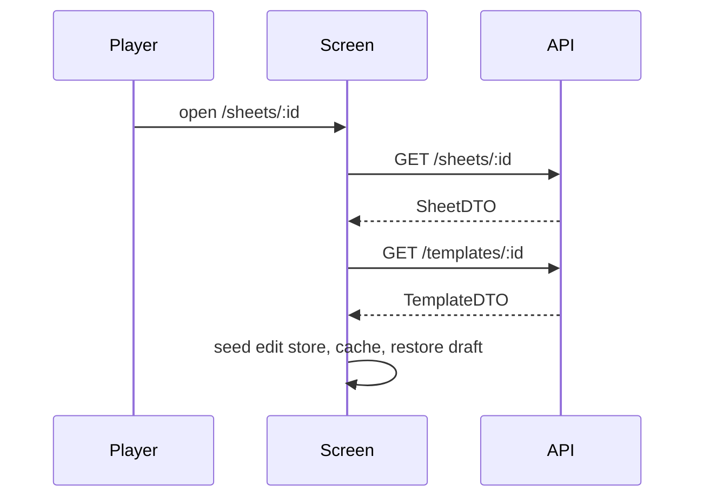
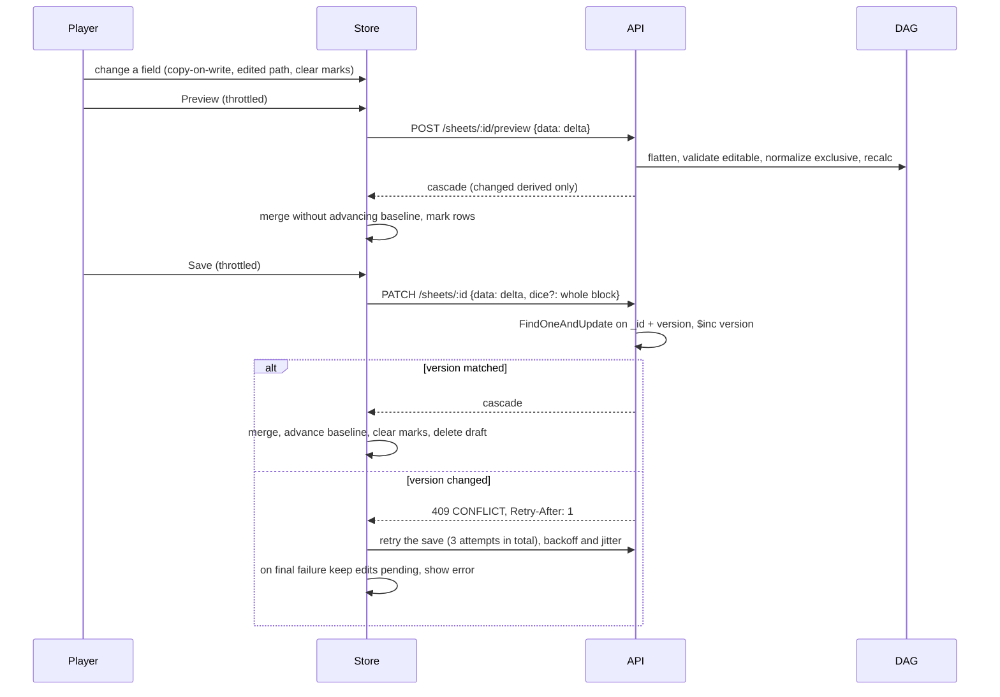
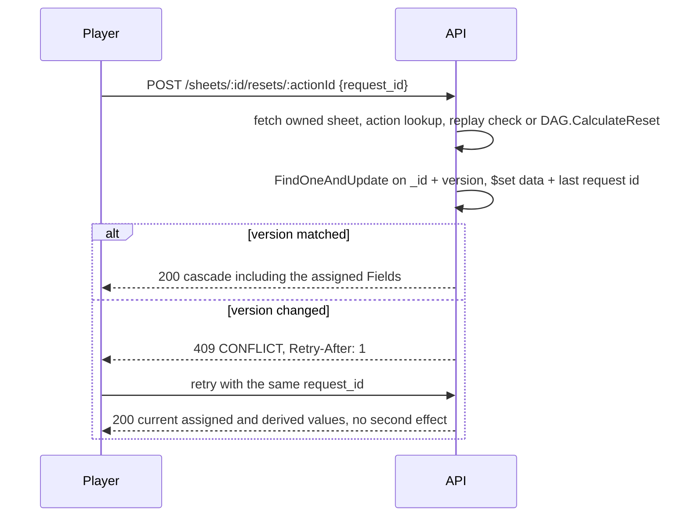
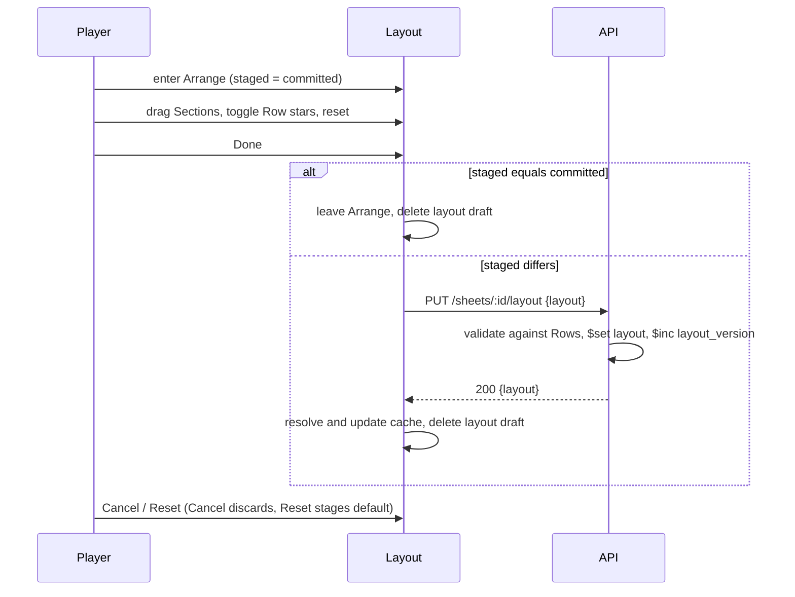

# Sheets

## Purpose

A sheet is one character, NPC or enemy: the values of a template's field tree, the player's
Dice choices and the player's Section order and pins. Templates are defined in code and served
read-only; the server validates writes, recalculates derived fields and stores a MongoDB
document, while the web client renders any template from its schema, edits only the changed
delta and keeps drafts locally. This file covers the template catalog, sheet
create/read/update/preview, layout and Arrange mode, and the web rendering and edit cycle.

## Why

- **Class-agnostic fifth-edition Templates (LGN-382), shipped complete, with a
  separate stat block Template over one class-aware character Template because** SRD 5.2.1
  carries only twelve classes with one subclass each and the engine has no choice field, and a
  creature's proficiency bonus comes from its challenge rating while a Template derives a value
  the same way for every kind it accepts. `fifth_character_v1` "5E Character" (`character`) keeps
  class, subclass, species and background as text, the player enters what they grant, and
  everything the rules derive from the Sheet is derived; `fifth_stat_block_v1` "5E Stat Block"
  (`npc`, `enemy`) derives the proficiency bonus and the XP from the challenge rating. Both are
  `active` Templates of the `fifth` Game system, and `fifth_character_v1` is the catalog default.
  Both play through the composable
  `fifth_character` and `fifth_stat_block` configs (LGN-417, LGN-418); the character draws every
  5E character surface and the stat block the compact NPC/enemy body. Cost: the player types
  class-granted values, and a Template without a config keeps the generic Section/Row form as its
  whole presentation; the engine capabilities they rely on are live: dice sized by Fields with a
  minimum total, Record lists with derived Record formulas, Reset actions, `min`, `max`, `lookup`,
  numeric flags and the d20-test marking of the Roll modes (LGN-390).
- **Composable presets (LGN-383): one config per Template over a bespoke preset per Template or
  Template-declared presentation roles because** a new Template should cost
  one config instead of about 35 files, while layout stays in the web rather than in the API
  contract. A need no piece covers becomes a new generic piece, and a Template without a
  config plays through the generic Section/Row view, which also draws Record lists, Reset
  actions and Roll modes. Cost: the library must grow generically, and the bespoke `fantasy`
  preset stays a frozen exception.
- **A Template lifecycle (`draft`, `active`, `retired`) over feature flags or registering new
  Templates only at release because** the codebase has no flags and a new Template must merge and be
  playable in local development before it is offered. Every Template declares its state at boot; a
  Draft is listed, fetched and creatable only when the API's `APP_ENV` is `development` (trimmed,
  case-insensitive), and an empty or any other value refuses it, so a process without the variable
  fails closed. A Retired Template leaves the catalog but keeps its existing Sheets, their reads,
  edits, rolls, layouts and duplicates working, and stays fetchable so the web can render them.
  Cost: every creation path checks the state, and nobody can try a Draft in production.
- **Templates as code over a `template` collection because** a template is reviewed content and
  no user-supplied game content may ship; the registry and its DAGs are built once at boot, so a
  read costs neither a query nor a compile. Cost: a template change is a deploy, an incompatible
  change needs a new slug (`fantasy_v1` → `fantasy_v2`), and users cannot author templates.
- **A code-defined Game system registry referenced by id over a field copied onto every Template
  because** the name, compatibility label and notice belong to the system, not to one Template, and
  a Template only chooses it. Boot refuses an unknown id, so a DTO never resolves a system at read
  time. Cost: a new system is a deploy, a Template cannot change its system under the same slug, and
  the notice path is validated twice (backend registry and web decoder) because it is rendered as a
  same-origin link target.
- **Dotted DAG keys with a validated alphabet over raw template keys because** formulas read
  identifiers such as `stats_dexterity` while documents and errors use `stats.dexterity`;
  restricting every segment to `^[A-Za-z][A-Za-z0-9]*$` makes the encodings collision-free.
  Cost: field names cannot contain `_` or `.`, and every template is checked at boot.
- **One read-lock acquisition per recalculation over three separate calls because** validation,
  exclusive normalization and the topological walk must see the same frozen graph, and a
  recursive `RLock` deadlocks once a writer is queued. Cost: a larger critical section, and
  callers must not nest DAG methods that lock.
- **Returning only changed derived fields over the whole sheet because** the client merges a small
  cascade and a no-op update writes nothing derived. Cost: change detection uses a relative
  epsilon (`1e-9 × max(1, |a|, |b|)`), so absolute slack grows with magnitude and integers above
  2^53 are indistinguishable in `float64`; this is unsuitable for exact large values, and a no-op
  PATCH never repairs an already-stale derived value.
- **Numeric 0/1 proxies for exclusive groups over an enum field because** one schema drives the
  formula environment and the single-choice control. Cost: members are numbers, a non-numeric
  member is a 400, and turning the chosen member off does not choose a sibling.
- **An opt-in `flag` marker on a number leaf over a `bool` field because** the generic sheet can
  draw an explicit 0/1 toggle in any path while formulas keep reading a number. Cost: a flag is a
  number with a marker, boot validates that it is an editable number defaulting to 0 or 1, and a
  value other than 0 or 1 is rejected.
- **Record lists as maps keyed by a client-made id over arrays because** the edit path is dotted
  keys and a slice is an opaque leaf, while a map keeps every Record Field on the same flatten and
  validation path and lets one PATCH create, reorder or remove a Record without rewriting the list.
  Cost: the client owns the id format (`r` plus 32 lowercase hex characters), every Record carries a
  reserved numeric `position` (ties order by id), the capacity is a Template constant, and derived
  formulas inside Records compile at boot and evaluate per Record on every save.
- **A compare-and-swap write over a server-side merge or lock because** it is one conditional
  `FindOneAndUpdate` with no lost writes and an honest conflict. Cost: a lost race spends a
  request on a 409, the version stays internal, and the client resends the delta.
- **Declared Reset actions over client-side arithmetic because** a rest may touch several leaves in
  one atomic save, and the server can validate every target against the DAG at boot. Cost: only a
  Template author can add an action, a target is an editable `number` leaf or list Field, and the
  server stores just the last applied request id.
- **Layout as user data on the sheet, with its own endpoint, over template variants or a `data`
  field because** the arrangement belongs to the player, survives devices and never enters the
  flatten/editability/DAG path. Cost: a second write path, a row-key grammar defined twice, and
  readers that tolerate stale keys. Rows pin instead of moving because a table Row owns its
  columns; cost: no arbitrary Row order and no page-level pinned zone.
- **No state library, with per-path subscriptions because** typing in one field must rebuild one
  control, not the whole sheet; `useSyncExternalStore` gives that without a dependency. Cost:
  stores are wired by hand, and the screen subscribes to coarse signals for the footer and marks.
- **A delta for edit, preview and save over a snapshot because** the server owns derived values
  and preview returns the same cascade a save would. Cost: the client tracks edited paths and a
  baseline, and a stale baseline yields a 409.
- **Best-effort local records over a durable offline database because** drafts and layout staging
  must survive a crash without becoming a second source of truth. Cost: no offline open, older
  records are discarded rather than migrated, and every local failure is silent.

## Flows

### Open a sheet

A sheet created from the catalog is seeded into the `['sheet', id]` query, so opening it makes no
second sheet fetch. A 404 evicts the cached sheet and its drafts; a restored draft is laid over
stored values and filtered to editable leaves.

### Edit → preview → save

A new edit clears the preview marks. An offline save or preview writes the pending delta to the
draft immediately; the normal cadence is 60 seconds. A successful save and an applied reset also
replace the cached `['sheet', id]` data with the new baseline, so leaving and reopening a Sheet in
the same session draws the saved values; the screen seeds its edit store once, so that cache write
never resets the open form. A save whose delta carries a non-empty `identity.name` also stores it
as the Sheet's top-level name; the server keeps the previous name when the value is cleared. The
screen writes name, data and Dice to the cache, updates the local library record and invalidates
the owned-sheet and campaign queries, so the library, the campaign list and the linked character
refetch the new name.

### Rest → reset action

A foreign Sheet and an unknown action are 404 before a malformed request id is 400, all before the
write; a replay of the last applied id never reaches the write. The owner's generic form draws one button per declared action
through `web/src/sheet/reset_actions.tsx`: one request id per tap is reused until that tap
succeeds, so an offline retry or a 409 resends the same id safely, and a 409 first refreshes the
Sheet. The bar is absent from `fantasy_v1`, from read-only campaign views and from Arrange mode.

### Arrange → commit layout

Nothing is sent while staging. A failed `PUT` keeps the staging and shows the mapped copy; `Done`
retries. A pending arrangement counts as unsaved work for the leave guard and `F5`; arranging
never marks values as unsaved and `Ctrl+S` saves nothing.

## Contracts

- **Ad slot on the catalog.** The catalog (`catalog_screen.tsx`, the sheet list) ends with an `AdSlot` (`catalog` surface) shown only to Free accounts; the sheet screen, dice and Arrange mode never show ads (see web-client Ads).

### Formula functions

The engine exposes `floor(v)`, `max(a, b)`, `min(a, b)` and
`lookup(x, k1, v1, k2, v2, ...)` to template formulas. Every argument is coerced to `float64`, so
int and float literals and field values mix freely and every result is a float; a non-numeric
argument is a typed engine error. `min` and `max` take exactly two arguments. `lookup` takes an
input plus at least one key/value pair, requires strictly ascending keys, and returns the value of
the greatest key less than or equal to `x`; below the first key it returns the first value and
above the last the last value, so a half-typed input never breaks a save. Wrong arity
(`ErrInvalidLookupArity`), unordered or duplicate keys (`ErrInvalidLookupKeyOrder`) and
non-numeric arguments (`ErrInvalidFloat`) are typed engine errors; the engine never imports
`apperr`, and the service translates failures at the boundary. `fantasy_v1` uses only `floor`.

### Template DTO

`GET /templates` returns an array and `GET /templates/:id` one object; both require an
authenticated, active account and share the per-user rate limit.

`TemplateDTO` is `{id, name, kinds, default, fields, dice?, actions?, game_system?}`. `kinds` is the ordered list of
Sheet kinds the Template accepts (`character`, `npc` or `enemy`); creation and generation with any
other kind stay 400 `INVALID_REQUEST`, and a Template that declares none omits the key. A node
carries exactly one of `schema` (leaf), `children` (group) or `list`; a group may carry `label` and
`columns`; a list carries `{label, columns, capacity, shape, dice?, not_d20?}` where `shape` is a
flat group of leaf schemas using the same schema shape as a leaf. A list's `dice` is the default
dice of every Record and `not_d20` marks every Record as not a d20 test. A leaf schema is `{type, label,
is_editable, default, formula?, depends_on?, exclusive_group?, option_label?, column_label?,
generatable?, generatable_kinds?, prefer_default?, min?, max?, max_length?, flag?, aggregate?}`. `default` stays
numeric for every type, so a text leaf shows `0`. `flag` marks an editable number leaf as a 0/1
toggle and is absent otherwise; boot rejects it on a non-number or derived leaf, or with a default
other than 0 or 1. `aggregate` is `{list, field, op}` on a derived number leaf: `op` is `sum` or
`count` (non-zero values), the field is a numeric shape Field (derived or editable), and an empty
list gives 0. A list path has at most three segments and its capacity is 1–200; boot rejects a
reserved `position` shape key, an invalid shape key, a group or list inside the shape, a deeper
path or an out-of-range capacity. `dice` is `{section?, row?, not_d20?}`; it is omitted when the
Template has no defaults and no marking, and `not_d20` is `{section: [...], row: [...]}` naming the
Rows and Sections whose dice are not d20 tests (see [dice](dice.md)). `actions` is omitted when the
Template declares none and is otherwise a list of `{id, label, assignments}`, where each assignment
is `{target, expression, filter?}` (see Reset actions). Sections follow the template's
`SectionOrder` and children their declared `Order`;
unlisted keys are alphabetical. Template IDs are slugs (`^[a-z][a-z0-9_]*$`); a malformed ID is
400, an unknown one 404.

### Game system

Game systems are code-defined and built once at boot, like Templates. `BuildGameSystems` validates
every entry: the `id` matches `^[a-z][a-z0-9_]*$`, the name and compatibility label are non-empty,
a duplicate id is refused and the notice path is a same-origin path. Exactly one entry ships:
`fifth`, name `5E`, compatibility label `5E compatible`, notice `SRD 5.2.1` at `/srd`.

A same-origin notice path starts with one `/`. A protocol-relative (`//host/x`), relative (`srd`),
absolute (`http:`, `https://host/x`) or `javascript:` path, and one carrying a backslash or a
control character, is refused by the backend registry and by the web decoder.

`Template.GameSystemID` is optional and resolved at boot: an unknown or malformed id fails
`BuildRegistry`, and `fantasy_v1` declares none. A Template never changes its Game system under the
same slug; the change is a new slug. In the DTO, `game_system` is
`{id, name, compatibility_label, notice: {label, path}}` and is omitted when the Template has none.
The catalog entry and the create-sheet dialog show the compatibility label as plain text, with no
attribution link and no notice label; a Template without a Game system renders exactly as before.
`Registry.TemplateStatesByGameSystem` returns every Template id of a Game system with its state,
without cloning; Campaign scope resolution filters that list with `Available` so Drafts appear
only in development and Retired Templates always do.

Every web view that draws a Template name draws its notice beside it through
`web/src/catalog/template_name.tsx`: the owner Sheet on the owner screen, the campaign read-only GM and
NPC views, and the generation review. The name reads `5E Character · SRD 5.2.1` (the `·`
separator is copy from `web/src/l10n/strings.ts`, never a literal in the component), and the notice
label is a router link to the Template's same-origin notice path. The link passes through the shell
leave guard, so leaving a Sheet with unsaved work still asks first. A Template without a Game system
draws the previous name markup with no link; `fantasy_v1` views are unchanged, and the catalog, the
create-sheet dialog, navigation, Account and Help never draw the notice. The `/srd` page itself is
not part of the Sheet feature.

### Template lifecycle

Every Template declares `state` as `draft`, `active` or `retired`; boot rejects a missing or
unknown value. `fifth_character_v1` and `fifth_stat_block_v1` are `active` and
`fifth_character_v1` is the default, while `fantasy_v1` is `retired`. The state stays
server-side: it is not in `TemplateDTO`.

Drafts are visible only when `APP_ENV`, trimmed and compared case-insensitively, is `development`.
An empty value, `production`, `staging` or anything else fails closed; the production API
deliberately carries no `APP_ENV` (only the worker sets `production`), so a bare `go run` without
the variable hides Drafts, while `scripts/dev.sh` exports `development`.

| Path                                                | active | draft in development | draft elsewhere | retired                                                                                                              |
| --------------------------------------------------- | ------ | -------------------- | --------------- | -------------------------------------------------------------------------------------------------------------------- |
| `GET /templates`                                    | listed | listed               | omitted         | omitted                                                                                                              |
| `GET /templates/:id`, `POST /templates/:id/preview` | yes    | yes                  | 404             | yes                                                                                                                  |
| `POST /sheets`                                      | yes    | yes                  | 400             | 400, or 201 from the catalog default template that accepts the kind, or 201 with an active Campaign that includes it |
| `POST /generations`                                 | yes    | yes                  | 400             | 400                                                                                                                  |
| Accept a succeeded generation job                   | yes    | yes                  | 400             | yes                                                                                                                  |
| Duplicate an existing NPC or enemy                  | yes    | yes                  | 400             | yes                                                                                                                  |
| Read, edit, roll, layout or link an existing Sheet  | yes    | yes                  | yes             | yes                                                                                                                  |

A refused creation or generation is 400 `INVALID_REQUEST` before any plan slot, quota or daily-cap
reservation, and the message names the reason: a Draft outside development says the Template is
not available in this environment, a Retired Template says it is retired and cannot start new
sheets (or generations). Duplicating a Retired Template is allowed because it follows the
existing-Sheet rule.
The Draft 404 is public only: `Registry.FetchByID` and `Registry.DAG` return every state, so an
existing Sheet's recalculation, rolls, Dice validation, layout and Reset actions never depend on
the environment.

The web loads a Sheet's Template through `GET /templates/:id`, which 404s for a Draft outside
development. There is no separate endpoint for it: a Draft Sheet can only be created where Drafts
are allowed, a Template never moves back to `draft`, and running without `APP_ENV=development`
against a database that holds Draft Sheets leaves those Sheets unopenable in the web. Keep the
environment aligned with the database instead of widening the Template read.

`POST /sheets` accepts an optional `campaign_id`, and that field is the only way to create a Sheet
from a Retired Template: it must name an active Campaign the caller belongs to whose `template_ids`
includes the Template. Every "not allowed" campaign outcome (malformed id, unknown, foreign or
non-member, deleting, out of scope) is the same 400 `INVALID_REQUEST` with
`campaign does not allow creating a sheet from this template`, so a foreign Campaign is
indistinguishable from one that does not exist; an unexpected Campaign read failure is 500
`INTERNAL_ERROR` with `campaign scope could not be checked`, so an outage is never reported as a
refusal. For an Active Template the field is ignored and not
even validated, and it never bypasses the Draft gate, the accepted kinds or the plan limit.
Without a `campaign_id`, a request naming a Retired Template falls back to the catalog `default`
Template that accepts the kind (today `fifth_character_v1`, and only for `character`); when none
accepts it, the request is the same 400 retired refusal. The fallback applies to `POST /sheets`
only, never to the generation accept path. Creation stores no `campaign_id` and publishes no link
event; the client links the Sheet afterwards. See [campaigns](campaigns.md) for the Campaign side.

### Fifth-edition Templates

`fifth_character_v1` and `fifth_stat_block_v1` share every field path below, so a later story
extends a Template without renaming a shared part. Both are `active` Templates of the `fifth` Game
system, carry `identity.name` as their Name leaf, and use the same static Section order: `identity`,
`abilities`, `saves`, `skills`, `exhaustion`, `passive`, `armor`. The character adds `hitDice`,
`spellcasting`, `combat`, `status` and `coins` after `armor`, then its Record Sections `attacks`,
`inventory`, `features`, `spells` and `resources`.

- **Identity** — `identity.name` (text, generatable); `identity.class`, `identity.subclass`,
  `identity.species` and `identity.background` (editable text, capped at 60 like the name,
  character only) are generatable with generation enums, and the subclass enum carries the empty
  option; `identity.level` (1–20, character only) or
  `identity.challengeRating` (0–30, fractional CRs entered as `0.125`, `0.25`, `0.5`) and the
  derived `identity.proficiencyBonus`. The character bonus is `2 + floor((level - 1) / 4)`; the
  stat block bonus is `2 + floor((max(CR, 1) - 1) / 4)`, so CR 0 and every fractional CR give +2.
  `identity.jackOfAllTrades` is a numeric 0/1 flag on the character only.
- **Abilities** — `abilities.<ability>.score` is entered (default 10) and
  `abilities.<ability>.mod` is `floor((score - 10) / 2)`.
- **Saves** — `saves.<ability>.prof` (numeric 0/1 flag), `.misc` (entered) and `.total`
  = modifier + prof × proficiency bonus + misc.
- **Skills** — all 18 SRD skills as `skills.<skill>.rank` (entered 0/1/2, never under `config`),
  `.misc` and `.total` = modifier + rank × proficiency bonus + misc. On the character,
  `identity.jackOfAllTrades` adds `floor(PB / 2)` to a rank-0 skill only; expertise (rank 2)
  doubles the bonus and never stacks with the half bonus. The stat block has no such flag.
- **Exhaustion** — `exhaustion.level` (entered 0–6) and the derived `exhaustion.penalty`
  = `-2 × level`. The penalty appears only inside the dice expression of the ability checks,
  saves and skills (`1d20 + @.mod` / `@.total + exhaustion.penalty`); no displayed total and no
  Passive Perception includes it.
- **Passive Perception** — `passive.perception` = 10 + `skills.perception.total` + the exclusive
  choice `perceptionChoice` (`choiceNone` is the default, `choiceAdvantage` +5,
  `choiceDisadvantage` −5). The choice never sets a Roll mode and the Section declares no dice.
- **Armor class** — the exclusive `armorChoice` group with `choiceNone` as the default,
  `choiceLight`, `choiceMedium`, `choiceHeavy`, `choiceBarbarian`, `choiceMonk` and, on the stat
  block, `choiceNatural`; plus `armor.base`, the numeric 0/1 `armor.shield` flag and `armor.misc`.
  `armor.armorClass` is the chosen base: none 10 + Dex, light base + Dex, medium base + min(Dex, 2)
  (a negative Dex still applies), heavy base, Barbarian 10 + Dex + Con, Monk 10 + Dex + Wis,
  natural base + Dex. The Shield adds +2 to every choice, except that a Monk with a Shield drops
  the Wisdom and uses 10 + Dex + 2; `armor.misc` stacks on top.
- **Hit Dice** — character only. `hitDice.primary.size` enters the class Hit Die size (4–12,
  default 8), `hitDice.primary.count` = `max(0, level − the extra counts)`, and each pool enters a
  `spent` behind a derived `remaining` = `max(0, count − spent)`: `hitDice.primary.spent`, and
  `hitDice.d6|d8|d10|d12.spent` for the multiclass `extra` counts (default 0, never generatable).
  Every pool rolls one die plus the Constitution modifier with ` min 1`:
  `1d{hitDice.primary.size} + abilities.constitution.mod min 1` for the primary pool (it reads the
  entered size) and `1d6|d8|d10|d12 + abilities.constitution.mod min 1` for an extra pool. The
  `hitDice` Section is marked as not a d20 test, so no Hit Die Row offers a Roll mode.
- **Spellcasting** — character only. The six `spellcasting.ability<Ability>` leaves are the
  exclusive `spellcastingAbility` group of numeric 0/1 flags; `spellcasting.abilityMod` selects the
  chosen ability's modifier, `spellcasting.attack` = ability modifier + PB and
  `spellcasting.saveDC` = 8 + ability modifier + PB. The spell attack Row rolls
  `1d20 + @ + exhaustion.penalty` and stays a d20 test; the save DC never includes Exhaustion.
  `spellcasting.preparedLimit` enters the prepared-spell limit. Levels 1–9 are `spellcasting.slotN`
  with an entered `total` and `spent` behind `remaining` = `max(0, total − spent)`; Pact Magic is
  `spellcasting.pact` with an entered `count`, `level` and `used` behind
  `remaining` = `max(0, count − used)`. Every spent and used entry stays an editable number leaf so
  a later rest action can zero it.
- **Combat (character)** — `combat.initiative.alert` (numeric 0/1 flag), `.misc` and `.total`
  = Dex mod + Alert × PB + misc; its Row dice is `1d20 + @.total + exhaustion.penalty`, and Jack
  of All Trades never applies. `combat.speed.base` and `.total` = base − 5 × Exhaustion − 10 when
  `armor.choiceHeavy` is chosen and the Strength score is below
  `combat.armorStrengthRequirement` (default 0 means no requirement, and a requirement left on
  other armor is ignored); there is no floor. `combat.hp.base`, `.perLevel`, `.misc`, `.current`
  and `.temp` are entered and `.max` = base + Con mod × level + per-level × level + misc.
  `combat.carryingCapacity` = Strength × 15.
- **Status (character)** — `status.xp` is entered independently of `identity.level`;
  `status.heroicInspiration` is a numeric 0/1 flag; `status.conditions.<condition>` has one
  numeric 0/1 flag for every SRD condition except Exhaustion, each label carrying its rule text;
  `status.deathSaves.successes` and `.failures` are entered 0–3 with the rule text on the Row, and
  the Row dice is `1d20 + exhaustion.penalty` because a death save is a d20 test.
- **Coins (character)** — `coins.cp`, `.sp`, `.ep`, `.gp` and `.pp` are entered, default 0, and
  stay outside the Inventory weight total.
- **Attacks (character Records)** — `attacks.list` (capacity 10) with `name`, the exclusive
  `attackAbility` group `abilityStrength` (the default), `abilityDexterity`, `abilityConstitution`,
  `abilityIntelligence`, `abilityWisdom` and `abilityCharisma`, the numeric 0/1 `proficient` flag,
  `misc`, `damage` (text) and `notes`. The derived `toHit` is the chosen ability modifier +
  `proficient` × PB + `misc`, and `damageBonus` is the chosen ability modifier, so damage adds it
  while its dice stay text. The list Row default is `1d20 + @.toHit + exhaustion.penalty`, and the
  Exhaustion penalty never enters the displayed `toHit`.
- **Inventory (character Records)** — `inventory.items` (capacity 100) with `name`, `quantity`
  (default 1), `weight`, the numeric 0/1 `attuned` flag and `notes`, plus the derived Record
  `lineWeight` = quantity × weight. `inventory.totalWeight` sums those Record values and
  `inventory.attuned` counts the non-zero `attuned` flags; an empty list gives 0, a quantity of 0
  adds nothing, and attunement is shown, never blocked. Coins stay static leaves outside the list,
  so they never enter the total.
- **Features and feats (character Records)** — `features.list` (capacity 50) with `name`, `source`
  and `text`, all text.
- **Spells (character Records)** — `spells.list` (capacity 100) with `name`, `level` (0 for a
  cantrip), the numeric 0/1 `prepared`, `concentration` and `ritual` flags, and `notes`.
- **Resources (character Records)** — `resources.list` (capacity 20) with `name`, `max`, `used` and
  the exclusive `resourceRecharge` group `rechargeShort`, `rechargeLong` and `rechargeNone` (the
  default). The rests zero `used` by recharge kind: the long rest sets it to
  `record_used * record_rechargeNone` and the short rest to
  `record_used * (1 - record_rechargeShort)`.
- **Rests (character)** — two Reset actions. `long_rest` sets `combat.hp.current` to
  `combat.hp.max`, zeroes `spent` in `hitDice.primary` and each `hitDice.d6|d8|d10|d12` pool, in
  every `spellcasting.slot1..slot9` and in `spellcasting.pact.used`, zeroes both
  `status.deathSaves` counters and `used` on every `resources.list` Record whose recharge is short
  or long, and lowers `exhaustion.level` by one with a floor of 0. `short_rest` zeroes
  `spellcasting.pact.used` and `used` on short-recharge Resources only. The list assignments read
  their own Record: `record_used * record_rechargeNone` for the long rest and
  `record_used * (1 - record_rechargeShort)` for the short rest. Every expression reads the stored
  Sheet before the action, and spending a Hit Point Die stays a Roll where the player enters the
  HP gained and the die spent.

- **Generation metadata (5E)** — both Templates declare per-kind prompt guidance: the character
  asks for an SRD class and subclass, an original name, level 1 with 0 XP when the concept states
  none, a Hit Point base equal to the Hit Die size and per level half the die plus one, and text
  at most about 300 runes; the stat block asks for an SRD or original creature and takes the
  challenge rating from the concept. The `fifth` Game system supplies the brief, the allowed
  class, subclass, species, background and condition names, and a denylist of product and setting
  terms (including `race`); boot rejects an unknown or unaccepted guidance kind and empty text.
  Record lists carry `MaxRecords`: the character caps attacks at 6, inventory at 20, features and
  feats at 15, spells at 30 and resources at 6; the stat block caps traits, actions, bonus actions,
  reactions and legendary actions at 6 each and resources at 4. A cap is 1–capacity, and 0 means
  no generation cap. The character's class, subclass, species and background leaves use generation
  enums from the allowed names, `identity.level` and `status.xp` prefer their defaults, the Hit Die
  size is generated as one of 6, 8, 10 or 12, and spell slot totals and the Pact Magic count are
  generated with a zero minimum. Its class/subclass rule binds the class, subclass and level paths
  with the subclass available from level 3, and requires the class enum to equal the allowed
  classes in order and the subclass enum to equal the allowed subclasses plus the empty option.
  The save-proficiency rule lists the six `saves.<ability>.prof` flags and requires exactly two on.
  Hit points are generated from `combat.hp.base` (1–20) and `combat.hp.perLevel` (0–20) on the
  character, and `hitPoints.count` (1–20) and `hitPoints.size` (4–20) on the stat block. Boot
  rejects a bad enum value or rule shape, a class/subclass enum that drifts from the Game system,
  and a save rule that does not ask for one to all of its distinct flagged paths.

The character's Record Sections use the generic list contract below: one Record Row per
`<list>.<id>`, a flat shape and the per-Record exclusive groups. The Template Section dice are the
three d20 checks only; `attacks.list` carries its own Row default.

The three d20 Sections declare Section dice, not per-Row defaults: `abilities`
`1d20 + @.mod + exhaustion.penalty`, `saves` and `skills` `1d20 + @.total + exhaustion.penalty`.
The character's initiative and death save Rows declare Row dice: `1d20 + @.total +
exhaustion.penalty` and `1d20 + exhaustion.penalty`. Every expression stays inside the
64-character cap. Only the character's `hitDice` Section and the stat block's `hitPoints.maximum`
Row are marked as non-d20 tests. Both Templates use only SRD terms in labels, keys and names.

`fifth_character_v1` plays through the composable config in
`web/src/sheet/preset/compose/configs/fifth_character.ts`, registered in `PRESET_CONFIGS`. The
identity header binds the name and the class subtitle; both stay editable, with no resting
underline, a solid hover/focus underline, a pencil hint on the same hover/focus and a visible
focus ring; one stat-pill row carries class, subclass,
species, background and level, another carries armor class, initiative, speed, proficiency bonus
and Passive Perception; the hit-point track binds `combat.hp.current`, `.max` and `.temp`; the
ability grid, save list and 18-skill list bind their score/modifier, proficiency/total and
rank/total leaves with an explicit `row`, so each roll reads the Exhaustion-penalised Section
expression from its own Row. The conditions piece carries every SRD condition and the Exhaustion
pips (level of 6 with the derived penalty); pips draw death save successes and failures out of 3,
the primary Hit Die and the four extra pools from their `spent` leaves, and the nine spell levels
and Pact Magic from `spent`/`total` and `used`/`count`; Record tables draw attacks, inventory,
features, spells and resources; the Reset bar binds `long_rest` and `short_rest`; and the Roll mode
bar drives the next roll. The wide layout keeps identity, vitals and hit points above four columns
(abilities; saves and skills; status and rest pips; spell slots) with the Record tables below;
the narrow layout flattens the same Sections in reading order. A test decodes the golden with `parseTemplateDetail`
and asserts `configPathErrors` is empty.

`fifth_stat_block_v1` keeps the seven shared Sections as a prefix and appends `experience`,
`hitPoints`, `initiative`, `speed`, `details`, `traits`, `actions`, `bonusActions`, `reactions`,
`legendaryActions` and `resources`; `fifth_character_v1` appends its own Record Sections above.

- **Experience (stat block)** — `experience.xp` is the SRD XP of `identity.challengeRating` by
  `lookup` over the whole table: CR 0 gives 10, the fractional CRs `0.125`, `0.25` and `0.5`
  give 25, 50 and 100, and every whole CR 1–30 gives its table value.
  `experience.zero` (numeric 0/1 flag) makes the XP 0 but is honoured only at CR 0;
  `experience.inLair` (numeric 0/1 flag) replaces the XP with the XP of CR + 1 only when the CR
  is a whole number from 1 to 29, so a fractional CR and CR 30 keep the table value.
- **Hit points (stat block)** — `hitPoints.count` (N, 1–20) and `hitPoints.size` (M, 4–20) are
  entered, `hitPoints.conBonus` = N × Con modifier is derived and
  `hitPoints.maximum` = `floor(N × (M + 1) / 2)` + `hitPoints.conBonus`; `hitPoints.current`
  and `hitPoints.temp` are entered. The `hitPoints.maximum` Row rolls
  `{hitPoints.count}d{hitPoints.size} + hitPoints.conBonus` and is marked a non-d20 test, so the
  Roll offers no mode even for d20 dice.
- **Initiative and speed (stat block)** — `initiative.modifier` is entered and the derived
  `initiative.score` = 10 + modifier is never imported; its Roll is
  `1d20 + initiative.modifier + exhaustion.penalty`. `speed.walk|fly|swim|climb|burrow` are
  entered as printed (walk defaults to 30) and each derived `<speed>Total` is
  `entered > 0 ? entered − 5 × exhaustion.level : 0`, so a printed speed has no floor while an
  unprinted 0 stays 0; the Strength-requirement penalty is character only.
- **Records (stat block)** — `traits`, `bonusActions`, `reactions` and `legendaryActions` are
  name-and-text Record lists. `actions` holds a name, an `actionAbility` exclusive group of
  numeric choices (one per ability), the `proficient` flag, `misc`, a derived
  `toHit` = ability modifier + PB if proficient + misc, damage and notes; its Records roll
  `1d20 + @.toHit + exhaustion.penalty` as a d20 test. `resources` holds a name, `max`, `used`,
  the derived `remaining` = max − used and a recharge text, so Legendary Resistance, X/Day and
  Recharge 5-6 are entered as printed. `details.resistances|immunities|senses|languages` are
  text. Every Record list holds at most 50 Records.

Both Templates also stay usable end to end through the generic form: every Section draws with
its title, a `flag` leaf draws as a toggle, a skill rank draws as a number entry, each Record list
draws as its table, and the Rows marked not a d20 test offer no Roll mode. The character's Edit
form still draws the Reset action bar with `Long rest` and `Short rest`. Their wire contract is
pinned by
`testdata/templates/fifth_character_v1.json` and `fifth_stat_block_v1.json`, full
`GET /templates/:id` bodies that a Go test compares to the registry's DTO and the web suite
decodes with `parseTemplateDetail`; a DTO change moves the goldens deliberately. Their ids,
names, labels, option and column labels and action labels stay SRD-only.

### Sheet DTO and endpoints

`SheetDTO` is `{id, template_id, kind, name, data, layout?, dice, campaign_id?, created_at,
updated_at}`. `kind` is `character`, `npc` or `enemy`. `layout` appears only when set; `dice` is
always present (`{"section": {}, "row": {}}` when empty); `version` and `layout_version` are
never exposed.

| Method and path                     | Body                                            | Success                        |
| ----------------------------------- | ----------------------------------------------- | ------------------------------ |
| `POST /sheets`                      | `{template_id, kind, sheet_name, campaign_id?}` | 201 sheet                      |
| `GET /sheets/owned?kind=character`  | —                                               | 200 array, oldest first        |
| `GET /sheets/:id`                   | —                                               | 200 sheet                      |
| `PATCH /sheets/:id`                 | `{data?, dice?}`                                | 200 cascade                    |
| `POST /sheets/:id/preview`          | `{data}`                                        | 200 cascade, no write          |
| `POST /sheets/:id/resets/:actionId` | `{request_id}`                                  | 200 cascade, one write         |
| `PUT /sheets/:id/layout`            | `{layout}`                                      | 200 `{layout}`                 |
| `POST /sheets/:id/duplicate`        | —                                               | 201 sheet (NPC and enemy only) |
| `DELETE /sheets/:id`                | —                                               | 204                            |

Every JSON success is wrapped in `{"data": ...}`. A malformed id is 400; a missing sheet and a
foreign sheet are both 404. Creating a Sheet stores the name trimmed; an empty or whitespace-only
name is 422 `SHEET_NAME_INVALID`. Creating reserves a per-owner, per-kind plan slot and inserts in
one transaction; deleting releases it. Free plans allow 1 character, 2 NPCs and 2 enemies; paid
plans allow 10/50/50. Duplicating a character is 422 `SHEET_KIND_MISMATCH`; exceeding the plan on
create is 409 `SHEET_LIMIT_REACHED` and on duplicate 403 `PLAN_LIMIT_REACHED`.

When the Template declares a `NameLeaf` (the 5E Templates use `identity.name`), the stored
`name` mirrors `TrimSpace(identity.name)`. Creation seeds `identity.name` from the validated
`sheet_name`, so both start equal. A data PATCH with a non-empty `identity.name` updates the stored
name in the same compare-and-swap; a blank or whitespace-only `identity.name` leaves the previous
name untouched. The values path (generation accept) uses a non-empty `identity.name` when present
and otherwise seeds it from `sheet_name`. Duplicate appends ` (copy)` to the copied
`identity.name` and stores the same value as the name; when the result would exceed the
`NameLeaf`'s `max_length`, the base name is truncated so the suffix still fits. A Template without
a `NameLeaf` keeps the creation name and duplicate still appends the suffix to it. Names are always
trimmed, and a name above the `NameLeaf`'s `max_length` is 422 `SHEET_NAME_TOO_LONG`.

### PATCH and preview

`data` is a nested map of editable leaves, flattened to DAG dot-keys. An unknown key or group
prefix is 400 `UNKNOWN_FIELD`; a derived leaf is 400 `INVALID_REQUEST`. A text leaf longer than its
schema `max_length` (counted in runes) is 400 `INVALID_REQUEST`, checked on every PATCH and preview
that carries the leaf; stored text is never re-validated, so a legacy sheet still saves an unrelated
delta. A leaf carrying `flag` accepts only a numeric 0 or 1 on PATCH, preview and create with
values; anything else is 400 `INVALID_REQUEST`. Each touched exclusive group may have at most one
non-zero member in the payload: two is 400,
a non-numeric member is 400, and a member set to zero leaves siblings unchanged.

`dice` is `{"section": {sectionKey: expr | null}, "row": {rowKey: expr | null}}`. A present block
replaces the whole block (an empty block clears it); an absent or `null` block leaves it
untouched. `null` means "no dice", an absent key means "use the template default". The block is
capped at 64 entries, keys must name a Section or Row, expressions must parse, a Row expression
must fit its Row and a Section expression at least one Row. A Row key may be a Record Row
`<list>.<well-formed id>`: it is checked against the list shape and id format without reading Sheet
data, so an id no Record carries any more is kept and does not block the save. Dice-only saves skip
the DAG and return `{"data": {}}`. A body with neither a top-level non-empty `data` nor a `dice`
block is 400. Preview reads `data` only and never writes; the Dice grammar and both implementations
are in [dice](dice.md).

The response is only the changed derived leaves, nested. A PATCH whose values do not change
returns `{}` and recomputes nothing. Sheets nest at most five levels; deeper input is 400.

### Record lists

A Template list declares a Record shape, a label, a display column order and a required capacity
(1–200). The list path is at most three segments, so a Record Field path (`<list>.<id>.<field>`)
never exceeds the five-level limit. The shape is flat: only leaves, using the normal leaf schema,
with the normal key rules; `position` is reserved, and a nested list or group fails boot. Flags and
`max_length` apply inside a Record exactly as on a static leaf.

The stored shape is always a map keyed by Record id, never an array:
`{"inventory": {"items": {"r<32 hex>": {"name": "Rope", "quantity": 1, "position": 0}}}}`. The
client creates the id as `r` followed by 32 lowercase hex characters (a UUID without hyphens); it is
not a `Sheet`-style server entity id and is never validated with `idgen`. A new Sheet seeds every
list as `{}`. Each Record carries the reserved numeric `position`; readers order Records by
`position` and, on a tie, by id. The server stores the value and never sorts or rewrites the map.

A Record is one Row, keyed `<list>.<id>`; its Fields are `<list>.<id>.<field>`. The Row key and its
Section (the first list-path segment) are decided from the Template and the id format alone, never
by reading Sheet data, so a pin or dice override for an id that no longer exists is still a
well-formed key. The shape decides what `@.<field>` means inside that Row: only a numeric shape
leaf fits, and `position` is not a Field. A list is one declaration for its Records: `dice` is the
Row default and `not_d20` the marking for every Record. A Section dice override or default fits
when it fits at least one static Row or one Record shape of the Section, including an empty list.

`PATCH /sheets/:id` and `POST /sheets/:id/preview` accept the same nested `data`; a key under a list
path is split out before the DAG runs:

- writing any shaped Field under a new id creates the Record, seeded from the shape (leaf defaults
  and the position after the current maximum), then applies the Fields;
- writing `<list>.<id>.position` moves the Record; the value must be numeric;
- `null` at `<list>.<id>` removes the Record; removing an absent id is a no-op, and a removal wins
  over a Field write to the same id in one PATCH (so a client cannot resurrect it in the same
  request);
- capacity is checked on the merged list, not on the delta, so removing one Record while adding
  another at capacity is allowed and one Record over capacity is 400;
- an empty list (`{}`), including one just cleared to empty, accepts a new Record.

Unknown Fields in a shape are 400 `UNKNOWN_FIELD`; a malformed id, a derived or non-editable shape
Field, a `null` Field value, a non-numeric `position`, a `flag` value other than 0 or 1, text over
`max_length`, two non-zero exclusive members in one Record and an over-capacity list are 400
`INVALID_REQUEST`. The response is the derived cascade: adding, editing or removing a Record
returns the Record's derived values under its id, and any aggregate they change; a save that changes
nothing derived answers `{}`.

### Record formulas and aggregates

A derived shape Field is declared like any other derived leaf, but its formula runs once per Record
and reads its own Record as `record_<field>`; the Sheet is read through the normal static keys, and
`record` is only a reserved top-level key (a top-level field of that name fails boot), never a
formula input, so a `record.<field>` read fails boot. Every own-Record dependency is a one-segment `depends_on` path (a
shape field name, or a top-level static field name); every Sheet dependency is its dotted path.
Boot rejects a missing shape field, a missing static path, an undeclared `record_<field>` read and a
cycle that crosses a Record and an aggregate, because the Record and aggregate nodes join one
topological sort. `position` is not a formula input.

An exclusive group in a shape behaves per Record: two non-zero members in one Record are 400, a
chosen member clears its siblings in that Record, and two Records may choose different members. A
Record's derived values are recomputed whenever any Record Field, `position` change, removal or any
Sheet Field it reads changes; the cascade carries them nested as
`{"inventory": {"items": {"r<id>": {"derivedTotal": 6}}}}`.

A Sheet-level aggregate is a derived number leaf declaring `{list, field, op}`, with `op` `sum` or
`count` (count counts non-zero values). It reads the Record Field of every Record in the list —
editable or derived — may feed another formula, and joins the same cascade. The dependency on
`<list>.<field>` is implicit, an empty or missing list gives 0, and the values are summed as stored
(non-numeric or missing values count as 0, and `count` ignores zero).

### Reset actions

A Template may declare named Reset actions; nothing about them is stored on the Template collection
because templates are code. `actions` in the DTO is the ordered list of `{id, label, assignments}`,
and an assignment is `{target, expression, filter?}`. The action `id` is a slug
(`^[a-z][a-z0-9_]*$`) and is unique within the Template.

`target` is an editable `number` leaf (`level`) or a list Field written as `<list>.<field>`
(`inventory.items.quantity`). A static target is rejected at boot when it is unknown, derived or
not editable; a list target is rejected when the field is absent from the shape, derived or not
editable. `filter` is optional and only valid on a list target: it names a numeric shape Field, and
only Records whose value is non-zero receive the assignment. An expression that does not compile —
for its static environment or, on a list target, for one that exposes only the declared
`record_<field>` reads — fails boot, as does a filter on a static target, an unknown filter Field, a
text filter and a duplicate id. `fantasy_v1` declares none, so its DTO has no `actions` key.

`POST /sheets/:id/resets/:actionId` takes `{"request_id": "<uuid>"}` and is owner only. Every
expression is evaluated against the Sheet as stored before the action, so two assignments in one
action never see each other's result; a list assignment is evaluated per matching Record. The
assigned values, the recalculated Record and aggregate values and the derived cascade are written in
one compare-and-swap `data` save under one `version`, with `updated_at`; the response is the assigned
Fields plus the derived cascade. A lost race is the usual 409 `CONFLICT` with `Retry-After: 1`.

The `request_id` is a canonical UUID (any version) and is required. The Sheet stores the last applied
id: replaying it answers 200 with the current stored values of every path the action assigns (for a
list target, that Field in every Record) plus every derived value, and writes nothing and emits no
event, so a retried rest never applies twice and merging the response into a client baseline is
idempotent; a different id is a new rest. A foreign or missing Sheet is 404 before anything else, an
unknown action is 404 before a malformed or missing request id, and a malformed or missing request id
is 400 `INVALID_REQUEST`. An action whose assignments change nothing still writes the request id and
answers 200 with the assigned values. The `sheet.updated` event lists the assigned target paths that
actually changed, flat, in sorted order.

### Layout

Body: `{"layout": {"section_order": [...], "pinned": [...]}}`; `{"layout": null}` or empty lists
reset it to none. The write is a full replacement and idempotent. An order equal to the
template's is stored as given when sent; the web sends only the lists that deviate and `null`
when none does. A partial list is valid: missing Sections fall back to template order, stale keys
are ignored on read, an unknown Section or pin is 400, and a duplicate within one list is 400. A
pin may be a static Row key or a Record Row `<list>.<well-formed id>`; the Record key is checked
against the Template shape and id format, so it saves without reading Sheet data and a key left by
a removed Record does not block a later save. Pins never reorder Rows across Sections: a pinned Row
is drawn at the top of its own Section in pin order. `PUT` does not touch `version` or
`updated_at`, so it never conflicts with a save.

### Row-key grammar (backend and web)

A Row key is derived only from the template:

- lone leaf → dotted path (`stats.dexterity`)
- group with a resolvable `columns` child → its path (`skills.acrobatics`); its columns and any
  exclusive members below it are not Rows
- editable leaves sharing a non-empty `exclusive_group` in one Section → `<parent path>#<group id>`
  (`config#armorClassAbility`); a one-member group stays a lone leaf
- one Record of a list → `<list path>.<id>` (`inventory.items.r<32 hex>`); the list path alone and
  any Field below the Record are not Rows, and a malformed id is no Row

Sections follow `SectionOrder`; children follow their declared `Order`, then alphabetical; a
Section with no leaf is omitted unless it declares a list. The backend definition is
`template.SectionRowKeys` for static Rows plus `template.IsRowKey`/`template.ParseRecordRowKey` for
Record Rows; the web definition is `buildRows`/`rowKey` in `web/src/engine/field_grouping.ts` plus
`isRowKey`/`parseRecordRowKey` in `web/src/engine/row_identity.ts`. They must change together. A
pinned key must be one of these Rows.

### Optimistic locking

`version` counts saved value and Dice changes. The CAS filter is `_id` + expected version, where
expected 0 matches a missing field as well as 0 (pre-versioning sheets). A match `$set`s `data`
when the save carries a delta, `dice` when it carries a block, and `updated_at`, then `$inc`s
`version`. A mismatch is 409 `CONFLICT` with `Retry-After: 1`; the service does not retry. The web
treats 409 as retryable: up to three attempts, exponential backoff with jitter, never shorter
than the hint, capped at five seconds, then the footer keeps the edits and shows the conflict
copy. Because the version is hidden, two open tabs find a conflict only on save.

### Errors

| Code                  | Status | Raised when                                                                                                                                                                                                                                                                                                                                                                                                                           |
| --------------------- | ------ | ------------------------------------------------------------------------------------------------------------------------------------------------------------------------------------------------------------------------------------------------------------------------------------------------------------------------------------------------------------------------------------------------------------------------------------- |
| `INVALID_JSON`        | 400    | malformed body, wrong value type, unknown body key                                                                                                                                                                                                                                                                                                                                                                                    |
| `INVALID_REQUEST`     | 400    | non-editable field, text longer than its `max_length`, invalid layout or dice, exclusive conflict or non-numeric member, nesting too deep, nothing to update, invalid kind or template/kind mismatch on create, malformed sheet id, malformed Record id, non-numeric Record `position`, over-capacity list, invalid Record field value, missing or malformed Reset `request_id`, or a Template whose lifecycle state refuses the path |
| `UNKNOWN_FIELD`       | 400    | data key or group prefix absent from the DAG, or a Record Field absent from its shape                                                                                                                                                                                                                                                                                                                                                 |
| `NOT_FOUND`           | 404    | sheet or template missing, including a foreign sheet; unknown Reset action                                                                                                                                                                                                                                                                                                                                                            |
| `CONFLICT`            | 409    | value/Dice save lost the version race; `Retry-After: 1`                                                                                                                                                                                                                                                                                                                                                                               |
| `SHEET_LIMIT_REACHED` | 409    | create would exceed the plan; details carry `kind` and `limit`                                                                                                                                                                                                                                                                                                                                                                        |
| `PLAN_LIMIT_REACHED`  | 403    | duplicate would exceed the plan                                                                                                                                                                                                                                                                                                                                                                                                       |
| `SHEET_KIND_MISMATCH` | 422    | duplicate of a character sheet                                                                                                                                                                                                                                                                                                                                                                                                        |
| `SHEET_NAME_INVALID`  | 422    | blank or whitespace-only name on Sheet create or generation accept                                                                                                                                                                                                                                                                                                                                                                     |
| `SHEET_NAME_TOO_LONG` | 422    | name above the `NameLeaf` max_length; details carry `max_length`                                                                                                                                                                                                                                                                                                                                                                      |
| `RATE_LIMITED`        | 429    | shared per-user budget (`USER_RATE_LIMIT_*`, 80 per minute)                                                                                                                                                                                                                                                                                                                                                                           |

### Record lists in the generic form

A Template list draws in the generic form as one table inside its Section: a header naming the
columns, then one Row per Record keyed `<list>.<id>`, ordered by the stored `position` and then the
id. The columns are the list's declared `columns` first and any remaining shape Field after them;
an exclusive group collapses into one choice cell, a `flag` leaf draws the toggle, and a derived
shape Field draws the read-only readout. Cells edit `<list>.<id>.<field>` through the usual draft,
Preview and Save cycle. A Record keeps its Row key, so it is pinned, revealed and rolled like any
other Row; the list's `dice`/`not_d20` declaration gives every Record its Row default and d20-test
marking.

Add appends a Record: the client makes the id (`r` plus 32 lowercase hex characters), seeds every
editable shape Field and writes the next `position`, all inside the pending delta. The button is
disabled with the reason `At capacity (N of M).` once the list is full. Remove writes `null` at
`<list>.<id>`; Move up and Move down rewrite the positions of the two Records. All three are real
buttons reachable from the keyboard. Focus lands on the new Record's first cell after Add, on the
next (or previous) Record's first cell after Remove, and on the moved Row's action after a move; one
polite live region announces the add, the removal and the new position. The edit store owns these
operations (`addRecord`, `removeRecord`, `moveRecord`), and its draft filter accepts Record Field,
`position` and removal paths, so a restored draft keeps added Records, a Discard restores removed
ones and drops added ones, and a 409 keeps the whole pending list.

Without the record seam the same table is drawn with no Add, Move or Remove control and, when empty, says `No records yet.`. The Campaign GM
sheet draws the same columns through `ReadOnlyRecordTable` as plain values with no input or action,
and the generation review reuses the data-mode form.

### Reset actions in the generic form

The owner's generic form draws one `outline` button per declared action, in Template order, in a
`role="group"` bar above the Sections. The bar is not drawn when the Template declares no action
(`fantasy_v1`), in a read-only view or in Arrange mode. Each tap mints one request id
(`crypto.randomUUID`) and keeps it until that tap succeeds: a retry after a network failure reuses it,
and a 409 offers `Refresh and retry`, which refetches the Sheet and then resends the same id, so the
server's replay check makes a retried rest safe. Every button is disabled — still focusable, with the
reason linked through `aria-describedby` — while the draft has unsaved values, while a save or preview
is in flight and while a reset is running. On success the returned cascade is merged into the Sheet in
the query cache; the edit store is reseeded from it, so both its baseline and the local cached Sheet
take the cascade without marking the Sheet unsaved. One polite live region announces `<label> applied`.
A failure shows the mapped copy (muted for offline) and one retry control.

### Sheet presentation

A sheet has one layout: every editable value is edited where it is drawn and every derived value is
read-only. A preset sheet opens locked; the header `Edit sheet` / `Done editing` button unlocks the
build values in place, without moving anything. A campaign read-only view uses the same preset with
the provider's `readOnly` flag and a no-op edit store: pip, condition and hit point controls render
as static values, the XP panel, reset and roll mode bars are absent, every roll target is a plain
value, and no pending card is drawn; a generic Template uses `SheetForm` data mode. Values stay
focusable and copyable. While locked, current and temporary hit points,
Damage and Heal, every pip track, conditions, the Record columns a piece lists as `playColumns`,
rolls and rests stay live. The lock is screen state: it is never stored or sent, and pending edits
survive it. While locked, a text or number build value is a read-only input with `aria-readonly`
(focusable, selectable and copyable) drawn without the edit-mode box: no border or raised fill, and
the text colour and placeholder stay the locked ones; a toggle stays disabled because a checkbox
has no read-only state. The generic form has no lock. A Template id with a preset draws the preset body; every other
Template (including the retired `fantasy_v1`) draws the generic form. The preset registry maps a
template id to a header component and ordered section slots, so later gameplay surfaces are additions
to the preset rather than branches in the screen.
The composable library (`preset/compose/`) is the generic half of that registry. One data-only
`PresetConfig` per Template carries its `templateId`, an identity `header` binding (the name Field
path and an optional subtitle Field path), an ordered `pieces` list and the same `layout` /
`narrowLayout` / `sectionNav` blocks as a `SheetPreset`; `presetFromConfig` marks its column blocks
with `columnsClassName`, so the compose configs lay out with
`repeat(auto-fit, minmax(20rem, 1fr))`. A piece carries a
stable `key`, a `kind` and its Field-path bindings, and holds no React, no strings and no
per-Template code. The fourteen kinds are:

- `statPills` — one labelled pill per bound leaf, passed through `RollableValue` (a Row without
  dice stays plain text); an optional `row` names the Row whose dice the pill reads. On a phone the
  pills sit on a six-track grid, three per row, and a short last row splits its width evenly.
- `spellSlots` — one titled group (`Spell slots`) holding a compact pip row per bound spell-slot
  level (`Level N`, drawn only while its total is above zero) plus an optional pact row under its
  schema label, and the note `Higher levels appear as you gain them.` while the highest bound level
  has no slots; a sheet with no slot at all draws no row.
- `pips` — the `count` leaf filled out of a `max` leaf path or a fixed number; each pip is a
  pressed toggle that commits through `usePresetCommit` and is named for what it does (a filled
  pip offers to clear to its own index minus one), and a zero maximum draws nothing. A track shows
  its filled count, and may declare a group `heading`, a short visible `label` (accessible names keep
  the field label) and `critical`.
- `abilityGrid` — one cell per bound `score`/`modifier` pair, the signed modifier rolled inside an
  accent ring and the score edited through the boxed `InlineEdit`, so the roll target and the edit
  target never look alike.
- `saveList` — one row per bound `proficiency`/`total` pair, its flag a pressed toggle that
  commits `0`/`1` and its signed total rolled; the group header names the list and carries the
  filled-dot `Proficient` legend, and the toggle's accessible name states `Proficient` or
  `Not proficient`.
- `skillList` — one row per bound `rank`/`total` pair plus an optional literal `ability` tag; the
  `0..max` rank is a segmented pill control (one segment per rank, filled in accent) (a `max` leaf path or fixed number) that cycles and wraps, and
  the signed total rolls. Its header names the list and explains the filled-dot `Proficient` and
  two-dot `Expertise` marks (expertise only when the ceiling is at least two), and the rank
  control's accessible name states the same meaning.
- `hitPoints` — the bound `current`, `max` and optional `temp` leaves, one row of quick changes
  (−5, −1, +1, +5, each applied at once and undoable), a meter and a labelled `Amount` entry; Damage
  lets the temp leaf absorb first and floors the current at zero, Heal clamps to the maximum and
  never lowers a current already at or above it (a zero maximum heals nothing), and a derived maximum
  stays read-only. Damage and Heal stay disabled until the amount parses as a positive whole number.
  When the piece declares `downNotice` and the current value is zero under a positive maximum, the
  card turns to the danger tone, a polite status line says so, and `critical` pip tracks follow.
- `conditions` — numeric flags as toggle chips that commit `0`/`1` (the part before the first
  colon stays the chip, the rest is its accessible description), under a `Conditions` heading
  whose `Show all` / `Show active only` toggle (`aria-expanded`) starts collapsed: only active
  chips render (inactive ones are `hidden`), with `No active conditions` when none is on plus an optional exhaustion track
  (`level`, a fixed or bound `max`, an optional derived `penalty`) that reuses the pips.
- `recordTable` — a bound Record list's chosen `columns` as editable `SheetFieldControl` cells
  plus Add, Move up/down (focus follows the moved Record and a live region announces the position;
  drawn only when the store can move and there are two or more Records) and an icon-only Remove
  named for the Record through the edit store's list operations (each guarded by the store method it
  needs), a visible level-2 heading with the list label, one shared column header per run of
  Records aligned to the cells by a grid template the table publishes as `--lg-record-template`
  (text fields take two shares, selects 1.25 with an 8.5rem floor, numbers and toggles one with a
  6.5rem floor) with the per-cell labels returning only
  on a phone, a d20 `RollableValue` on the To hit value when the piece names its `nameColumn`,
  `rollColumn` and `damageColumn` and the list declares Row dice (its accessible name carries the
  attack name and modifier), a damage cell that holds a dice expression drawn as its own damage
  roll, otherwise a `RollableValue` on the Record Row when the list declares Row default dice, and
  the shared empty and at-capacity copy. Every cell subscribes to its own path.
- `resetBar` — `ResetActions` for its bound action ids over the provider's reset binding (the same
  run, apply and refresh callbacks as the generic form, so there is no new request path).
- `rollMode` — a provider-held Normal / Advantage / Disadvantage choice that the next d20
  `RollableValue` roll applies and consumes, then returns to Normal; a non-d20 roll, an explicit
  Shift/Alt click, a dialog choice or a `not_d20` Row leaves it alone. It writes nothing to the
  Sheet.
- `xpBar` — the bound `level` and `xp` leaves as a progress bar between the level floor and the next
  threshold, with the floor-to-threshold total, a Gain XP form, Set XP through `InlineEdit` while
  editing, and `Level up to N?` at the threshold; level 20 fills the bar and offers no next level.
  On a locked sheet Gain XP and Level up stay live, like the other play actions.
- `fields` — a closed `details` disclosure of bound leaves drawn with the engine controls
  (`SheetFieldControl`, and one native select per exclusive group); derived leaves read as readouts
  and the title row may show one derived `summary` value. It is the home of every editable leaf no
  other piece draws (identity, armor, movement, hit-point and spellcasting setup, misc bonuses,
  passive choice, coins).
- `diceFormulas` — a closed disclosure that, once open, draws the generic form with no value
  control, only the Row and Section dice actions, so a formula is edited or rolled without a mode.
- `textFields` — bound text leaves with their original label, an inline text edit that commits
  through `usePresetCommit`, and the shared inline add copy when the value is blank.

`presetFromConfig(config)` turns a config into the existing `SheetPreset` shape, so
`PresetPlayView` draws it unchanged: the header becomes `Header`, each piece becomes one `sections`
entry in its listed order, and the optional blocks pass through. A piece component reads values
only through `usePresetValue` / `usePresetLabel` / `usePresetCommit` (`preset_context.tsx`); the
Record table additionally reads its list membership from the store's ordered Records, while every
cell still subscribes to its own path.
Missing values draw the shared empty copy and offer no roll. The score pieces keep their rolls on
`RollableValue`, bind the Section whose dice they read (`section`) instead of deriving it from the
row, and take an optional `row` for a Section expression that reads its Row's columns (`@.mod`,
`@.total`), falling back to the bound leaf path; `compose/scores_data.ts` holds the pure signed
formatting, integer score parse, proficiency toggle and clamped rank helpers, and
`compose/hit_points.ts` the hit-point math.

`registry.ts` keeps `PRESET_CONFIGS` and resolves a Template id through `presetFor`; the registry
holds `fifthCharacterConfig` and `fifthStatBlockConfig`, and a Template with no registered config
opens the generic form.
`configPathErrors(config, template)` is pure: it collects every header and piece binding and
reports the paths absent from the Template's `buildSections(template.fields)` leaves, Record list
paths and their column names, a score piece's `section` that names no Template Section, a `row`
that is not a real Row key (a leaf path is refused), a `layout` / `narrowLayout` key that names
no piece, and a Reset bar action id.
`web/src/test/preset_fixtures.tsx` builds the Template-agnostic Template, Sheet, edit store, Dice
context and `PresetProvider` wrapper every piece test reuses, and the piece suites name no 5E or
fantasy id; `preset_config_paths.test.ts` covers the path validation, the piece suites cover each
kind, and `preset_fifth_a11y.test.tsx` sweeps both 5E configs for accessible names, Tab order,
Enter/Space operation and the reduced-motion CSS block.

The `fifth_character_v1` config (`compose/configs/fifth_character.ts`) and the
`fifth_stat_block_v1` config (`compose/configs/fifth_stat_block.ts`) are the two shipped data-only
presets; both are described under Fifth-edition Templates. Together their pieces bind every editable
leaf of their Template, and neither needs per-Template React.

A preset that declares `sectionNav` draws a section chip row (`preset/section_nav.tsx` over the pure
`preset/section_nav_targets.ts`): chips are full `--lg-size-control` tab stops in a horizontally
scrolling `nav`, tapping one scrolls its heading into view and focuses it, and the current Section
follows the scroll. Every rollable total shares one affordance through `rollable_value.tsx`: text
colour, a dashed underline and an accent fill on hover or focus, while every typeable value is a
bordered box. A d20 rollable takes the roll mode: Shift-click rolls with advantage, Alt-click with
disadvantage (Shift wins), and a long press, the Context Menu key or Shift+F10 opens a dialog with
Normal, Advantage and Disadvantage. A Row or Section the Template marks `not_d20` offers no mode.

Preset edits go through the same edit store (`setPath`), so Preview, Save, the draft cadence and
both guards behave exactly as in the generic form. The header holds one action group (`Duplicate`
for an NPC or enemy, `Help`, and `Arrange` on the generic form only: a layout orders the generic
form, so a preset sheet has no Arrange mode or pins). The reusable inline-edit control (`inline_edit.tsx`)
opens on click or Enter, commits on Enter or blur, cancels on Escape, writes one dotted path and
shows `Add <label>` while the value is empty; its accessible name is the template's field label,
an optional display node can replace the shown value and an optional `editLabel` names the trigger
separately. On one column (`max-width: 40rem`, the single exported `NARROW_QUERY` that
every preset CSS media query matches) the same control keeps its trigger and
opens a bottom-sheet `Dialog` instead, portalled to the document body: the input takes `type` and `inputMode` from the field schema
(`number`/`numeric` for numbers), Enter commits, and Escape or the close button cancels without
writing. The narrow check reads `matchMedia` through `useNarrowViewport`; a browser without it edits
inline. The hit points bar animates its width and the roll toast animates in, and
every one of those animations is switched off under `prefers-reduced-motion`; on a phone the roll
toast is flush with the bottom edge. The roll result floats above the current bottom surface: the
sticky footer on the generic form, or the pending bar on a preset, which carries the same floor
marker as the footer. A panel already open lifts or drops when that surface appears or disappears, through the
floor observer, so the bar never covers the total, the parts or the `role="status"` announcement.
The panel keeps the last three rolls of the session (`dice_history.ts`, `rememberRoll`), newest
first: a fourth roll evicts the oldest, only the newest is announced through the one polite live
region, and its × or Escape clears the whole history. The history is in memory only, so a reload
starts empty. A roll made with a mode names `Advantage` or `Disadvantage` beside its total, lists
every thrown d20 with the kept one in text colour and the dropped one struck through, and announces
the newest as `<label> rolled <total> with advantage` (or `with disadvantage`).

Every inline edit and rollable value keeps its label first and appends the visible value to its
accessible name when the name does not already contain it as a whole token
(`nameWithVisibleText` in `web/src/sheet/inline_edit.tsx`: `Strength, 12`, `Roll Initiative, d20,
0`), so voice control can target what is on screen (WCAG 2.5.3). Compose group and table titles
render through `GroupTitle`, at h2 by default and h3 under the `/demo` page's h2 character heading
(`PresetProvider` `groupHeadingLevel`); the section nav anchors on either level. The temporary hit
points value and each ability score keep at least a 40px hit area (44px on a coarse pointer).

The 5E Character header names `rollMode` as its `trailing` piece: the adapter draws that piece at
the far end of the identity header (wrapping under the name on a phone) as a pill segmented
control, and leaves it out of the body sections. Its `narrowLayout` opens on hit points, the death-save and hit-dice pips and the conditions, then the
vitals, the three setup disclosures, identity and the rest, so the phone's first screen carries the
table-play controls. On wide screens identity comes first, then a wide column with the vitals above
hit points beside a bordered column with the pips and conditions, then the armor, movement and
hit-point setup disclosures at full width, and two columns with abilities and saving throws beside
skills. On every width the Spell slots group
sits directly above the Spells table. Pips drawn as
their own section are compact rows (label then marks, start-aligned, a hairline under each) and
consecutive pip sections drop the column gap between them.

The landing demo (`web/src/landing/fifth_demo_sheet.tsx`) reuses the same preset components and the
`SheetEditStore` interface without the sheet screen: `demo_provider.tsx` builds the real Dice
context, `demo_store.ts` keeps the sample in memory, and `template_derivation.ts` evaluates the
demo Template's own formulas after every write. The demo Template and Sheet come from
`moment_demo.ts`, which points at the invented level 3 Cleric in `fifth_demo_character.ts` decoded
from the `fifth_character_v1` golden, so the sample derives the same values the server Template
does. `fifth_demo_sheet.tsx` is a separate lazy module and `/demo` is its only route. It makes no
API or auth call and resets on every mount; it supplies no reset binding, so no Reset bar is drawn.
Given a `pendingAction`, it wraps the sheet in `PendingCardOverrideProvider`
(`pending_card.tsx`): the pending card keeps Discard but replaces Preview and Save with that action
and `not saved yet` with the override note, so the demo never offers a save it cannot keep.

Any unsaved value or Dice edit on a preset floats the pending-changes bar (`pending_card.tsx`, fed by the pure
`pending_changes.ts`): the only save surface of a preset sheet, which draws no footer.
It is a compact pop-up: a toggle showing the change count and `not saved yet`, with Discard,
Preview and Save wired to the same edit store; opening the toggle lists each changed field as
`<label> <old> → <new>`. The bar clears the phone home indicator
(`viewport-fit=cover` plus `env(safe-area-inset-bottom)`); while it is shown it marks the Play root
with `lg-preset--pending-card` and publishes `--lg-pending-card-space` (its measured height plus its
distance from the viewport bottom), which the root turns into bottom padding, so the last content
scrolls fully above it; hiding the bar removes both. On `/demo` the phone card also stacks above
the sticky sign-up bar instead of covering it. Its actions
are `--lg-size-control` tall on a phone, it slides in unless `prefers-reduced-motion` asks it not
to, and one polite, debounced live region announces the change summary once typing settles instead
of on every committed edit. Escape never discards pending edits; `Ctrl+S`/`Cmd+S` saves. The bar appears while a value or a Dice formula differs from the saved baseline and hides on Save
or Discard, or when every edit is reverted; a failed save or preview keeps it and shows the mapped
failure copy. A successful save, from the card's Save button or `Ctrl+S`/`Cmd+S`, shows a brief `Saved` status in
the same polite region; the button path also moves focus to the header's Edit sheet / Done editing
button, so the card can disappear without dropping focus to the page body, while the shortcut keeps
the caret in the field. The status clears after two seconds or on the next edit. The generic footer
reads the same signal for its `Saved` label and announces it in its own polite live region, cleared
with the label; the card and the footer never mount together, so one save produces one announcement. The bar is also the roll result's floor: the result panel sits fully above it and moves
with it. Dice changes are summarised as one `Dice formulas changed` line. A field reverted to its old
value while a save is in flight stays pending after that save resolves.

### Web local records

IndexedDB database `legnaris-sheets` (`SCHEMA_VERSION` 3) with stores `sheets`, `drafts` and
`layoutDrafts`. Every record is an envelope `{schemaVersion, id, ...}`; a different version or id
reads as missing rather than being migrated. The draft holds only the pending editable delta plus
the whole Dice block, never a credential. View state (collapsed Sections, pinned filter,
explainer seen, settings open) lives in `localStorage` under `lg.sheet-view.<sheetId>`, record
version 1, local to the viewer and never sent. Every local write and delete is best-effort.

**Play feedback (roll labels, HP undo, desktop section nav).** The Dice panel names a field term by its Template schema label (`web/src/sheet/dice_label.ts`: own label, then parent label plus leaf, then a humanized path; never a dotted path) and hides zero-valued field terms; the total is unchanged and nothing is system-specific. The compose hit-point track keeps the last Damage or Heal as an undo entry (`aria-live` line with an Undo button, cleared after 8 s, on use, or by the next apply) (the divider between Heal and Damage was later removed). An undo that returns a value to the saved baseline removes that path from the pending set (both edit stores drop any written path whose value matches the saved one), so the pending card clears unless an earlier unsaved value or another change is still pending. The preset section chip row is now drawn on wide screens too, sticky at the top of the Play body; the 5E Character config places conditions under the ability grid.

## Code map

Backend:

- `backend/internal/sheet/template/template.go` — `Template`, `FieldGroup`, `FieldNode`,
  `FieldSchema`, seed values; `dag.go` — DAG build, topological order, cycle detection,
  exclusive normalization, change detection and the one-lock `CalculateSave`; `list.go` —
  `ListSchema`, list boot validation and Record seeding; `records.go` — splitting a PATCH into
  static and Record updates, Record id validation, applying create/remove/position, per-Record
  exclusive groups and checking capacity; `record_formula.go` — Record formula compilation, the
  `record_<field>` environment and per-Record evaluation; `aggregate.go` — aggregate declaration,
  boot validation and `sum`/`count` evaluation; `reset_actions.go` — Reset action declaration,
  boot compilation and the one-lock `CalculateReset`; `row_identity.go` — Record Row keys, Section
  membership and the shape-aware fit schema.
- `backend/internal/sheet/template/registry.go`, `seeders.go` — boot registry,
  `TemplateStatesByGameSystem` and the `fantasy_v1` catalogue; `game_system.go` — the code-defined Game system registry, its validation
  and the DTO resolution; `layout.go` — `SectionRowKeys`, `ValidateLayout`;
  `dice_defaults.go`, `not_d20.go`, `name_leaf.go`, `generation_metadata.go`, `flags.go`, `dto.go` — boot
  validators and JSON shape (a list node is `{label, columns, capacity, shape, dice?, not_d20?}`).
- `backend/internal/sheet/service.go`, `create_values.go` — create, fetch, patch, reset, preview,
  layout, delete, seeding and `CreateWithValues` for generation, which drops derived (non-editable) leaves sent back from the
  preview and recalculates them, while unknown keys are still refused. `recalculate` hands the whole
  flattened delta to `DAG.CalculateSave`, which splits and applies Record updates and derives Record
  values and aggregates under one read lock.
- `backend/internal/sheet/repository.go` — reads, CAS PATCH, layout write and plan counters;
  `duplicate.go`, `limits.go`, `migrate.go`, `dto.go`, `events.go` — duplicate rules, limits,
  migration, DTO and events; `sheettest/list_fixture.go` — the test-only list Template (not in
  production).
- `backend/internal/engine/engine.go` — expr-lang wrapper and `floor`/`max`/`min`/`lookup`;
  `backend/internal/app/template.go`, `sheet.go`, `router.go`, `errors.go` — routes, decoding
  and boundary translation.
- `backend/internal/dice` — Dice grammar used by defaults and choices; see [dice](dice.md).

Web:

- `web/src/catalog/catalog_screen.tsx`, `create_sheet_dialog.tsx`, `queries.ts` — catalog,
  creation surface and query keys; the surface offers only the Template's `kinds`, preselects the
  first and shows a single kind without a choice, with the limit, Generate link and submit
  following the selected kind; a Template with a Game system shows its compatibility label as plain
  text in the catalog entry and the dialog, with no attribution link. On Free the dialog's
  `Generate with AI` entry carries a Pro badge and opens the upgrade dialog (see
  [web-client](web-client.md)). The same dialog serves the Campaign screen through optional
  `campaignId`, `allowedKinds`, `replaceWarning` and `onCreated`: it filters the Template kinds to
  the role's, hides the generation entry, sends `campaign_id`, keeps the created Sheet when the
  caller's link fails and lets the caller link and navigate; `useTemplateDetails` reads every
  Campaign scope entry through the detail route, so a Retired Template still offers a button.
  `template_name.tsx` is the one Template name with its Game system
  notice as a same-origin link, used on the owner Sheet, the campaign read-only views and the
  generation review; a Template without a notice draws the name alone.
- `web/src/engine/field_grouping.ts` — schema → Sections and Rows (static Rows and one `record`
  Row per Record), the list column model and static row keys; `row_identity.ts` — list discovery,
  Record Row keys and order, shape Fields and Section membership; `layout.ts`, `arrange_ops.ts` —
  arrangement resolution, view and staging; a flagged leaf is a toggle, never a number Row.
- `web/src/engine/sheet_form.tsx`, `field_control.tsx`, `exclusive_control.tsx`,
  `sheet_defaults.ts`, `sheet_mark.ts`, `dependents.ts` — stateless rendering core, seed/merge
  and marks; `record_table.tsx` — the read-only Record table of the Campaign GM sheet.
- `web/src/sheet/sheet_open.ts` — open situation; `sheet_edit.ts` — edit store, delta, marks,
  Record add/remove/move, throttle and restore; `save_retry.ts` — 409 retry;
  `reset_actions.tsx` — the declared Reset action bar of the generic form (per-tap request id,
  refresh-and-retry, cascade merged into the cached Sheet).
- `web/src/sheet/sheet_screen.tsx` — mounted screen, the template line (name plus notice), the
  generic-form footer and the guards;
  `layout_store.ts` — committed/staged layout, commit and backup.
- `web/src/sheet/preset/` — template-id registry, `play_view.tsx` (ordered section slots, column
  and narrow layouts, optional section nav), `rollable_value.tsx` (the reusable roll target),
  `pending_card.tsx` and `pending_changes.ts` (the preset save bar and its pure summary),
  `section_nav.tsx` with `section_nav_targets.ts`; `compose/` — the data-only `PresetConfig`
  contract, its `presetFromConfig` adapter, the pure `configPathErrors` validation and the generic
  pieces; `inline_edit.tsx` — the reusable single-path inline editor (inline on a wide viewport, a
  schema-typed bottom sheet on a phone, with Cancel and Save actions beside Return and Escape).
- `web/src/sheet/view_store.ts`, `sheet_view.tsx`, `section_index.tsx` — local view state,
  collapse/filter and section strip; `dice_store.ts`, `dice_row.tsx`, `dice_panel.tsx`,
  `dice_history.ts`, `dice_view.ts` — Dice choices over the edit store and the recent-roll
  history (see [dice](dice.md)).
- `web/src/library/sheet_store.ts`, `idb_sheet_store.ts`, `sheet_library.ts`, `draft_backup.ts`,
  `session_data.ts` — local cache, drafts, cadence, sign-out.

## Tools & dependencies

- **expr-lang/expr** evaluates formulas; the engine exposes `floor`, `max`, `min` and `lookup` and
  coerces numeric types. Formulas compile once per template at boot.
- **MongoDB** stores `sheets` and the `sheet_counts` plan counters; a conditional
  `FindOneAndUpdate` is the only concurrency control for values.
- **React, TanStack Query and React Router** drive the catalog and sheet screens; query keys are
  `['templates']`, `['template', id]` and `['sheet', id]`.
- **idb** is the only IndexedDB dependency (imported only by `idb_sheet_store.ts`);
  **@dnd-kit core, sortable and utilities** are the only drag dependency, mounted only while
  arranging. They touch the DOM through React props and CSSOM, so the production CSP needs no
  relaxation.
- **No state library** (per-path subscriptions use `useSyncExternalStore`), **no template
  database** and no template mutation endpoint.

## Known limits

- No sheet import or export endpoint exists; the server is the only backup.
- Record lists store editable Fields and their derived Fields: a shape formula is compiled at boot
  and evaluated per Record, and Sheet aggregates read the list. A derived Field is still refused as
  a write (the server computes it). The web client draws a list in the generic form and in a
  preset's record tables.
- Users cannot create or edit templates; the registry is frozen at boot. The two fifth-edition
  Templates are `active` and `fifth_character_v1` is the default, `fantasy_v1` is retired, and
  only the `fifth` Game system ships. Both 5E Templates draw through their composable presets and
  read their declared generation metadata (see Fifth-edition Templates); a Template without a
  config keeps the generic form and its footer. A template change
  requires a deploy and, if incompatible, a new ID, and a Template bound to a Game system keeps it
  for the life of its slug.
- No offline open: the IndexedDB sheet copy is written and evicted but never read as a fallback,
  so a failed `GET /sheets/:id` fails the screen. A draft can be restored only after a successful
  open.
- No live sync between tabs or devices. `version` is internal and the owner sheet endpoints send no
  ETag, so a stale tab discovers a conflict only when it saves.
- Preview marks are ephemeral: a new edit, a save or a discard clears them, and a dice-only change
  cannot be previewed. Preview and save are each limited to three requests per rolling minute on
  the client.
- The relative epsilon and `float64` formulas make the engine unsuitable for exact currency or
  experience arithmetic; values above 2^53 lose precision.
- The ranges on 5E entries — `status.deathSaves.successes|failures` 0..3, a skill `rank` 0..2,
  `exhaustion.level` 0..6 and `identity.level` 1..20 — are generation metadata only and are not
  enforced on PATCH: an entered value outside its range is stored as entered.
- A layout is seeded at open, so a template refresh that changes Sections within the same session
  does not reseed it. Row order inside a Section is template-defined; only pins lift a Row, and
  there is no pin cap.
- A Reset action only assigns numeric leaves and list Fields, evaluates no text expression and
  stores only the last applied request id: replaying an older id after a newer rest applies again.
  The generic form cannot preview a rest; the 5E Character preset draws its own Reset bar.
- Collapsed Sections and the pinned filter are local to one browser profile and one sheet; they
  are not part of the layout and are not exported.
- The landing demo's cascade is local to `web/src/landing/demo_store.ts` and
  `template_derivation.ts`; it evaluates the demo Template's own formulas but is not the server
  engine, and it is not a second template registry.
- A preset sheet has no Arrange mode, pins, section collapse or pinned filter, and ignores a stored
  layout. Collapsed `fields` disclosures hide their controls but not the pending bar.
- `GET /sheets` still returns one arbitrary owned sheet for the legacy `/your-sheet` surface; the
  catalog uses `GET /sheets/owned` with an explicit kind.
- Character sheets cannot be duplicated; only NPCs and enemies can. Campaign-linked sheets are
  read through the campaign routes and rendered read-only there; see [campaigns](campaigns.md).
- Template state is code with no admin surface, so moving a Template between `draft`, `active` and
  `retired` is a deploy. A Retired Template's Sheet is creatable only from inside an active Campaign
  that includes it, and that request stores no link.
