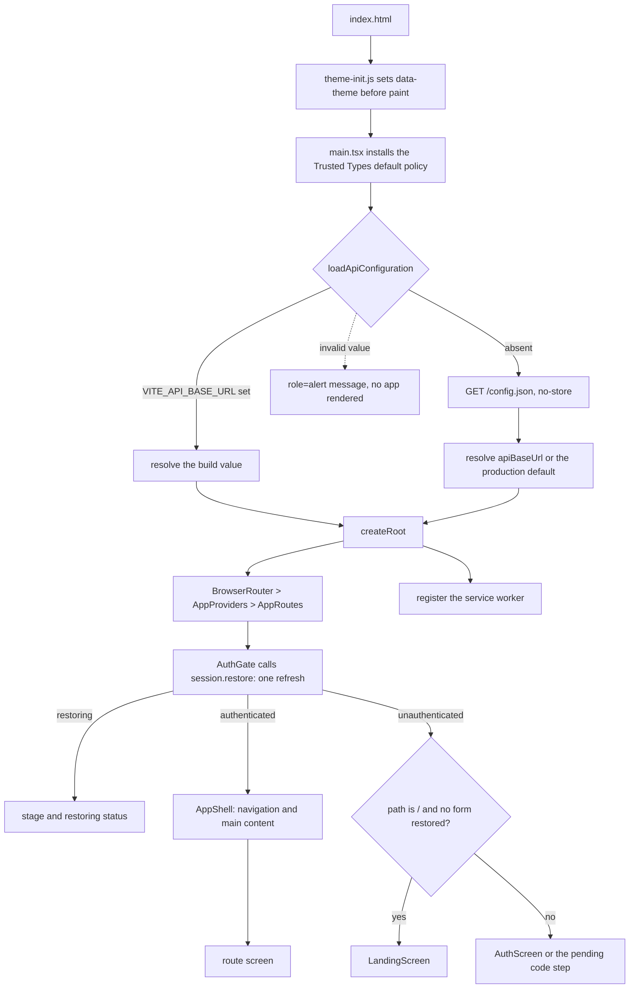
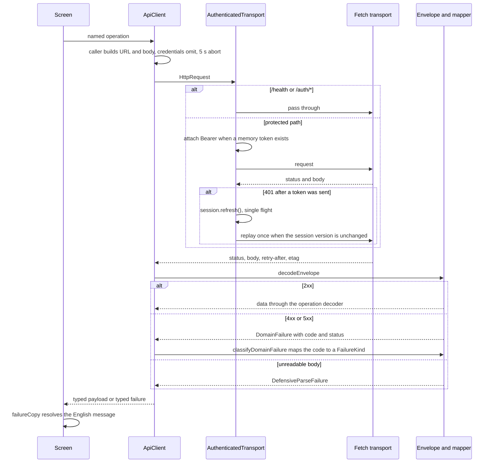
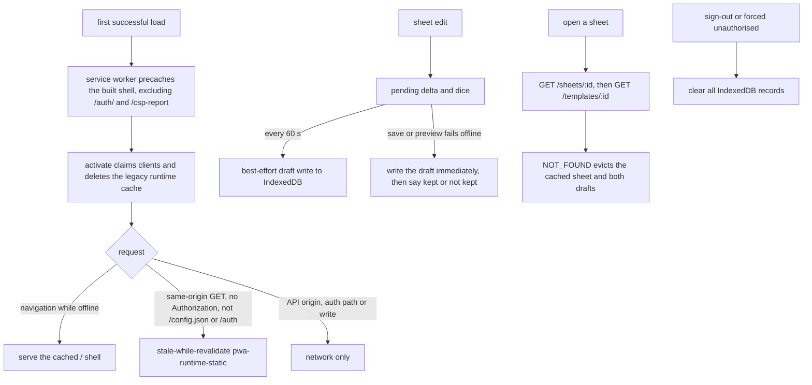
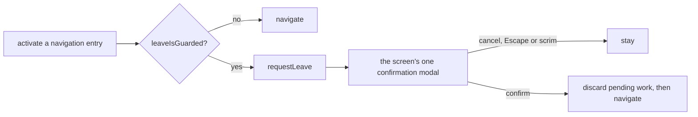

# Web client

## Purpose

The product client: an installable React PWA that serves the public landing, live demo and privacy pages, gates the workspace behind the browser session, and renders every screen on one typed network layer. It owns the shell and navigation, the route table and leave guard, keyboard shortcuts, the theme, the shared UI primitives, the English copy catalog, the offline shell and service worker, and the client half of the security posture. Feature screens (catalog, sheets, dice, generation, billing, campaigns, account) are described by their own context files; this file covers the platform they mount on.

## Why

- **PWA over a desktop app.** Players use the sheet on a phone at the table, so one installable, same-origin client reaches every device with no installer, no Windows cross-build and no separate release channel. The cost is that the client lives inside browser capabilities: no native file access, no reliable background execution, and installability depends on HTTPS and a valid manifest.
- **No general state library.** Server state belongs to TanStack Query; per-field and per-viewer state belongs to small stores read through `useSyncExternalStore`. A mutation rebuilds only the controls subscribed to the changed path, and the client adds no state package. The cost is hand-written stores, subscription cleanup and immutable snapshots instead of generated selectors.
- **Self-hosted everything but ads.** Scripts, styles, fonts, images and icons come from the app origin, so `style-src` stays `'self'`; only the AdSense and CMP origins the ad unit needs are added to `script-src`, `connect-src`, `frame-src` and `img-src`. The cost is a vendored Geist woff2 plus its license, a larger bundle, and releasing a new build for every asset change.
- **Accessible overlays over native `<dialog>`.** `role="dialog"`, `aria-modal`, a focus trap and a dialog stack work in every browser and in jsdom, which does not implement `showModal`; the cost is owning focus entry, Escape ordering, scrim clicks and focus restoration.
- **One transport and memory-only credentials.** Every request crosses one transport, the refresh credential is an `HttpOnly` cookie, and the access token lives only in module memory. A script cannot persist a credential across reloads; the cost is that a reload starts unauthenticated until the single-flight refresh completes and every protected call needs the transport decorator.
- **Runtime API origin and ads.** The container writes `/config.json` from `API_BASE_URL` plus the optional AdSense client and slot ids, so one image serves every environment and changing them needs a restart, not a rebuild; a valid client also publishes `/ads.txt`. The cost is asynchronous boot, a read that must never be cached, and a visible startup failure when the value is malformed.
- **Client-side routing with a host fallback.** `BrowserRouter` plus the host's `try_files` fallback keeps deep links working and makes the route table one declarative list. The leave guard is a small shell registry rather than a router blocker because the app does not mount a data router; the cost is that browser-back and a manual reload are not intercepted, only in-app navigation.
- **Typed failures and pinned captures.** A refusal becomes a `FailureKind` the interface can render, and real captured responses pin the wire contract with no backend in CI. The cost is maintaining the mapping and regenerating captures deliberately whenever the backend contract changes.
- **Landing, live demo and legal are public, the product copy is English.** The landing page and the interactive demo market the product before sign-in, and the privacy policy ships as English and Brazilian Portuguese content chosen from the browser's languages. The interface itself has one English copy catalog; a full locale switch is not built.

## Flows

### App boot and session gate

`AppProviders` constructs the fetch transport, the auth API, the session, the authenticated transport, the API client, the IndexedDB sheet store, the view storage and the query client. Tests may inject any of them. The theme store follows `lg.theme` when present and the live system preference otherwise; the head script repeats the same resolution before the first paint so the wrong theme never flashes.

### An API call through the transport and error mapper

A transport-level failure repeats a `GET` once after 300 ms and never repeats a write; once both attempts fail the call is `offline`. A received HTTP failure is classified immediately and is not retried. A rejected base address raises `ConfigurationFailure` before the first request.

### Offline behavior

The shell and static assets load offline; product data does not. The API is a different origin, so the service worker never caches it, and the open flow always asks the network. Drafts make a successful open restorable, and an offline save keeps the pending work on the device with a manual retry.

### In-app navigation and the leave guard

Only one guard is registered at a time. The screen owns the modal, so the refresh guard and the leave guard share one surface instead of stacking.

## Contracts

- **Ads (`web/src/ads/`).** `/config.json` may carry `adsense: {client, slots: {catalog, campaigns}}` (strictly validated; invalid or unknown surfaces → no slot). `AdsProvider` loads Google's certified CMP (Funding Choices, TCF v2) and, only after a consent decision, the `adsbygoogle.js` script, and only while an eligible `AdSlot` is mounted; a declined consent sets `requestNonPersonalizedAds`. Script URLs pass the `lg-ads` Trusted Types policy, which admits only those two prefixes. `AdSlot` renders for Free accounts, reserves its height via `--lg-size-ad-slot` tokens, and is mounted only in the catalog and the campaign list (`ads_placement.test.ts` guards the list); the landing mounts no slot.

- **Routes.** `web/src/app/routes.ts` is the declared table. `/demo` and `/privacy` are public; the single `*` entry is the fallback; every other declared path is session-only and deep-linkable. An unknown path renders the designed not-found screen inside the shell. The host serves `index.html` for unknown paths; the service worker does the same for an offline navigation. An unauthenticated deep link carries a sanitised local `next` path to sign-in; protocol-relative and auth paths are rejected. The landing's sign-up CTAs carry `?start=fantasy` through `web/src/landing/start_intent.ts`; the auth gate reads it after authentication and opens a new Fantasy sheet, while other entry points keep the catalog flow. The starter strips the intent from the address with a replace navigation before it posts the sheet, so reloading the address cannot create a second sheet.
- **Shell.** Two regions only: `LeftNav` and `main`. The navigation column paints its surface and trailing hairline across the full page height, and a viewport-high sticky rail inside it keeps the links and Sign out in place while a long page scrolls; below 640 px the same `nav` is a static top bar. The payment-issue banner sits at the top of the content when cached plan data reports a billing problem. The landing page, the live demo and the auth stage own their own layouts and set the browser `theme-color` to the stage ground.
- **Public pages.** The home at `/` leads with proof: headline, lead, a primary `Try the live sheet` link to `/demo` and a secondary `Create your character sheet` sign-up action, beside a lazy `HeroSheet` (the live hit-points card over its own `DemoProvider`, under the copy on a phone; its chips and amount field are the only damage controls, and any change to the current total replays the flash and updates the result line). Below come a game-moments section (experience and spell slots), steps illustrated with sheet visuals, the FAQ and the sign-in action, all copy from the catalog and the hero images from the app origin. A `Suspense` boundary mounts the lazy `GameMoments` chunk (`web/src/landing/game_moments.tsx`): the real experience bar and spell-slot pips over an in-memory `DemoProvider` (the hit-points card lives in the hero), with one action per moment (gain experience and level up, take damage, spend a focus slot) and a polite result line; an action moves focus to that line, so a control that exhausts or removes itself never drops focus to the page. The home's sticky mobile sign-up bar stays hidden and `inert` until the hero actions leave the viewport (an `IntersectionObserver`; without one it shows). The new-account form states `Free to start. No card needed.` and offers `Try the live sheet first` to `/demo` unless it is opening a shared sheet. Signed modifiers draw a typographic minus (U+2212). Every sign-up action is labelled `Create your character sheet`; the word archive is gone. The home carries no ad slot and never mounts the sheet. It reports one anonymous visit and its sign-up CTA clicks as fire-and-forget beacons whose body carries only the event name; the endpoint stores no cookie or identifier. `/demo` is public, loads as its own lazy page chunk (`web/src/landing/demo_screen.tsx`) and shows a short header (title, one-line lead, `Back to home`) over a second `Suspense` boundary for the lazy `DemoSheet` (`web/src/landing/demo_sheet.tsx`): the real Fantasy Play components over an in-memory sample character, with a local edit store and cascade and no API or auth call. The `DemoSheet` provider reports its first edit or roll, which reveals the contextual sign-up CTA, and a sticky sign-up CTA covers narrow viewports once the visitor has interacted (hidden and `inert` before); every conversion action uses `signUpCtaPath('fantasy')` and reports a CTA click. The demo's character heading is level 2 under the page's one H1. `/privacy` renders the policy for `en` or `pt-BR` from the browser's languages; a small markdown parser produces typed blocks, and bold runs and HTTP links become React elements. The same article opens in a dialog from the account and generation surfaces. No policy text is injected as raw HTML.
- **Phone navigation.** Below 640 px `LeftNav` keeps the brand mark and one control-height menu button (`aria-expanded`, `aria-controls`); Catalog, Your sheet, Plans, Campaigns, Account and Sign out open in one panel under the bar. Opening moves focus to the first destination; Escape, an outside tap, a destination, sign-out or a resize to desktop closes it, and Escape or an outside tap restores focus to the button. The current route keeps `aria-current="page"` on its link. The panel overlays the content but is not a second shell region; from 640 px the sidebar is unchanged. `useCompactNav` follows the same `(max-width: 39.99rem)` query as the CSS.
- **Leave guard.** `registerLeaveGuard` stores one active guard; `leaveIsGuarded` and `requestLeave` are the only queries `LeftNav` makes. Pending values, dice, a pending arrangement and an in-flight layout commit all count as work to confirm. Browser-back and a manual reload are outside this registry.
- **Shortcuts.** `SHORTCUTS` is the one action-to-key map: save is Ctrl/Cmd+S, refresh is F5. The mounted sheet registers one handler; the document listener prevents the browser default and dispatches to the latest handler. Unmounting removes it.
- **Theme and local records.** The theme is exactly `light` or `dark` under `lg.theme`; an explicit choice stops the live system follow, and storage failures are swallowed. IndexedDB `legnaris-sheets` holds cached sheets, drafts and layout drafts under schema version 3; a wrong version or corrupt record reads as missing and is rebuilt, never migrated. The sheet view store persists under `lg.sheet-view.<sheetId>`. The sheet's Play/Edit mode is component state for the open screen, local to the viewer, never persisted and never sent. No local record holds a credential.
- **Copy.** `web/src/l10n/strings.ts` is the typed English catalog. `message` returns an entry; `messageWith` resolves `{placeholders}` and throws on a missing value; `generationCopy` selects kind-specific copy. Feature notices such as the Plans checkout-return states (`plans.checkoutConfirming`, `plans.checkoutProcessing`, `plans.checkoutActivated`) live in the same catalog. Source scans keep the feature directories to keys the catalog defines, and the API module emits codes and kinds rather than copy. The privacy policy is the one localised artefact and chooses `en` or `pt-BR` from `navigator.languages`.
- **Generation gate.** Free accounts cannot generate, and `GET /me/plan` carries no trial block or last-free flag. The `Generate with AI` entry stays visible with a Pro badge and, on Free, opens the one shared upgrade dialog (`UpgradeDialog`, built on `ui/Dialog`) instead of sending a request; a `403 PLAN_UPGRADE_REQUIRED` from the generation API opens the same dialog as a fallback. The dialog highlights the paid AI allowance and lists the other paid limits, read from `web/src/api/models/plan.ts`, and offers `See plans` (the `/plans` route) and `Not now`. A Free account never sees the LLM consent prompt. While the plan is loading or after a plan read failure the entry stays a plain link with no badge, and a paid plan generates normally.
- **Primitives.** `web/src/ui/` is the shared base layer and imports no feature directory; it is the one sanctioned place for a base component, and any other extraction needs at least three real usages with the same shape and purpose. `Button` defaults to `type="button"`, exposes variants and sizes, blocks activation while loading or disabled, and supports link modes. `Field` always renders a label and wires hint, error and `aria-invalid`. `Dialog` renders `role="dialog"`, `aria-modal`, a title reference, a focus trap, top-of-stack Escape, scrim dismissal and focus restoration. `Toast` announces through a polite status; `Notice` exposes an opt-in polite status; `EmptyState`, `ErrorState` and `LoadingState` standardise the three screen states. Every style consumes `--lg-*` tokens; visual values are in `web/DESIGN.md`.
- **API surface.** `ApiClient` exposes one named method per consumed operation: health, template catalog/detail/preview, sheet create/read/list/update/preview/delete/duplicate/owned, layout replacement, plan and billing redirects, LLM consent, generations, campaigns, joins and NPC links. Request bodies are built in the client; callers never build a URL or read an envelope themselves.
- **Request policy.** The base address is the trimmed `VITE_API_BASE_URL` when set, otherwise `/config.json`'s `apiBaseUrl`, otherwise the production HTTPS default. Only absolute `http(s)` values are accepted; HTTP is allowed for an explicit override and reported as `secure: false`. Each attempt aborts after 5 s. A `GET` gets two transport attempts with a 300 ms injected delay; writes get one. Ordinary requests omit ambient credentials; only `/auth/*` asks for `include`. Conditional campaign reads return `notModified` on 304 and keep the ETag otherwise.
- **Envelope and failures.** A 2xx body must be JSON with a `data` key; a failure must carry `error.code`. A `DomainFailure` carries status, code, server message and `retryAfterMs`; `classifyDomainFailure` maps the code through `error_mapper.ts`, and an unknown code keeps its raw values under the `unknown` kind. Unreadable JSON, a missing envelope key or a missing error code is a `DefensiveParseFailure`; a malformed dotted path is a `PathFailure`; a bad base address is a `ConfigurationFailure`. `failureCopy` owns the user-visible wording.
- **Credentials.** Registration, login and code verification post with `credentials: 'include'`. Refresh and logout also echo the readable `__Host-legnaris_csrf` cookie as `X-CSRF-Token`, bootstrapping it through `/auth/csrf` when absent. The access token is never written to storage. A definitive refresh refusal or sign-out clears the session data; a transient refresh failure keeps it.
- **Offline.** The precache is the built shell manifest minus auth and CSP paths. The runtime cache accepts only same-origin `GET` requests that are not navigations, carry no `Authorization`, and are not `/config.json` or under `/auth`; entries expire after 50 records or 24 hours. `/auth/*` and API responses are never cached. Drafts are written on a 60 s cadence and immediately after an offline save or preview failure; a failed local write is reported instead of promising that the work was kept.
- **Pinned captures.** `web/src/api/fixtures/` holds real local-stack requests and responses, one file per case, plus the capture script; the pinned suite decodes them with no backend and a shape change fails it. A capture is never hand-edited to make a test pass: the shape change is a backend contract change, and the decoders move deliberately instead. The fixture directory is excluded from Prettier so the bytes stay as the server sent them.
- **Security.** The production origin enforces the CSP from the edge proxy: `default-src 'self'`, `script-src 'self'` plus the AdSense/CMP origins, `style-src 'self'`, `img-src 'self' data: https:`, `font-src 'self'`, `connect-src 'self'` plus the API origin and the ad origins, `frame-src` for the ad frames, `object-src 'none'`, `base-uri 'self'`, `form-action 'self'`, `frame-ancestors 'none'`, `require-trusted-types-for 'script'`, and reports to the API's CSP endpoint. HSTS, frame denial, nosniff, referrer and permissions policies, COOP and CORP accompany it. Development relaxes only inline styles and the React refresh preamble. The client installs a default Trusted Types policy before rendering; DOM injection sinks are forbidden by ESLint, React escapes data, no third-party style or font is loaded, the only third-party script is the AdSense unit configured at runtime, and the API and auth modules contain no logging call.

## Code map

| Path | What it owns |
| --- | --- |
| `web/index.html` | Document head, the `viewport-fit=cover` viewport that lets surfaces reach the phone safe-area insets, theme boot script, font preload, icons and manifest links; no inline script. |
| `web/public/theme-init.js` | Pre-paint theme resolution from `lg.theme` or the system preference. |
| `web/public/manifest.webmanifest`, `web/public/icons/`, `web/public/images/` | Installability identity, icon set and local imagery. |
| `web/src/main.tsx` | Trusted Types installation, runtime configuration load, root render, service-worker registration, startup failure. |
| `web/src/app/routes.ts`, `router.tsx`, `providers.tsx` | Declared routes, route tree, auth gate placement, and the client/session/store/query composition. |
| `web/src/shell/app_shell.tsx`, `left_nav.tsx`, `compact_nav.ts`, `not_found.tsx` | Two-region shell, navigation (the phone menu and its media query), sign-out, payment banner and fallback screen. |
| `web/src/shell/leave_guard.ts`, `shortcut_registry.ts` | One active leave guard and the central keyboard map. |
| `web/src/shell/brand_mark.tsx`, `payment_banner.tsx` | Inline brand mark and the billing-problem banner. |
| `web/src/auth/auth_gate.tsx`, `auth_session.ts` | Cold-start restore, session state machine, single-flight refresh, code step and sign-out. |
| `web/src/api/client.ts` | One typed method per consumed operation. |
| `web/src/api/transport.ts`, `authenticated_transport.ts`, `request.ts` | Fetch adapter, Bearer/refresh decorator, URL and body building, timeout, retry and conditional reads. |
| `web/src/api/envelope.ts`, `errors.ts`, `error_mapper.ts` | Envelope decoding, typed failures, code-to-kind mapping and failure copy. |
| `web/src/api/config.ts`, `runtime_config.ts`, `csrf.ts`, `auth_api.ts` | Base-address resolution, runtime document, CSRF cookie and auth operations. |
| `web/src/api/models/`, `web/src/api/parse.ts` | Decoders for templates, sheets, layout, dice, plan, billing, generation and campaigns; defensive payload helpers. |
| `web/src/api/fixtures/` | Real captured requests and responses plus the capture script and inventory. |
| `web/src/pwa/sw.ts`, `cache_rules.ts`, `register_sw.ts`, `trusted_types.ts` | Precache and runtime cache rules, shell fallback, external registration and the Trusted Types policy. |
| `web/src/theme/theme.ts`, `use_theme.ts`, `tokens.css`, `tokens.ts`, `base.css`, `fonts.css` | Theme store, hook, token declarations, base styles and the vendored font face. |
| `web/src/sheet/` (with `engine/`, `library/`) | Sheet open, edit, preview, save, drafts, Dice, Arrange and the per-template Play presets; see [sheets.md](sheets.md). |
| `web/src/sheet/preset/`, `web/src/sheet/inline_edit.tsx` | Per-template Play presets, their responsive body layout (a wide 85rem page with a 200px ability column beside saves and skills and attacks and spells, two columns near 1100px, one on a phone, with ability names stacked above their medals in both narrow layouts so they never truncate; the combat strip is sticky only on wide screens; rollable values take a quiet dashed underline and the accent only on hover or focus; the spellcasting panel stacks its ability select above its two stats whenever its card is under 28rem) and section slots (the hero header with its experience bar and pure XP thresholds, the ability medallions, the combat strip with its armor class shield and breakdown, its initiative and speed tiles and its hit-points card, the pure HP, identity and armor class math, the attack cards with their slot visibility, note subtitle and rollable bonus/damage, the saving-throw and skill rows with their proficiency dots, the spellcasting panel with its ability select and pure slot-pip and hidden-level math, the table-rules disclosure, and the compact NPC/enemy stat block over the same cards with its pure `stat_block_data.ts` selection and initiative parsing), the Play/Edit presentation mode (a labelled `Sheet mode` group), the floating Play save bar over the edit store (Play draws no footer), the reusable roll target (`rollable_value.tsx`) and the reusable inline-edit control (inline when wide, a schema-typed bottom sheet on a phone). |
| `web/src/ui/` | Shared button, field, checkbox, select, dialog, focus trap, toast, notice, page header, state and icon primitives. |
| `web/src/l10n/strings.ts` | English copy catalog and the parameterised resolution. |
| `web/src/landing/` | Public home screen with its static hero and the lazy game-moments chunk, the public `/demo` page (`demo_screen.tsx`) with its own short header and the lazy in-memory sheet over the Fantasy Play preset (`demo_sheet.tsx`, `demo_provider.tsx`, `demo_store.ts`, `demo_character.ts`), the sheet-visual step illustrations, the reusable sign-up CTA intent and its post-auth Fantasy sheet starter, the interaction signal that reveals the contextual CTA, stage colour and local hero images. |
| `web/src/legal/` | Privacy policy sources, markdown parser, full screen and consent dialog. |
| `web/src/library/` | IndexedDB sheet store, cache and draft helpers, session-data sweep. |
| `web/src/types/trusted_types.d.ts` | Trusted Types declarations for TypeScript. |
| `web/src/test/`, `web/e2e/` | Vitest and Playwright suites; tests are flat with feature prefixes. |
| `web/config/security_headers.ts` | Development headers and the policy mirror asserted by tests. |
| `web/nginx.conf`, `web/docker-entrypoint.d/40-runtime-config.sh`, `web/Dockerfile` | Static hosting, cache rules, SPA fallback, runtime `/config.json` and `/ads.txt`, and the container image. |
| `deploy/traefik/dynamic.yml` | The production web router and its security-header middleware. |

## Tools & dependencies

- React 19 and React DOM, Vite 8, TypeScript 6 and React Router 7.
- TanStack Query for server state; `idb` for IndexedDB; `@dnd-kit` core/sortable/utilities for the Arrange mode drag; `workbox-*` with `vite-plugin-pwa` in `injectManifest` mode for the service worker.
- Vitest, Testing Library, jsdom, `fake-indexeddb`, Playwright and axe for unit, rendering, contract and browser coverage.
- ESLint 9 with the TypeScript, React, hooks, accessibility, `no-unsanitized` and security plugins; Prettier; Node 24.
- nginx as the static host, Traefik as the TLS edge and header emitter, Docker Compose for deployment.
- Geist is vendored under `web/public/fonts/geist/` with its OFL license; no font, UI kit, icon pack, state library, HTTP wrapper or i18n runtime is installed.
- No runtime package is added without strict necessity. The drag trio is the one justified exception, because accessible pointer, touch and keyboard reordering with announcements is not worth hand-rolling; a design-system package never is.

## Known limits

- Product data is not available offline. The shell and assets load, but opening a sheet still requires the API; cached sheet records are written but no screen reads them, and there is no Background Sync or offline write queue. An offline save keeps the draft and waits for a manual retry.
- The service worker registers with a prompt strategy but exposes no update prompt. A new build waits until the old clients close instead of applying on acceptance.
- Only in-app navigation runs through the leave guard. A manual reload or the browser-back gesture can discard work that has not reached the 60 s draft cadence.
- The theme store supports an explicit choice, but no theme control is mounted in the current surfaces; the effective theme comes from `lg.theme` or the system preference.
- The interface copy is English-only. The privacy policy is the only content with an English and a Brazilian Portuguese version; there is no runtime locale switch or translated UI.
- The production policy is strict, but the development server allows inline styles and the React refresh preamble by hash. Trusted Types default policy passes strings through; the protection rests on the CSP, the ESLint sink bans and React escaping, not on an HTML sanitiser.
- The live contract suite needs a configured API and the capture script needs a local stack plus `mongosh` to read the one-time code; neither runs in ordinary CI.
- A malformed runtime configuration stops startup with a visible message instead of offering a degraded mode. A plaintext API base is reported on the resolved configuration but no surface warns about it.
- The demo sheet and its game moments are ephemeral: each resets on every mount, writes no local record and makes no network request. The sheet lives only on the public `/demo` page and ships as its own lazy page chunk after the static copy and the lazy game-moments chunk, so the home's initial JavaScript carries no sheet code.
- Installability and the service worker are verified automatically only in Chromium; the other target browsers are checked manually per release.
