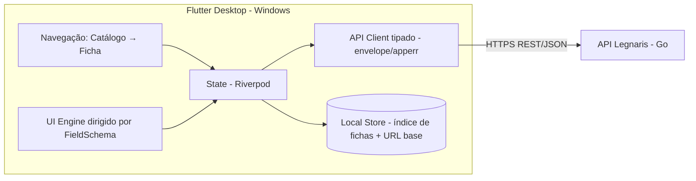

# TDD - Legnaris Desktop: MVP do Frontend (Flutter)

> **Nota (2026-10-16)**: o cliente ativo do produto passou a ser o **PWA web** em `web/`
> (`docs/plan-web-pwa.md`, `.specs/features/001-web-pwa-foundation/`). Este TDD do desktop
> Flutter é mantido como referência até o **gate de paridade** (F10), após o qual `desktop/`
> é removido. Regras visuais equivalentes do cliente web: `web/AGENTS.md`.

| Campo         | Valor                               |
| ------------- | ----------------------------------- |
| Tech Lead     | @pmv                                |
| Time          | @pmv (projeto solo)                 |
| Epic/Ticket   | LGN-88 — [Front End] Frontend Desktop — MVP em Flutter · V1 em 6 épicos por fase (sob a LGN-88) |
| Status        | Approved                           |
| Criado        | 2026-09-29                         |
| Última Edição | 2026-09-29                         |
| Referências   | `docs/TDD.md` (TDD do backend)     |
| Confluence    | https://paulovalleriotedev.atlassian.net/wiki/spaces/LGN/pages/1015809 |

---

## Contexto

O backend Legnaris (`docs/TDD.md`) provê o núcleo diferenciador do produto — templates genéricos com fórmulas declarativas e recálculo em cascata via DAG — mas hoje só é utilizável via chamadas HTTP diretas (curl, Postman). Sem interface, o produto não pode ser validado por uso real: nenhuma pessoa edita fichas de personagem num terminal durante uma sessão de RPG.

Este TDD cobre o **frontend desktop em Flutter** que consome a API REST do Legnaris. O desafio central de UI não é desenhar telas de um sistema de RPG específico — é **renderizar fichas genéricas a partir do `FieldSchema` do template**: campos editáveis, campos derivados (recalculados pelo backend), agrupamento por caminho pontilhado e nós proxy de configuração (0/1).

Estratégia de versões acordada:

- **V1 (este documento)**: app desktop **sem auth, sem usuário**, conectando à **API pública atual** (endpoints `/templates` e `/sheets` hoje abertos), para **uso pessoal do mantenedor** — ferramenta de validação de UX dos fluxos reais (criar ficha, editar campo, ver cascata) antes de investir em auth.
- **V2**: mesma base de código + fluxos de autenticação do backend (Fase 1/2 do TDD do backend: JWT + refresh em cookie httpOnly, ownership). **A V2 é o que viabiliza distribuição pública** do app — sem auth não há isolamento de dados.

O backend ainda não está em produção pública (Fase 6 pendente). Isso **não bloqueia a V1**: qualquer instância alcançável serve (deploy local, túnel via `make deploy-local`, ou VPS quando existir) — a URL base é compilada no build, com override exclusivo de dev para apontar dev/túnel.

**Domínio**: ferramentas para RPG de mesa — a interface é onde a promessa "flexibilidade radical" encontra o usuário: a mesma tela deve renderizar qualquer template multi-gênero sem código específico por sistema.

**Stakeholders**: o mantenedor (usuário e validador da V1), e futuramente jogadores/mestres (público da V2).

---

## Definição do Problema & Motivação

### Problemas que Estamos Resolvendo

- **A API é inutilizável para o usuário final**: editar `stats.dexterity` via `PATCH` bruto com JSON aninhado é fricção inaceitável em mesa.
  - Impacto: o núcleo técnico (cascata, recálculo) nunca é visto em ação; sem feedback visual, não há validação de produto.
- **Falta de evidência de UX para o design das fases de auth**: o TDD do backend assume SPA/frontend desacoplado, mas nenhuma interface existe para validar contratos na prática (ex: como o cliente deve mergear a resposta de cascata do PATCH).
  - Impacto: risco de desenhar auth (Fase 1/2) cego, sem conhecer os fluxos reais de uso.
- **Templates genéricos precisam de UI genérica**: o valor do produto é renderizar *qualquer* sistema de RPG; uma UI hardcoded para `fantasy_v1` trairia a premissa central.
  - Impacto: sem uma UI dirigida por schema, a flexibilidade do backend é apenas teórica.

### Por Que Agora?

- O núcleo do backend está estável: criar/ler/editar ficha com recálculo em cascata **já funciona** nos endpoints públicos.
- Validar UX **antes** das Fases 1/2 (auth/ownership) evita retrabalho: os contratos descobertos no uso real informam o design do auth.
- Projeto solo: a interface é o maior risco de descoberta restante do MVP.

### Impacto de NÃO Resolver

- **Produto**: o backend permanece um exercício técnico sem usuário; sem interface, não há MVP.
- **Técnico**: as decisões de auth do TDD do backend (cookie httpOnly, refresh rotation) seguem sem validação prática de consumibilidade.
- **Usuários**: jogadores continuam sem alternativa calculada e portátil.

---

## Escopo

### ✅ Dentro do Escopo (V1 — MVP sem auth)

- **App desktop Flutter para Windows** (plataforma única, simplifica build e distribuição para uso pessoal).
- **Consumo da API pública atual**: `/templates` (GET, GET/:id), `/sheets` (POST, GET/:id, PATCH/:id) — tudo que existe hoje, sem depender de fases pendentes do backend.
- **UI genérica dirigida por schema**: renderização de fichas a partir do `FieldSchema` — agrupamento por prefixo de caminho (`stats`, `modifiers`, `derived`, `config`), campos editáveis como inputs (número/texto conforme `type`), campos derivados como read-only, nós proxy `config.*` como toggles 0/1.
- **Fluxo de edição com cascata (commit explícito)**: edições locais até o botão **Salvar**; o `PATCH` envia o delta dos campos alterados e a resposta (com **apenas os efeitos em cascata**) é mergeada incrementalmente no estado local.
- **Biblioteca local de fichas**: persistência local dos IDs das fichas criadas (a API não tem `GET /sheets` — lista — nem conceito de usuário; o app mantém a própria lista "minhas fichas").
- **Tratamento de erros tipado**: mapeamento dos códigos `apperr` do envelope `{"error":{code,message}}` para mensagens acionáveis na UI.
- **URL base hardcoded no build** (default: API pública) com **override exclusivo de dev** (flag de debug) — Questão #2 resolvida.
- **Wireframes (apêndice deste documento)** como guia de baixa fidelidade das telas da V1.

### ❌ Fora do Escopo (V1)

- **Auth/fluxos de usuário** (login, registro, tokens): V2 — acompanha as Fases 1/2 do backend. A V1 é **temporária por construção**: quando o backend ligar auth nos endpoints de fichas, a V1 perde acesso e é substituída pela V2.
- **Distribuição pública do app**: sem auth não há isolamento de dados; a V1 circula só entre mantenedor e interesse direto.
- **Delete de fichas** (`DELETE /sheets/:id` é Fase 2 do backend), **import/export pela UI** (Fase 4 do backend), **lista de fichas via API** (`GET /sheets` é Fase 2): a V1 não pode consumir o que não existe.
- **Templates customizados** (V2+ do backend), múltiplas fichas por "usuário" na nuvem (não há usuário), rolagem de dados, modo offline, i18n.
- **Plataformas Linux/macOS**: o desenvolvimento ocorre em Linux, mas o alvo de uso é Windows; Linux pode entrar como build secundário de baixo custo, sem compromisso.
- **Identidade visual/design gráfico** (paleta, tipografia, specs de componente): V2, junto com a distribuição pública — a V1 usa o visual padrão do Flutter guiado pelos wireframes do apêndice.

### 🔮 Considerações Futuras (V2+)

- **V2 — Auth**: telas de login/registro, armazenamento seguro de access token e do cookie de refresh (ver Considerações de Segurança), migração da biblioteca local de fichas para a lista do usuário autenticado.
- **V2 — Distribuição pública**: builds empacotados (MSIX/instalador), code signing opcional, atualizações.
- **V3+**: modo "mesa de RPG" (compartilhamento), rolagem de dados integrada, suporte a `DELETE`/import/export na UI conforme o backend entrega.

---

## Solução Técnica

### Visão Geral da Arquitetura

App Flutter desktop em camadas, com estado gerenciado por **Riverpod** e o coração da complexidade num **UI Engine dirigido por schema** — a única peça que não é commodity. O cliente HTTP é isolado numa camada própria para que a V2 (auth) adicione headers/tokens **sem reescrever features**.

**Componentes-chave**:

- **API Client** (camada isolada): cliente tipado por endpoint; decode do envelope `{"data": ...}` / `{"error":{code,message}}`; mapeamento `apperr` → erro de domínio da UI; timeout e retry simples (idempotente apenas para GET).
- **Models**: `TemplateCatalog`/`TemplateDetail` (id, name, fields), `FieldSchema` (type, label, formula, depends_on, is_editable, default), `Sheet` (id, template_id, name, `data` como mapa dinâmico com **acesso por caminho pontilhado** — ex: `stats.dexterity`). `data` é intencionalmente dinâmico: o valor do produto é renderizar qualquer schema.
- **State (Riverpod)**: providers por feature — catálogo de templates (cache em memória), ficha aberta (estado imutável com copy-with + **dirty state** das edições não salvas), biblioteca local de fichas, configurações (override de dev da URL base). Sem estado global ad-hoc.
- **UI Engine (núcleo)**: transforma `FieldSchema[]` + estado da ficha em widgets — agrupamento por prefixo de caminho, inputs por `type`, read-only para derivados, toggle para `config.*` (0/1), labels do schema. É a única camada com regra de renderização de domínio.
- **Local Store**: persistência leve (preferências do app) — IDs/nomes/template_id das fichas criadas, URL base. **Não** duplica `data` das fichas (fonte da verdade é a API; local é só índice).
- **Navegação**: fluxo raso de 2–3 telas — Catálogo → Ficha (criar/abrir) → Edição. Sem routing profundo na V1.

**Diagrama de arquitetura**:



### Fluxo de Dados Principal (edição de campo com cascata)

1. Usuário altera campos editáveis (ex: `stats.dexterity` de 14 para 16) — edições ficam **locais** (estado *dirty*, indicador "alterações não salvas").
2. Usuário clica **Salvar** — client envia **um único** `PATCH /sheets/:id` com o **delta**: apenas os campos editáveis alterados desde o último load/save (ex: `{"data": {"stats": {"dexterity": 16}}}`).
3. Resposta `200` contém **apenas os efeitos em cascata** (ex: `{"data": {"modifiers": {"dexterityMod": 3}}}`) — **não** a ficha completa.
4. Estado local faz **merge incremental** da cascata no mapa `data`, **limpa o dirty state** e re-renderiza apenas os campos afetados.
5. Em erro (`UNKNOWN_FIELD`, `INVALID_REQUEST`, rede/5xx): edições locais **permanecem** (usuário corrige e salva de novo), indicador dirty visível + mensagem mapeada — o estado na API só muda via resposta de sucesso, nunca diverge.

**Política de envio (decidida)**: commit explícito via botão **Salvar** — sem debounce por tecla, sem auto-save. Payload = delta dos campos editáveis alterados; campos derivados nunca vão no payload (read-only na UI; o backend recalcula e devolve na cascata).

> **Descoberta de contrato registrada**: o formato "resposta = só delta" do PATCH exige que todo cliente mantenha a ficha completa em memória e saiba mergear mapas aninhados. Isso valida a necessidade de merge no cliente e deve constar como expectativa de consumo para qualquer frontend futuro (inclusive a V2).

### Fluxo de Dados — biblioteca local de fichas

1. Usuário cria ficha a partir de um template (`POST /sheets`).
2. `201` retorna a ficha com `id` — o app registra `{id, name, template_id}` no Local Store ("minhas fichas").
3. Abrir ficha = lookup local do ID + `GET /sheets/:id`.
4. Sem DELETE na API (Fase 2 do backend): remover da biblioteca local é **apenas local** na V1 (a ficha continua na API — documentado na UI).

### APIs & Endpoints Consumidos (todos existem hoje)

| Endpoint        | Método | Uso no app                        | Envelope de resposta |
| --------------- | ------ | --------------------------------- | -------------------- |
| `/health`       | GET    | Indicador de conexão com a API    | próprio              |
| `/templates`    | GET    | Catálogo (listar templates)       | `{"data": [...]}`    |
| `/templates/:id`| GET    | Detalhe (fields para renderizar)  | `{"data": {...}}`    |
| `/sheets`       | POST   | Criar ficha a partir de template  | `{"data": {...}}`    |
| `/sheets/:id`   | GET    | Abrir ficha da biblioteca local   | `{"data": {...}}`    |
| `/sheets/:id`   | PATCH  | Salvar edições (delta) → cascata  | `{"data": {delta}}`  |

**Mapeamento de erros `apperr` → UI** (códigos reais de `backend/shared/apperr/err.go`):

| Code                | HTTP provável | Tratamento na UI                                              |
| ------------------- | ------------- | ------------------------------------------------------------- |
| `INVALID_JSON`      | 400           | Bug do client (não do usuário) — log + mensagem técnica        |
| `INVALID_REQUEST`   | 400           | Edição em campo derivado → reverter campo, informar read-only  |
| `UNKNOWN_FIELD`     | 400           | Bug de renderização vs schema — log + reverter                 |
| `NOT_FOUND`         | 404           | Ficha/template não existe → remover da biblioteca local       |
| `CONFLICT`          | 409           | Reservado (SHEET_LIMIT_REACHED é Fase 2) — V2                  |
| `UNAUTHORIZED`/`FORBIDDEN` | 401/403 | Inexistente na V1 (sem auth) — aparece só na V2               |
| `INTERNAL_ERROR`    | 500           | "Erro no servidor" + retry manual                              |
| rede/timeout        | —             | Estado offline claro; edições mantidas (dirty), sem merge fantasma |

**Exemplo de contrato — merge de cascata (comportamento esperado)**:

```json
// PATCH /sheets/:id — usuário editou stats.dexterity = 16
{ "data": { "stats": { "dexterity": 16 } } }

// 200 OK — resposta contém APENAS as cascatas; o app faz merge incremental
{ "data": { "modifiers": { "dexterityMod": 3 }, "derived": { "armorClass": 13 } } }
```

### Regras de Renderização do UI Engine

| Aspecto do `FieldSchema` | Renderização                                 |
| ------------------------ | -------------------------------------------- |
| `is_editable: true`      | Input habilitado (editável)                  |
| `is_editable: false`     | Valor read-only com destaque de "calculado"  |
| `type` numérico          | Input numérico com step apropriado           |
| `type` texto             | Input de texto multi-linha se label sugerir  |
| `formula` presente       | Indicador visual de campo derivado (opcional)|
| caminho `config.*` (0/1) | Toggle on/off (nó proxy de configuração)      |
| prefixo do caminho       | Seção agrupada (ex: "Stats", "Modifiers")     |

### Persistência Local (Local Store)

- **Conteúdo**: índice de fichas `{id, name, template_id, created_at}`; override de dev da URL base (se ativo); preferências de UI. Apenas isso — `data` da ficha **nunca** é cacheado localmente (fonte única de verdade; o estado em memória é recarregado via `GET` na abertura).
- **Formato**: preferências/JSON simples do app — dado não sensível na V1 (sem tokens). Na V2, tokens migram para **secure storage** (ver Segurança).

---

## Riscos

| Risco | Impacto | Probabilidade | Mitigação |
| ----- | ------- | ------------- | --------- |
| V1 quebra quando o backend ligar auth (Fases 1/2) | Alto | Alta (esperado) | **Por design**: V1 é ponte de validação; API Client isolado para V2 adicionar auth sem reescrever features; calendário V2 acoplado às Fases 1/2 do backend |
| Fichas sem ownership na API pública (qualquer um com o ID pode PATCH) | Alto | Baixa (uso pessoal) | V1 não distribuída publicamente; IDs são UUIDs (não enumeráveis); janela de exposição curta (até Fase 2 do backend) |
| Perda do índice local de fichas (sem `GET /sheets` na API) → fichas órfãs | Médio | Média | IDs são os nomes de arquivos do uso: documentar; backup trivial do store local; `GET /sheets` (Fase 2 backend) elimina o problema |
| UI genérica explode em complexidade (tipos exóticos, layout ruim para templates grandes) | Médio | Média | V1 renderiza apenas os tipos do `FieldSchema` atual (número/texto/bool); agrupamento por prefixo; templates default são o limite do teste |
| Merge de cascata com bug (estado local diverge da API) | Alto | Média | Merge incremental testado unitariamente (casos: chave nova, sobrescrita, aninhada); toda reabertura de ficha recarrega da API (autocorreção) |
| Build Windows a partir do dev em Linux (Flutter não suporta cross-compile Windows) | Médio | Alta (se ignorado) | CI em GitHub Actions (runner Windows) para build do .exe desde a Fase 0, não no fim |
| Contrato do backend muda antes da V2 (novos envelopes/códigos) | Médio | Média | Client tipado centraliza o contrato; testes de contrato com fixtures fixados; seguir versionamento do backend TDD |
| Scope creep (auth "rapidinho", delete, import) em projeto solo | Médio | Alta | Escopo V1 congelado; tudo que depende de fase pendente do backend fica explicitamente fora |

---

## Plano de Implementação

| Fase | Tarefa | Descrição | Estimativa |
| ---- | ------ | --------- | ---------- |
| **Fase 0 — Setup** | Projeto Flutter + CI Windows | Diretório `desktop/` no monorepo (Questão #1 resolvida), toolchain Riverpod, lints, GitHub Actions com runner Windows gerando build desde o dia 1 (workflows filtrados por path: Go no raiz, Flutter em `desktop/**`) | 1d |
| **Fase 1 — API Client** | Client tipado + erros | Envelope `data`/`error`, models, mapeamento `apperr`, timeout/retry GET, testes com fixtures do contrato real | 2d |
| **Fase 2 — Catálogo** | Lista + detalhe de templates | `GET /templates` + `GET /templates/:id`, navegação, estado vazio/erro | 1,5d |
| **Fase 3 — UI Engine** | Renderização por schema | Form genérico guiado pelos wireframes (apêndice): agrupamento por prefixo, editáveis vs derivados, toggles `config.*`, tipos básicos | 4d |
| **Fase 4 — Ciclo da ficha** | Criar/abrir/editar + cascata | `POST`/`GET`/`PATCH`, commit via Salvar (delta), merge incremental da cascata, dirty state, biblioteca local de IDs | 3d |
| **Fase 5 — Polish & Testes** | Estados de erro, cobertura, build | Offline/conectividade, widget tests do UI Engine, golden test de renderização de template, build MSIX/zip | 3d |

**Estimativa total**: ~14,5 dias úteis (~3 semanas)

**Dependências entre fases**:

- Fase 1 → todas (client é base).
- Fase 3 → Fase 4 (renderização antes do ciclo de edição).
- Fase 4 depende do Local Store (embutido na fase).
- CI Windows (Fase 0) valida cross-build cedo — não deixar para o fim.

---

## Considerações de Segurança

### V1 (sem auth — análise honesta da superfície)

- **Sem tokens, sem PII** no app: o Local Store contém apenas IDs de fichas e URL da API. Sem credenciais para vazar.
- **Risco real é do lado da API**: fichas na API pública sem ownership são acessíveis a quem souber o UUID. Mitigado por uso pessoal + não distribuição do app + UUIDs não enumeráveis. **A janela termina com a Fase 2 do backend** (ownership).
- **Dados de ficha**: podem conter texto livre do usuário (nomes de personagem etc.) — tratados como dado do usuário, sem log local de conteúdo (apenas IDs e operações).

### V2 — Auth (requisitos que o design V1 já precisa respeitar)

- **Armazenamento**: access token em memória (não persistir); refresh token (cookie httpOnly do backend) persistido em **secure storage** do OS (Windows Credential Manager via flutter_secure_storage).
- **Cookie httpOnly em cliente não-browser**: `httpOnly` é restrição de *browser*; o client desktop captura o `Set-Cookie` da resposta de login/refresh, armazena em secure storage e anexa `Cookie` manualmente no `/auth/refresh`. O API Client isolado da V1 é o ponto de extensão exato para isso.
- **CSRF**: menor risco que em browser (não há cookies ambientais anexados automaticamente) — mas manter validação de `Origin` do backend e nunca logar tokens.
- **Rotação e reuso**: client deve tratar resposta de refresh com família revogada (reuso detectado) como logout forçado + re-login.
- **TLS obrigatório**: a URL base default deve ser `https://`; aceitar `http://` apenas como override explícito de dev (marcado visualmente na UI).

---

## Estratégia de Testes

| Tipo | Escopo | Meta | Abordagem |
| ---- | ------ | ---- | --------- |
| **Unitários** | API Client, merge de cascata, mapeamento `apperr`, Local Store | > 80% das camadas não-widget | `package:test`/`flutter_test` com HTTP mocked; fixtures fixadas do contrato real (envelope, delta do PATCH) |
| **Widget** | UI Engine (renderização por schema), formulário de edição, catálogo | Renderização de todos os tipos + toggles | `flutter_test` + templates de teste (fantasy_v1 + template sintético com todos os tipos) |
| **Golden** | Renderização visual da ficha | 1 template de referência | Snapshots por plataforma (fontes variam no Windows) |
| **Contrato** | Client vs API real | Fluxos principais | Testes de integração marcados/skipped sem API alcançável (padrão do repo: self-skip) |
| **E2E manual** | Fluxo completo em mesa real | 1 sessão de jogo | Uso pessoal do mantenedor (o objetivo da V1) |

### Cenários de Teste Críticos

**Unitários (foco em edge cases — padrão do repo)**:

- ✅ Merge de cascata: chave nova, chave sobrescrita, árvore aninhada profunda, delta vazio (`{}`), resposta com envelope de erro no lugar de `data`.
- ✅ Mapeamento `apperr`: cada código → estado de UI correto; código desconhecido → fallback genérico; corpo sem `error.code` → erro de parse defensivo.
- ✅ Decode de `data` dinâmico: tipos numéricos variados (int/float), ausência de campo, caminho pontilhado com segmento vazio.
- ✅ Local Store: store vazio, ID duplicado, ID inexistente (abrir ficha removida).
- ✅ Delta do Salvar: múltiplos campos alterados; campo revertido ao valor original (fora do payload); nenhum campo alterado (Salvar inerte); campo derivado nunca incluído.

**Widget**:

- ✅ Template com todos os tipos de campo → controles corretos por tipo.
- ✅ Campo derivado → read-only, sem input; `config.*` → toggle.
- ✅ Salvar com erro → edições mantidas (dirty), mensagem mapeada exibida; Salvar com sucesso → dirty limpo e cascata mergeada.
- ✅ Sem conexão → estado de erro claro, sem UI quebrada.

**Contrato/integração (contra API real quando disponível)**:

- ✅ Criar ficha → 201 com valores derivados calculados.
- ✅ Salvar (PATCH editável) → 200 com delta de cascata (validar formato "só delta").
- ✅ PATCH em campo derivado → 400 `INVALID_REQUEST`/`UNKNOWN_FIELD`.
- ✅ `GET /sheets/:id` inexistente → 404 `NOT_FOUND`.

---

## Monitoramento e Observabilidade

V1 é app de uso pessoal — observabilidade é **local e leve**:

- **Logs locais** (nível debug, arquivo rotativo no diretório do app): requests (método/rota/status/duração), erros de decode, códigos `apperr` recebidos. Sem conteúdo de ficha, sem tokens.
- **Indicador de conexão** na UI: health check periódico leve (`GET /health`) → estado online/offline visível.
- **Crash reporting**: fora do escopo da V1 (uso pessoal); candidato na V2 (opt-in) quando houver distribuição.

O backend já tem a stack Prometheus/Grafana/Loki versionada em `deploy/` — a V1 não adiciona telemetria client-side além dos logs locais.

---

## Plano de Rollback

### V1 (app local — risco baixo)

- **Estratégia de versão**: cada build é auto-contido (sem auto-update); "rollback" = executar o build anterior (mantidos os últimos N builds + artefatos de CI).
- **Gatilho**: build novo corrompe a biblioteca local ou quebra o merge → voltar ao build anterior; formato do Local Store é versionado (campo `schema_version`) para builds futuros migrarem sem perder o índice.
- **Estado da API**: o app não altera schema da API (só usa endpoints existentes); não há rollback de dados — pior caso é ficha com valores inconsistentes por bug de merge, corrigível reabrindo a ficha (`GET` refresh).

### V2 (distribuída — herda obrigações do backend)

- Rollout de auth só depois das Fases 1/2 validadas no backend; V1 e V2 podem coexistir localmente durante a transição.
- Quebra de contrato percebida no client → pin da versão da API aceita pelo app (header/setting) até correção.

---

## Métricas de Sucesso

| Métrica | Baseline | Meta | Medição |
| ------- | -------- | ---- | ------- |
| Fluxo completo (abrir app → criar ficha → editar campo → ver cascata) | N/A | < 2 min na primeira uso | Uso real do mantenedor |
| Edição de campo → cascata visível | N/A | < 300ms percebido (roundtrip incluído) | Uso + logs locais |
| Renderização de template novo sem mudança de código | 0 templates | Qualquer template do catálogo | Teste com template sintético |
| Cobertura de testes (camadas não-widget) | 0 | > 80% | CI |
| Bugs de contrato descobertos ANTES das Fases 1/2 do backend | N/A | ≥ 1 doc de feedback ao TDD do backend | Entrega da V1 |

**Métrica de produto (a que importa)**: a V1 existe para gerar **evidência** — descobertas de UX/contrato realimentando o TDD do backend antes das fases de auth. Se a V1 não produzir pelo menos uma decisão revisada no backend, ela falhou no objetivo (mesmo que o app funcione).

---

## Glossário

| Termo | Definição |
| ----- | --------- |
| **UI Engine dirigido por schema** | Camada que renderiza a ficha dinamicamente a partir do `FieldSchema` do template (agrupamento, inputs por tipo, read-only para derivados, toggles de config) — sem código por sistema de RPG. |
| **Envelope de resposta** | Formato padronizado da API: `{"data": ...}` no sucesso; `{"error": {"code", "message"}}` no erro (`backend/shared/response`). |
| **Delta de cascata (PATCH)** | Resposta do `PATCH /sheets/:id` contendo **apenas** os campos derivados recalculados — exige merge incremental no cliente. |
| **Biblioteca local de fichas** | Índice local `{id, name, template_id}` das fichas criadas — necessário porque a API não tem `GET /sheets` (lista) nem usuário na V1. |
| **Nó proxy de configuração** | Campo editável 0/1 (ex: `config.acUsesDex`) renderizado como toggle — peça da estratégia anti-copyright do backend. |
| **Merge incremental** | Fusão do delta de cascata no mapa `data` em memória, sem recarregar a ficha inteira. |
| **Dirty state** | Edições locais ainda não confirmadas na API; exibidas como "alterações não salvas" e limpas no Salvar com sucesso. |
| **V1 / V2 (frontend)** | V1: sem auth, uso pessoal, API pública atual. V2: com auth (Fases 1/2 do backend), habilita distribuição pública. |

---

## Alternativas Consideradas

| Decisão | Opção | Prós | Contras | Veredito |
| ------- | ----- | ---- | ------- | -------- |
| **Framework desktop** | Flutter (escolhido) | Um código → desktop/mobile/web futuramente; widgets ricos para forms dinâmicos; compiled AOT | Runtime próprio; binário maior | ✅ Escolhido — alinha com roadmap de produto (apps mobile são V2+ do backend) |
| | Electron/Tauri (web) | Ecossistema web maduro | Duas stacks (o backend não tem frontend web); binário pesado (Electron) | Rejeitado — sem base web no projeto |
| | TUI (Go, mesmo repo) | Zero nova linguagem; rápido | UX inadequada para form dinâmico; não valida UX de produto real | Rejeitado — trairia o objetivo da V1 |
| **Gestão de estado** | Riverpod (escolhido) | DI + estado reativo testável; forte p/ API clients e cache de catálogo | Curva de aprendizado | ✅ Escolhido |
| | Bloc/Cubit | Estados explícitos | Verboso para form dinâmico dirigido por schema | Rejeitado |
| | Provider + ChangeNotifier | Simples | Escala mal com cache/invalidação | Rejeitado |
| **Conexão V1** | API pública atual, remota (escolhido) | Valida o contrato real da API; zero infra local; setup mínimo | Depende de conectividade; fichas sem ownership (uso pessoal mitiga) | ✅ Escolhido — ver Questão em Aberto #2 |
| | Backend local embutido (sidecar + Mongo) | Dados 100% locais; sem dependência de rede | Docker/Mongo na máquina do usuário; complexidade de processo para ganho zero na V1 | Rejeitado para V1 |
| **Plataforma alvo** | Windows único (escolhido) | Alvo de uso real; foco de esforço | Dev em Linux exige CI p/ build Windows | ✅ Escolhido — CI desde a Fase 0 |
| | Windows + Linux | Linux quase grátis no Flutter | Superfície de teste x2 na V1 | Adiado — Linux como build secundário sem compromisso |
| **Envio de edições** | Botão Salvar (escolhido) | 1 request por commit; reversão simples; valida o delta de cascata por lote | Menos fluido que auto-save | ✅ Escolhido |
| | Debounce ao digitar / auto-save | Cascata fluida em tempo real | Múltiplos requests; reversão parcial complexa | Rejeitado para V1 |

---

## Dependências

| Dependência | Tipo | Status | Risco |
| ----------- | ---- | ------ | ----- |
| API Legnaris (endpoints públicos: templates + sheets POST/GET/PATCH) | Externa ao app | ✅ Existe hoje | Baixo |
| Instância da API alcançável (deploy local / túnel / VPS — Fase 6 do backend pendente) | Infraestrutura | `make deploy-local` disponível | Médio até Fase 6 |
| `GET /sheets` (lista), `DELETE /sheets/:id`, import/export | API (fases pendentes do backend) | Fases 2/4 do backend | Não bloqueia V1; limita features |
| Auth (login/refresh) | API (Fase 1 do backend) | Pendente | Bloqueia **V2** do app |
| Flutter SDK + toolchain Windows (CI runner) | Ferramenta | A configurar (Fase 0) | Baixo |
| Riverpod | Biblioteca | A adicionar | Baixo |

**Bloqueadores conhecidos**: nenhum para a V1 — todos os endpoints consumidos existem; a V2 bloqueia nas Fases 1/2 do backend.

---

## Requisitos de Performance

| Métrica | Requisito | Medição |
| ------- | --------- | ------- |
| Renderização inicial da ficha (template ≤ 200 campos) | < 100ms após resposta da API | DevTools/trace local |
| Roundtrip percebido de Salvar (PATCH → cascata visível) | < 300ms (dominado pela rede; ver requisito de PATCH do backend: p95 < 300ms) | Logs locais |
| Startup do app a frio | < 2s | Medição manual |
| Memória do app | < 200MB em uso nominal (ficha + catálogo em memória) | Task Manager |

**Não-alvo (V1)**: performance de larga escala de templates/fichas — o limite real é o catálogo default do backend (poucas dezenas de campos). O UI Engine deve evitar re-render global por edição (rebuild granular por campo via Riverpod select/family), mas sem otimização premária além disso.

---

## Questões em Aberto

| # | Questão | Contexto | Status |
| - | ------- | -------- | ------ |
| 1 | App em repo separado ou monorepo (`desktop/` neste repo)? | Projeto solo se beneficia de um único local de issues/CI; toolchains distintos convivem com workflows filtrados por path (Go vs Flutter/Windows); convenções do repo (English-only, testes obrigatórias) aplicam ao `desktop/` | ✅ Resolvida: monorepo em `desktop/` |
| 2 | URL base da API na V1: hardcode com override de dev, ou setting de primeira execução? | **Hardcode no build** (default https da API pública) + **override exclusivo de dev** via flag de debug; sem setting de usuário na V1 — menos UI e menos estado | ✅ Resolvida: hardcode + override dev |
| 3 | Cookie httpOnly do refresh na V2: cookie jar manual no client (secure storage) vs pedir ao backend variante refresh-no-body p/ clientes não-browser | TDD do backend escolheu cookie httpOnly pensando em SPA/browser; desktop captura `Set-Cookie` como header comum. Recomendação: cookie jar no client (zero mudança no backend) — validar quando Fase 1 do backend existir | 🟡 Adiada (V2) |
| 4 | Como representar o catálogo de templates do backend na UI (cards por gênero, busca)? | Depende do volume da Fase 3 do backend (3–5 templates) — quase trivial na V1 | 🟡 Adiada (Fase 2 do app) |
| 5 | Múltiplas fichas simultâneas (tabs) na UI? | **1 ficha ativa por vez na V1** — abrir outra ficha fecha a atual (estado global simples, UI focada em mesa). Tabs/múltiplas simultâneas: V2+ conforme demanda real | ✅ Resolvida: 1 ficha por vez |

---

## Roadmap / Timeline

| Fase | Entregáveis | Duração | Status |
| ---- | ----------- | ------- | ------ |
| **Fase 0 — Setup** | Projeto Flutter, Riverpod, lints, CI com build Windows funcional | 1d | ⏳ Pendente |
| **Fase 1 — API Client** | Client tipado, envelope/apperr, testes de contrato (fixtures) | 2d | ⏳ Pendente |
| **Fase 2 — Catálogo** | Lista/detalhe de templates, navegação | 1,5d | ⏳ Pendente |
| **Fase 3 — UI Engine** | Renderização por FieldSchema (tipos, grupos, toggles), guiada pelos wireframes | 4d | ⏳ Pendente |
| **Fase 4 — Ciclo da ficha** | Criar/abrir/editar + commit via Salvar + merge de cascata + biblioteca local | 3d | ⏳ Pendente |
| **Fase 5 — Polish & Testes** | Estados de erro/offline, widget/golden tests, build distribuído | 3d | ⏳ Pendente |
| **V2 — Auth** (pós Fases 1/2 backend) | Login/registro, secure storage, cookie jar, migração da biblioteca local | ~5d (estimativa preliminar) | ⏳ Pendente |

**Duração total V1**: ~14,5 dias úteis (~3 semanas)

**Marcos**:

- 🎯 **M1 (fim Fase 1)**: client tipado testado contra fixtures reais — contrato validado.
- 🎯 **M2 (fim Fase 3)**: qualquer template do catálogo renderiza sem código específico — **a promessa central do frontend**.
- 🎯 **M3 (fim Fase 5)**: V1 em uso pessoal real (1 sessão de mesa jogada com o app).
- 🎯 **M4 (V2)**: app com auth, pronto para distribuição pública — acoplado às Fases 1/2 do backend.

**Caminho crítico**: Fase 0 → 1 → 3 → 4 → 5 (Fase 2 pode andar paralela à 1).

---

## Aprovação & Sign-off

| Papel | Nome | Status | Data |
| ----- | ---- | ------ | ---- |
| Tech Lead / Mantenedor | @pmv | ✅ Aprovado | 2026-09-29 |

**Critérios de aprovação**:

- [x] Estratégia de versões V1 (sem auth, uso pessoal) / V2 (auth, distribuição) aceita
- [x] Escopo limitado aos endpoints existentes (sem dependência de fases pendentes do backend)
- [x] Questões em aberto #1 (monorepo `desktop/`), #2 (URL base) e #5 (1 ficha por vez) resolvidas
- [x] Política de PATCH decidida (botão Salvar, payload = delta) e visual definido (wireframes no apêndice; identidade visual → V2)
- [x] Estimativas realistas para ritmo solo

**Próximos passos após aprovação**:

1. Iniciar Fase 0: criar `desktop/` no monorepo com CI de build Windows desde o primeiro commit (workflow filtrado por path).
2. Realimentar o TDD do backend (`docs/TDD.md`) com as descobertas de contrato/UX da V1 — em especial antes das Fases 1/2.

---

## Apêndice — Wireframes (V1)

Rascunhos de **baixa fidelidade** das telas da V1. A UI é dirigida por `FieldSchema`: grupos, labels e campos abaixo são exemplos com `fantasy_v1` — o conteúdo real vem do template carregado. Identidade visual (paleta, tipografia) é deliberadamente ausente: V2. As regras de construção (layout, densidade, tokens, interação) que governam estes wireframes estão em `desktop/AGENTS.md`.

### Tela 1 — Catálogo (home)

```
+----------------------------------------------+
| Legnaris                          * online    |
+----------------------------------------------+
| MINHAS FICHAS                                 |
|   > Meu Personagem (fantasy_v1)    [abrir]    |
|   (vazio: "Nenhuma ficha criada ainda")       |
| --------------------------------------------- |
| CATALOGO                                      |
|   +----------------+   +----------------+     |
|   | Fantasy v1     |   | (proximos      |     |
|   | 26 campos      |   |  templates)    |     |
|   | [criar ficha]  |   |                |     |
|   +----------------+   +----------------+     |
+----------------------------------------------+
```

- `* online` = indicador de conexão (health check periódico).
- "criar ficha" abre o diálogo da Tela 3.

### Tela 2 — Ficha (edição; tela principal)

```
+----------------------------------------------+
| <- Meu Personagem (fantasy_v1)     * online   |
+----------------------------------------------+
| STATS                    (editavel)            |
|   dexterity       [ 16 ]                      |
|   constitution    [ 14 ]                      |
| MODIFIERS                (calculado)           |
|   dexterityMod        3                        |
|   constitutionMod     2                       |
| DERIVED                 (calculado)           |
|   armorClass         13                        |
| CONFIG                  (regras)              |
|   acUsesDex        [ on/off ]                  |
+----------------------------------------------+
| * alteracoes nao salvas          [ SALVAR ]   |
+----------------------------------------------+
```

- Rodapé fixo: indicador dirty + botão Salvar (desabilitado sem alterações).
- Campos editáveis = input; calculados = texto read-only; `config.*` = toggle.

### Tela 3 — Criação de ficha (diálogo)

```
+----------------------------------------------+
| <- Catalogo                                   |
+----------------------------------------------+
| Template: Fantasy v1                         |
|   stats: 7 - modifiers: 7 - derived: 3       |
|   config: 2                                   |
| Nome da ficha: [ Meu Personagem ]             |
|                             [ criar ficha ]  |
+----------------------------------------------+
```

- Resumo do template carregado de `GET /templates/:id` (contagem por prefixo).
- Erros mapeados (`NOT_FOUND`, rede) exibidos inline no diálogo.

