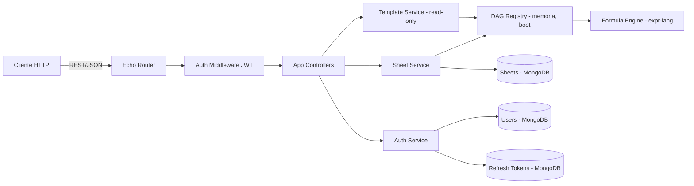

# TDD - Legnaris: Gerenciador Flexível de Fichas de RPG

> **Nota (2026-10-16)**: o cliente ativo do produto passou a ser o **PWA web** em `web/`
> (`docs/plan-web-pwa.md`, `.specs/features/001-web-pwa-foundation/`). As seções de auth
> para clientes **nativos** abaixo ficam como referência histórica até a feature
> `backend-browser-auth-cookies`, que migra o refresh para cookie httpOnly e remove o
> caminho `X-Refresh-Token`.

| Campo         | Valor                              |
| ------------- | ---------------------------------- |
| Tech Lead     | @pmv                               |
| Time          | @pmv (projeto solo)                |
| Epic/Ticket   | A definir                          |
| Status        | Draft                              |
| Criado        | 2026-09-22                         |
| Última Edição | 2026-09-28                         |
| Confluence    | https://paulovalleriotedev.atlassian.net/wiki/spaces/LGN/pages/720898 |

---

## Contexto

Legnaris é um backend em Go para gerenciamento de fichas de RPG de mesa (TTRPG) construído sobre uma premissa central: **flexibilidade radical**. Em vez de modelar regras de um sistema de RPG específico no código, o Legnaris modela **templates genéricos** — estruturas de campos com fórmulas declarativas — que permitem expressar qualquer sistema de jogo (fantasia medieval, sci-fi, horror, cyberpunk) sem que o projeto contenha conteúdo protegido por copyright ou trademark.

O estado atual do código já contém o núcleo diferenciador funcionando:

- **Engine de fórmulas** (`backend/internal/engine`): compila e avalia expressões declarativas via `expr-lang`, com funções customizadas (`floor`, `max`).
- **Templates** (`backend/internal/sheet/template`): `FieldSchema` define tipo, fórmula, dependências (`depends_on`), editabilidade e valor default de cada campo.
- **DAG de dependências** (`backend/internal/sheet/template/dag.go`): constrói um grafo acíclico dirigido a partir dos campos do template, com ordenação topológica (algoritmo de Kahn), detecção de ciclos e recálculo em cascata com propagação seletiva (só recalcula nós afetados pela mudança).
- **Fichas** (`backend/internal/sheet`): documentos flexíveis (`map[string]any`) vinculados a um template, com criação (valores iniciais calculados) e atualização parcial com validação de editabilidade e recálculo de campos derivados.
- **Infraestrutura**: API REST com Echo v5, MongoDB como banco, tratamento de erros tipado (`backend/shared/apperr`), logger estruturado, mocks gerados com Mockery.

**Domínio**: ferramentas para jogos de RPG de mesa — um mercado com players estabelecidos que licenciam conteúdo oficial de sistemas. O Legnaris se posiciona deliberadamente no lado oposto: zero conteúdo licenciado, 100% estrutura genérica.

**Stakeholders**: jogadores e mestres de RPG (usuários finais), o próprio mantenedor (projeto solo), e indiretamente a comunidade open-source de TTRPG.

**Estratégia anti-copyright (já presente no design)**: os campos usam nomes genéricos (`stats.dexterity`, `modifiers.dexterityMod`) e o template seed inclui **nós proxy de configuração** (`config.acUsesDex`, `config.spellUsesIntelligence`) — multiplicadores 0/1 que permitem à mesma estrutura genérica expressar regras diferentes sem hardcodar regras de nenhum sistema publicado. No MVP, **todos os templates são defaults travados, definidos no código-fonte** — todo conteúdo distribuído passa por code review, o que é a linha de defesa anti-copyright mais forte possível. O projeto distribui apenas a *mecânica de cálculo*, nunca o *conteúdo de jogo*.

---

## Definição do Problema & Motivação

### Problemas que Estamos Resolvendo

- **Ferramentas existentes prendem o usuário a sistemas licenciados**: as principais plataformas de fichas digitais dependem de licenciamento de conteúdo oficial, o que limita sistemas disponíveis, gera custo e cria risco de conteúdo ser removido.
  - Impacto: usuários de sistemas indie, brasileiros ou caseiros (homebrew) são mal atendidos.
- **Fichas genéricas existentes não calculam nada**: alternativas "flexíveis" (planilhas, PDFs editáveis) exigem que o usuário calcule modificadores, perícias e valores derivados manualmente.
  - Impacto: erro humano constante em sessão; fricção que afasta jogadores de sistemas não suportados.
- **Dados do usuário reféns da plataforma**: ferramentas SaaS de fichas frequentemente não oferecem exportação completa dos dados.
  - Impacto: se o serviço morre, as fichas morrem junto — anos de personagens perdidos.

### Por Que Agora?

- O núcleo técnico diferenciador (DAG + engine de fórmulas) **já está provado no código** — o custo de descoberta técnica já foi pago.
- Comunidade TTRPG em crescimento sustentado, com demanda por ferramentas abertas e auto-hospedáveis.
- Projeto solo: quanto mais tempo sem usuários reais, maior o risco de over-engineering na direção errada.

### Impacto de NÃO Resolver

- **Produto**: o núcleo vira um exercício técnico abandonado em vez de um produto usável.
- **Técnico**: a arquitetura atual (templates em memória desde o boot, sem auth, sem ownership) degrada em débito técnico se não for endereçada com um plano.
- **Usuários**: continuam presos entre ferramentas licenciadas fechadas e planilhas sem automação.

---

## Escopo

### ✅ Dentro do Escopo (V1 / MVP)

- **Autenticação e usuários**: registro, login, JWT stateless (access token no corpo da resposta + refresh token opaco no corpo, reenviado por header dedicado), hash de senha com bcrypt.
- **Ownership de fichas**: toda ficha pertence a um usuário; endpoints protegidos por autorização (adicionar `owner_id` ao modelo `Sheet` — campo não existe mais; comentário removido em LGN-81).
- **Limite de 1 ficha por usuário**: regra de negócio do MVP, garantida também por índice único no banco.
- **Biblioteca de templates genéricos multi-sistema**: catálogo de templates default para múltiplos gêneros (fantasia, sci-fi, horror, etc.), todos com nomes e regras 100% genéricos, **definidos no código e read-only** (sem edição por usuários).
- **Import/Export de fichas em JSON**: exportação **auto-contida** (ficha + template embutido) e importação com **validação estrita** contra o template (campos extras ou ausentes são rejeitados).
- **Deploy em produção pública**: VPS único com Docker, HTTPS, monitoramento e plano de rollback.
- **Hardening do núcleo existente**: correção do débito técnico restante (persistência do PATCH com chaves pontilhadas); demais itens já resolvidos — ver tabela de débito técnico.

### ❌ Fora do Escopo (V1)

- **Templates customizados por usuário (CRUD de templates)**: usuários **não** criam/editam templates no MVP — apenas o catálogo default read-only. V2.
- **Frontend/interface web**: este TDD cobre apenas o backend; a UI será um projeto separado consumindo a API.
- **Compartilhamento de fichas entre usuários** (modo "mesa de RPG" com múltiplos jogadores): V2.
- **Galeria pública de templates** com moderação de conteúdo: V2.
- **Múltiplas fichas por usuário**: V2 (o limite do MVP é 1).
- **Colaboração em tempo real** (WebSockets, edição simultânea): V2+.
- **Multi-idioma (i18n)**: V2+.
- **Apps mobile**: fora do roadmap previsível.

### 🔮 Considerações Futuras (V2+)

- Templates customizados por usuário, com **registry dinâmico de DAGs** (construção lazy + invalidação) e limites anti-abuso de fórmulas — a arquitetura atual já antecipa esse caminho.
- Compartilhamento de fichas com permissões (mestre/jogador, leitura/escrita).
- Múltiplas fichas por usuário.
- Rolagem de dados integrada à engine de fórmulas.
- Versão self-hosted documentada para a comunidade (um comando `docker compose up`).

---

## Solução Técnica

### Visão Geral da Arquitetura

API REST stateless em Go, organizada em módulos de domínio sob `backend/internal/`, com o motor de cálculo desacoplado da persistência. No MVP, **templates são código**: o catálogo default vive em `backend/internal/sheet/template` (como o `FantasyV1Seed` atual), é carregado no boot em um **registry em memória** que já materializa os DAGs com fórmulas compiladas — atualizações de ficha são resolvidas sem recompilação e sem queries de template. O MongoDB persiste apenas dados de usuários: `users`, `refresh_tokens` e `sheets`.

**Componentes-chave**:

- **API Layer** (`backend/internal/app`): controllers Echo, roteamento, tratamento de erros tipado → respostas JSON padronizadas.
- **Auth Module** (novo, `backend/internal/auth` + expansão de `backend/internal/user`): emissão/validação de JWT, hash de senhas, middleware de autenticação, refresh rotation.
- **Template Catalog** (`backend/internal/sheet/template`): templates default definidos em código, validados e compilados no boot, servidos read-only do registry em memória (elimina o seed no Mongo e a coleção `template`).
- **Sheet Module** (`backend/internal/sheet`): ciclo de vida da ficha (1 por usuário), atualização parcial com recálculo, import/export.
- **Formula Engine** (`backend/internal/engine`): compilação e avaliação de fórmulas (já existente, sem mudanças arquiteturais previstas).
- **Shared** (`backend/shared/`): env, logger, db, apperr, response — já existentes.

**Diagrama de arquitetura**:



### Fluxo de Dados Principal (atualização parcial de ficha)

1. Cliente envia `PATCH /sheets/:id` com os campos editáveis alterados.
2. Middleware JWT autentica; service valida ownership da ficha.
3. Service delega a validação ao DAG (`DAG.ValidateUpdateKeys`): cada campo enviado precisa existir como nó editável — chave desconhecida → 400 `UNKNOWN_FIELD`, campo derivado → 400 `INVALID_REQUEST` (já implementado; LGN-66).
4. DAG recalcula em ordem topológica apenas os nós afetados, propagando efeitos em cascata (já implementado).
5. Repositório persiste o mapa `data` inteiro (merge local de updates + efeitos em cascata) + `updated_at` via `$set` (`repository.go:59-68`). **Débito conhecido**: substituir por `$set` com chaves pontilhadas para reduzir superfície de escrita e risco de sobrescrever campos concorrentes — ver tabela de débito técnico.
6. Resposta retorna apenas os efeitos em cascata, permitindo ao cliente atualizar a UI de forma incremental.

### APIs & Endpoints

| Endpoint                    | Método | Descrição                                   | Auth          | Status                       |
| --------------------------- | ------ | ------------------------------------------- | ------------- | ---------------------------- |
| `/health`                   | GET    | Health check                                | Não           | ✅ Existe hoje               |
| `/metrics`                  | GET    | Métricas Prometheus                          | Não           | ✅ Existe hoje               |
| `/auth/register`            | POST   | Cria conta (email, username, senha)         | Não           | ⏳ Fase 1                    |
| `/auth/login`               | POST   | Retorna access + refresh tokens no corpo    | Não           | ⏳ Fase 1                    |
| `/auth/refresh`             | POST   | Renova access token (rotation)              | Refresh token | ⏳ Fase 1                    |
| `/auth/logout`              | POST   | Revoga o refresh token atual                | Refresh token | ⏳ Fase 1                    |
| `/templates`                | GET    | Lista templates default do catálogo         | Sim           | ✅ Existe hoje (público)     |
| `/templates/:id`            | GET    | Detalhe do template (campos, fórmulas)      | Sim           | ✅ Existe hoje (público)     |
| `/sheets`                   | POST   | Cria a ficha do usuário a partir de template| Sim           | ✅ Existe hoje (público)     |
| `/sheets`                   | GET    | Retorna a ficha do usuário autenticado      | Sim           | ⏳ Fase 2                    |
| `/sheets/:id`               | GET    | Detalhe da ficha                            | Sim (owner)   | ✅ Existe hoje (público)     |
| `/sheets/:id`               | PATCH  | Atualização parcial com recálculo           | Sim (owner)   | ✅ Existe hoje (público)     |
| `/sheets/:id/dice`          | PUT    | Substitui o bloco `dice` da ficha (sem recálculo) | Sim (owner) | ✅ Existe hoje (público)     |
| `/sheets/:id`               | DELETE | Remove a ficha                              | Sim (owner)   | ⏳ Fase 2                    |
| `/sheets/:id/export`        | GET    | Exporta ficha em JSON auto-contido          | Sim (owner)   | ⏳ Fase 4                    |
| `/sheets/import`            | POST   | Importa ficha de JSON (validação estrita)   | Sim           | ⏳ Fase 4                    |

> **Nota**: endpoints marcados como "✅ Existe hoje" são públicos (sem auth). A coluna "Auth" indica o estado-alvo pós-Fase 1/2.

**Regras de negócio relevantes**:

- `POST /sheets`: retorna **409 Conflict** se o usuário já possui uma ficha (limite do MVP). Para trocar de template, o usuário deleta a ficha atual e cria outra — ou usa import.
- `POST /sheets/import`: validação **estrita** — todo campo do payload deve existir no template de destino, todo campo base obrigatório deve estar presente, e campos derivados no payload são ignorados (recalculados). Violações retornam 400 com a lista de campos inválidos.
- `GET /sheets/:id/export`: retorna JSON **auto-contido** — metadados da ficha, dados completos e o template de origem embutido, permitindo backup real e portabilidade mesmo se o template sair do catálogo.

**Exemplo de contrato — criação de ficha**:

```json
// POST /sheets
{
  "template_id": "fantasy_v1",
  "sheet_name": "Meu Personagem"
}

// 201 Created — envelope "data"
{
  "data": {
    "id": "550e8400-e29b-41d4-a716-446655440000",
    "template_id": "fantasy_v1",
    "name": "Meu Personagem",
    "data": {
      "stats": { "dexterity": 10, "constitution": 10 },
      "modifiers": { "dexterityMod": 0, "constitutionMod": 0 },
      "derived": { "armorClass": 10 }
    },
    "created_at": "2026-09-22T10:00:00Z",
    "updated_at": "2026-09-22T10:00:00Z"
  }
}

// 409 Conflict (usuário já possui ficha)
{ "error": { "code": "SHEET_LIMIT_REACHED", "message": "user already owns a sheet" } }
```

**Exemplo de contrato — atualização parcial** (já implementado, comportamento preservado):

```json
// PATCH /sheets/:id
{ "data": { "stats": { "dexterity": 16 } } }

// 200 OK — apenas efeitos em cascata (mapa aninhado, envelope "data")
{ "data": { "modifiers": { "dexterityMod": 3 }, "derived": { "armorClass": 13 } } }
```

**Exemplo de contrato — expressões de dados (`dice`)**:

O bloco `dice` é a escolha do jogador sobre as expressões de rolagem (ADR 0005). Ele é dado do usuário guardado na ficha; o template só fornece os padrões (`dice` no payload do template, somente leitura, omitido quando vazio). Em `section` e `row`, a chave ausente significa "usar o padrão do template" e `null` significa "sem dados" (explícito). Nenhuma rolagem é salva.

```json
// PUT /sheets/:id/dice  (owner; substitui o bloco inteiro, sem recálculo)
{
  "dice": {
    "section": { "combat": "1d20 + @" },
    "row": { "skills.acrobatics": null, "stats.dexterity": "d20 + stats.dexterity" }
  }
}

// 200 OK — eco do que foi gravado (ambos os mapas sempre presentes, mesmo vazios)
{
  "data": {
    "dice": {
      "section": { "combat": "1d20 + @" },
      "row": { "skills.acrobatics": null, "stats.dexterity": "d20 + stats.dexterity" }
    }
  }
}
```

- `GET /sheets/:id` sempre retorna `dice` (`{"section": {}, "row": {}}` quando a ficha não tem escolhas), inclusive em fichas criadas antes da funcionalidade.
- `PUT` é validado de forma estrita: chave de Section/Row desconhecida, gramática inválida, expressão que não encaixa na Row, ou mais de 64 entradas → **400 `INVALID_REQUEST`**. Leituras são tolerantes.
- Chaves de Row são as mesmas de `layout.pinned`; `@` significa "esta Row".
- Não altera `version` nem `updated_at` e não conflita com `PATCH` de `data` nem com `PUT /sheets/:id/layout`.

**Exemplo de contrato — export auto-contido**:

```json
// GET /sheets/:id/export → 200 OK (envelope "data")
{
  "data": {
    "format": "legnaris.sheet.v1",
    "exported_at": "2026-09-22T10:00:00Z",
    "sheet": {
      "name": "Meu Personagem",
      "template_id": "fantasy_v1",
      "data": { "stats": { "dexterity": 16 } }
    },
    "template": {
      "id": "fantasy_v1",
      "name": "Fantasy Template",
      "fields": { "...": "..." }
    }
  }
}
```

### Mudanças no Banco de Dados

**Novas coleções**:

- `users`: `_id`, `email` (único), `username`, `password_hash`, `created_at`, `updated_at`
  - Índice único em `email`.
- `refresh_tokens`: `_id`, `token_hash` (SHA-256 de token opaco), `user_id`, `family_id` (para detecção de reuso), `expires_at`, `revoked`, `replaced_by`, `created_at`
  - Índice único em `token_hash`, índice em `family_id` e índice TTL em `expires_at` para limpeza automática.

**Coleções alteradas**:

- `sheets`: adicionar `owner_id` (string) — campo a ser criado no struct `Sheet` e na collection (não existe mais; comentário removido em LGN-81).
  - **Índice único em `owner_id`**: garante o limite de 1 ficha por usuário no nível do banco (defesa em profundidade contra race conditions de criação concorrente).

**Coleções removidas**:

- `template`: eliminada. Templates default passam a viver exclusivamente no código e no registry em memória (ver decisão em Alternativas Consideradas).

### Evolução de templates default (estratégia de versionamento)

Templates default são **imutáveis por ID**: quando uma release precisa mudar regras de um template, um **novo ID versionado** é criado (ex: `fantasy_v1` → `fantasy_v2`) em vez de mutar o existente. Fichas criadas na versão antiga continuam funcionando com o DAG da versão antiga, que permanece no catálogo enquanto houver fichas ativas apontando para ela. Isso elimina a classe inteira de bugs de "recalcular fichas existentes com regras novas" sem exigir infraestrutura de versionamento no banco — apenas disciplina de IDs no código.

### Autenticação (fluxo de tokens)

Os clientes do produto são **nativos** (desktop Flutter + mobile futuro), sem SPA no browser. Por isso o refresh token **não** usa cookie: é um token opaco de alta entropia devolvido no corpo e reenviado pelo cliente em um header dedicado `X-Refresh-Token`. Sem credencial ambiente, o endpoint de refresh não é alvo de CSRF.

1. `POST /auth/login` valida credenciais → retorna **access token** (JWT, ~15min) e **refresh token** (~30 dias) no corpo JSON.
2. Cliente guarda o access token em memória e o refresh token em armazenamento seguro do SO (keychain/Credential Manager).
3. Cliente envia o access token em `Authorization: Bearer` nas demais rotas.
4. `POST /auth/refresh` lê o `X-Refresh-Token`, valida, **rotaciona** o refresh token (novo token na mesma família, anterior revogado) e retorna novo par access + refresh.
5. **Detecção de reuso**: refresh token já rotacionado apresentado novamente → revoga toda a família de tokens do usuário (possível roubo).
6. `POST /auth/logout` revoga o refresh token atual (via `X-Refresh-Token`); o cliente descarta a cópia local.

> **Nota de segurança**: como o refresh trafega no corpo/header, TLS é obrigatório; o cliente é responsável por guardá-lo no armazenamento seguro do SO. Se um cliente browser (SPA) for introduzido no futuro, a decisão de transporte deve ser reavaliada (cookie `httpOnly` volta a ser candidato) — ver Questões em Aberto #5.

### Débito técnico (identificado na análise do código)

**Resolvido (pós-2026-09-22)**

| Item | Local | Evidência |
| ---- | ----- | --------- |
| Mensagem de erro "template not found" no repositório de **fichas** | `backend/internal/sheet/repository.go` | `ErrSheetNotFound = "sheet not found"` (linha 26); o "template not found" restante em `service.go:67` está correto (lookup de DAG) |
| Resquícios de PostgreSQL (README, Makefile, docker-compose `migrate`) | raiz | Sem matches em Makefile/compose; não existe `README.md` na raiz |
| Seed de templates no Mongo a cada boot | `backend/cmd/api.go` | Commit `e0e4154` (2026-09-23): templates em memória; única collection em código é `sheets` |
| `log.Fatal` dentro de listagem do repositório de templates | `backend/internal/sheet/template/repository.go` | Arquivo não existe mais; leituras vêm do registry em memória (`registry.go`) |
| Funções `floor`/`max` com rejeição de `int` inconsistente | `backend/internal/engine/engine.go` | `coerceFloat64` (linha 55) normaliza todos os tipos numéricos |

**Pendente**

| Item | Local | Correção |
| ---- | ----- | -------- |
| Persistência do partial update como mapa aninhado vs chaves pontilhadas | `backend/internal/sheet/service.go` | Normalizar para `$set` com chaves `data.x.y` |

---

## Riscos

| Risco | Impacto | Probabilidade | Mitigação |
| ----- | ------- | ------------- | --------- |
| Mudança de template default entre releases quebra fichas existentes | Alto | Média | IDs versionados imutáveis (`fantasy_v1` → `fantasy_v2`); versões antigas permanecem no catálogo enquanto houver fichas ativas |
| Alegação de copyright apesar da abordagem genérica | Alto | Baixa | Templates default travados no código → todo conteúdo passa por code review; nomes/termos genéricos; revisão manual pré-release; política de conteúdo no repositório |
| Concorrência em PATCH da mesma ficha (read-modify-write) | Média | Média | PATCH grava com compare-and-swap sobre o campo `version` da ficha: em conflito o servidor **não** refaz a tentativa: responde 409 `CONFLICT` com `Retry-After: 1` e o cliente reenvia (cada retry é uma nova request HTTP e passa pelo rate limit); `PUT /layout` não altera a versão |
| Vazamento do segredo JWT / refresh tokens roubados | Alto | Baixa | Segredo em variável de ambiente; refresh opaco armazenado apenas como hash; rotation com detecção de reuso; TTL curto no access token; TLS obrigatório |
| Vazamento do refresh token em clientes nativos | Média | Média | Refresh no corpo/header (sem cookie ambiente, sem CSRF); cliente guarda em armazenamento seguro do SO; TLS obrigatório; rotation com detecção de reuso |
| CSRF em endpoints de auth | Baixa | Baixa | Mitigado na origem: refresh não usa cookie, então não há credencial ambiente. CORS restritivo mantido; reavaliar validação de `Origin` se um SPA for introduzido |
| Perda de dados (VPS único, sem replicação) | Alto | Média | Backups diários automatizados do MongoDB para storage externo; restore testado no deploy |
| Scope creep em projeto solo com escopo grande | Média | Alta | Escopo V1 congelado neste documento; CRUD de templates explicitamente adiado para V2; features novas entram na lista V2 sem exceção |
| Carga de trabalho solo inviabiliza o prazo | Média | Alta | Fases com entregas independentes; cortar escopo do fim (import/export, biblioteca) antes de cortar auth/ownership |
| Abuso de fórmulas (DAG hostil criado por usuário) | Alto | Baixa **no MVP** | Não aplicável na V1 (templates travados); na V2: limites de campos/dependências/profundidade + timeout de compilação — já registrado como requisito da V2 |

---

## Plano de Implementação

| Fase | Tarefa | Descrição | Estimativa |
| ---- | ------ | --------- | ---------- |
| **Fase 0 — Higiene** | Limpeza de débito técnico | ✅ 5 de 6 itens resolvidos (ver tabela de débito técnico). Restante: persistência do PATCH com chaves pontilhadas | 0.5d |
| **Fase 1 — Auth** | Módulo de usuários | `users` + `refresh_tokens` collections, registro com bcrypt, login, JWT (access + refresh opaco no corpo, reenviado via `X-Refresh-Token`), middleware de autenticação, refresh rotation com detecção de reuso, logout | 6d |
| **Fase 2 — Ownership** | Autorização + limite | Adicionar campo `owner_id` ao struct `Sheet` e à collection (não existe mais; comentário removido em LGN-81) + índice único (1 ficha/usuário), guarda de ownership em todos os endpoints, `GET /sheets` do usuário autenticado, 409 na criação duplicada | 3d |
| **Fase 3 — Biblioteca multi-sistema** | Templates default | 3-5 templates de gêneros distintos (fantasia, sci-fi, horror, moderno), revisão anti-copyright de cada nome/termo, IDs versionados | 4d |
| **Fase 4 — Import/Export** | Portabilidade | Export JSON auto-contido (ficha + template), import com validação estrita contra o template | 3d |
| **Fase 5 — Hardening** | Produção-ready | Rate limiting, validação de payloads, CORS, proteção CSRF do refresh, testes de carga, cobertura dos caminhos críticos | 5d |
| **Fase 6 — Deploy** | VPS + Docker | Provisionar VPS, publicar stack existente (`deploy/docker-compose.yml` — Traefik + Cloudflare Tunnel + Prometheus/Grafana/Loki/Alloy), configurar DNS/TLS, backups automatizados, alertas | 4d |

**Estimativa total**: ~25,5 dias úteis (~5 semanas)

**Dependências entre fases**:

- Fase 2 depende da Fase 1 (ownership exige auth).
- Fases 3 e 4 são independentes entre si, ambas depois da Fase 0.
- Fases 5 e 6 são sequenciais e fecham a V1.

---

## Considerações de Segurança

### Autenticação & Autorização

- **Autenticação**: JWT stateless — access token de curta duração (~15min) transportado em `Authorization: Bearer`; refresh token opaco de longa duração (~30 dias) devolvido no corpo e reenviado pelo cliente no header `X-Refresh-Token` (clientes nativos: desktop/mobile).
- **Refresh rotation com detecção de reuso**: cada refresh gera token novo e revoga o anterior; apresentar um token já rotacionado revoga a família inteira (`family_id`) do usuário.
- **Senhas**: hash com bcrypt (custo ≥ 12); nunca logar senhas ou tokens.
- **Autorização**: modelo de ownership — toda ficha tem `owner_id`; middleware extrai `user_id` do JWT e services validam posse antes de qualquer operação. Templates default são read-only para todos (não há o que proteger além de leitura autenticada).

### Proteção de Dados

**Criptografia**:

- **Em trânsito**: TLS obrigatório (HTTPS via reverse proxy no VPS) — protege access e refresh tokens, que trafegam no corpo/header.
- **Em repouso**: volumes Docker do MongoDB em disco do VPS; backup criptografado no storage externo.
- **Segredos**: `JWT_SECRET`, credenciais do Mongo e chaves de backup em variáveis de ambiente (`.env` fora do git, já previsto em `.env.example`).

**PII (dados pessoais)**:

- Coletado: email, username, hash de senha. Nada mais.
- Fichas podem conter texto livre do usuário — tratar como dado do usuário, exportável e deletável.
- **Direito de exclusão**: endpoint de deleção de conta remove usuário, ficha e tokens (LGPD/GDPR).

### Sandbox da engine de fórmulas

- `expr-lang` já é sandboxed por design (sem I/O, sem acesso a rede/disco).
- Superfície exposta: apenas funções whitelisted (`floor`, `max`, e futuras aprovadas explicitamente).
- **No MVP, fórmulas só são escritas pelo mantenedor** (templates travados no código), então o risco de abuso é mínimo. Como defesa em profundidade e preparação para a V2 (templates customizados), a validação estrutural com limites (máx. campos, dependências por campo, profundidade do DAG) fica registrada como **requisito obrigatório da V2**, antes de abrir criação de templates para usuários.

### Boas Práticas

- ✅ Validação de entrada em todos os endpoints (DTOs tipados + validação de tipos dos campos da ficha contra o `FieldSchema`).
- ✅ Rate limiting por IP nos endpoints de auth (ex: 10 req/min em login/register) e por usuário nos demais.
- ✅ CORS restritivo (origens explícitas; frontend é projeto separado) + validação de `Origin` no refresh (mitigação CSRF).
- ✅ Sem queries dinâmicas por string — driver Mongo com filtros construídos tipados (sem injeção).
- ✅ Logs de auditoria para eventos sensíveis: login, refresh, reuso de refresh token detectado, deleção de conta, import de ficha.
- ✅ Respostas de erro padronizadas via `apperr` sem vazar stack trace ou detalhes internos (já implementado no `HTTPErrorHandler`).

### Compliance

| Regulação | Requisito | Implementação |
| --------- | --------- | ------------- |
| **LGPD/GDPR** | Exportação e exclusão de dados | Export de ficha auto-contido (V1) + endpoint de deleção de conta |
| **Copyright** | Não distribuir conteúdo protegido | Templates default travados no código (100% code review); nomes genéricos; revisão manual pré-release; política de conteúdo no repositório |

---

## Estratégia de Testes

| Tipo | Escopo | Meta de Cobertura | Abordagem |
| ---- | ------ | ----------------- | --------- |
| **Unitários** | engine, DAG, services, auth | > 80% nos módulos de domínio | `testify` + mocks Mockery (já configurado; usar os mocks existentes em `backend/internal/*/mocks` sem duplicar) |
| **Integração** | repositories + MongoDB real | caminhos críticos | MongoDB em container (docker-compose já existe) |
| **E2E de API** | fluxos completos HTTP | happy path + erros | servidor Echo em processo de teste contra Mongo de teste |
| **Carga** | recálculo de fichas sob concorrência | baseline | k6 ou vegeta contra staging |

### Cenários de Teste

**Unitários (expandindo os existentes — `dag_test.go`, `engine_test.go`)**:

- ✅ DAG: ciclo detectado é rejeitado; ordem topológica correta; propagação seletiva (nó não afetado não recalcula).
- ✅ Engine: fórmulas inválidas falham na compilação; `floor`/`max` com tipos inválidos retornam erro.
- ✅ Sheet service: PATCH em campo não editável → erro; campo inexistente → erro; cascata correta (mocks de Repository/Template Service existentes).
- ✅ Auth service: senha correta/incorreta; refresh rotation; reuso de refresh token revoga a família inteira; logout revoga token.

**Integração**:

- ✅ Criar ficha → valores derivados iniciais calculados e persistidos.
- ✅ Segunda criação de ficha para o mesmo usuário → rejeitada pelo índice único de `owner_id` (race incluída).
- ✅ PATCH → campos persistidos com chaves pontilhadas; leitura posterior retorna estado consistente.
- ✅ Índice único de email rejeita registro duplicado.
- ✅ Refresh token expirado é removido pelo índice TTL.

**E2E**:

- ✅ Registrar → login → criar ficha → editar → exportar (auto-contido) → deletar conta → dados removidos.
- ✅ Segundo `POST /sheets` → 409.
- ✅ Acessar ficha de outro usuário → 403/404.
- ✅ Token expirado → 401; refresh via `X-Refresh-Token` → novo par access + refresh (rotation); token reapresentado → família revogada.
- ✅ Import com campo extra → 400 com lista de campos inválidos; import válido → ficha recalculada e persistida.
- ✅ Ficha criada em `fantasy_v1` continua recalculando com as regras da v1 após release que introduz `fantasy_v2`.

**Carga**:

- Alvo: 100 req/s sustentado em PATCH de fichas (recálculo em memória, sem query extra por nó).
- Critério de aceite: p95 < 200ms, taxa de erro < 0,1%.

---

## Monitoramento e Observabilidade

### Métricas

| Métrica | Tipo | Limiar de Alerta |
| ------- | ---- | ---------------- |
| `http_request_duration_seconds` (p95 por rota) | Latência | > 500ms por 5min |
| `http_requests_total{status=~"5.."}` | Taxa de erro | > 1% por 5min |
| `dag_recalculate_duration_seconds` | Latência do motor | p95 > 50ms |
| `mongo_operation_duration_seconds` | Latência do banco | p95 > 100ms |
| `auth_login_failures_total` | Contador | > 20 em 5min (possível brute force) |
| `auth_refresh_reuse_detected_total` | Contador | > 0 (possível roubo de token) |
| `process_resident_memory_bytes` / uptime | Saúde do processo | restart inesperado |

Exposição via endpoint `/metrics` (formato Prometheus), coletado pela stack já versionada em `deploy/` (Prometheus + Grafana + Loki + Alloy); serviço de uptime externo como complemento.

### Logging Estruturado

Manter o padrão JSON já estabelecido em `backend/shared/logger`, com campos obrigatórios: `level`, `timestamp`, `message`, `request_id`, `user_id` (quando autenticado), `route`, `duration_ms`.

**Logar**: requests HTTP, falhas de auth, reuso de refresh token detectado, operações de escrita (create/update/delete/import), falhas de validação de import.
**Nunca logar**: senhas, tokens JWT/refresh, segredos, payload completo de fichas (apenas IDs e chaves alteradas).

### Alertas

| Alerta | Severidade | Canal | Ação |
| ------ | ---------- | ----- | ---- |
| API fora do ar (health check falha) | P1 | Uptime monitor (email/webhook) | Verificar container, rollback se pós-deploy |
| Taxa de erro 5xx > 5% | P1 | Email/webhook | Investigar logs; rollback se pós-deploy |
| Falhas de login em massa | P2 | Email | Avaliar bloqueio de IP / ajuste de rate limit |
| Reuso de refresh token detectado | P2 | Email | Família já revogada automaticamente; avaliar contato ao usuário |
| Falha no backup diário | P2 | Email | Reexecutar backup manualmente |
| Disco do VPS > 80% | P2 | Email | Limpar imagens Docker antigas / expandir volume |

---

## Plano de Rollback

### Estratégia de Deploy

- Imagens Docker versionadas por tag (ex: `legnaris:1.4.2` + `legnaris:latest`); o compose de produção referencia tag explícita, nunca `latest` implícito.
- Deploy = subir novo container ao lado, health check OK, trocar tráfego no reverse proxy, derrubar container antigo.
- Mudanças de templates default são deploy de código comum — como IDs são versionados e imutáveis, **nunca há migração destrutiva de templates**; índices Mongo são criados de forma compatível com a versão anterior (migrações *backward-compatible*; nunca remover campo em uso no mesmo deploy).

### Gatilhos de Rollback

| Gatilho | Ação |
| ------- | ---- |
| Health check falha após deploy | Rollback automático para imagem anterior |
| Taxa de erro 5xx > 5% por 5min | Rollback imediato |
| Recálculo de fichas retornando valores errados (reporte de usuário) | Rollback imediato + incidente |
| Falha na criação de índice no banco | **Parar** deploy; investigar antes de prosseguir |

### Passos de Rollback

1. **Aplicação (< 5 min)**: apontar o compose para a tag da imagem anterior e reiniciar o serviço; health check confirma recuperação.
2. **Banco**: por design, migrações são apenas aditivas (novos campos/índices), então a versão anterior continua funcionando sobre o schema novo. Em caso de corrupção de dados: restaurar o backup diário mais recente.
3. **Comunicação**: registrar post-mortem no repositório (causa raiz, correção, prevenção) em até 48h.

### Pós-Rollback

- Correção em branch dedicada, suíte de testes completa + teste novo cobrindo a causa raiz, novo deploy seguindo o mesmo processo.

---

## Métricas de Sucesso

| Métrica | Baseline | Meta | Medição |
| ------- | -------- | ---- | ------- |
| Latência de PATCH de ficha (p95) | N/A | < 200ms | Métricas da API |
| Taxa de erro 5xx | N/A | < 0,1% | Métricas da API |
| Uptime (primeiros 90 dias) | N/A | > 99% | Uptime monitor |
| Cobertura de testes (domínio) | ~parcial (engine/DAG) | > 80% | `go test -cover` |
| Templates default disponíveis | 1 (fantasy_v1) | ≥ 4 gêneros | Catálogo da release |
| Usuários registrados (90 dias pós-lançamento) | 0 | > 50 | Contagem no banco |

**Métricas de produto**: usuário consegue criar conta, criar sua ficha e ver o recálculo funcionando em < 5 minutos; exportação JSON auto-contida disponível para 100% das fichas (portabilidade é promessa central do produto).

---

## Glossário

| Termo | Definição |
| ----- | --------- |
| **Template** | Estrutura que define os campos de uma ficha: tipos, defaults, fórmulas e dependências. Análogo a "sistema de jogo". No MVP, existe apenas como default versionado em código. |
| **Sheet (Ficha)** | Instância de um template com os dados de um personagem. Pertence a um usuário (limite de 1 por usuário no MVP). |
| **FieldSchema** | Definição de um campo: `type`, `label`, `formula`, `depends_on`, `is_editable`, `default`. |
| **Campo base** | Campo editável sem fórmula (ex: `stats.dexterity`). |
| **Campo derivado** | Campo calculado por fórmula, não editável (ex: `modifiers.dexterityMod`). |
| **Nó proxy de configuração** | Campo editável numérico (0/1) usado como multiplicador em fórmulas para ligar/desligar regras (ex: `config.acUsesDex`) — peça-chave da estratégia anti-copyright. |
| **DAG** | Grafo acíclico dirigido dos campos de um template, com fórmulas compiladas e ordem topológica para recálculo. Imutável após o boot: estado protegido por mutex privado e uma única leitura por recálculo. |
| **Recálculo em cascata** | Propagação de uma mudança de campo base por todos os derivados dependentes, em ordem topológica, apenas nos nós afetados. |
| **DAG Registry** | Mapa em memória `template_id → DAG`, construído no boot a partir dos templates default em código. Congelado após o boot: exposto por `DAG(id)`/`DAGProvider` (nunca como mapa), com cópias profundas dos templates na entrada e na saída. |
| **Template default** | Template distribuído com o sistema (ex: `fantasy_v1`), definido no código-fonte, read-only, com ID versionado. |
| **Export auto-contido** | JSON de exportação que embute o template de origem junto aos dados da ficha, garantindo portabilidade total. |
| **Família de refresh tokens** | Conjunto de refresh tokens encadeados por rotation (`family_id`); reuso de um token antigo revoga a família inteira. |

---

## Alternativas Consideradas

| Decisão | Opção | Prós | Contras | Veredito |
| ------- | ----- | ---- | ------- | -------- |
| **Banco de dados** | MongoDB (escolhido) | Documento flexível casa com `map[string]any` das fichas; schema da ficha varia por natureza | Sem transações multi-doc maduras como SQL | ✅ Escolhido — resquícios de PostgreSQL já removidos |
| | PostgreSQL (jsonb) | Robusto, transações | Queries e índices sobre jsonb mais verbosos; migrações mais pesadas | Rejeitado para V1 |
| **Armazenamento de templates default** | Código-fonte (escolhido) | Todo conteúdo passa por code review (defesa anti-copyright); zero seed no boot; DAGs compilados uma única vez; deploy = release | Mudança de template exige release | ✅ Escolhido para o MVP |
| | MongoDB (estado atual) | Templates mudam sem deploy | Registry em memória desde o boot (desde 2026-09-23); conteúdo em código sob code review; complexidade sem necessidade (sem CRUD de usuário no MVP) | Rejeitado no MVP; volta a ser considerado na V2 (templates customizados) |
| **Linguagem de fórmulas** | expr-lang (escolhido) | Sandboxed, compilado, sintaxe simples, tipado, sem I/O | Menos poderoso que uma linguagem completa | ✅ Escolhido — já provado no núcleo |
| | Lua (gopher-lua) / JS (goja) | Expressividade total | Sandbox real é difícil; superfície de ataque; performance de VM | Rejeitado — risco de segurança inaceitável para input de usuário (V2) |
| | Parser próprio | Controle total | Meses de trabalho; manutenção | Rejeitado |
| **Auth** | JWT stateless + refresh opaco no corpo/header (escolhido) | API stateless; clientes nativos (desktop/mobile); sem CSRF (sem credencial ambiente); refresh fica em armazenamento seguro do SO | Não há proteção httpOnly (não se aplica fora do browser); exige TLS e disciplina do cliente | ✅ Escolhido |
| | JWT com refresh em cookie httpOnly | Refresh não acessível a XSS de browser | Clientes nativos não persistem cookie sem jar; exige mitigação CSRF; sem ganho de segurança fora do browser | Rejeitado na V1 (clientes nativos); reconsiderar se surgir SPA |
| | Sessão em cookie + store | Revogação trivial | Estado no servidor (Redis); menos adequado a API pública | Rejeitado |
| **Evolução de templates** | IDs versionados imutáveis (escolhido) | Fichas antigas nunca quebram; zero infraestrutura de versionamento no banco | Catálogo acumula versões (mitigado: remover versão só quando não houver fichas ativas) | ✅ Escolhido |
| | Mutação in-place + migração de fichas | Um template só | Recalcular fichas com regras novas = bugs e perda de dados | Rejeitado |
| **Histórico de mutações da ficha** | Event sourcing (coleção de eventos) | Replay e auditoria completos | Sem ganho de desempenho (PATCH continua uma escrita); sem necessidade de produto (undo/auditoria); segunda escrita sem transação no Mongo standalone | Rejeitado — debug via log estruturado (Loki) e campo `version` na ficha |

---

## Dependências

| Dependência | Tipo | Status | Risco |
| ----------- | ---- | ------ | ----- |
| MongoDB | Infraestrutura | Em uso (docker-compose) | Baixo |
| expr-lang | Biblioteca | Em uso, estável | Baixo |
| Echo v5 | Framework HTTP | Em uso | Baixo |
| golang-jwt/jwt/v5 | Biblioteca | A adicionar (Fase 1) | Baixo |
| golang.org/x/crypto (bcrypt) | Biblioteca | Já no `go.mod` (indireta) | Baixo |
| VPS + Docker + Traefik + Cloudflare Tunnel | Infraestrutura | Stack versionada em `deploy/docker-compose.yml`; provisionamento pendente (Fase 6) | Médio |
| Storage externo para backups (S3-compatível) | Infraestrutura | A provisionar (Fase 6) | Baixo |
| Stack de métricas (Prometheus + Grafana + Loki + Alloy) | Infraestrutura | Stack versionada em `deploy/docker-compose.yml`; provisionamento pendente (Fase 6) | Baixo |

**Bloqueadores conhecidos**: nenhum externo — projeto solo, todas as dependências sob controle do mantenedor.

---

## Requisitos de Performance

| Métrica | Requisito | Medição |
| ------- | --------- | ------- |
| Latência API (p95) | < 200ms (leituras), < 300ms (PATCH com recálculo) | Métricas Prometheus |
| Recálculo de DAG (p95) | < 50ms para templates de até 200 campos | Métrica dedicada + benchmark em teste |
| Throughput | 100 req/s sustentado em VPS de entrada | Teste de carga (Fase 5) |
| Disponibilidade | > 99% (projeto solo, VPS único) | Uptime monitor |
| Memória do processo | < 256MB em carga nominal (DAGs compilados em cache) | Métricas de processo |

**Estratégia de escala**: V1 é vertical (VPS único). O desenho stateless (JWT + registry de DAG derivado de código, não de estado) permite escalar horizontalmente no futuro sem mudança arquitetural — todo container sobe com o mesmo catálogo compilado.

---

## Plano de Migração

Não há migração de sistema legado (greenfield). Os pontos de migração de **dados** da V1 são:

1. **Remoção da coleção `template`**: templates passam a vir do código; a coleção existente em dev pode ser simplesmente descartada (ambiente sem dados reais).
2. **Adição de `owner_id` em fichas existentes** (se houver dados de desenvolvimento a preservar): script one-shot atribuindo os documentos a um usuário admin, ou reset do banco de dev (preferível).
3. **Criação de índices** (`users.email` único, `sheets.owner_id` único, TTL de `refresh_tokens.expires_at`): executados na inicialização controlada do deploy das Fases 1/2, antes do tráfego.
4. **Evolução futura de templates default**: coberta pelos IDs versionados (seção Solução Técnica) — fichas nunca migram de versão automaticamente; uma futura ferramenta de "upgrade de ficha para nova versão do template" (V2) será explícita e acionada pelo usuário.

---

## Questões em Aberto

| # | Questão | Decisão | Status |
| - | ------- | ------- | ------ |
| 1 | Templates default editáveis ou travados? Templates por usuário no MVP? | **Travados no código; MVP sem templates por usuário** (CRUD de templates → V2) | ✅ Resolvida |
| 2 | Limite de fichas por usuário na V1? | **1 ficha por usuário**, garantida por regra de negócio + índice único em `owner_id` | ✅ Resolvida |
| 3 | Import de ficha: validação estrita ou campos extras tolerados? | **Estrita** — campos extras/ausentes rejeitados com 400 e lista de inválidos | ✅ Resolvida |
| 4 | Export JSON inclui o template embutido ou só referencia? | **Auto-contido** — template embutido no payload | ✅ Resolvida |
| 5 | Refresh token em cookie httpOnly ou no corpo/header? | **Corpo + header `X-Refresh-Token`** — clientes nativos (desktop/mobile), sem SPA; sem CSRF (sem cookie ambiente); rotation com detecção de reuso. Reavaliar cookie httpOnly se um SPA for introduzido | ✅ Resolvida |
| 6 | Quais funções matemáticas adicionais entram na whitelist da engine? (`ceil`, `min`, `round`...) | **Decidir futuramente** — avaliar durante a Fase 3 (biblioteca de templates), conforme demanda real dos templates | 🟡 Adiada (Fase 3) |

---

## Roadmap / Timeline

| Fase | Entregáveis | Duração | Status |
| ---- | ----------- | ------- | ------ |
| **Fase 0 — Higiene** | Débito técnico quase zerado (5 de 6 resolvidos); repo Mongo-only; templates servidos do registry | 0.5d | 🟡 Em andamento |
| **Fase 1 — Auth** | Registro, login, JWT, refresh opaco com header dedicado e rotation, logout | 6d | ⏳ Pendente |
| **Fase 2 — Ownership** | `owner_id` com índice único (1 ficha/usuário), autorização, `GET /sheets` | 3d | ⏳ Pendente |
| **Fase 3 — Biblioteca** | 3-5 templates default multi-gênero revisados, IDs versionados | 4d | ⏳ Pendente |
| **Fase 4 — Import/Export** | Export auto-contido, import com validação estrita | 3d | ⏳ Pendente |
| **Fase 5 — Hardening** | Rate limit, validação, CORS/CSRF, testes de carga, cobertura | 5d | ⏳ Pendente |
| **Fase 6 — Deploy** | Produção pública com HTTPS, backups, monitoramento | 4d | ⏳ Pendente |

**Duração total**: ~25,5 dias úteis (~5 semanas)

**Marcos**:

- 🎯 **M1 (fim Fase 2)**: API com auth, ownership e 1 ficha por usuário — já utilizável com o template fantasy_v1
- 🎯 **M2 (fim Fase 4)**: biblioteca multi-sistema + portabilidade total — **a promessa do MVP está de pé**
- 🎯 **M3 (fim Fase 6)**: V1 pública em produção

**Caminho crítico**: Fase 0 → 1 → 2 → (3 ∥ 4) → 5 → 6

---

## Aprovação & Sign-off

| Papel | Nome | Status | Data |
| ----- | ---- | ------ | ---- |
| Tech Lead / Mantenedor | @pmv | ⏳ Aguardando revisão | - |

**Critérios de aprovação**:

- [x] Escopo V1 validado (sem CRUD de templates; 1 ficha por usuário)
- [x] Estratégia de templates default travados + IDs versionados aceita
- [x] Decisões de auth (JWT + refresh opaco via header) aceitas
- [ ] Estimativas de fases realistas para ritmo solo

**Próximos passos após aprovação**:

1. Iniciar Fase 0 (higiene do repositório).
2. Criar issues no repositório espelhando as fases.
3. Atualizar este documento ao final de cada fase (Status → In Review → Approved).
