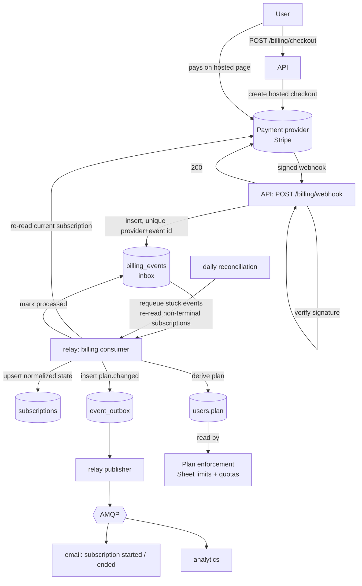
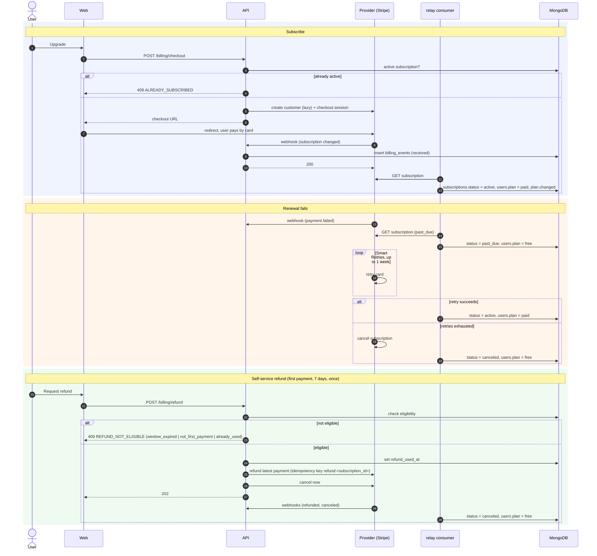
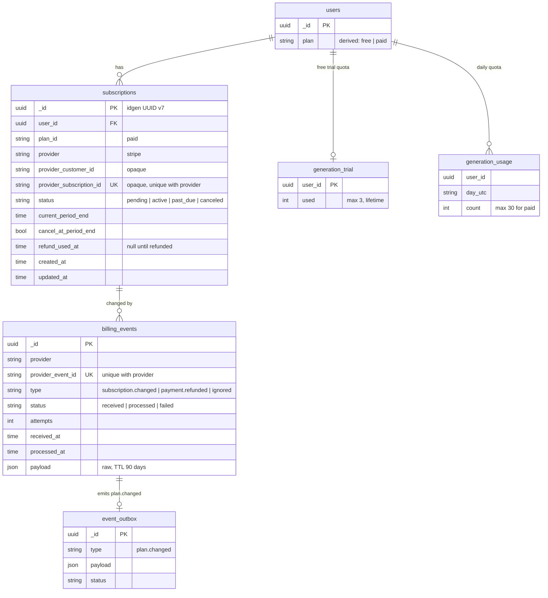

# Subscriptions are driven by provider webhooks through an inbox

A user's Plan comes from our own `subscriptions` collection. Only provider webhooks, processed through an idempotent inbox, change it. Stripe is the MVP provider and sits behind a `billing.Provider` interface: nothing in the domain or in MongoDB uses Stripe vocabulary except the `provider` value and opaque IDs. The paid Plan is card only and costs USD 6.99 per month. BRL (R$ 29.90) comes later. Decided in LGN-178, on top of the Plans and limits from LGN-174.

## Considered Options

- **Asaas (recommended in LGN-171):** strong for BRL (PIX, PIX Automático, boleto, NFS-e). It has no documented USD support, its webhooks are not signed, and its hosted subscription checkout is card only. The MVP charges in USD first.
- **AbacatePay / Appmax:** no USD support. Fees, webhook signing and hosted subscription checkout are unverified.
- **Grant the Plan on the checkout redirect:** a redirect can be spoofed or lost. Only a verified webhook changes state.
- **Trust the webhook payload as state:** Stripe does not guarantee event order. The consumer re-reads the subscription from the provider instead, so a stale event can never regress the status.
- **Grace period on failed renewal:** rejected. No payment means no paid Plan.
- **Free trial of the paid Plan:** rejected because of the cost and abuse risk. The Free Plan gets a small lifetime generation allowance instead.

## Decisions

- **Plan and price:**
  - Monthly only, a single paid Plan. Because there is no paid-to-paid change, there is no proration: an upgrade is a new subscription, and a downgrade is a cancellation.
  - The Plan registry stores the price per currency (`USD: 699`). The provider price ID comes from env.
- **Free trial allowance (amends LGN-174):**
  - Free users get **3 lifetime generations**.
  - The allowance uses a `generation_trial{user_id, used}` counter, with the same conditional `$inc` reserve/refund rule as the daily quota. Refunded generations do not count.
  - When the counter is exhausted, the API returns `PLAN_UPGRADE_REQUIRED` 403.
  - The allowance needs an OTP-verified email that is not from a disposable domain. At most 3 accounts per IP per 24 h receive it (shared `platform/ratelimit` store). Accounts over the limit are still created, without the allowance. No CPF or other document is collected.
- **Checkout and self-service:**
  - Card collection happens only on the provider's hosted checkout. Cancellation and card updates happen in the provider's customer portal. The web client has no card form.
  - `POST /billing/checkout` returns a URL. It returns `ALREADY_SUBSCRIBED` 409 when the user already has an `active` subscription, and it reuses a `pending` one.
  - `POST /billing/portal` returns a URL, or `NO_SUBSCRIPTION` 404 when the user has no provider customer.
  - The provider customer is created lazily: one per user, with `user_id` in metadata and in the client reference.
- **Status model (provider-agnostic):**
  - `subscriptions.status` is one of `pending | active | past_due | canceled`.
  - The Stripe adapter maps Stripe statuses to it:
    - `incomplete` → `pending`
    - `active` → `active`
    - `past_due` and `paused` → `past_due`
    - `unpaid`, `incomplete_expired` and `canceled` → `canceled`
  - **The Plan is paid if and only if `status = active`.** The domain derives it, not the adapter, and writes it to `users.plan`. `users.plan` is the only field that Plan enforcement reads.
- **Webhook and inbox:**
  - `POST /billing/webhook` verifies the provider signature (`INVALID_SIGNATURE` 400, no details).
  - It then inserts into `billing_events`, which has a unique index on `(provider, provider_event_id)`, and returns 200. A duplicate key also returns 200 and does nothing.
  - Provider events are normalized to `subscription.changed`, `payment.refunded` or `ignored`.
- **Consumer (relay process):**
  1. Claims `received` events.
  2. Re-reads the current subscription from the provider.
  3. Upserts `subscriptions` and derives `users.plan`.
  4. Inserts `plan.changed` into a new `event_outbox` collection, which follows the `email_outbox` claim/lease pattern.
  5. Marks the event `processed`.

  MongoDB is standalone, so these steps are idempotent writes rather than a transaction. A retry replays them safely. The relay publishes `plan.changed` to AMQP for the email and analytics consumers.
- **Reconciliation:** a daily job requeues events stuck in `received` or `failed`, and re-reads every non-terminal subscription from the provider. It covers lost webhooks and a paused provider queue.
- **Failed renewal:**
  - On `past_due`, the Plan drops to Free immediately.
  - Smart Retries runs for 1 week. A successful retry restores `active` and the paid Plan. When the retries are exhausted, the provider cancels the subscription.
  - The period stays anchored on the original due date.
  - The UI shows a payment-issue banner.
- **Cancellation:**
  - Cancellation takes effect at period end (`cancel_at_period_end`), with no prorated refund.
  - Sheets above the Free limits are never locked (LGN-174).
- **Refund (automated, self-service):**
  - Only for the user's first payment, within 7 days (CDC art. 49 withdrawal right, applied to every user), and once per user ever (`refund_used_at`).
  - `POST /billing/refund`:
    1. checks eligibility (otherwise `REFUND_NOT_ELIGIBLE` 409, with `details.reason` set to `window_expired`, `not_first_payment` or `already_used`);
    2. sets `refund_used_at`;
    3. refunds the latest payment with the idempotency key `refund:<subscription_id>`;
    4. cancels the subscription immediately;
    5. returns 202.
  - The final state (`canceled`, Free) arrives through the webhook, like every other transition.
- **Account deletion:**
  - The subscription is canceled immediately, without a refund.
  - The provider customer is kept but stripped of personal metadata.
  - `subscriptions` and `billing_events` are deleted after the 5-year fiscal retention period. LGN-190 inherits this rule.
- **Errors:**

  | Code | HTTP | When |
  |---|---|---|
  | `ALREADY_SUBSCRIBED` | 409 | checkout with an active subscription |
  | `BILLING_UNAVAILABLE` | 503 | provider down or timed out on checkout, portal or refund |
  | `NO_SUBSCRIPTION` | 404 | portal requested without a provider customer |
  | `INVALID_SIGNATURE` | 400 | webhook with an invalid signature |
  | `REFUND_NOT_ELIGIBLE` | 409 | refund requested outside the rules |

- **`GET /me/plan`** also returns `subscription_status`, `current_period_end`, `cancel_at_period_end` and `payment_issue`.

## Diagrams

### Event flow

### Subscribe, failed renewal and refund

### Data model

## Consequences

- **Production deploy is blocked** until a follow-up card confirms that the Stripe account (Brazilian CNPJ or another entity) can charge USD, and settles tax and NFS-e. Design and implementation run in Stripe test mode in the meantime.
- **Adding BRL** (and handling Stripe's per-customer currency) is a separate card. The MVP has no currency logic beyond the registry.
- **Swapping the provider** means a new `billing.Provider` adapter and a status mapping. The collections and the domain do not change.
- **LGN-174 changes:** Free is no longer "zero generations" but gets 3 lifetime generations. Plan enforcement keeps reading only `users.plan`.
- **Privacy:** the privacy policy must list Stripe as a processor. Raw webhook payloads expire after 90 days.
- **Tests:**
  - Signature rejection returns 400.
  - A duplicate event is a no-op.
  - Out-of-order events do not regress the status (fake provider).
  - The status mapping table.
  - `users.plan` derivation.
  - Each `REFUND_NOT_ELIGIBLE` reason, and refund idempotency.
  - `ALREADY_SUBSCRIBED`.
  - Trial counter reserve and refund, and its exhaustion returning 403.
  - Per-IP trial gating.
  - Reconciliation requeues stuck events.
