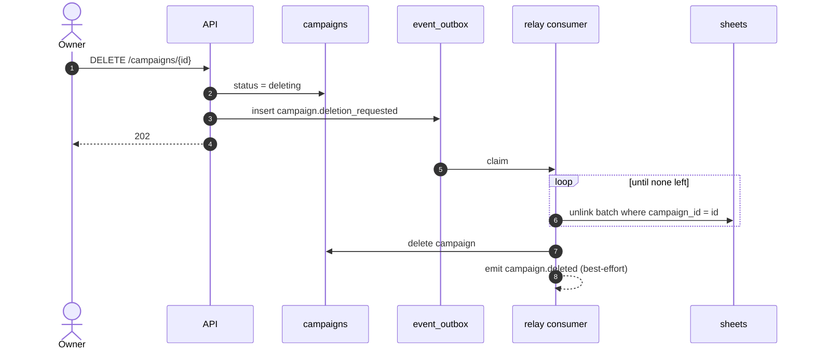

# Campaigns have one Owner among their GMs, join by code, give GMs read-only access, and are deleted asynchronously

A Campaign is a shared space where Game Masters run a game with Players. It fixes one Template. People join with an invite code, optionally protected by a password, and always join as Players. GMs read their Players' Sheets but never write them, refreshed by polling every minute. A Campaign is deleted asynchronously: it enters a `deleting` state while a guaranteed event unlinks every Sheet, and it is removed when the last one is unlinked. Decided in LGN-179, on top of the Plans from LGN-174 and the event catalog from ADR 0010.

## Considered Options

- **A Campaign accepts any Template:** a GM would read Sheets from different game systems, and a reused NPC or Monster (LGN-180) would lose coherence.
- **One character Sheet in several Campaigns:** a GM edit in one Campaign would leak into another, and a Free user (1 character) could play every Campaign with one Sheet.
- **A third role (Owner) next to GM and Player:** every Owner is also a GM. A flag on one GM keeps two roles in the glossary.
- **Per-person invites by email with pending approval:** more state (pending invites, expiry, resend) for no V1 need. A shared code that any GM can rotate covers both inviting and revoking.
- **GMs edit Players' Sheets:** write conflicts with the Player, and open questions on who owns Layout, Pins and dice choices. Deferred.
- **Real-time updates (WebSocket or SSE):** a long-lived connection per GM for values that change a few times per scene. Polling with `sheet_version` is enough.
- **A ban list on removal:** rotating the code or the password already blocks a removed Player from coming back.
- **Synchronous hard delete:** unlinking every Sheet in one request does not scale with Campaign size, and a crash halfway leaves Sheets pointing at a missing Campaign.
- **Members-per-Campaign as a Plan lever:** a Plan never extends to other members (glossary). The member cap is a technical ceiling, the same for every Plan. A GM Plan covering the whole Campaign is evaluated in LGN-191.

## Decisions

- **Template:** chosen at creation and never changed. Only Sheets of that Template can be linked.
- **Roles:**
  - A member is either a GM or a Player in a given Campaign, never both.
  - The creator is the **Owner**: a GM with the `owner` flag. There is exactly one Owner.
  - Only the Owner can delete the Campaign, transfer ownership (to an existing GM only), promote and demote GMs, and remove GMs.
  - Any GM can invite and remove Players, rotate the invite code, and set, change or clear the password.
  - The Owner cannot leave or demote themselves without first transferring ownership.
- **Invite code:**
  - One code per Campaign, random with enough entropy, shareable as a link (`/join/<code>`).
  - It does not expire. Rotating it invalidates the previous code at once.
  - Everyone who joins does so as a Player. Becoming a GM is an Owner promotion afterwards.
- **Campaign password:**
  - Optional. Stored as an argon2id hash, never in clear.
  - When set, joining requires the code **and** the password.
  - An invalid code and a wrong password return the same `INVALID_INVITE`, so a guess does not reveal whether a Campaign exists. Join attempts go through the shared rate limit store (ADR 0003), keyed by IP and by Campaign.
  - Changing or clearing the password removes no member.
  - There is no public listing or discovery of Campaigns.
- **Character link:**
  - A character Sheet is linked to at most one Campaign, and a Player has at most one character per Campaign. Joining without a character is allowed; linking comes later.
  - The Player picks one of their own Sheets of kind `character`, of the Campaign's Template, not linked elsewhere. They can unlink or swap it at any time.
  - The link is a `campaign_id` field on the Sheet, set by a conditional update (`campaign_id: null`) so two concurrent links cannot both win.
  - GMs have no character in a Campaign they run. Promoting a Player to GM unlinks their character; the Sheet stays with them.
- **Access:**
  - GMs read the linked Sheets of their Players, read-only. Layout, Pins and dice choices remain the Player's.
  - Players see the member list (name, role, character name) but not other Players' Sheets.
  - The GM view polls every **1 minute**, using `sheet_version` and an `ETag` so an unchanged Sheet costs a `304`. Polling pauses while the tab is hidden (`visibilitychange`) and refreshes at once when it becomes visible.
  - The GM's read-only Sheet view shows a quiet, permanent caption, "Values may not reflect real time", with no number, and a manual refresh button.
- **Leaving and removal:** synchronous. The Player's character is unlinked and stays with them, and GM access ends at once. Removal does not ban: a removed Player can rejoin with a valid code and password.
- **Plan limits:**
  - A Plan limits how many Campaigns a user **owns**: Free 1, paid 5. Participation is not limited; it is already bounded by how many characters a user has.
  - Each Campaign holds at most 10 Players and 3 GMs, for every Plan. The cap is enforced by a conditional update on the member counters so concurrent joins cannot overshoot it (`CAMPAIGN_FULL`).
  - After a downgrade nothing is locked (LGN-174). The user cannot create a Campaign or receive an ownership transfer that would put them over the limit (`PLAN_LIMIT_REACHED`).
- **Deletion (asynchronous):**
  1. Only the Owner deletes. `DELETE /campaigns/{id}` sets `status: deleting`, inserts `campaign.deletion_requested` into `event_outbox` (ADR 0009) and returns `202`.
  2. A consumer unlinks, in batches, every Sheet with that `campaign_id` (and the NPC and Monster links of LGN-180). Every step is idempotent, so a retry is safe.
  3. When no linked Sheet remains, it deletes the Campaign and emits `campaign.deleted`.
  - While `deleting`, the Campaign disappears from members' lists, GM access to Sheets ends at once, every read and write on it returns `CAMPAIGN_NOT_FOUND` `404`, and it no longer counts toward the Owner's Plan limit.
  - **Race with a concurrent link:** linking requires `status: active`, and after writing the link it re-reads the Campaign and undoes the link if it is `deleting`. A `campaign_id` that points to a missing Campaign is read as "not linked".
  - **Reconciliation:** the daily job (ADR 0009) clears orphan links and requeues Campaigns stuck in `deleting` for more than 1 hour.
- **Account deletion of the Owner (input to LGN-190):** ownership passes to the longest-standing GM. With no other GM, the Campaign goes through the same asynchronous deletion.
- **Events (added to the ADR 0010 catalog):**

  | Type | Aggregate | `data` | Tier |
  |---|---|---|---|
  | `campaign.created` | campaign | `template_id` | best-effort |
  | `campaign.member_joined` | campaign | `user_id`, `role` | best-effort |
  | `campaign.member_left` | campaign | `user_id`, `reason` (`left` \| `removed`) | best-effort |
  | `campaign.role_changed` | campaign | `user_id`, `from`, `to` | best-effort |
  | `campaign.ownership_transferred` | campaign | `from_user_id`, `to_user_id` | best-effort |
  | `campaign.deletion_requested` | campaign | — | guaranteed |
  | `campaign.deleted` | campaign | — | best-effort |

  No Campaign name, password, invite code or Sheet value appears in any payload.
- **Errors:**

  | Code | HTTP | When |
  |---|---|---|
  | `INVALID_INVITE` | 404 | unknown or rotated code, or wrong password |
  | `CAMPAIGN_NOT_FOUND` | 404 | missing, `deleting`, or not a member |
  | `CAMPAIGN_FULL` | 409 | Player or GM cap reached |
  | `CAMPAIGN_FORBIDDEN` | 403 | member lacks the role for the action |
  | `TEMPLATE_MISMATCH` | 422 | linking a Sheet of another Template |
  | `SHEET_ALREADY_LINKED` | 409 | Sheet linked to another Campaign |
  | `PLAN_LIMIT_REACHED` | 403 | creating or receiving a Campaign over the owned limit |

## Diagrams

### Asynchronous deletion

## Consequences

- **`PRODUCT.md`** no longer lists Game Masters as out of scope. Players at the table stay the design priority.
- **Sheets gain `campaign_id`**, indexed, read as "not linked" when it points to a missing Campaign.
- **LGN-180** builds NPC and Monster links on this model and must be unlinked by the deletion consumer.
- **LGN-190** inherits the Owner transfer rule and reuses the asynchronous deletion.
- **Implementation is split into follow-up cards** under LGN-169: Campaign model and membership (LGN-199); invite code and password (LGN-200); character link and GM read access with polling (LGN-201); asynchronous deletion (LGN-202); Plan limits on owned Campaigns (LGN-203).
- **Tests:**
  - Role matrix: every action against Owner, GM, Player and non-member.
  - Concurrent joins never exceed the cap; concurrent links never link one Sheet twice.
  - Wrong password and unknown code return the same error and both hit the rate limit.
  - Promotion unlinks the character; leaving keeps the Sheet with its owner.
  - Deletion is idempotent under retry, a late link is undone, and a stuck `deleting` Campaign is requeued.
  - No PII, password, code or Sheet value appears in any event payload.
