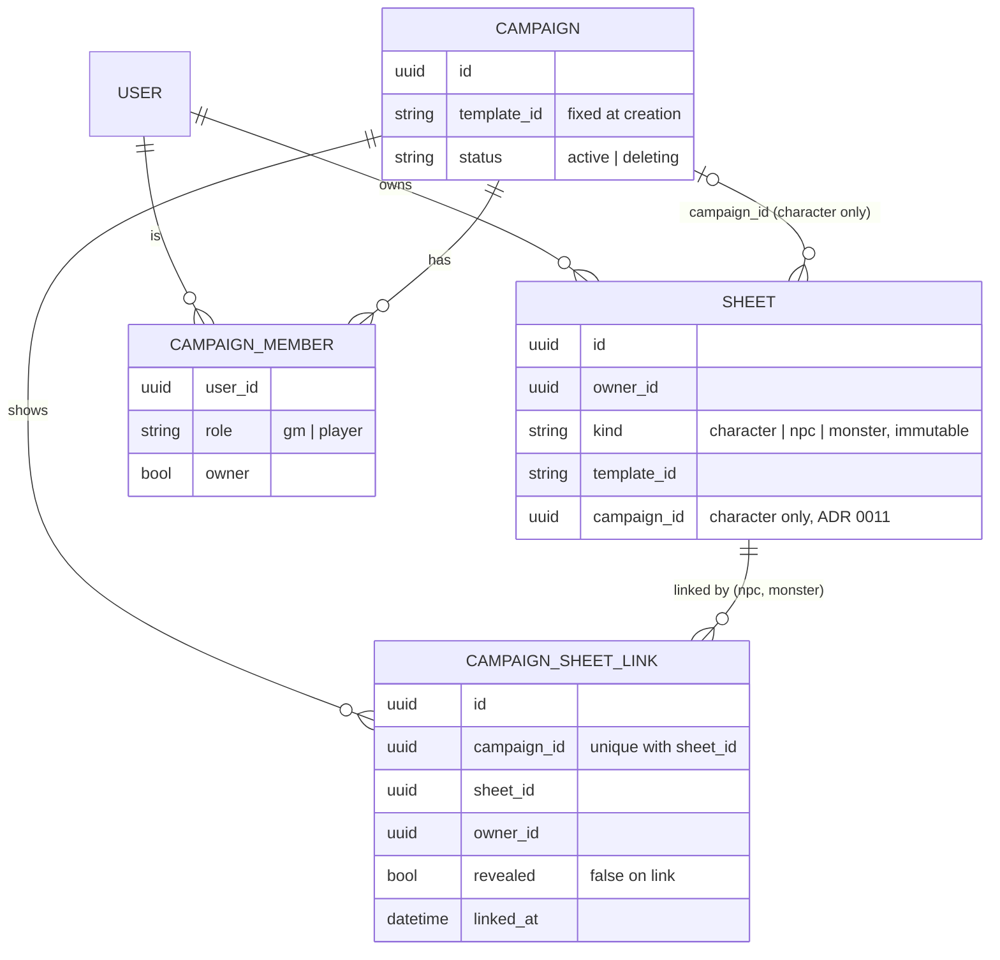
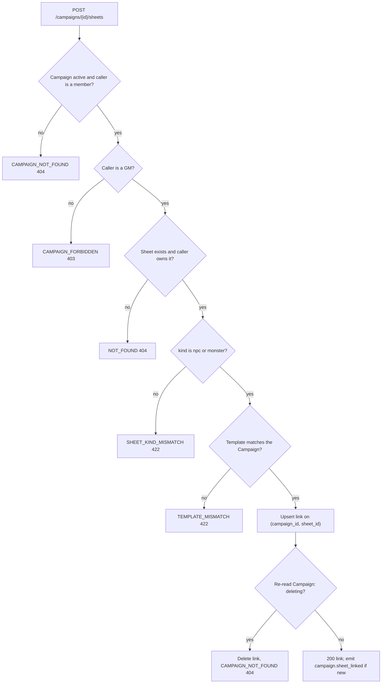
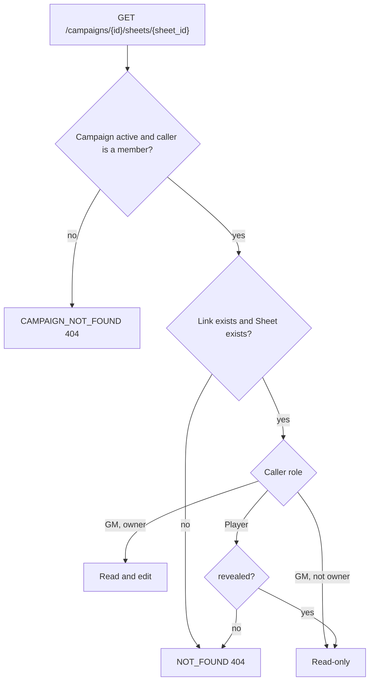
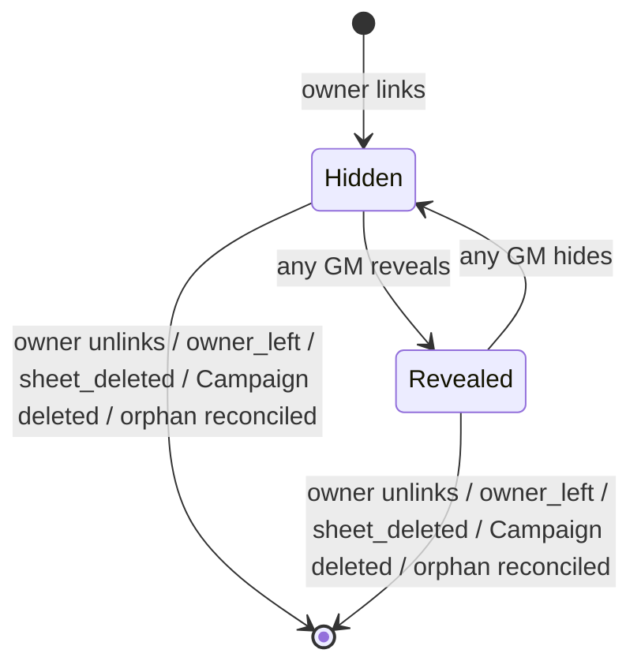
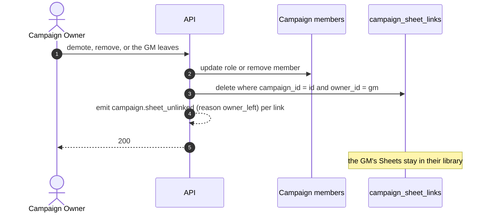
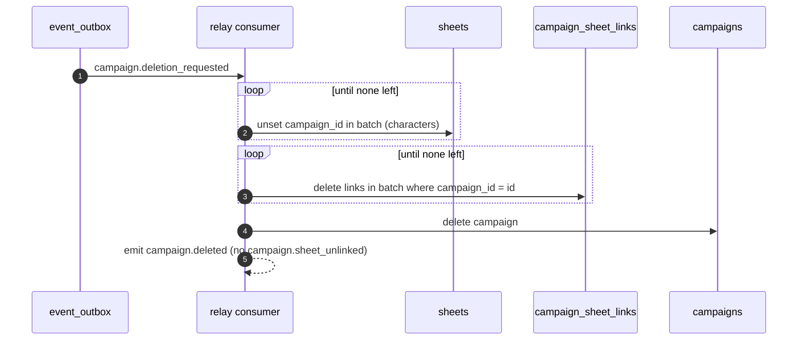
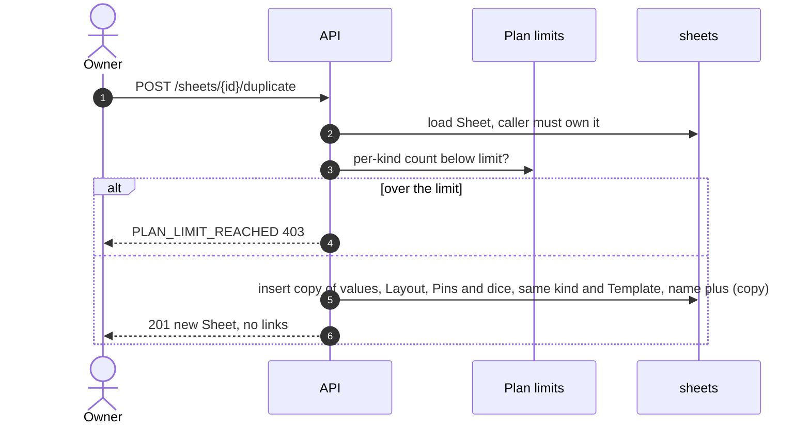
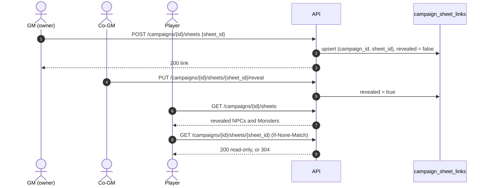

# NPC and Monster Sheets are shared by reference across Campaigns, hidden from Players until a GM reveals them

> Amended by [ADR 0013](0013-replica-set-transactions-and-pending-work-on-the-entity.md): link creation and the GM-exit cascade run in the Campaign transaction, and polling authorizes before evaluating `If-None-Match`.

An NPC or Monster Sheet belongs to the user who made it and lives on its own, with no Campaign. Its owner can link it to any Campaign where they are a GM, and to several at once: every Campaign sees the same Sheet, so an edit shows up everywhere. Each link is a document of its own that carries whether Players can see the Sheet in that Campaign. NPCs and Monsters use the Campaign's Template in full, with no simplified form. Decided in LGN-180, on top of the Campaign model (ADR 0011), the Plans (LGN-174) and the event catalog (ADR 0010).

## Considered Options

- **A copy per Campaign:** every reuse would take a Plan slot, and copies drift apart. A GM who wants separate state (for example a Monster's hit points) duplicates the Sheet explicitly.
- **A `campaign_ids` array on the Sheet:** reveal is state of each link, not of the Sheet. An array would need a parallel structure for it, and two concurrent links would race on one document.
- **The `campaign_id` field used by characters:** it allows one Campaign only. Characters keep it (ADR 0011); NPCs and Monsters need many.
- **Reveal per Field or Row:** state per Field and per Campaign, plus a selection UI, for what a Player usually needs: "this NPC exists and is called X". Deferred.
- **A simplified form for Monsters:** the Sheet kind never changes how values are computed (glossary). A lighter sheet, if needed, is a separate Template.
- **Co-GMs edit any linked NPC:** write conflicts and unclear ownership, the same reason GMs do not edit Players' Sheets in ADR 0011.
- **A per-Campaign cap on NPCs and Monsters:** the total is already bounded by each GM's per-kind Plan limit times at most 3 GMs.
- **A mutable Sheet kind:** a linked character turned NPC would leave an inconsistent link, and converting would bypass the per-kind limits.

## Decisions

- **Ownership and existence:**
  - Any user can create NPC and Monster Sheets within their Plan's per-kind limit (LGN-174), with or without a Campaign.
  - The Sheet kind is set at creation and never changes.
  - Only the owner edits the Sheet, wherever it is linked.
- **Template:** only a Sheet of the Campaign's Template can be linked (`TEMPLATE_MISMATCH`). Every kind uses the whole Template.
- **Link:**
  - A collection `campaign_sheet_links {id, campaign_id, sheet_id, owner_id, revealed, linked_at}`, with a unique index on `(campaign_id, sheet_id)` and an index on `campaign_id`. `id` comes from `idgen`.
  - Only the owner links, and only to a Campaign where they are a GM. One Sheet can be linked to any number of Campaigns.
  - Linking an already linked pair is idempotent: it returns `200` with the current link.
  - Characters never go through this collection; they keep `campaign_id` on the Sheet (ADR 0011). Linking a `character` here returns `SHEET_KIND_MISMATCH`.
  - Only the owner unlinks their own Sheet.
- **Duplicate:** creates a new Sheet owned by the same user, with the same kind and Template, named `<name> (copy)`. It copies values, Layout, Pins and dice choices, and no link or reveal. It counts toward the per-kind limit (`PLAN_LIMIT_REACHED`).
- **Reveal:**
  - A new link is hidden (`revealed: false`).
  - Any GM of the Campaign can reveal or hide it, because reveal is Campaign state, not Sheet state.
  - Reveal belongs to the link: revealing in one Campaign reveals nothing in another.
  - It applies to the whole Sheet.
- **Access:**
  - Every GM of the Campaign sees every linked NPC and Monster, hidden or revealed, with its owner, read-only unless they own it.
  - Players see the list of revealed NPCs and Monsters and open each one read-only. Hiding it again ends their access at once.
  - Both views reuse the polling from ADR 0011: every 1 minute, with `sheet_version` and an `ETag`, paused while the tab is hidden, and with the "Values may not reflect real time" caption and a manual refresh.
  - Layout, Pins and dice choices stay the owner's.
- **Lifecycle:**
  - **Owner stops being a GM of the Campaign** (leaves, is removed, is demoted to Player): their links to that Campaign are deleted synchronously. The Sheets stay with them.
  - **Sheet deleted:** its links are deleted synchronously.
  - **Campaign deleted:** the consumer of `campaign.deletion_requested` (ADR 0011) also deletes, in batches, every link with that `campaign_id`. Every step is idempotent, and the Campaign is removed only when no character and no link remain.
  - **Race with a concurrent link:** linking requires `status: active`, and after writing the link it re-reads the Campaign and deletes the link if it is `deleting`. A link that points to a missing Campaign or Sheet is ignored on read.
  - **Reconciliation:** the daily job (ADR 0009) deletes orphan links.
  - **Downgrade:** nothing is locked and links stay (LGN-174). The user cannot create or duplicate a Sheet over the new limit.
- **Events (added to the ADR 0010 catalog):**

  | Type | Aggregate | `data` | Tier |
  |---|---|---|---|
  | `campaign.sheet_linked` | campaign | `sheet_id`, `kind`, `owner_id` | best-effort |
  | `campaign.sheet_unlinked` | campaign | `sheet_id`, `kind`, `owner_id`, `reason` (`unlinked` \| `owner_left` \| `sheet_deleted`) | best-effort |
  | `campaign.sheet_revealed` | campaign | `sheet_id`, `kind`, `owner_id` | best-effort |
  | `campaign.sheet_hidden` | campaign | `sheet_id`, `kind`, `owner_id` | best-effort |

  Unlinking during Campaign deletion emits nothing; `campaign.deleted` already reports it. No Sheet name or value appears in any payload.
- **Errors:**

  | Code | HTTP | When |
  |---|---|---|
  | `SHEET_KIND_MISMATCH` | 422 | linking a `character` as an NPC or Monster |
  | `NOT_FOUND` | 404 | the Sheet is not the caller's, or a Player opens a hidden or unlinked one |
  | `TEMPLATE_MISMATCH` | 422 | the Sheet's Template is not the Campaign's |
  | `CAMPAIGN_FORBIDDEN` | 403 | a non-GM links, reveals or hides; a GM unlinks a Sheet they do not own |
  | `CAMPAIGN_NOT_FOUND` | 404 | missing, `deleting`, or not a member |
  | `PLAN_LIMIT_REACHED` | 403 | duplicating over the per-kind limit |

## Diagrams

### Data model

### Link validation

### Read access to a linked NPC or Monster

### Link lifecycle

### Owner stops being a GM

### Campaign deletion with links

### Duplicate

### Link and reveal

## Consequences

- **ADR 0011:** its deletion consumer and its leave, removal and demotion paths now also delete links.
- **ADR 0010:** the catalog gains the four `campaign.sheet_*` events.
- **LGN-187** generates NPCs and Monsters into this model: a generated Sheet is created unlinked.
- **LGN-190** deletes the user's NPC and Monster Sheets, and with them their links.
- **Implementation is split into follow-up cards** under LGN-169: link collection, link, unlink and Duplicate (LGN-204); reveal, hide and the Player view with polling (LGN-205); deletion consumer, GM exit and reconciliation (LGN-206).
- **Tests:**
  - Role matrix for link, unlink, reveal, hide and read: owner GM, co-GM, Player and non-member.
  - Concurrent links of the same pair create one link; re-linking is idempotent.
  - Reveal in one Campaign does not reveal in another; hiding ends Player access at once.
  - Kind, Template and ownership checks return their typed errors.
  - Demotion, leaving and Sheet deletion remove the links; the Sheet stays with its owner.
  - Deletion is idempotent under retry, a late link is deleted, and orphan links are reconciled.
  - Duplicate copies values, Layout, Pins and dice choices but no link, and respects the per-kind limit.
  - No Sheet name or value appears in any event payload.
